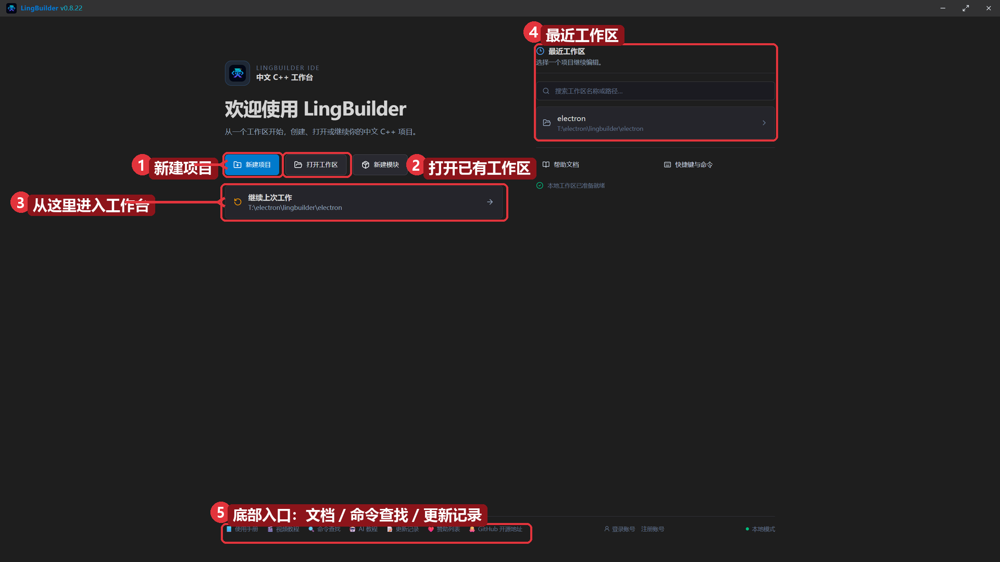
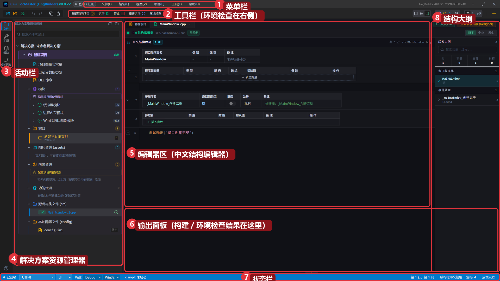
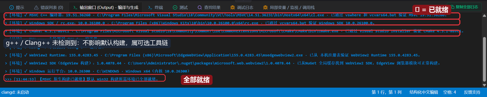
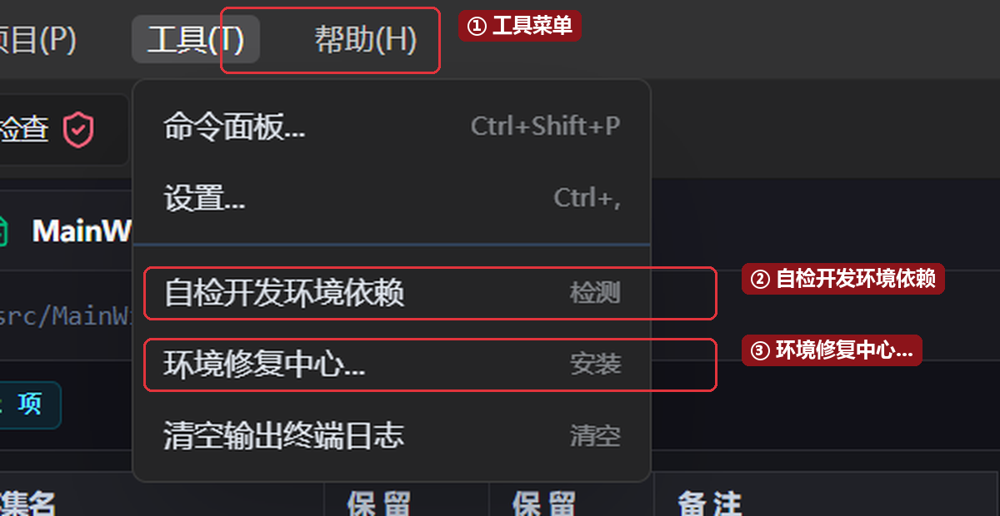
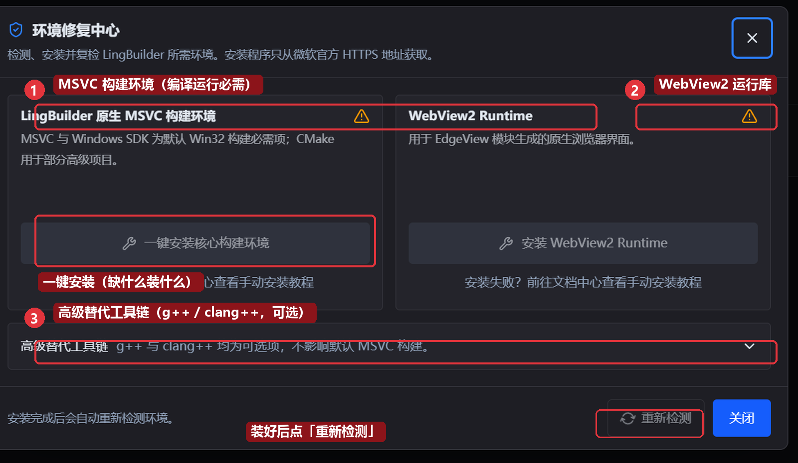

# 01 · 安装与第一次运行

> 本篇是《LingBuilder 零基础入门实战》系列第 1 集。整个系列参照「零基础也能跟得上」的节奏编排：每集只讲一件事，讲完立刻上手。全集目录见 [课程大纲](/guide/tutorials/beginner)。
>
> 本集目标：**把 LingBuilder 装到电脑上，打开它，并确认 C++ 构建环境就绪。** 全程约 15 分钟（含构建环境安装约 30~60 分钟）。

- 适用系统：Windows 10 / 11（64 位）
- 你将得到：一个能打开的 LingBuilder IDE + 就绪的本机构建环境

## 1. 下载安装包

打开浏览器，访问官网 `lingbuilder.com`，点击页面右上角的 **「下载 IDE」**：

下载页会列出当前**稳定版**版本号、SHA-256 校验码和更新说明。点击 **「直链」** 即可开始下载，安装包保存到「下载」文件夹即可。

> 提示：请只从官网下载安装包。稳定版适合初学者；「预览版」更新更快但主要面向会员尝鲜，本系列全部以稳定版为准。

## 2. 运行安装向导

1. 双击下载好的安装包（文件名类似 `LingBuilder-x.x.x-x64.exe`）。
2. 系统弹出 **用户账户控制 (UAC)** 窗口时，点「是」。
3. 安装界面语言保持 **简体中文**，点「确定」。
4. 勾选 **我接受许可协议中的条款**，一路「下一步」。
5. 安装路径保持默认（`C:\Program Files\LingBuilder`）即可，建议勾选 **创建桌面快捷方式**。
6. 点「安装」，等进度条走完，点「完成」。

> 小知识：安装包目前没有做数字签名，部分杀毒软件可能弹一次拦截提示，选择「允许」即可，这是未签名安装包的正常现象。

## 3. 第一次启动：欢迎页

双击桌面上的 LingBuilder 图标，第一次会看到**欢迎页**——这里是所有工作的起点：

1. **新建项目**：从零创建一个项目（下一集从这里开始）。
2. **打开已有工作区**：打开一个存放项目的文件夹。
3. **继续上次工作**：直接回到上次关闭时的工作区。
4. **最近工作区**：快速进入最近打开过的项目。
5. 底部一排入口：使用手册、命令查找、更新记录等，遇到问题时这里都有。

## 4. 认识工作台

点击「继续上次工作」（或「新建项目」）进入**工作台**。第一次进入空工作区时，会看到一个自带的默认「新建项目」——不用管它，下一集我们会正式创建自己的项目。先认清工作台的八个区域：

1. **菜单栏**：文件、编辑、视图、项目、工具、帮助。
2. **工具栏**：编译当前项目、运行、停止、重新运行、**环境检查**（本集主角，见下节）。
3. **活动栏**：切换文件、工具、模块等侧边视图。
4. **解决方案资源管理器**：项目和文件都在这棵树上。
5. **编辑器区**：默认打开「中文结构编辑器」（新手模式），中文代码按结构分块显示。
6. **输出面板**：构建日志、环境检查结果都输出在这里。
7. **状态栏**：编码、构建配置（Debug / Win32）等当前状态。
8. **结构大纲**：当前代码的类、变量、事件处理程序结构。

## 5. 检查 C++ 构建环境（重要）

LingBuilder 不是「假装运行」：它把你的中文代码**确定性地翻译成真实 C++ 代码**，再用微软 MSVC 工具链编译成真正的 exe。所以除了装 LingBuilder 本身，电脑还需要：

| 组件 | 作用 | 是否必需 |
| --- | --- | --- |
| MSVC C++ 编译器 | 编译生成的 C++ 代码 | 必需 |
| Windows SDK | 提供窗口、控件的系统头文件与库 | 必需 |
| CMake | 部分高级项目使用 | 可选 |
| g++ / Clang++ | 替代工具链 | 可选 |
| WebView2 Runtime | EdgeView 浏览器模块的界面 | 可选（一般已内置） |

点工具栏右侧的 **「环境检查」** 按钮，稍等几秒，结果会输出到底部**输出面板**：

每行一项，`✓` 表示已就绪。看到最后一行 **「【MSVC 原生构建已就绪】默认 Win32 构建所需环境已全部就绪」** 就说明可以开始写程序了。

> 说明：`g++` / `Clang++` 未检测到**不影响**任何本系列内容，它们只是可替代的编译器选项。

## 6. 缺环境怎么办：环境修复中心

如果检查结果里有组件缺失（显示未找到），点菜单 **工具(T) → 环境修复中心...**：

也可以用命令面板（`Ctrl+Shift+P`）输入「环境」找到同一入口。

在修复中心里：

- **一键安装核心构建环境**：自动下载并安装 MSVC 构建环境（含 Windows SDK），安装程序只从微软官方地址获取，装什么缺什么。
- **安装 WebView2 Runtime**：一般系统已内置，缺失时再装。
- **高级替代工具链**：g++ / clang++ 可选项，不用管。
- 安装完成后点 **「重新检测」**，全部变成就绪即可关闭。

安装构建环境约需 30~60 分钟（视网速），装一次以后就不用再装了。想手动安装的话，「安装失败？前往文档中心查看手动安装教程」一行有官方图文指引。

## 本集小结

- 从官网下载并安装了 LingBuilder。
- 认识了欢迎页和工作台的八个区域。
- 用「环境检查」确认 MSVC 构建环境就绪；缺什么就在「环境修复中心」一键补齐。

**下一集预告**：[02 · 第一个窗口：新建项目与界面设计器](/guide/tutorials/beginner)——我们将正式创建自己的第一个项目，拖两个控件上去，按 F5 编译出人生第一个属于你的 exe。
