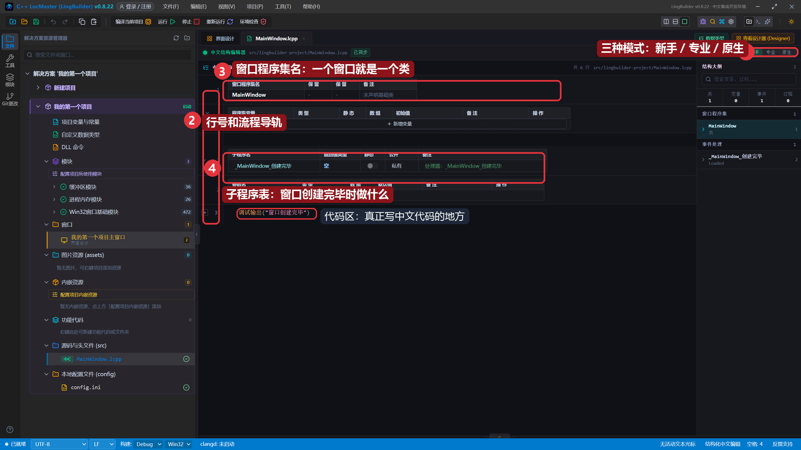
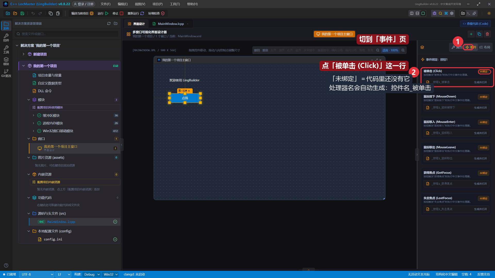
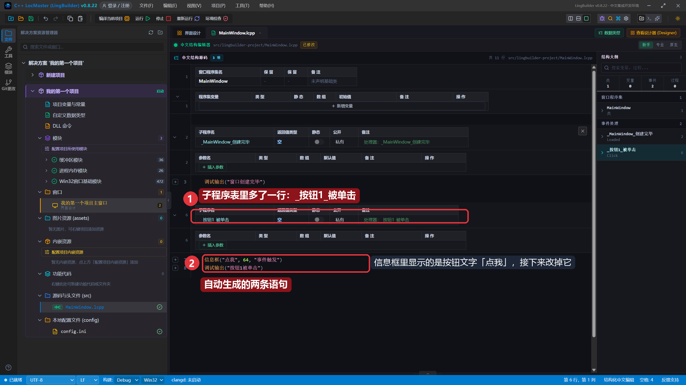
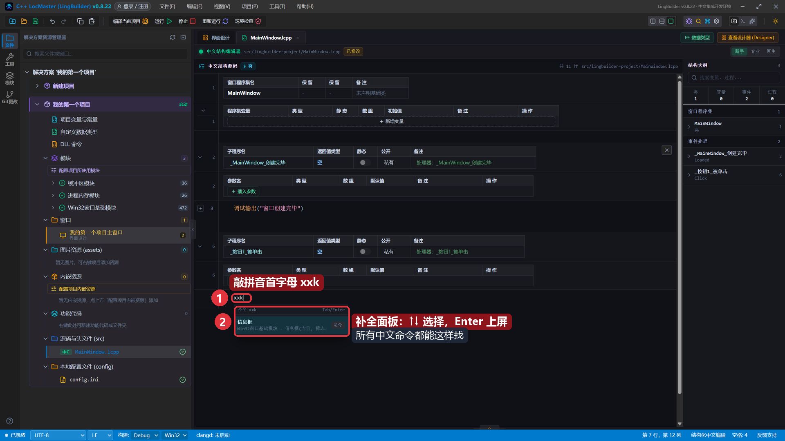
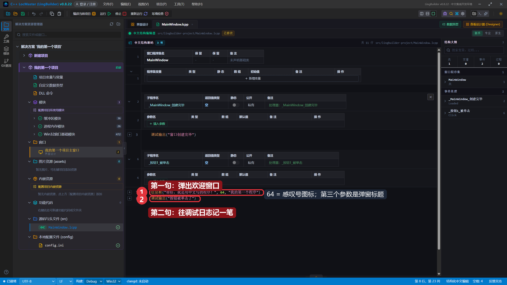
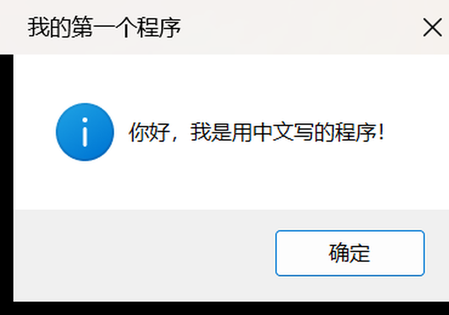
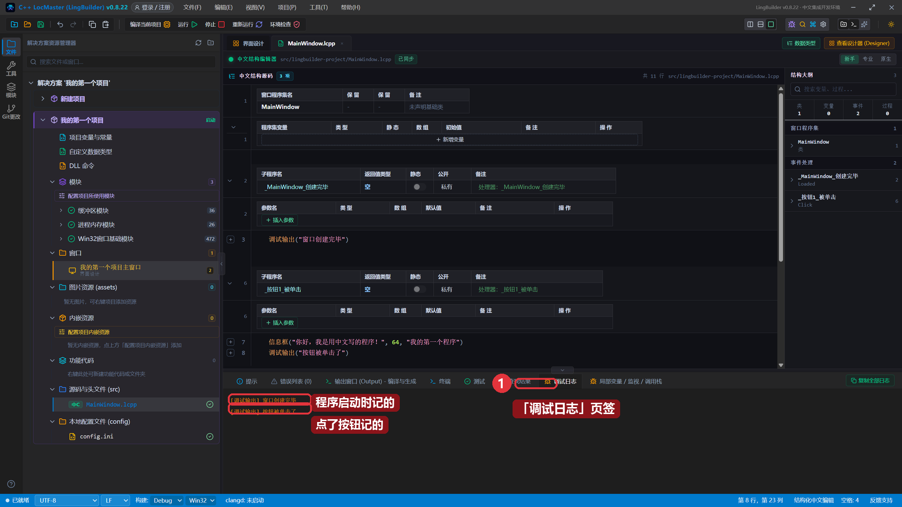

# 03 · 新手编辑器：第一行中文代码

> 《LingBuilder 零基础入门实战》第 3 集。上一集我们的窗口有了「点我」按钮，但点了没反应。这一集回到中文源码，给按钮写上第一段中文代码，让它弹出真正的问候。全集目录见 [课程大纲](/guide/tutorials/beginner-04-if-flow)。
>
> 本集目标：认识新手编辑器 → 绑定按钮事件 → 用拼音补全写出 `信息框` → 运行，点按钮，弹窗！

## 1. 认识新手编辑器

在解决方案树双击 `MainWindow.lcpp`（或点上方页签），就来到**中文结构编辑器**——新手模式：



1. 右上角是**三种模式**：新手 / 专业 / 原生。本系列全程用「新手」，专业模式是给熟手的纯文本编辑，原生模式可以直接看生成出来的 C++。
2. 左边是**行号**，行号右边一列是**流程导轨**（`┌` 结构开始、`│` 中间、`└` 结束）——它按你写的结构自动配对，写错嵌套一眼就能看出来。
3. **窗口程序集名**：一个窗口对应一个「类」，`MainWindow` 就是主窗口类的名字。
4. **子程序表**：列出「什么时刻做什么」。`_MainWindow_创建完毕` 是窗口创建时自动执行的一段代码，模板里已经有一句 `调试输出("窗口创建完毕")`。
5. 表格下面的**代码区**，就是写中文代码的地方。

## 2. 给按钮绑定「被单击」事件

先到「界面设计」页签，**点选「点我」按钮**，再在右侧属性面板切到 **「事件」** 页：



按钮1 的事件列表里，第一行就是 **被单击 (Click)**，右侧标着「未绑定」。**点这一行**：

- 处理器名自动按「控件名_被单击」生成，也就是 `_按钮1_被单击`；
- IDE 会自动在中文源码里创建这段代码，并跳转过去。

## 3. 看看自动生成的代码

跳回源码，子程序表里多了一行 `_按钮1_被单击`，代码区也多出了两条现成的语句：



```lingbuilder
信息框("点我", 64, "事件触发")
调试输出("按钮1被单击")
```

IDE 很贴心：绑定「被单击」时直接给了你一个能弹窗的模板。现在就保存运行的话，点按钮已经会弹窗了——我们来把它改成自己的话。

> 小知识：`_按钮1_被单击` 这个名字是「下划线 + 控件的中文名称 + 事件名」。上一集让你记住的「按钮1」，在这里用上了。

## 4. 用拼音补全写 `信息框`

把 `_按钮1_被单击` 方法体里的两行**删掉**（选中删掉即可），然后在新的一行敲拼音首字母 **`xxk`**：



补全面板立刻列出「信息框」命令，`↑↓` 选择、`Enter` 上屏。所有中文命令都能这样找——不用背，会拼就行。

上屏后填成：



```lingbuilder
信息框("你好，我是用中文写的程序！", 64, "我的第一个程序")
调试输出("按钮被单击了")
```

两句话，都是中文命令：

- **信息框**：弹一个提示框。第一个参数是要显示的话；第二个 `64` 表示感叹号图标；第三个是弹窗标题。
- **调试输出**：不弹窗，往 IDE 的调试日志里记一笔，用来看程序「刚才发生了什么」。

记得点工具栏的 **保存**。

## 5. 运行！点按钮！

点工具栏 **「运行」**，等编译完成、程序窗口弹出，然后**点「点我」按钮**：



弹窗标题「我的第一个程序」、内容「你好，我是用中文写的程序！」——一字不差，全是你写的。

关掉弹窗，回到 IDE 底部的 **「调试日志」** 页签：



两行记录：程序启动时记的「窗口创建完毕」，和你点按钮时记的「按钮被单击了」。以后程序「不听话」，就靠 `调试输出` 一路留下记号找原因。

## 本集小结

- 新手编辑器按「结构」显示中文代码，行号旁边有流程导轨防走神。
- 给控件加事件：设计器选中控件 → 「事件」页 → 点一下要的事件，代码自动生成。
- 拼音首字母呼出补全（`xxk` → 信息框），中文命令不用背。
- `信息框` 弹窗、`调试输出` 记日志，一个给人看、一个给写程序的人看。

**下一集预告**：[04 · 如果流程与按钮进阶](/guide/tutorials/beginner-04-if-flow)——用 `如果` 让程序学会「做判断」，再顺手把界面打扮一下。
