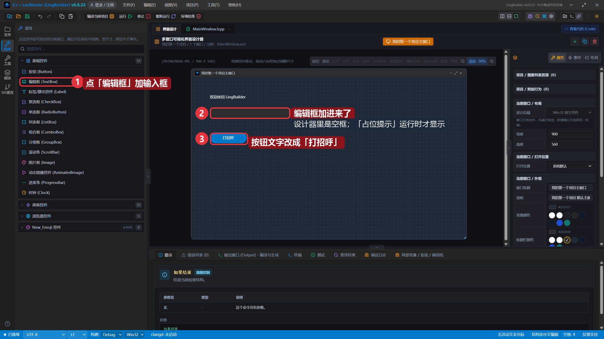
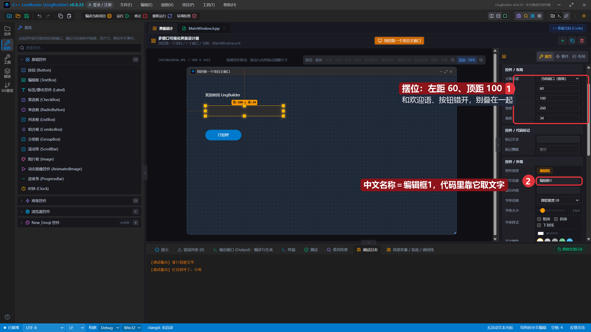
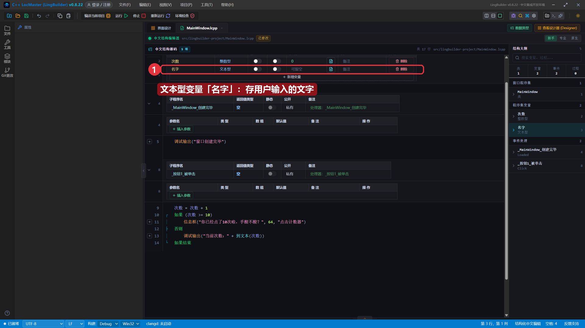
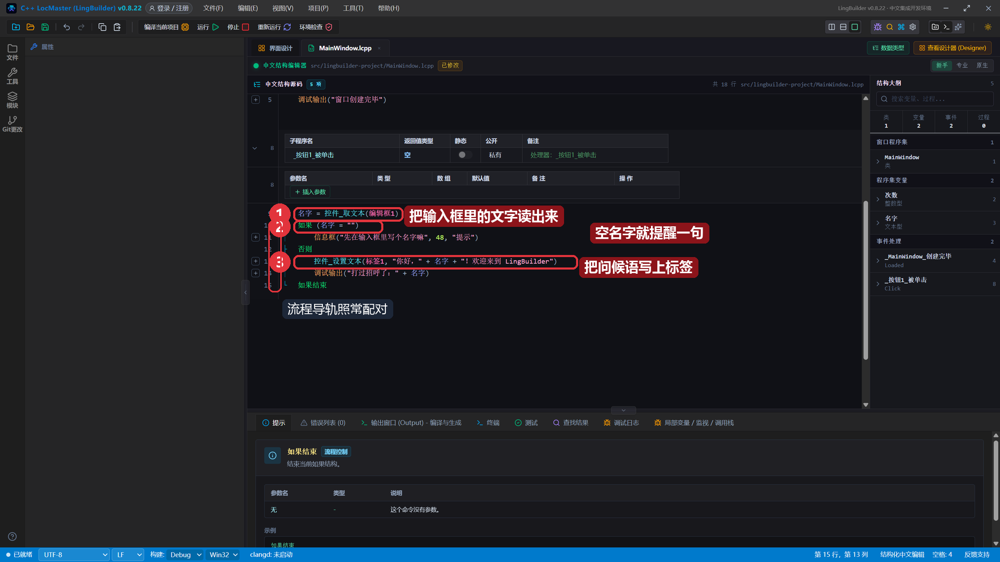
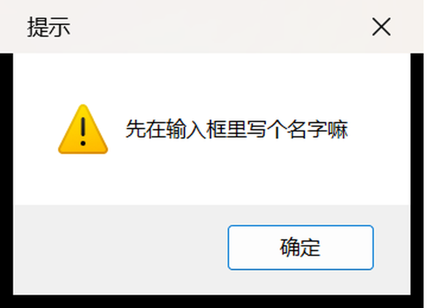
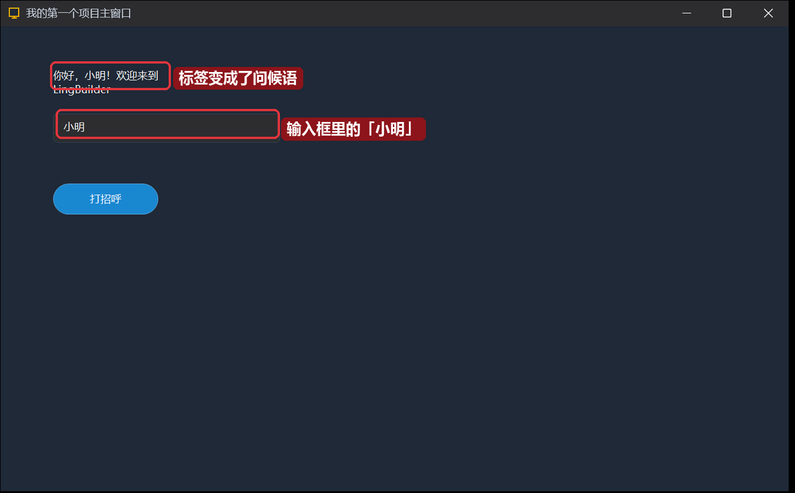
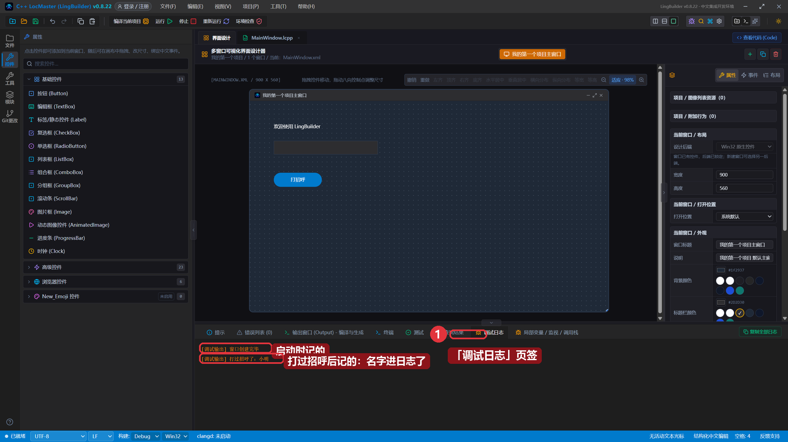

# 05 · 编辑框与文本型变量

> 《LingBuilder 零基础入门实战》第 5 集。程序现在只会说固定的话。这一集给它加一个**输入框**，让用户自己输入名字——程序用 `控件_取文本` 读出来、用文本型变量存起来，再写上标签跟他打招呼。全集目录见 [课程大纲](/guide/tutorials/beginner)。
>
> 本集目标：输入框读文字 → 空名字给提醒 → 标签实时更新问候语。全程约 15 分钟。

## 1. 加一个编辑框

到「界面设计」，在工具箱点 **编辑框 (TextBox)**，输入框就加进来了：



> ⚠️ **注意摆位**：新加的控件默认落在画布中间，**很可能压在已有控件上**（按钮被盖住就点不到了）。按住它拖开，或者在属性面板改「左距 / 顶距」。本集的摆法：
> - 编辑框：左距 `60`、顶距 `100`、宽度 `260`
> - 「打招呼」按钮：顶距 `180`
>
> 三行各占一层：欢迎语、输入框、按钮，谁也不挡谁。

## 2. 认识编辑框的属性

点选编辑框，右侧属性面板里有几个编辑框专属的东西：



1. **中文名称**：默认 `编辑框1`——下一节代码里就靠这个名字读它的内容。
2. **显示内容**：输入框里的初始文字，我们留空。
3. 往下翻还有 **占位提示**（没输入时显示的灰字，我们填了「在这里输入你的名字」，运行时才显示）、**密码输入**（打字变圆点）和 **多行**——都是勾选就能用的现成功能。

## 3. 文本型变量：存用户输入的文字

第 4 雠我们加过整数型的「次数」。这次再加一个**文本型**变量：程序集变量表点「+ 新增变量」，名称 `名字`、类型选 **文本型**：



整数型装数字，文本型装文字——「名字」这种内容就用文本型。

## 4. 写打招呼代码

把 `_按钮1_被单击` 方法体改成：

```lingbuilder
名字 = 控件_取文本(编辑框1)
如果 (名字 = "")
    信息框("先在输入框里写个名字嘛", 48, "提示")
否则
    控件_设置文本(标签1, "你好，" + 名字 + "！欢迎来到 LingBuilder")
    调试输出("打过招呼了：" + 名字)
如果结束
```



三个新朋友：

- **控件_取文本(编辑框1)**：把输入框里的文字读出来。参数写控件的中文名称（裸名字，不带引号）。
- **如果 (名字 = "")**：什么都没输入时名字就是空文本 `""`，这时候不打招呼，先提醒一句（`48` 是警告图标）。
- **控件_设置文本(标签1, …)**：把文字写到标签上——「你好，」+ 名字 +「！欢迎来到 LingBuilder」三段拼起来。

保存，点「运行」。

## 5. 打个招呼试试

程序跑起来后，输入框里是灰色的占位提示。**先什么都不输，直接点「打招呼」**——程序不上当，弹出提醒：



现在在输入框里输入 `小明`，再点「打招呼」：



标签变成了「你好，小明！欢迎来到 LingBuilder」——你输入什么，程序就问候谁。

底部「调试日志」里也留下了记录：



## 本集小结

- 编辑框让程序「听用户说话」：`控件_取文本(控件名)` 读、`控件_设置文本(控件名, 内容)` 写。
- 文本型变量存文字；判断「有没有输入」用 `如果 (名字 = "")`。
- 新加控件会落在画布中间，记得挪开，别让控件叠在一起。
- 占位提示、密码输入、多行都是编辑框现成的属性。

**下一集预告**：[06 · 实战：登录界面](/guide/tutorials/beginner)——把前五集全用上：输入框 + 密码框 + 如果判断，做一个像模像样的登录界面。
