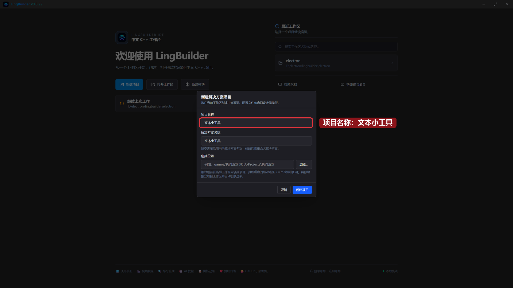
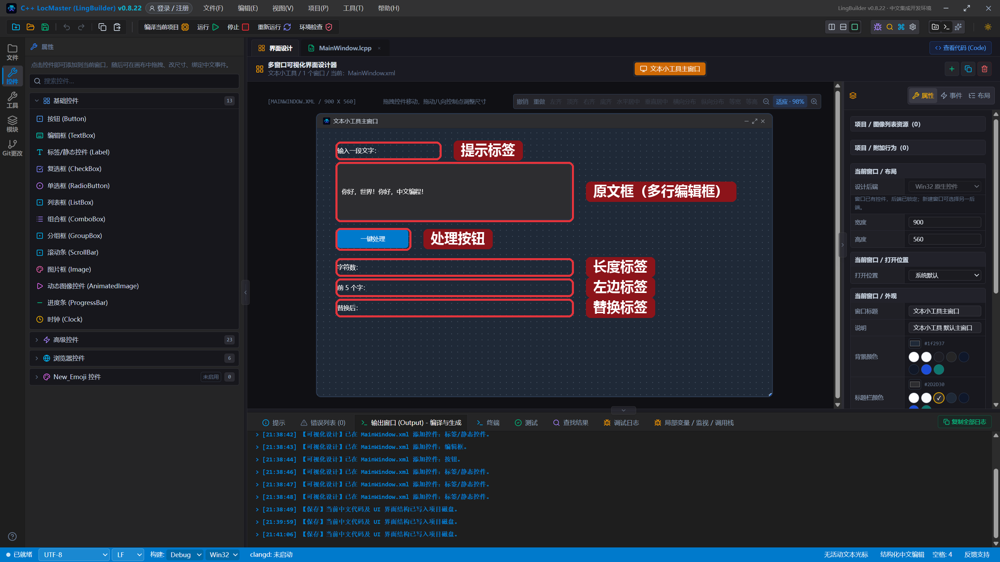
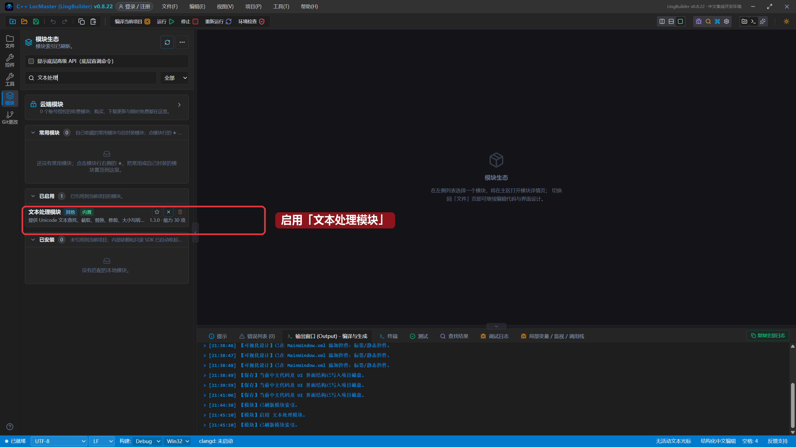
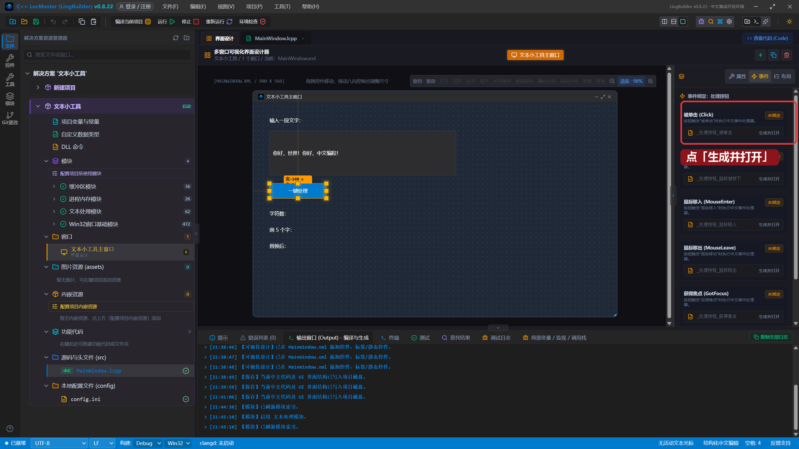
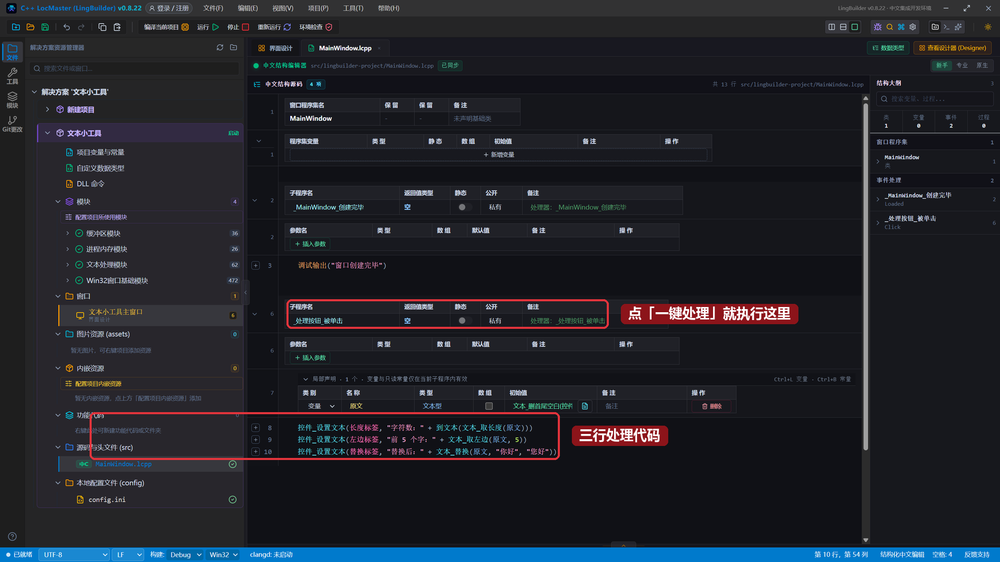
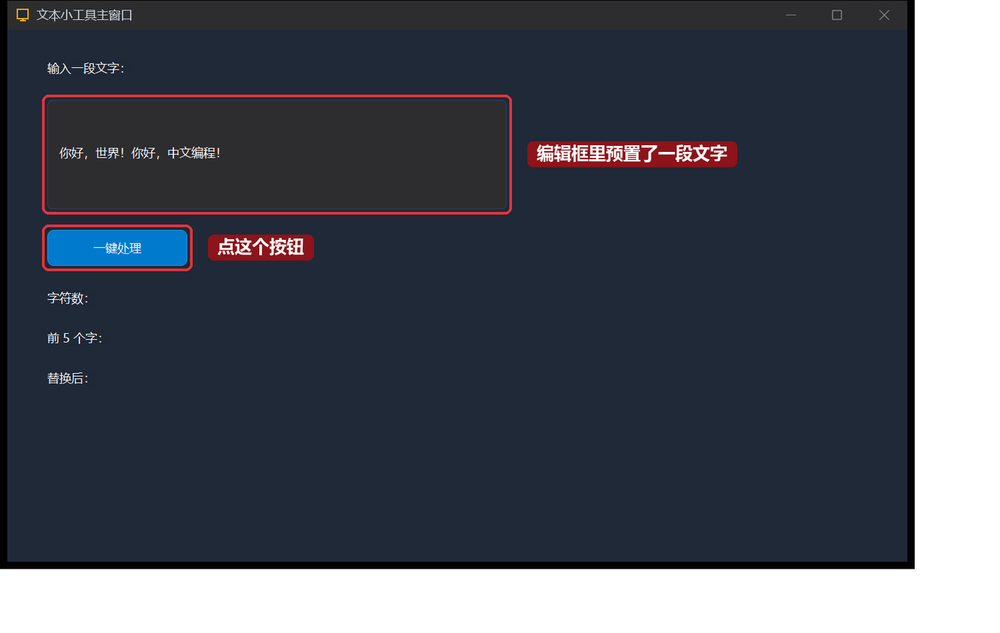
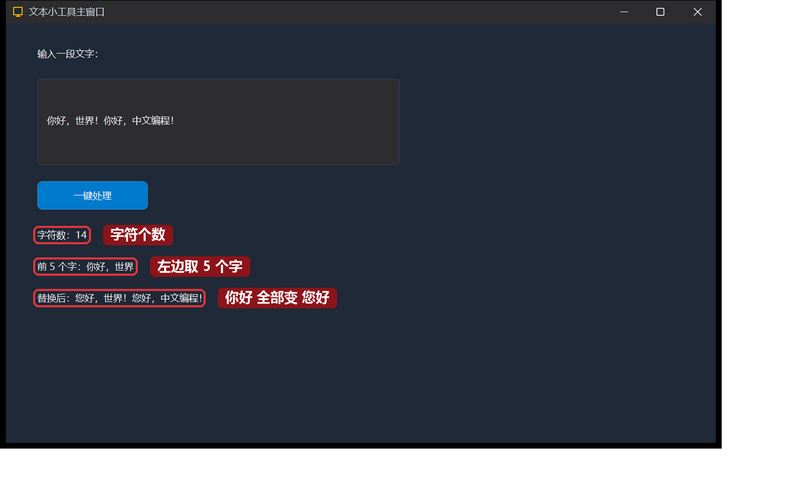

# 09 · 文本处理与变量进阶

> 《LingBuilder 零基础入门实战》第 9 集。上一集程序学会了「按时间做事」。这一集来学**处理文字**：数一个句子有多少个字、取出开头几个字、把某个词全部替换掉——做完就是一个能干的「文本小工具」。全集目录见 [系列总览](/guide/tutorials/beginner)。
>
> 本集目标：启用文本处理模块 → 学会 `文本_取长度`、`文本_取左边`、`文本_替换` 三个命令 → 用局部变量装中间结果。全程约 10 分钟。

## 1. 新建项目

打开 LingBuilder，点欢迎页的「**新建项目**」→ 选择「Windows 界面设计」→ 项目名称填 **文本小工具** → 点「创建项目」：



这些步骤第 2 集详细讲过，忘了就回去翻一眼。

## 2. 搭界面：一个输入框、一个按钮、三个结果标签

进入界面设计，从工具箱里依次点 6 个控件加到窗口上，并按下面的表设置属性（选中控件后，在右侧属性面板改）：

| 控件 | 中文名称 | 显示内容 | 左距 | 顶距 | 宽度 | 高度 |
| --- | --- | --- | --- | --- | --- | --- |
| 标签/静态控件 | `提示标签` | `输入一段文字：` | 40 | 30 | 200 | 28 |
| 编辑框 | `原文框` | `你好，世界！你好，中文编程！` | 40 | 70 | 460 | 110 |
| 按钮 | `处理按钮` | `一键处理` | 40 | 200 | 140 | 36 |
| 标签/静态控件 | `长度标签` | `字符数：` | 40 | 260 | 460 | 28 |
| 标签/静态控件 | `左边标签` | `前 5 个字：` | 40 | 300 | 460 | 28 |
| 标签/静态控件 | `替换标签` | `替换后：` | 40 | 340 | 460 | 28 |

> 编辑框加进来后，记得在属性里勾选「**多行**」，这样能显示一整句话。

全部摆好后长这样（编辑框里预置了一句话，等会儿专门拿它开刀）：



## 3. 启用「文本处理模块」

数长度、取左边、替换，这些命令都在**文本处理模块**里。和第 8 集启用日期时间模块一样：点活动栏的「**模块**」，在搜索框输入「文本处理」，点这一行右侧的开关启用：



启用后立刻能用：`文本_取长度` 数字符个数、`文本_取左边` 从左边截取几个字、`文本_替换` 把词替换掉。

## 4. 绑定按钮的「被单击」事件

回到界面设计，**点一下「一键处理」按钮**选中它，右侧切到「**事件**」页，第一张卡片就是「被单击 (Click)」，点「**生成并打开**」：



IDE 会自动在源码里生成 `事件 _处理按钮_被单击()` 并跳过去。

## 5. 写下三行处理代码

在 `_处理按钮_被单击` 事件里输入下面 4 行（第一行是**局部变量**声明，后面三行各管一个结果标签）：

```lingbuilder
局部 文本型 原文 = 文本_删首尾空白(控件_取文本(原文框))
控件_设置文本(长度标签, "字符数：" + 到文本(文本_取长度(原文)))
控件_设置文本(左边标签, "前 5 个字：" + 文本_取左边(原文, 5))
控件_设置文本(替换标签, "替换后：" + 文本_替换(原文, "你好", "您好"))
```

写完后的完整代码长这样（第一行的局部变量会自动登记进「局部声明」表）：



逐行拆开看：

- `局部 文本型 原文 = ...`：声明一个只在按钮事件里用的文本型变量，装进编辑框的文字。`文本_删首尾空白` 先把两头可能多敲的空格删掉。
- `文本_取长度(原文)`：数出原文有多少个字符；结果是个数字，用 `到文本(...)` 转成文字才能和 "字符数：" 拼在一起。
- `文本_取左边(原文, 5)`：从左边数 5 个字符拿回来。
- `文本_替换(原文, "你好", "您好")`：把原文里所有的「你好」都换成「您好」。

> 小知识：`+` 号可以把文本和文本拼在一起；数字想拼进文本里，先用 `到文本(...)` 转一下——这个套路以后天天用。

## 6. 运行！一键处理

保存，点「运行」。窗口弹出来，编辑框里是预置的那句话：



点「**一键处理**」，三行结果一起出来：



- 字符数 **14**：「你好，世界！你好，中文编程！」正好 14 个字符（逗号、感叹号也算）。
- 前 5 个字是「你好，世界」。
- 两个「你好」都变成了「您好」。

你可以回到编辑框随便改一句话再点一次按钮，三个结果都会跟着变。

## 本集小结

- 文本命令都在**文本处理模块**里：`文本_取长度` 数长度、`文本_取左边` 截取开头、`文本_替换` 批量替换、`文本_删首尾空白` 清理空格。
- `局部 文本型 原文 = ...` 声明**局部变量**：只在当前事件里有效，用来装中间结果。
- 数字拼进文本用 `到文本(...)`。
- 「控件_取文本」拿输入、「控件_设置文本」写结果——界面和数据就是这么来回倒腾的。

**下一集预告**：[10 · 文本数组与列表框](/guide/tutorials/beginner)——一个变量装一串名字：数组登场，做一个好友名单小程序。
