# 13 · 图片框与动态图像

> 《LingBuilder 零基础入门实战》第 13 集。界面全是文字和按钮，有点单调？这一集请出两位新朋友：**图片框**（显示一张图片）和**动态图像控件**（播放 GIF 动图），再带上一个会自己走的**进度条**。做完就是一个图片查看小窗。全集目录见 [系列总览](/guide/tutorials/beginner)。
>
> 本集目标：认识图片框与填充方式 → 学会 `控件_设置图片` 在运行时换图 → 用进度条复习时钟事件。全程约 10 分钟。

## 1. 新建项目

欢迎页 →「**新建项目**」→ 项目名称 **图片查看器** →「创建项目」：

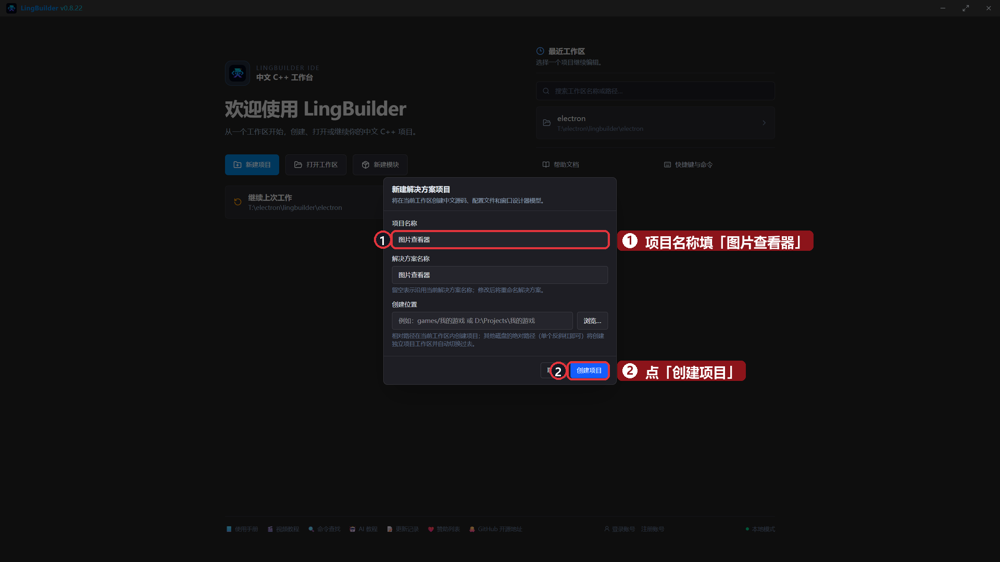

## 2. 搭界面：两块「屏幕」加一条进度条

这一集的控件都在**基础控件组**里（图片框、动态图像控件、进度条），不用额外启用模块。按下面的表摆：

| 控件 | 中文名称 | 属性 | 左距 | 顶距 | 宽度 | 高度 |
| --- | --- | --- | --- | --- | --- | --- |
| 图片框 | `大图框` | 先不用管图片源 | 40 | 40 | 440 | 340 |
| 动态图像控件 | `动画框` | 先不用管 GIF 文件 | 520 | 40 | 340 | 340 |
| 进度条 | `加载条` | 当前值改 `0` | 40 | 420 | 820 | 24 |
| 按钮 | `换图按钮` | 显示内容 `换一张` | 40 | 470 | 130 | 40 |
| 标签/静态控件 | `状态标签` | 显示内容 `当前图片：风景一` | 200 | 478 | 660 | 28 |

再到工具箱「**非可视**」组里点一下「**时钟**」，在属性里把「周期毫秒」改成 `200`、勾上「**创建后自动计时**」——窗口一启动它就开始干活，不用再写启动代码：

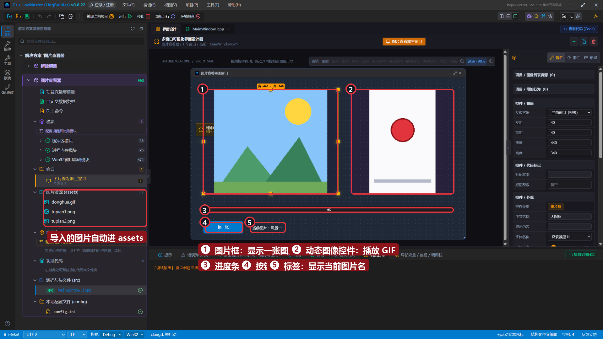

> 小知识：图片框刚拖出来会显示「请设置图片源」的提示字，属正常现象，下一步就给它喂图。

## 3. 给图片框选一张图片

选中「大图框」，在右侧属性面板找到「**图片源**」，点输入框旁边的小文件夹按钮：

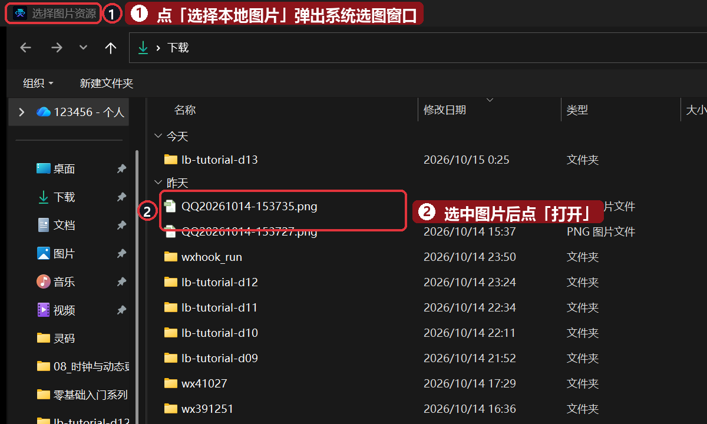

随便选一张你电脑里的图片（PNG、JPG 都行）。LingBuilder 会**自动把图片复制进项目的 assets 文件夹**，省得你自己管文件：

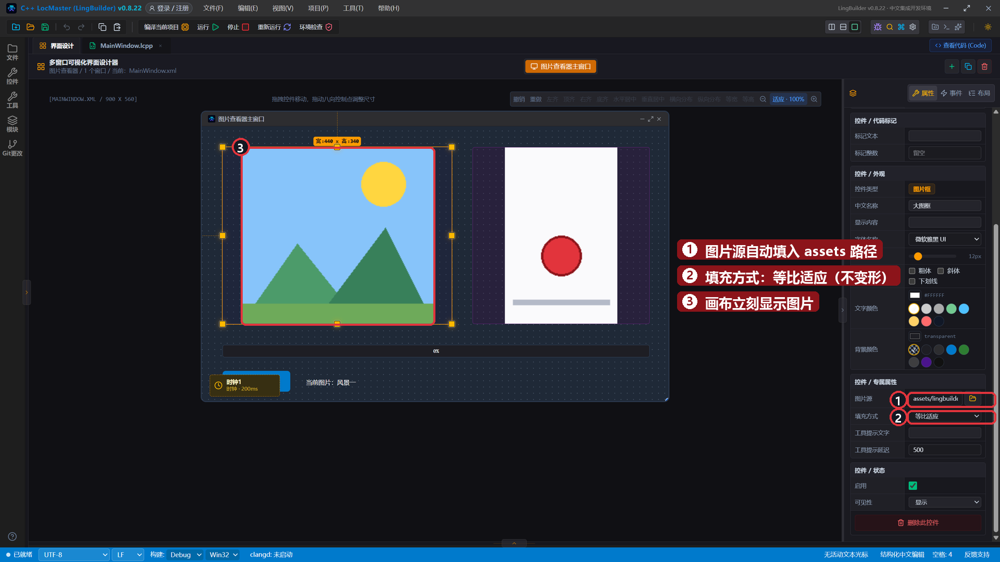

- **图片源**：自动填成了 `assets/…` 开头的路径——图片已经进项目了，换电脑、拷给别人都不会丢。
- **填充方式**：图片和框大小不一致时怎么办？四种模式任你选：

| 填充方式 | 效果 |
| --- | --- |
| 原始大小 | 图片多大就显示多大，框装不下就裁掉 |
| 拉伸填满 | 强行撑满框，图片会变形 |
| 等比适应 | 保持比例缩小到刚好装进框（最常用） |
| 等比填满 | 保持比例放大到填满框，多出来的裁掉 |

本集用默认的「**等比适应**」就好。

## 4. 动态图像控件：会动的 GIF

再选中「动画框」，属性里点「**GIF 文件**」的小文件夹按钮，选一个 GIF 动图（本集素材里有一个弹跳小红球的 `donghua.gif`）。「自动播放」「循环播放」默认都勾着，不用动：

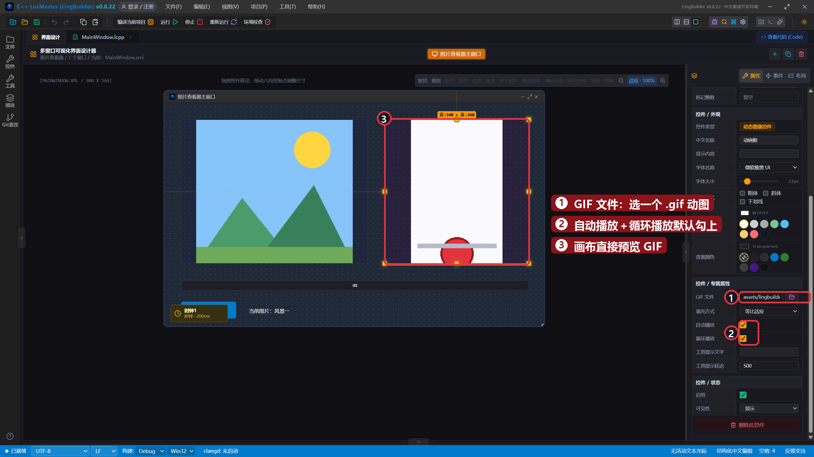

> 小知识：动态图像控件只认 GIF 文件；普通图片请交给图片框。

## 5. 绑定「换一张」的单击事件

选中「换图按钮」→ 「事件」页 → 「被单击 (Click)」卡片 → 「生成并打开」：

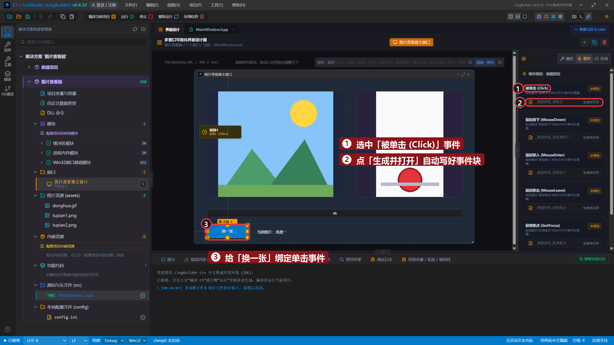

## 6. 写代码：换图 + 进度条

`_换图按钮_被单击` 里写两行：

```lingbuilder
控件_设置图片(大图框, "assets/lingbuilder-project/tupian2.png")
控件_设置文本(状态标签, "当前图片：风景二")
```

- `控件_设置图片(控件名, 图片路径)`：想让程序**在运行时换图**就用它。路径写 assets 里的相对路径——把第二张图片（比如 `tupian2.png`）用文件管理器复制进项目的 `assets\lingbuilder-project` 文件夹，跟第一张放一起。
- 第二行把状态标签的文字也更新掉，界面更完整。

`_时钟1_周期到期` 里写进度条的推进逻辑：

```lingbuilder
如果 (控件_取数值(加载条) >= 100)
    控件_设置数值(加载条, 0)
否则
    控件_设置数值(加载条, 控件_取数值(加载条) + 10)
如果结束
```

- `控件_取数值(控件名)`：读取进度条这类**数值控件**的当前值。
- `控件_设置数值(控件名, 数值)`：给数值控件设置新值。
- 每 200 毫秒走一步：到 100 就归零重来，否则加 10——进度条就这么循环往复。

完整代码分上下两屏：

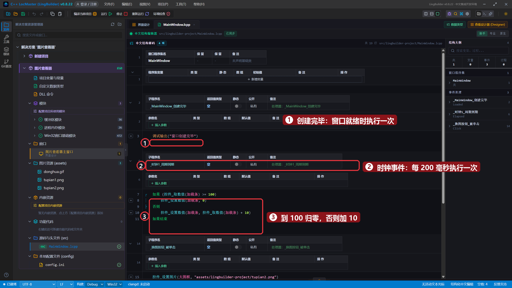

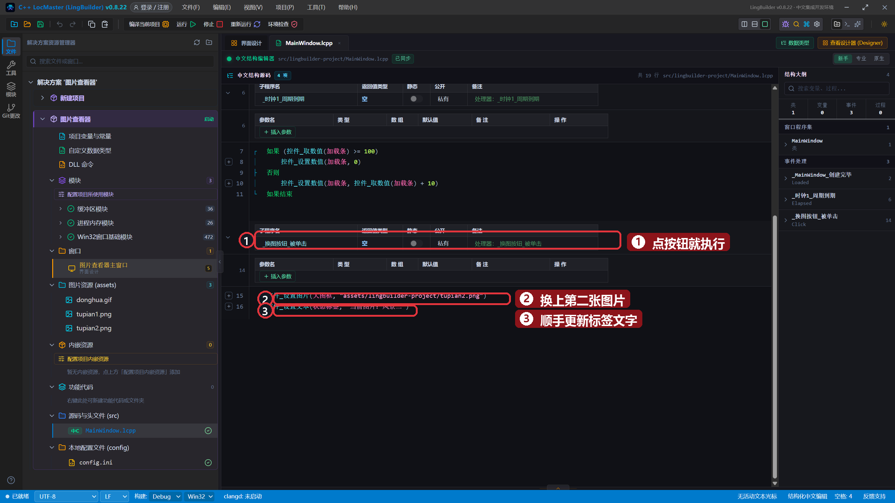

## 7. 运行！图片查看小窗

保存，点「运行」。左边显示风景一，右边的小红球在上下弹跳（GIF 真的在播），底部进度条自己往前走：

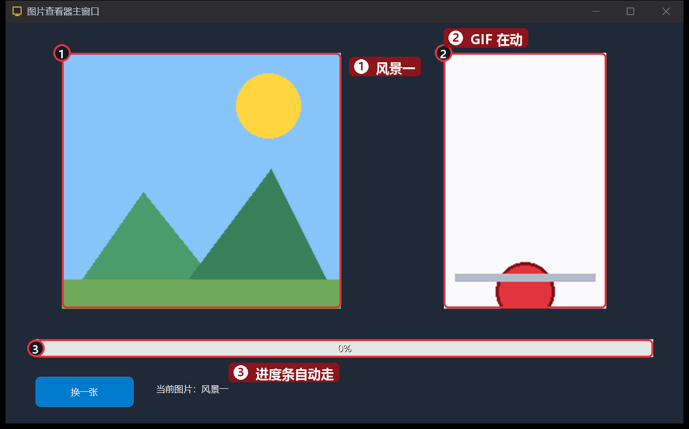

隔半秒再看一眼：进度条从 0% 走到了 40%，小球的位置也变了——都是程序自己干的活：

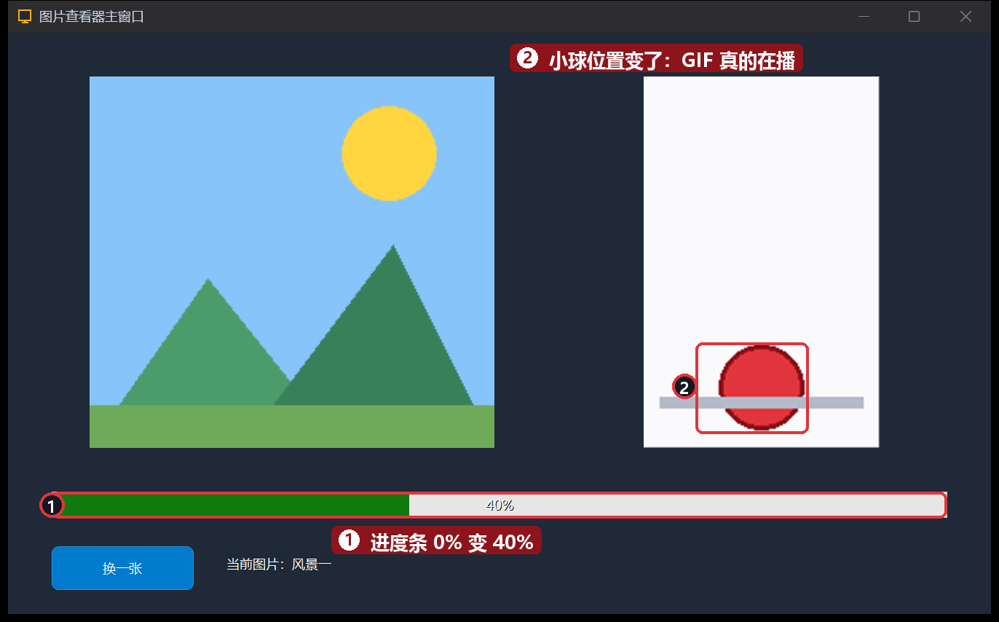

点一下「**换一张**」——夜空月亮的风景二立刻换上，状态标签也变成了「当前图片：风景二」：

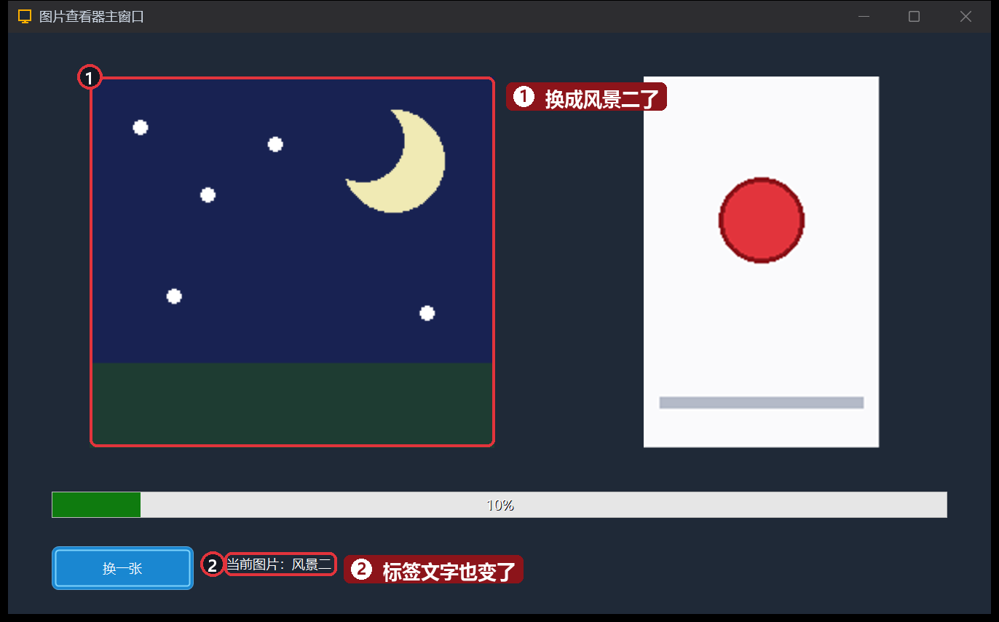

## 本集小结

- **图片框**显示静态图片：属性「图片源」选图会自动复制进项目 assets；「填充方式」四种模式按需选。
- **动态图像控件**播放 GIF：选好文件就自动播放、自动循环。
- `控件_设置图片`：运行时换图；`控件_取数值` / `控件_设置数值`：读写进度条的值。
- 时钟周期事件 + 数值命令，就能让界面「自己动起来」。

**下一集预告**：[14 · 选择类控件](/guide/tutorials/beginner)——组合框、复选框、单选框，让用户「做选择」：做一个报名表单。
