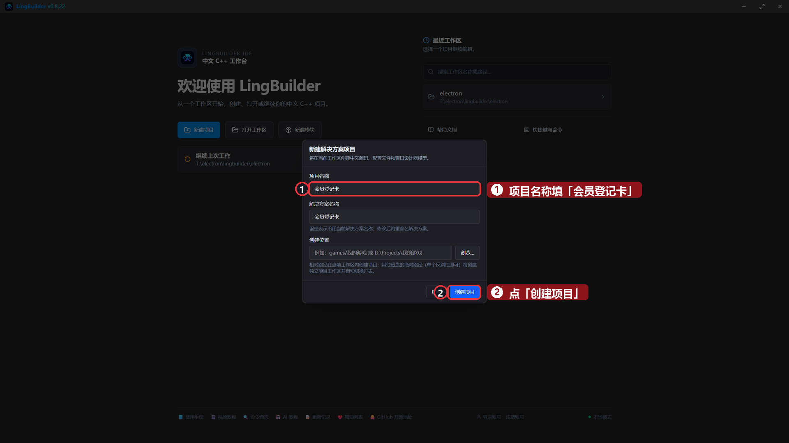
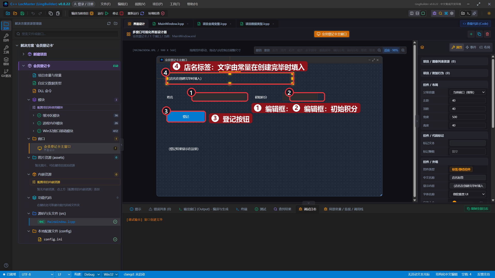
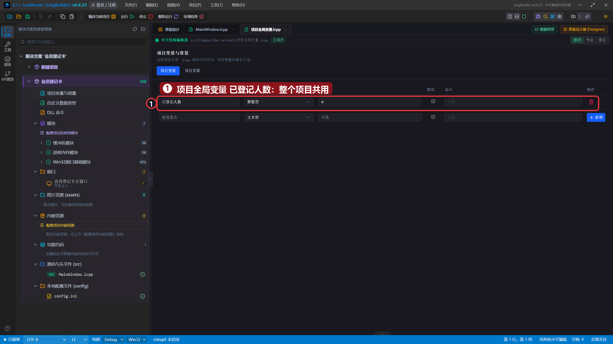
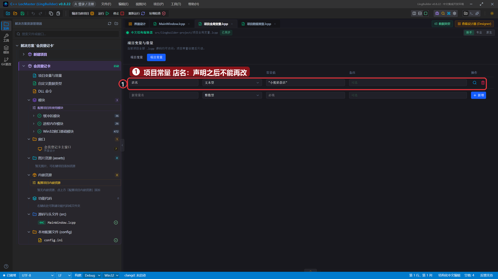
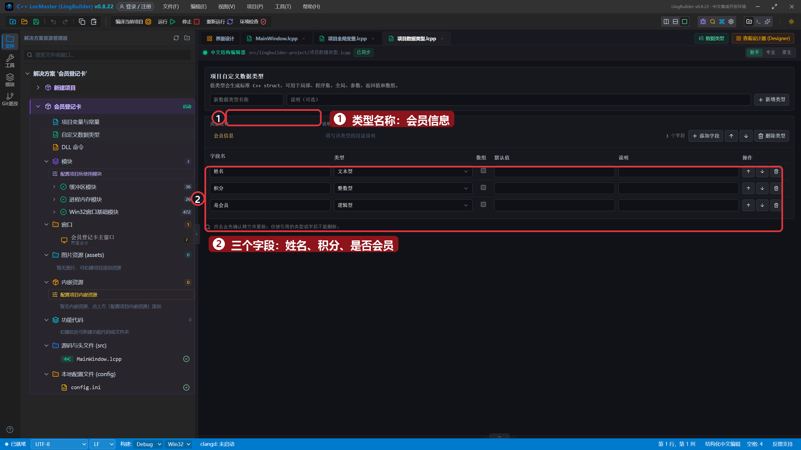
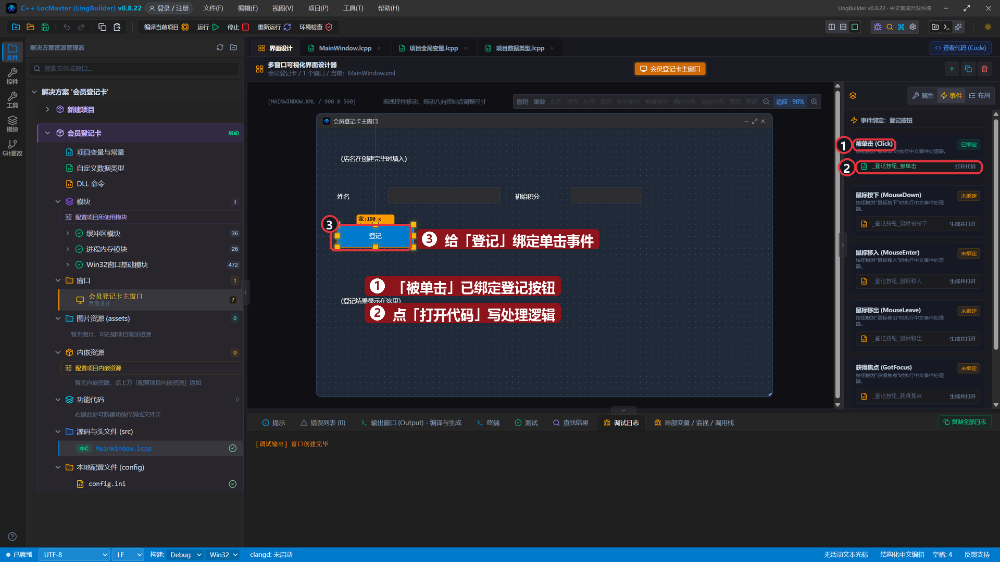
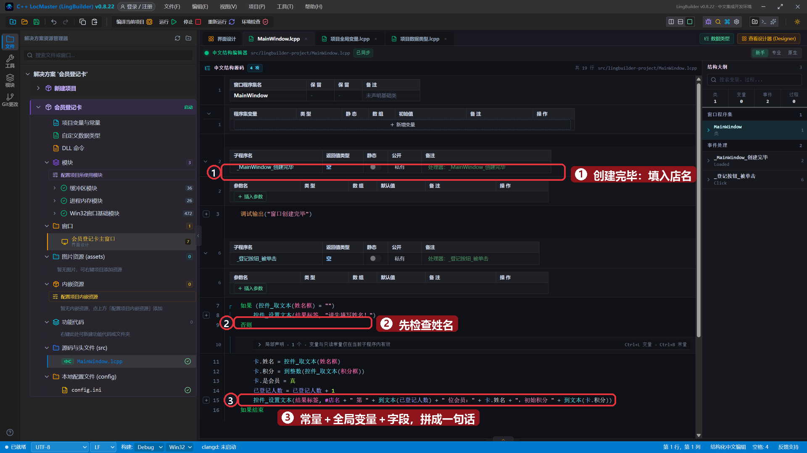
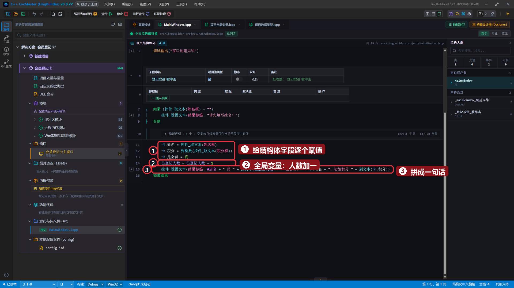
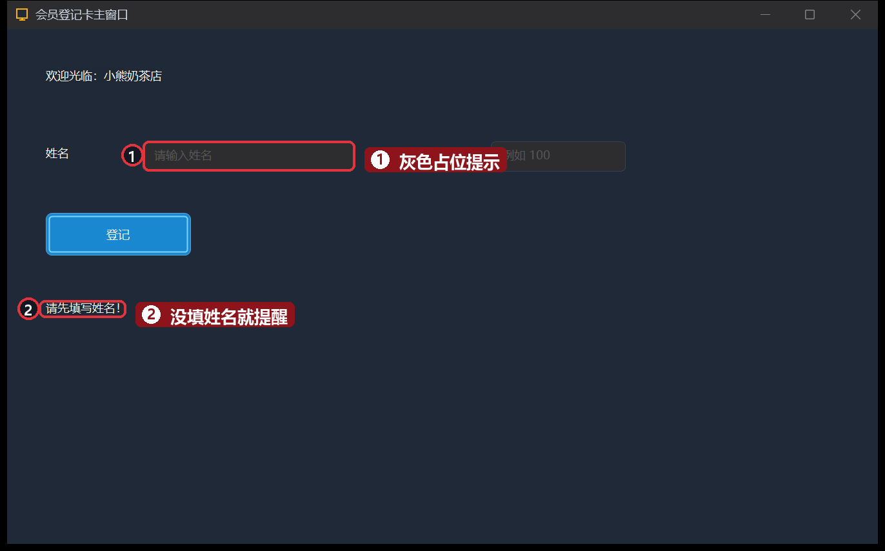
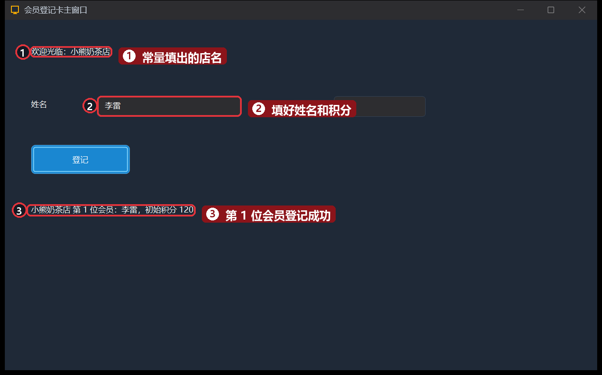

# 16 · 项目变量、常量与自定义数据类型

> 《LingBuilder 零基础入门实战》第 16 集。前面用过的变量都住在「一个窗口」里，这一集把数据搬进**全项目共用**的地方：**项目全局变量**（大家都能看）、**项目常量**（定了就不能改）、**自定义数据类型**（把几个字段捆成一个「东西」）。做完是一张会员登记卡。全集目录见 [系列总览](/guide/tutorials/beginner)。
>
> 本集目标：学会声明项目常量与项目全局变量 → 学会定义自己的数据类型并使用字段 → 体会「常量 + 全局变量 + 结构体」怎么配合。全程约 12 分钟。

## 1. 新建项目

欢迎页 →「**新建项目**」→ 项目名称 **会员登记卡** →「创建项目」：



## 2. 搭界面

| 控件 | 中文名称 | 显示内容 | 左距 | 顶距 | 宽度 | 高度 |
| --- | --- | --- | --- | --- | --- | --- |
| 标签/静态控件 | `店名标签` | （店名在创建完毕时填入） | 40 | 40 | 500 | 40 |
| 标签/静态控件 | `姓名标签` | 姓名 | 40 | 120 | 80 | 28 |
| 编辑框 | `姓名框` | （留空，占位提示：请输入姓名） | 140 | 116 | 220 | 32 |
| 标签/静态控件 | `积分标签` | 初始积分 | 390 | 120 | 90 | 28 |
| 编辑框 | `积分框` | （留空，占位提示：例如 100） | 500 | 116 | 140 | 32 |
| 按钮 | `登记按钮` | 登记 | 40 | 190 | 150 | 44 |
| 标签/静态控件 | `结果标签` | （登记结果显示在这里） | 40 | 280 | 820 | 120 |



## 3. 声明项目全局变量和项目常量

在解决方案树点「**项目变量与常量**」——它们住在专门的文件 `项目全局变量.lcpp` 里。「**项目变量**」页里加一行：名称 `已登记人数`、类型 `整数型`、初始值 `0`：



切到「**项目常量**」页，加一行：名称 `店名`、类型 `文本型`、常量值 `"小熊奶茶店"`（文本要带引号）：



- **项目全局变量**：整个项目（所有窗口、所有功能库）共用，进程活着它就在。程序集变量只有本窗口能用，这就是区别。
- **项目常量**：声明之后**不能再改**，适合店名这类固定值。代码里用 `#店名` 引用它。

## 4. 定义自己的数据类型

再点解决方案树里的「**自定义数据类型**」——这次住在 `项目数据类型.lcpp`。新建类型 `会员信息`，加三个字段：`姓名`（文本型）、`积分`（整数型）、`是会员`（逻辑型）：



- 自定义数据类型就是**把几个相关的值捆成一个整体**：一个「会员」= 姓名 + 积分 + 是否会员。
- 用的时候声明一个变量就拥有全部字段，比如 `局部 会员信息 卡`，然后用 `卡.姓名`、`卡.积分` 读写。

## 5. 绑定「登记」按钮的单击事件

老流程：选中「登记」→「事件」页 →「被单击 (Click)」→「打开代码」：



## 6. 写代码：常量 + 全局变量 + 结构体齐上场

先给 `创建完毕` 补一行——窗口一打开就用常量把店名填上：

```lingbuilder
调试输出("窗口创建完毕")
控件_设置文本(店名标签, "欢迎光临：" + #店名)
```

`_登记按钮_被单击` 里写：

```lingbuilder
如果 (控件_取文本(姓名框) = "")
    控件_设置文本(结果标签, "请先填写姓名！")
否则
    局部 会员信息 卡
    卡.姓名 = 控件_取文本(姓名框)
    卡.积分 = 到整数(控件_取文本(积分框))
    卡.是会员 = 真
    已登记人数 = 已登记人数 + 1
    控件_设置文本(结果标签, #店名 + " 第 " + 到文本(已登记人数) + " 位会员：" + 卡.姓名 + "，初始积分 " + 到文本(卡.积分))
如果结束
```

- `局部 会员信息 卡`：声明一个「会员」变量，`卡.字段名` 逐个赋值。
- `已登记人数 = 已登记人数 + 1`：项目全局变量直接加减，不用声明——它是大家的。
- `#店名`：常量引用写法，`#` 开头就是常量。
- 最后一句把三种数据**拼成一句话**：常量（店名）＋ 全局变量（第几位）＋ 结构体字段（姓名、积分）。

完整代码分上下两屏：





## 7. 运行！先空着点一下

保存，点「运行」。什么都不填直接点「登记」——程序正确提醒先填姓名：



## 8. 正式登记第一位会员

填上「李雷」、初始积分 `120`，点「登记」——店名常量、人数、姓名积分全部拼进了结果：



## 本集小结

- **项目全局变量**：`项目全局变量.lcpp` 里声明，全项目共用、进程内一直活着。
- **项目常量**：同一文件里声明、写在变量前面，代码里用 `#名字` 引用，不能改。
- **自定义数据类型**：`项目数据类型.lcpp` 里 `数据类型 … 结束数据类型`，字段用 `变量.字段` 读写。
- 三者配合：常量给「不变的招牌」，全局变量记「大家的账」，结构体装「一个人的完整信息」。

**下一集预告**：[17 · 功能库](/guide/tutorials/beginner)——把常用的代码装进「工具箱」：功能库的建法、限定调用和跨文件补全。
