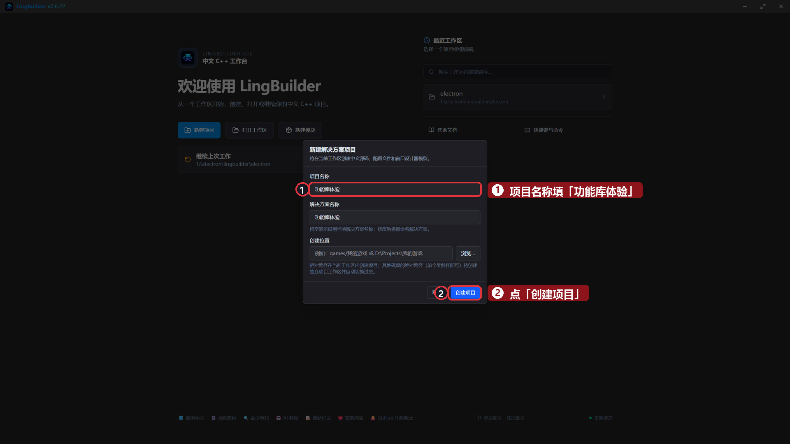
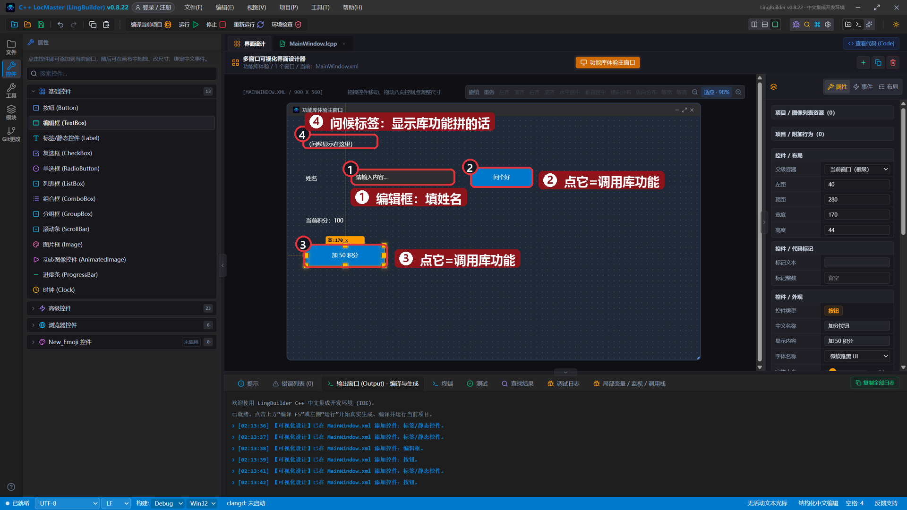
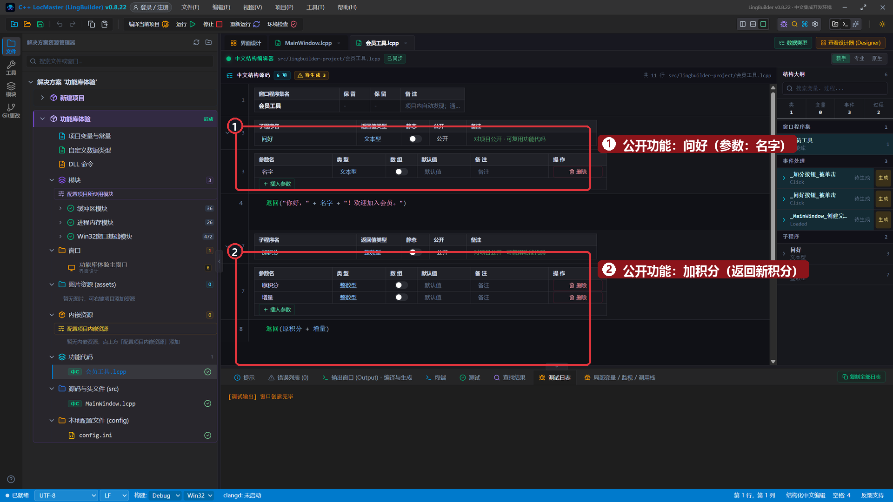
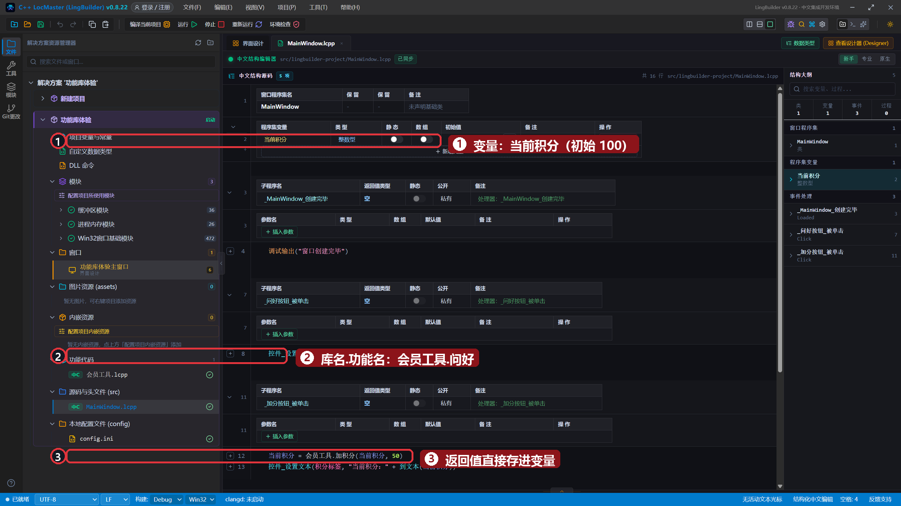
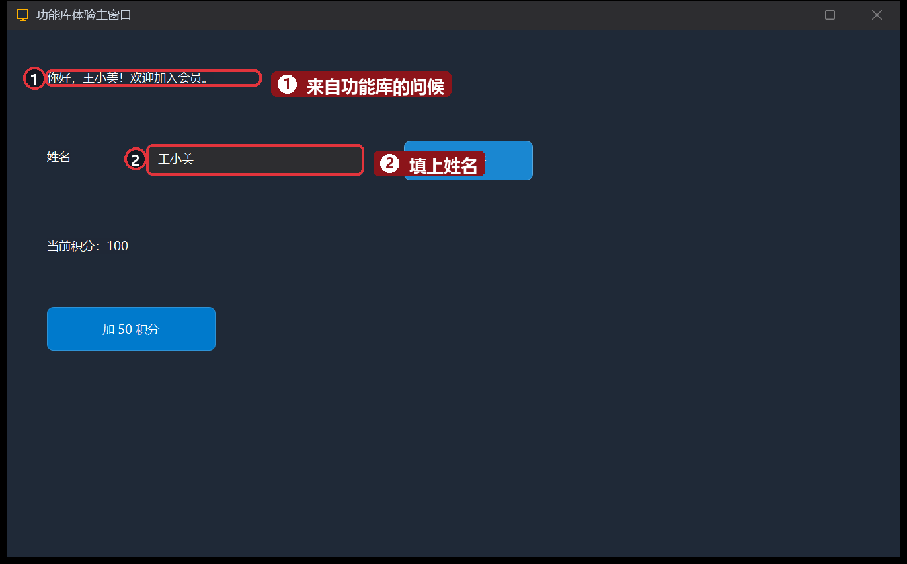
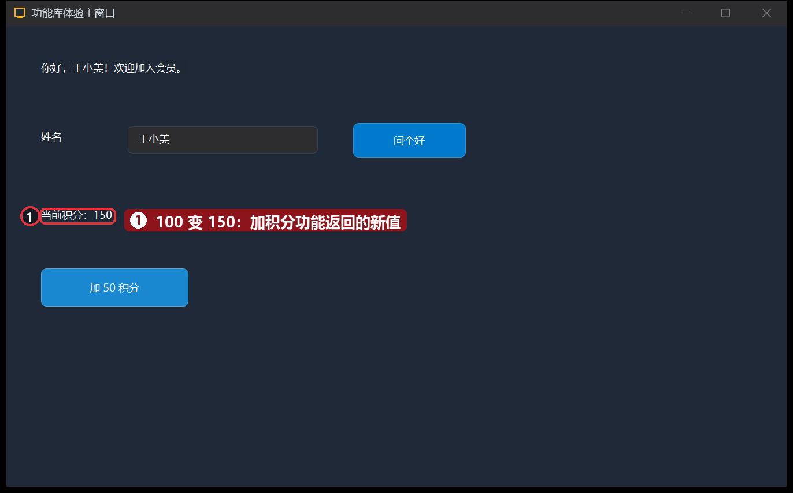

# 17 · 功能库：把代码装进工具箱

> 《LingBuilder 零基础入门实战》第 17 集。代码越写越多，全挤在窗口里就乱了。这一集学会**功能库**——一个专门放「可复用功能」的文件：写好一次，项目里哪儿都能用。全集目录见 [系列总览](/guide/tutorials/beginner)。
>
> 本集目标：认识功能库文件 → 学会写带参数、带返回值的公开功能 → 学会「库名.功能名」限定调用。全程约 10 分钟。

## 1. 新建项目

欢迎页 →「**新建项目**」→ 项目名称 **功能库体验** →「创建项目」：



## 2. 搭界面

| 控件 | 中文名称 | 显示内容 | 左距 | 顶距 | 宽度 | 高度 |
| --- | --- | --- | --- | --- | --- | --- |
| 标签/静态控件 | `问候标签` | （问候显示在这里） | 40 | 40 | 700 | 40 |
| 标签/静态控件 | `姓名标签` | 姓名 | 40 | 120 | 80 | 28 |
| 编辑框 | `姓名框` | （留空，占位提示：请输入姓名） | 140 | 116 | 220 | 32 |
| 按钮 | `问好按钮` | 问个好 | 400 | 112 | 130 | 40 |
| 标签/静态控件 | `积分标签` | 当前积分：100 | 40 | 210 | 400 | 32 |
| 按钮 | `加分按钮` | 加 50 积分 | 40 | 280 | 170 | 44 |



## 3. 建一个功能库

在项目源码文件夹（`src/功能库体验`）里新建文件 `会员工具.lcpp`，输入：

```lingbuilder
功能库 会员工具
公开:
    文本型 问好(文本型 名字)
        返回("你好，" + 名字 + "！欢迎加入会员。")
    结束

    整数型 加积分(整数型 原积分, 整数型 增量)
        返回(原积分 + 增量)
    结束
结束功能库
```

- **一个文件就是一个库**，库名跟文件名一致（`会员工具.lcpp` → 库名 `会员工具`）。
- `公开:` 下面放「对外的功能」：`返回值类型 功能名(参数)`，没有返回值写 `空`。
- 保存后解决方案树会多出「**功能代码**」分组，`会员工具.lcpp` 就住在里面：



## 4. 用「库名.功能名」调用它

绑定两个按钮的「被单击」事件，然后这样写 `MainWindow.lcpp`：

`_问好按钮_被单击`：

```lingbuilder
控件_设置文本(问候标签, 会员工具.问好(控件_取文本(姓名框)))
```

`_加分按钮_被单击`：

```lingbuilder
当前积分 = 会员工具.加积分(当前积分, 50)
控件_设置文本(积分标签, "当前积分：" + 到文本(当前积分))
```

- 调用格式是 **`库名.功能名(参数)`**——`会员工具.问好(...)`。少了库名会报错，这是故意的：一眼看出功能来自哪个库。
- `问好` 返回文本，可以直接塞进 `控件_设置文本`；`加积分` 返回整数，存进变量接着用。
- 程序集变量 `当前积分`（整数型，初始值 `100`）别忘了在变量表里声明。



## 5. 运行！两个功能都能用

保存，点「运行」。填上「王小美」，点「问个好」——问候语由功能库拼好送回来：



点「加 50 积分」——积分从 100 变 150，新值是 `加积分` 功能算好返回的：



## 本集小结

- 功能库 = 一个 `.lcpp` 文件 + `功能库 库名 … 结束功能库`，`公开:` 下的功能才能被别的文件用。
- 调用必须写全名：`库名.功能名(参数)`。
- 带参数、带返回值的功能写法与子程序一致：`返回值类型 功能名(参数)` + `返回(值)`。
- 积分按钮没写一句「怎么加」——加法住在库里，按钮只管「要结果」。

**下一集预告**：[18 · 获取鼠标位置并实时显示](/guide/tutorials/beginner)——进入趣味实战线：读鼠标坐标，做一个实时坐标显示器。
