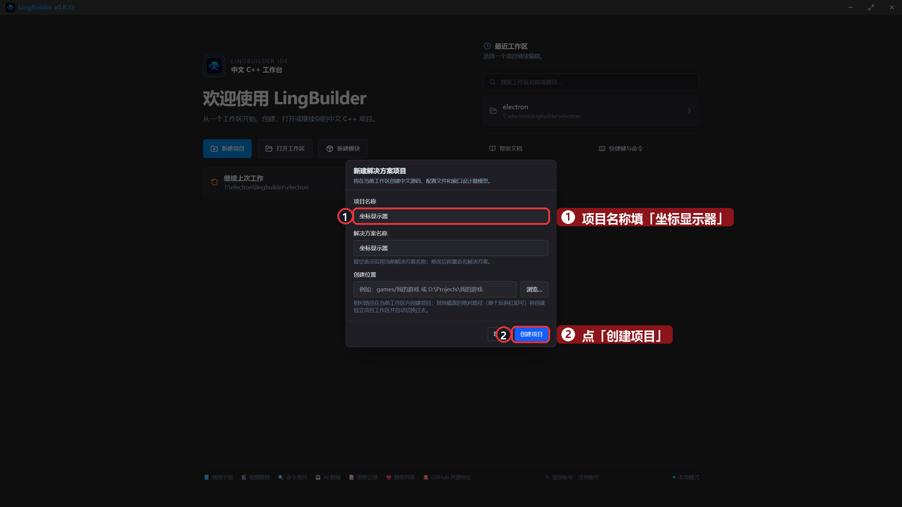
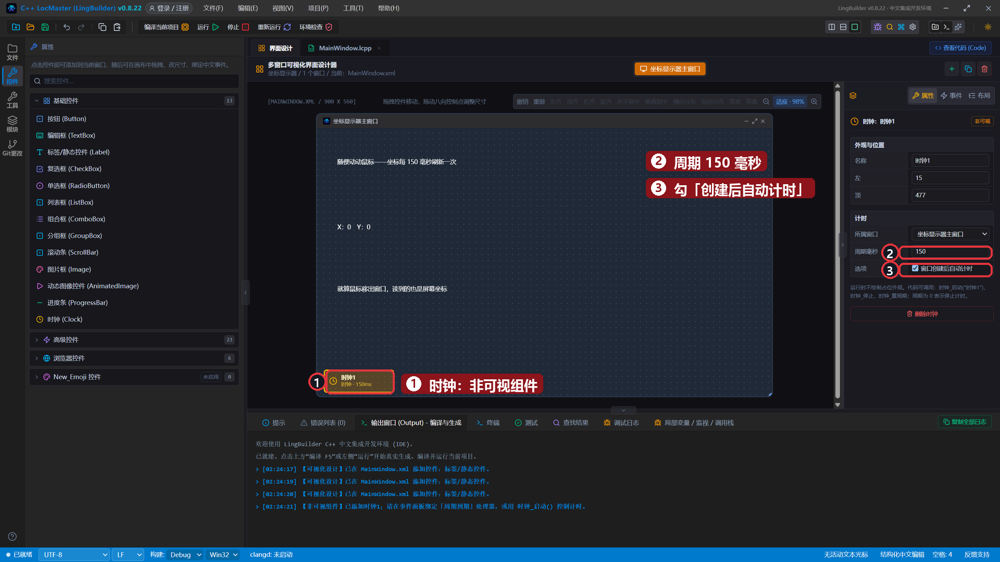
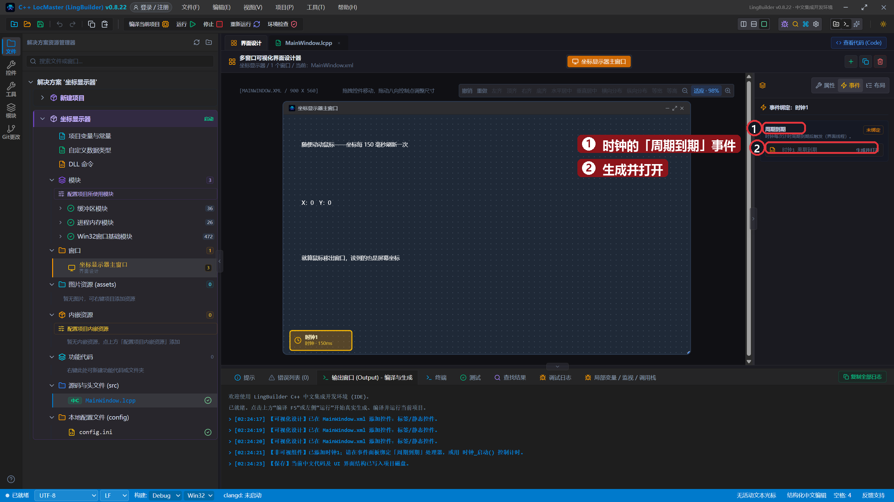
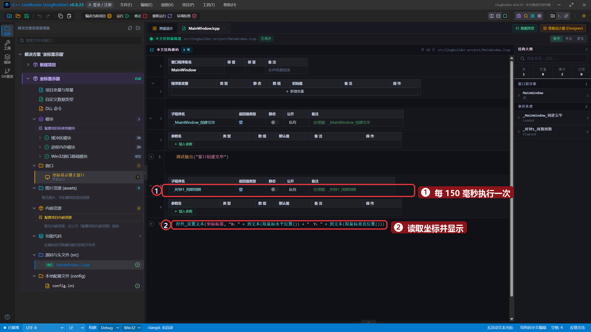
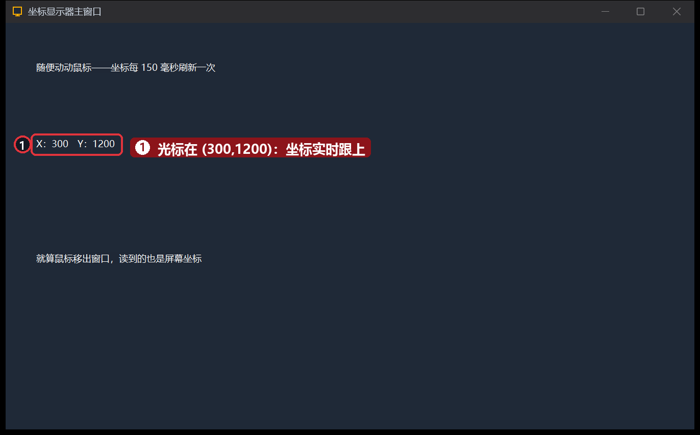
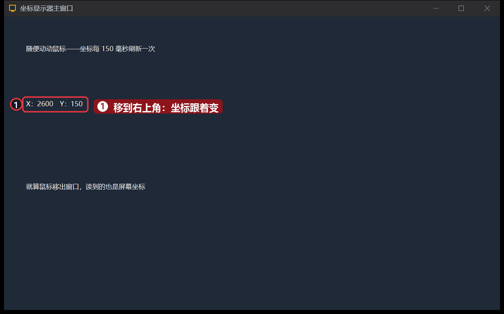
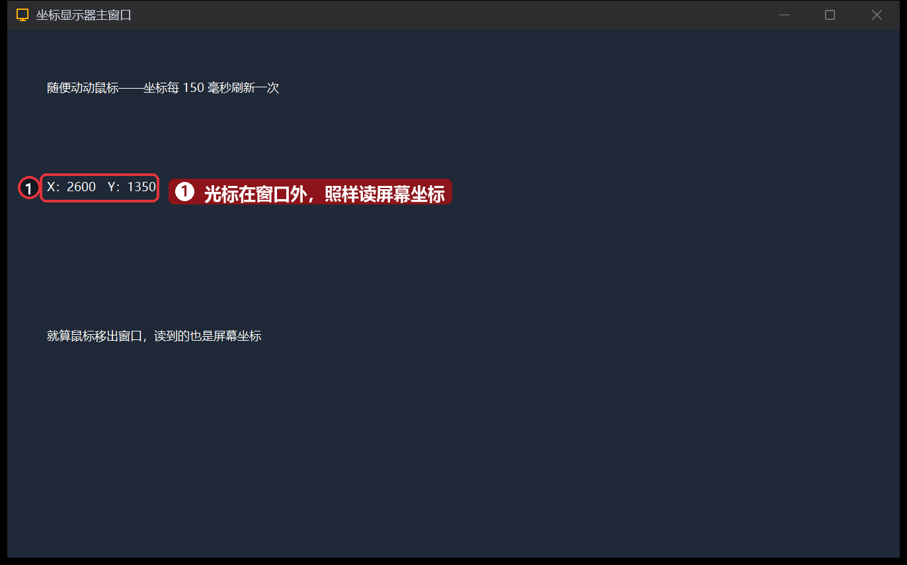

# 18 · 获取鼠标位置并实时显示

> 《LingBuilder 零基础入门实战》第 18 集。从这集开始进入趣味实战线：让程序「看见」鼠标。学会两个读坐标的命令，再配合第 8 集的时钟，做一个实时坐标显示器。全集目录见 [系列总览](/guide/tutorials/beginner)。
>
> 本集目标：学会 `取鼠标水平位置()` / `取鼠标垂直位置()` → 复习时钟周期刷新 → 理解「屏幕坐标」。全程约 8 分钟。

## 1. 新建项目

欢迎页 →「**新建项目**」→ 项目名称 **坐标显示器** →「创建项目」：



## 2. 搭界面 + 一个时钟

| 控件 | 中文名称 | 显示内容 | 左距 | 顶距 | 宽度 | 高度 |
| --- | --- | --- | --- | --- | --- | --- |
| 标签/静态控件 | `提示标签` | 随便动动鼠标——坐标每 150 毫秒刷新一次 | 40 | 50 | 700 | 32 |
| 标签/静态控件 | `坐标标签` | X：0　Y：0 | 40 | 150 | 700 | 90 |
| 标签/静态控件 | `补充标签` | 就算鼠标移出窗口，读到的也是屏幕坐标 | 40 | 300 | 700 | 32 |
| 时钟（非可视） | `时钟1` | 周期毫秒 `150`，勾「创建后自动计时」 | - | - | - | - |



- 这两个读坐标命令是**基础命令**，不用启用任何模块。
- 时钟勾了「创建后自动计时」，窗口一打开就每 150 毫秒「滴答」一次。

## 3. 绑定时钟的「周期到期」事件

点画布上的时钟占位标记 →「事件」页 →「周期到期 (Elapsed)」→「生成并打开」：



## 4. 写代码：一行就够

`_时钟1_周期到期` 里写：

```lingbuilder
控件_设置文本(坐标标签, "X：" + 到文本(取鼠标水平位置()) + "　Y：" + 到文本(取鼠标垂直位置()))
```

- `取鼠标水平位置()` / `取鼠标垂直位置()`：读**鼠标指针**当前相对屏幕左边/顶边的位置，单位是像素点。
- 每 150 毫秒读一次、拼好、显示——老三样：读数、拼接、上标签。



## 5. 运行！鼠标到哪儿，数字跟到哪儿

保存，点「运行」。把鼠标移到屏幕左下——坐标显示 `X：300 Y：1200`：



再移到右上角——数字立刻跟上：



把鼠标移到**窗口外面**照样读——因为读到的是整个屏幕的坐标，不是窗口里的：



## 本集小结

- `取鼠标水平位置()` / `取鼠标垂直位置()`：读鼠标的屏幕坐标，免模块、开箱能用。
- 「时钟 + 读数 + 拼文本 + 上标签」是做一切**实时刷新**界面的固定套路。
- 坐标是**屏幕坐标**：鼠标在不在你的窗口里都能读。

**下一集预告**：[19 · 录制鼠标轨迹](/guide/tutorials/beginner)——把鼠标的每一步「录」下来存成文件，为自动回放做准备。
