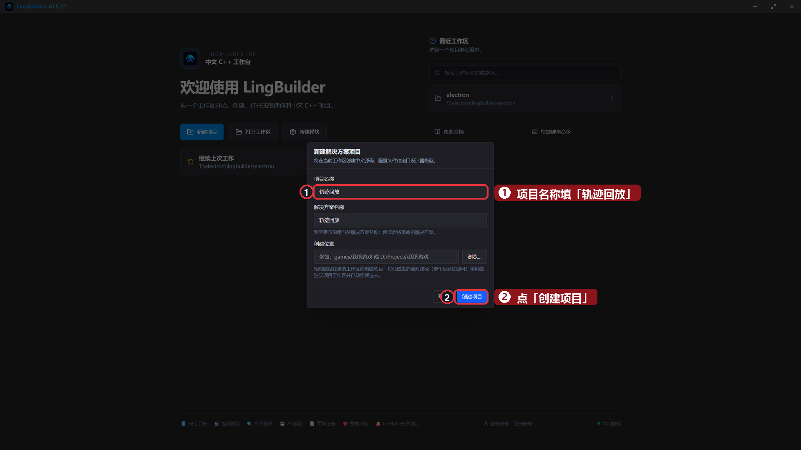
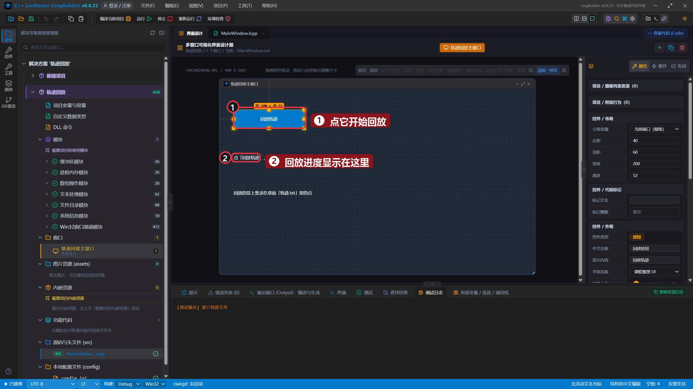
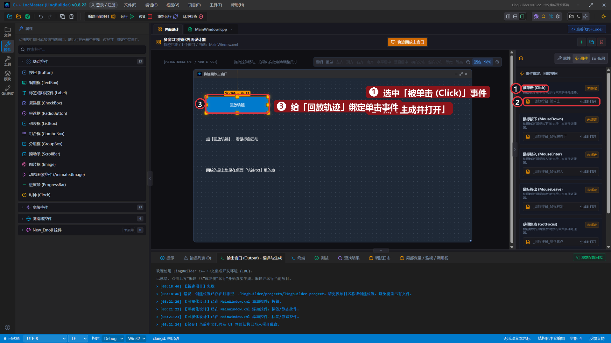
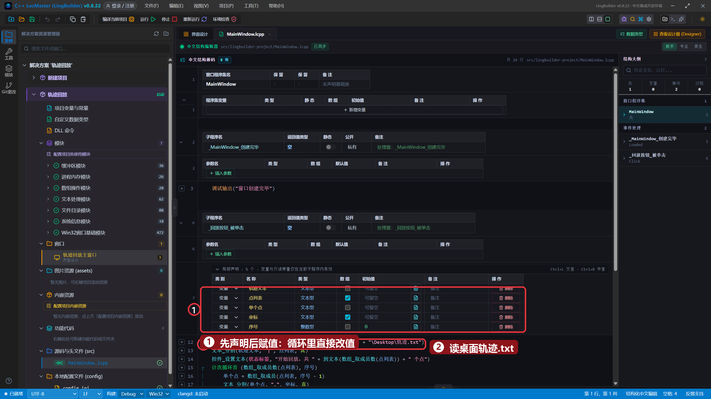
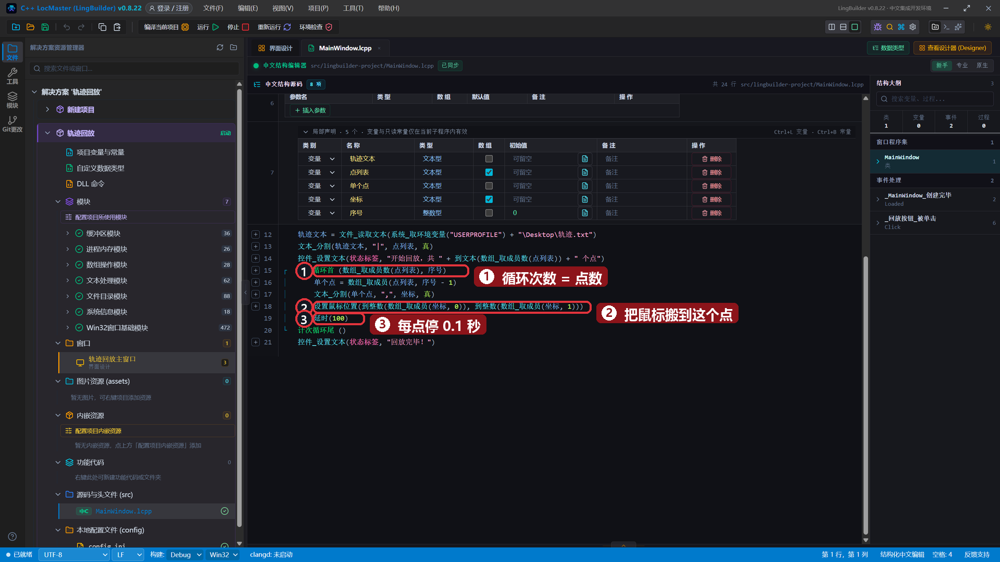
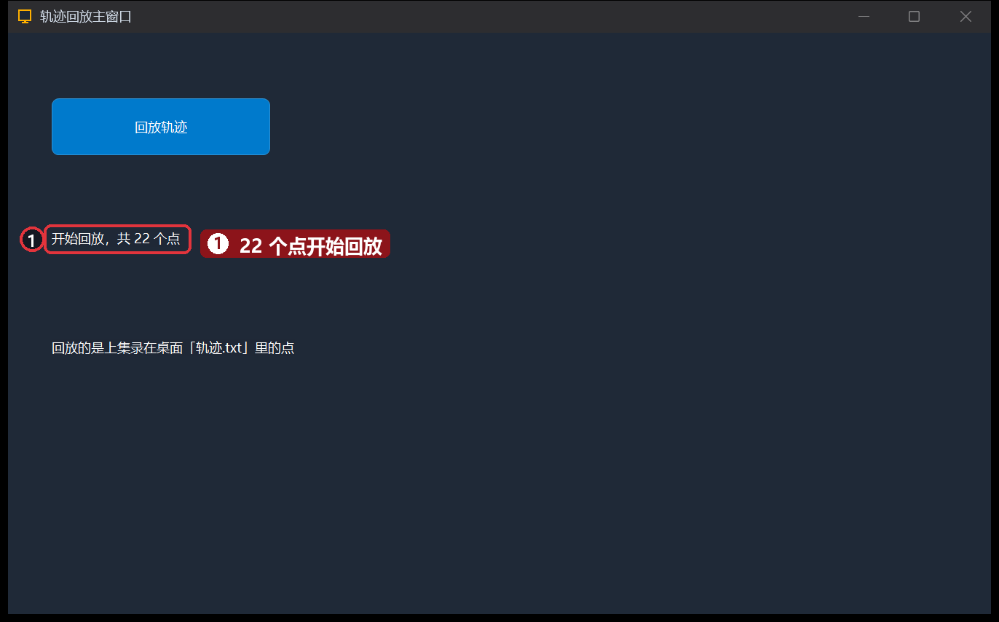
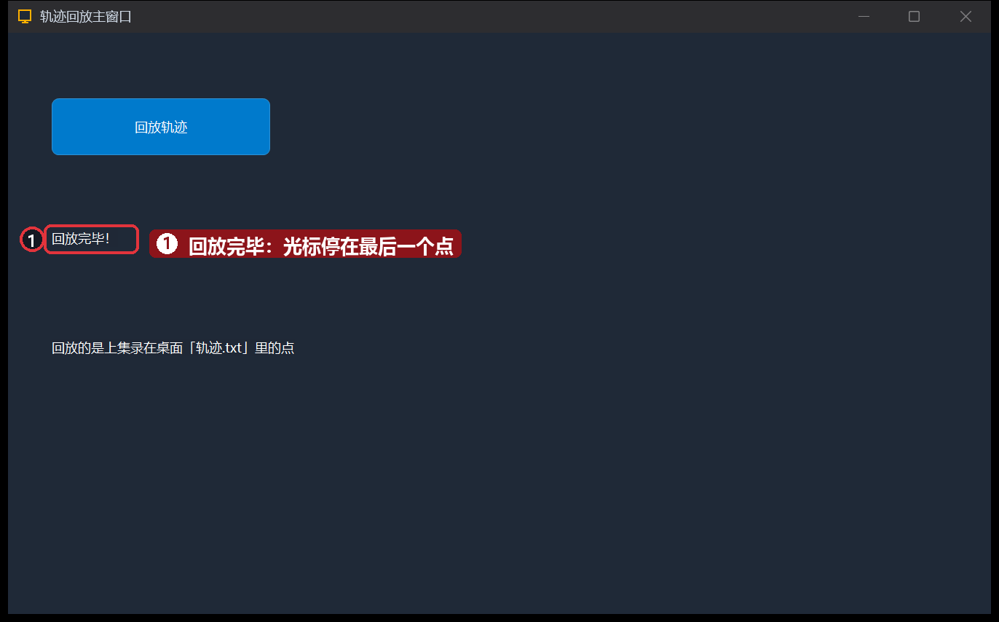

# 20 · 回放鼠标轨迹

> 《LingBuilder 零基础入门实战》第 20 集。录好的轨迹怎么用？这集让鼠标「自己动」：读回上集存在桌面的 `轨迹.txt`，拆点、循环、搬鼠标——录什么就重放什么。全集目录见 [系列总览](/guide/tutorials/beginner)。
>
> 本集目标：学会 `文本_分割` 拆字符串 → 复习 `数组_取成员` 与 `计次循环首` → 学会 `设置鼠标位置` 搬鼠标。全程约 12 分钟。

## 1. 新建项目

欢迎页 →「**新建项目**」→ 项目名称 **轨迹回放** →「创建项目」：



> 前提：桌面 `轨迹.txt` 还在（第 19 集录的那份）。没了就回上集重录一份。

## 2. 搭界面

| 控件 | 中文名称 | 显示内容 | 左距 | 顶距 | 宽度 | 高度 |
| --- | --- | --- | --- | --- | --- | --- |
| 按钮 | `回放按钮` | 回放轨迹 | 40 | 60 | 200 | 52 |
| 标签/静态控件 | `状态标签` | 点「回放轨迹」，看鼠标自己动 | 40 | 180 | 820 | 32 |
| 标签/静态控件 | `提示标签` | 回放的是上集录在桌面「轨迹.txt」里的点 | 40 | 280 | 700 | 32 |



## 3. 绑定「回放轨迹」按钮的单击事件

老流程：选中按钮 →「事件」页 →「被单击 (Click)」→「生成并打开」：



## 4. 写代码：拆点、循环、搬鼠标

`_回放按钮_被单击` 里写：

```lingbuilder
局部 文本型 轨迹文本
局部 文本型 点列表[]
局部 文本型 单个点
局部 文本型 坐标[]
局部 整数型 序号 = 0
轨迹文本 = 文件_读取文本(系统_取环境变量("USERPROFILE") + "\Desktop\轨迹.txt")
文本_分割(轨迹文本, "|", 点列表, 真)
控件_设置文本(状态标签, "开始回放，共 " + 到文本(数组_取成员数(点列表)) + " 个点")
计次循环首 (数组_取成员数(点列表), 序号)
    单个点 = 数组_取成员(点列表, 序号 - 1)
    文本_分割(单个点, ",", 坐标, 真)
    设置鼠标位置(到整数(数组_取成员(坐标, 0)), 到整数(数组_取成员(坐标, 1)))
    延时(100)
计次循环尾 ()
控件_设置文本(状态标签, "回放完毕！")
```

这段信息量大，拆开看：

- **先声明后赋值**：所有局部变量在方法开头声明，循环里只赋值——带初始化的声明会被提升到方法最前，循环里再赋值就乱了（第 11 集的老朋友）。
- `文本_分割(文本, 分隔符, 结果数组, 真)`：把 `"x,y|x,y|…"` 按 `|` 拆开装进 `点列表`；最后的 `真` 表示丢弃末尾空段。
- **两层拆**：先按 `|` 拆出每个点，再把单个点按 `,` 拆成横纵坐标。
- `数组_取成员(点列表, 序号 - 1)`：`计次循环首` 的序号**从 1 数**，数组**从 0 数**，所以减 1。
- `设置鼠标位置(横, 纵)`：把鼠标搬到指定屏幕坐标——回放的核心就这一行。
- `延时(100)`：每个点停 0.1 秒，不然鼠标「嗖」一下就完了。

完整代码分上下两屏：





## 5. 运行！看鼠标自己动

保存，点「运行」。状态标签先显示「开始回放，共 22 个点」：



鼠标开始按录制的路径自己移动，约 2 秒后显示「回放完毕！」——光标正好停在录制时的最后一个点上：



## 本集小结

- `文本_分割(文本, 分隔符, 结果数组, 真)`：一段文本拆进数组，第 4 参传 `真` 丢弃末尾空段。
- **两层拆**的套路：先拆记录、再拆字段，处理 CSV/日志都靠它。
- `设置鼠标位置(横, 纵)` 搬鼠标 + `延时` 控制节奏 = 轨迹回放。
- 录制（19 集）+ 回放（本集）= 一个完整的「宏」工具，你已经在做自动化了。

**下一集预告**：[21 · 键盘模拟与热键](/guide/tutorials/beginner)——不光能搬鼠标，还能「敲键盘」：键盘模拟命令与热键注册。
