# 23 · 界面布局进阶：选项卡、分组框与状态栏

> 《LingBuilder 零基础入门实战》第 23 集。控件一多，窗口就像杂物间——这集学三个「整理术」：**选项卡**把功能分页、**分组框**给设置画框、**状态栏**在窗口底部常驻提示。做完一个深色主题的「设置中心」。全集目录见 [系列总览](/guide/tutorials/beginner)。
>
> 本集目标：启用高级控件模块 → 选项卡分页 → 分组框嵌套 → 状态栏联动。全程约 15 分钟。

## 1. 新建项目

欢迎页 →「**新建项目**」→ 项目名称 **设置中心** →「创建项目」：

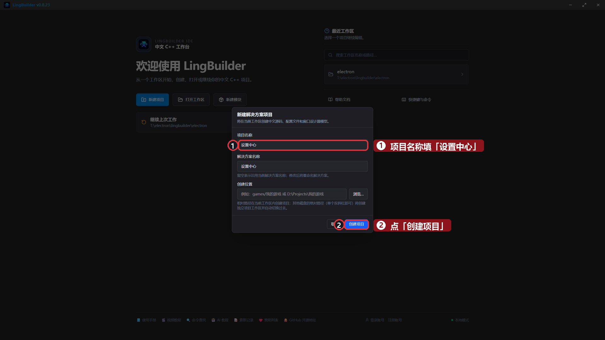

## 2. 启用「Win32高级控件模块」

选项卡、状态栏属于高级控件。模块面板搜索「**高级控件**」→ 启用「**Win32高级控件模块**」（工具箱里才会出现它们；启用后没看到就重启一下 IDE）：

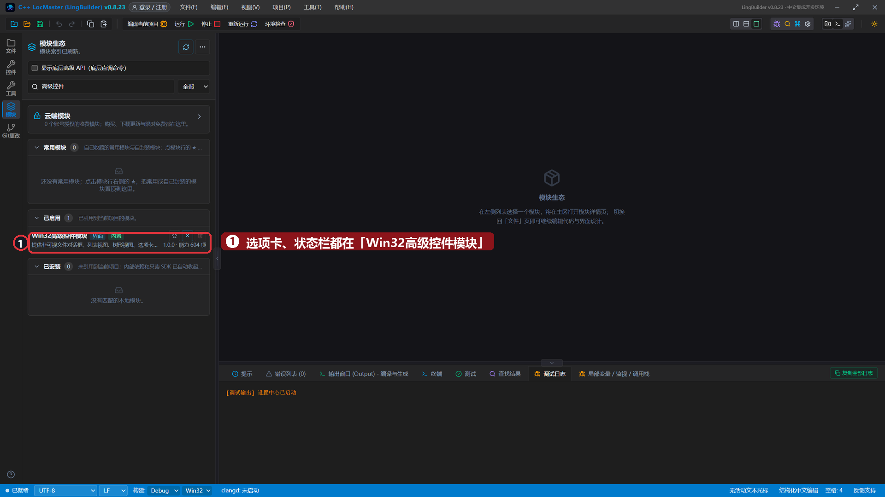

## 3. 搭界面

工具箱搜索「**选项卡**」添加，改中文名称 `选项卡1`，左距 40、顶距 40、宽度 560、高度 380。选中它，在专属属性「**标签页**」点「编辑标签页」→ 把两页标题改成 `常规设置` 和 `关于`：

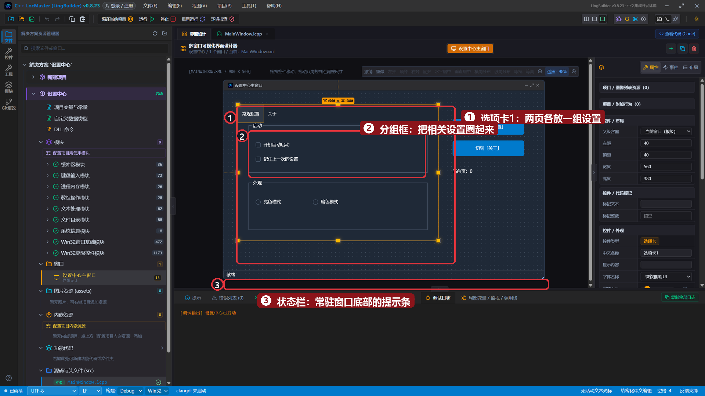

然后往页里放控件。关键概念是**父容器**：选中控件后，属性面板「控件 / 布局」的「父级容器」下拉决定它「住在哪里」：

| 控件 | 中文名称 | 显示内容 | 位置 (左,顶,宽,高) | 父容器 |
| --- | --- | --- | --- | --- |
| 分组框 | `分组框1` | 启动 | 70, 90, 500, 140 | 选项卡1 |
| 复选框 | `开机自启框` | 开机自动启动 | 90, 140, 200, 24 | 分组框1 |
| 复选框 | `记忆框` | 记住上一次的设置 | 90, 180, 240, 24 | 分组框1 |
| 分组框 | `分组框2` | 外观 | 70, 250, 500, 140 | 选项卡1 |
| 单选框 | `亮色框` | 亮色模式 | 90, 300, 160, 24 | 分组框2 |
| 单选框 | `暗色框` | 暗色模式 | 250, 300, 160, 24 | 分组框2 |
| 标签 | `版本标签` | 设置中心 v1.0.0 | 70, 100, 400, 32 | 选项卡1（切到「关于」页再放） |
| 标签 | `说明标签` | 把常用设置分组放进选项卡，窗口立刻清爽起来。 | 70, 150, 460, 64 | 选项卡1（「关于」页） |
| 状态栏 | `状态栏1` | 就绪 | 0, 504, 900, 24 | 根级 |
| 按钮 | `切到常规按钮` | 切到「常规设置」 | 640, 80, 200, 44 | 根级 |
| 按钮 | `切到关于按钮` | 切到「关于」 | 640, 140, 200, 44 | 根级 |
| 标签 | `页码标签` | 当前页：0 | 640, 210, 200, 32 | 根级 |

两个新手必踩的坑，这集演示项目已经替你躲过：

- **深底白字**：窗口是深色主题时，选项卡里的分组框、复选框默认白底白字会「隐身」。把它们统一设成「背景颜色 #1F2937、文字颜色 #FFFFFF」，设计器和运行效果就一致了。
- **状态栏要放在根级**：它属于整个窗口底部，挂进选项卡会被页签坐标带跑。

## 4. 绑定事件

- 两个按钮各绑「被单击 (Click)」；
- 选项卡1 绑「**标签页被改变** (SelectionChanged)」；
- 状态栏1 绑「**分区被双击** (DoubleClick)」。

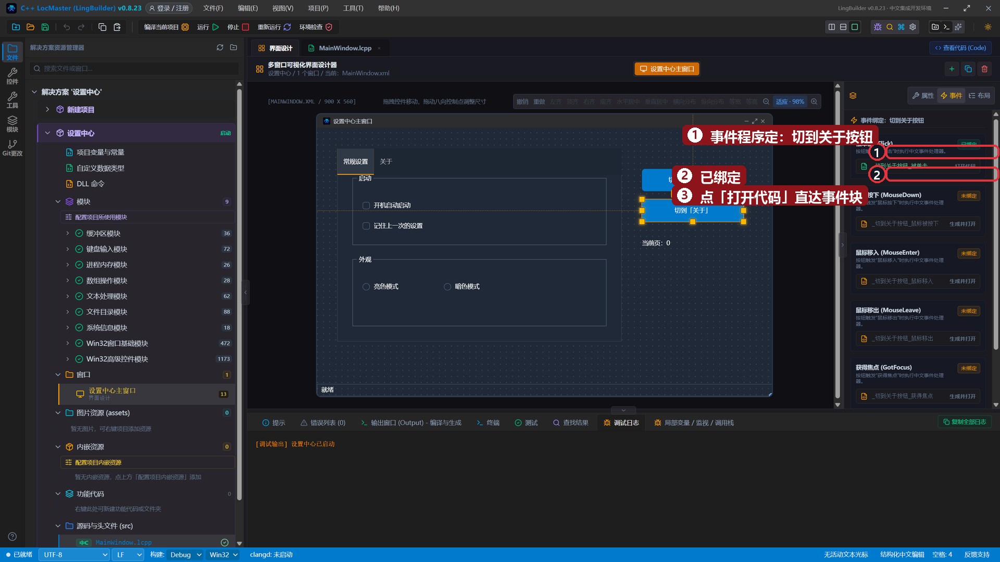

## 5. 写代码

`_MainWindow_创建完毕`（启动先刷新一次显示）：

```lingbuilder
调试输出("设置中心已启动")
更新页码显示()
控件_设置文本(状态栏1, "就绪 | 试试右侧的切换按钮，或直接点页签、双击状态栏")
```

两个切页按钮——`控件_设置选择项(选项卡1, 页索引)` 一行就能切页：

```lingbuilder
控件_设置选择项(选项卡1, 1)
更新页码显示()
```

`_选项卡1_标签页被改变`（用鼠标点页签头时触发）和 `_状态栏1_分区被双击`：

```lingbuilder
更新页码显示()
```

```lingbuilder
调试输出("双击了状态栏分区：" + 到文本(状态栏_最后分区()))
控件_设置文本(状态栏1, "你双击了状态栏（分区编号 " + 到文本(状态栏_最后分区()) + "）")
```

真正的显示逻辑收在一个**子程序**里，两条切换路径（按钮、页签）都调它，页码永远同步：

```lingbuilder
空 更新页码显示()
    控件_设置文本(页码标签, "当前页：" + 到文本(控件_取选择项(选项卡1)))
    控件_设置文本(状态栏1, "当前页面索引：" + 到文本(控件_取选择项(选项卡1)))
结束
```

完整代码分四屏：

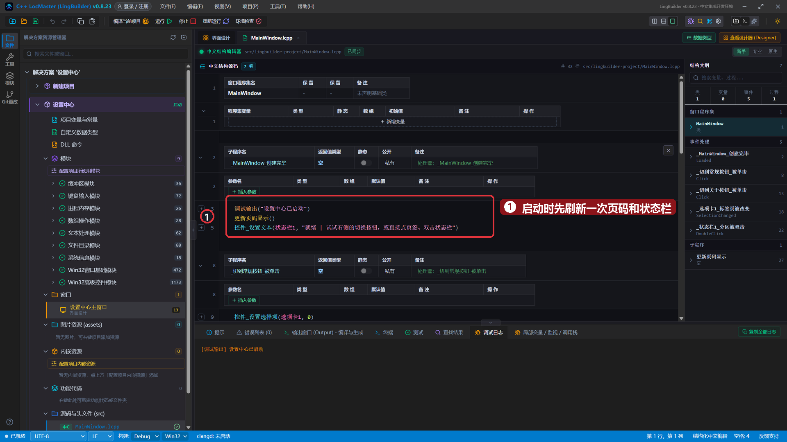

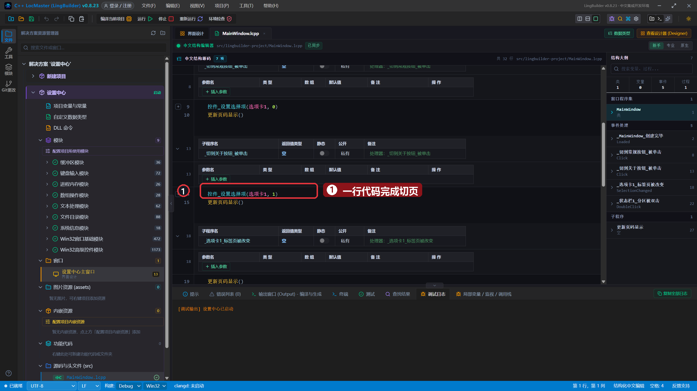

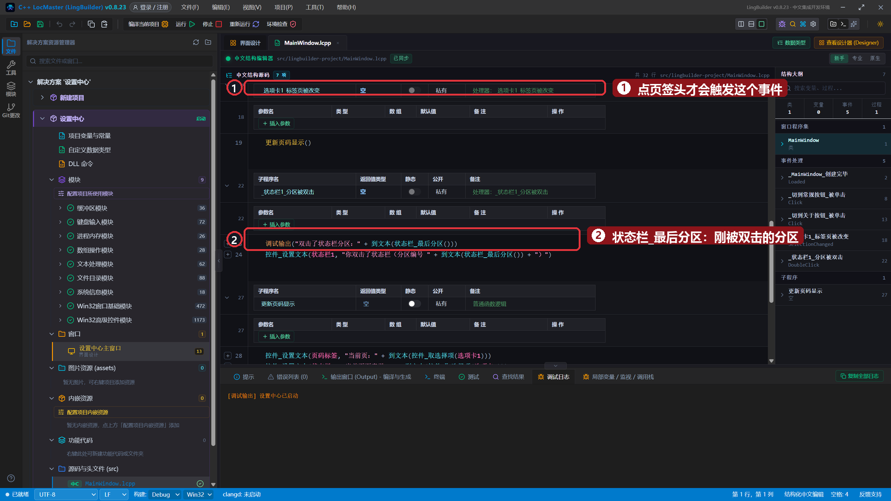

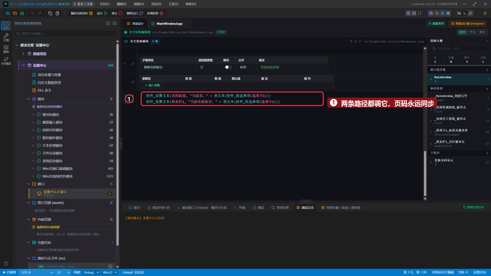

## 6. 运行！

保存，点「运行」。窗口底部状态栏亮出「就绪」：

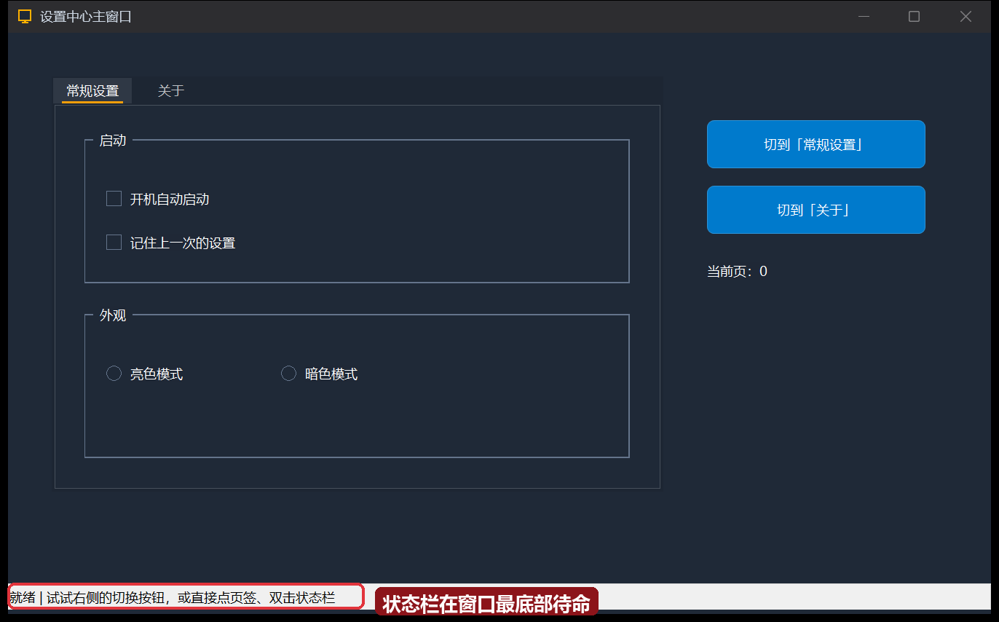

点「切到『关于』」——页面切过去，页码标签同步成 1：

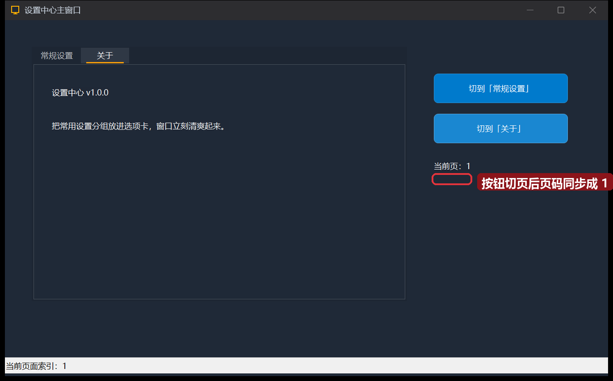

再直接点「关于」页签头——这次走的是「标签页被改变」事件，状态栏也跟着报当前索引：

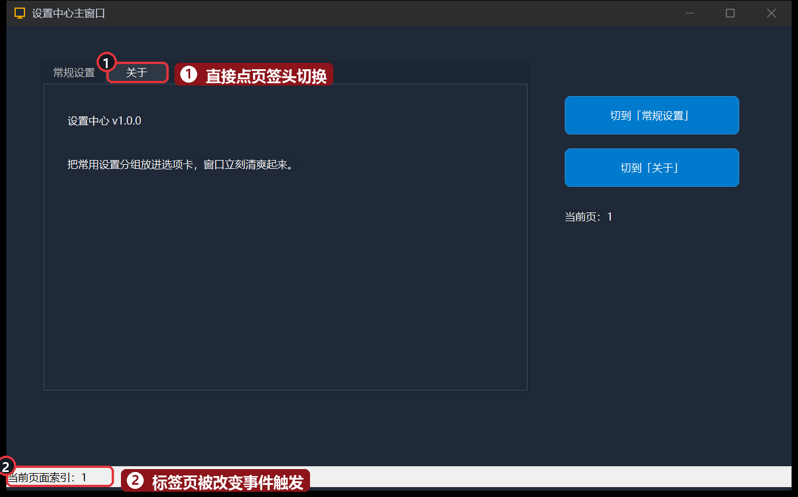

点「切到『常规设置』」切回第一页：

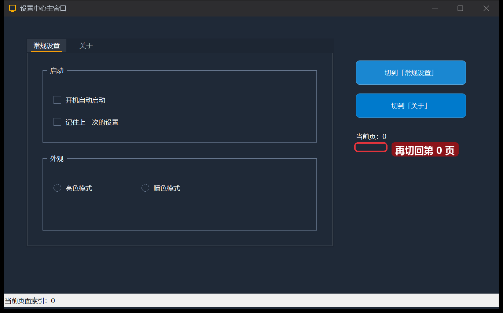

## 本集小结

- **选项卡**：专属属性「标签页」里编辑页标题；子控件靠「父级容器」住进某一页；运行期 `控件_设置选择项` 切页、`控件_取选择项` 读页码。
- **分组框**：纯容器，没有命令，价值在「把相关控件圈在一起」；嵌套顺序 选项卡页 → 分组框 → 复选框/单选框。
- **状态栏**：贴着窗口底部常驻；`状态栏_最后分区()` 告诉你刚被双击的是哪个分区。
- **切页的两种路径**：按钮里 `控件_设置选择项` 不会触发「标签页被改变」，鼠标点页签头才会——所以把显示刷新收进子程序、两条路径都调它，是本集最重要的代码习惯。
- 深色界面记住口诀：**底色深的容器里，子控件要「白字 + 同色底」**。

**下一集预告**：[24 · 菜单与窗口事件](/guide/tutorials/beginner)——给窗口装上右键菜单。
