# 24 · 菜单与窗口事件

> 《LingBuilder 零基础入门实战》第 24 集。专业软件都有「右键菜单」——在输入框里点右键，清空、复制、关于一字排开。这集给「右键小助手」装上右键菜单，再认识几位**窗口级事件**：窗口去后台了、回到前台了，程序全知道。全集目录见 [系列总览](/guide/tutorials/beginner)。
>
> 本集目标：上下文菜单组件 → 菜单项逐项绑事件 → 剪贴板模块 → 窗口事件三兄弟。全程约 14 分钟。

## 1. 新建项目

欢迎页 →「**新建项目**」→ 项目名称 **右键小助手** →「创建项目」：

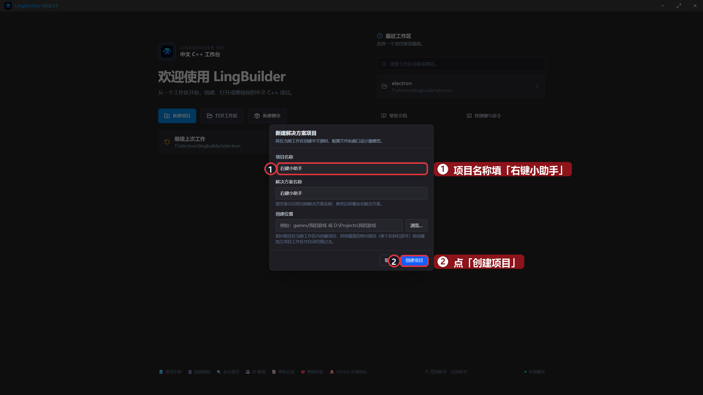

## 2. 启用模块

模块面板启用两个：「**Win32高级控件模块**」（上下文菜单在这里）和「**剪贴板模块**」（`剪贴板_置文本` 在这里）。

## 3. 搭界面

| 控件 | 中文名称 | 显示内容 | 位置 (左,顶,宽,高) | 备注 |
| --- | --- | --- | --- | --- |
| 标签 | `标题标签` | 右键小助手 — 在下面的笔记区点右键 | 40, 30, 700, 40 | |
| 编辑框 | `笔记框` | 试一试：在这里点右键，或者拖动窗口大小。 | 40, 90, 820, 300 | 勾选「**多行**」 |
| 标签 | `状态标签` | （还没有操作） | 40, 420, 820, 32 | 操作结果都显示在这 |

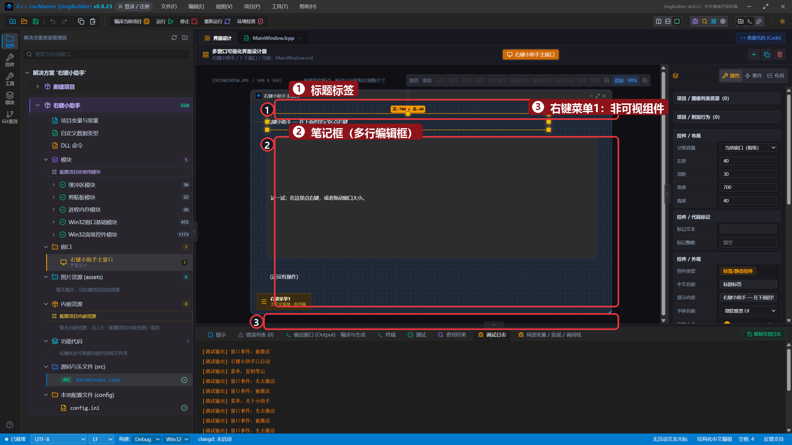

## 4. 添加上下文菜单

工具箱搜索「**上下文菜单**」添加（非可视组件，画布上是一个小方块）。选中它，右侧属性面板：

- 「**右键目标**」选 `笔记框`——在笔记框上点右键才会弹出；
- 「**菜单项**」逐个添加：`清空笔记`、`复制笔记`、一条「新增分隔线」、`关于小助手`。

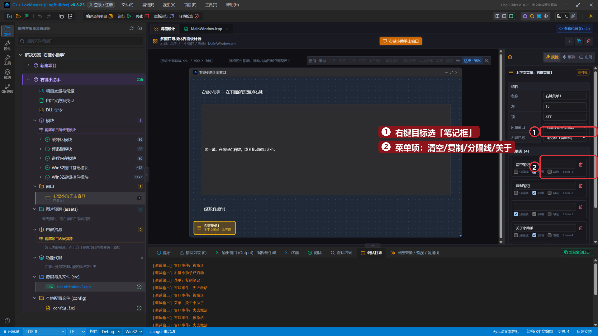

## 5. 逐项绑定事件

选中右键菜单1 →「事件」页——**每个菜单项一张卡片**（菜单项被选择·逐项绑定）。把三张卡片都「生成并打开」：

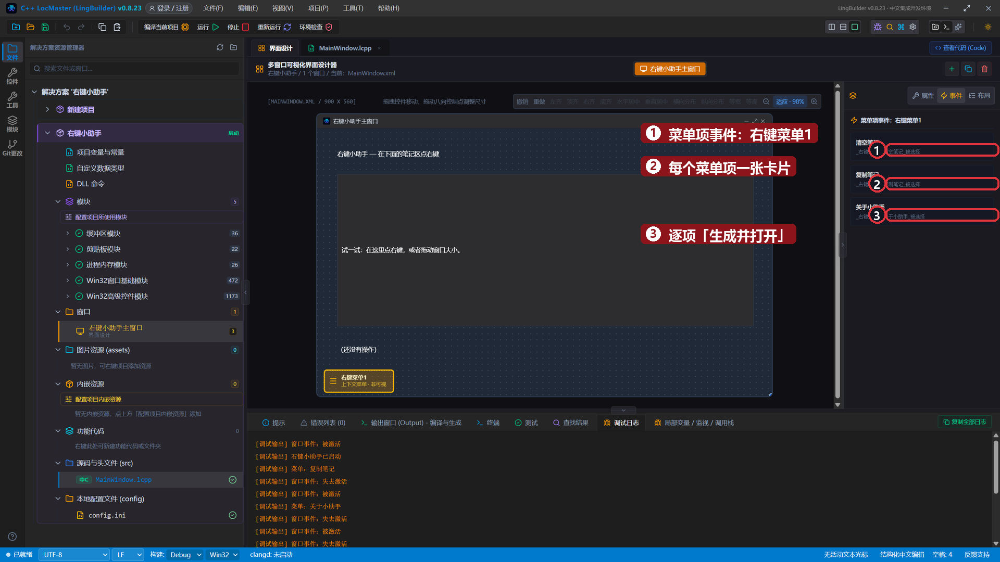

再到画布空白处点一下 →「事件」页变成窗口事件列表，绑定「**大小被改变**」「**被激活**」「**失去激活**」三个。

## 6. 写代码

三个菜单项处理器（注意处理器名 = `_<菜单名>_<菜单项>_被选择`）：

```lingbuilder
事件 _右键菜单1_清空笔记_被选择()
    控件_设置文本(笔记框, "")
    控件_设置文本(状态标签, "笔记已清空")
    调试输出("菜单：清空笔记")
结束

事件 _右键菜单1_复制笔记_被选择()
    剪贴板_置文本(控件_取文本(笔记框))
    控件_设置文本(状态标签, "笔记全文已复制到剪贴板")
    调试输出("菜单：复制笔记")
结束

事件 _右键菜单1_关于小助手_被选择()
    信息框("右键小助手 v1.0 —— LingBuilder 第 24 集演示", 64, "关于")
    控件_设置文本(状态标签, "打开了关于对话框")
    调试输出("菜单：关于小助手")
结束
```

- `剪贴板_置文本(文本)`：把文字写进系统剪贴板，别的程序直接能粘贴。
- `信息框(内容, 图标, 标题)`：`64` 是「信息」图标（第 3 集学过）。

窗口事件三兄弟——不需要任何参数，状态标签实时汇报：

```lingbuilder
事件 _MainWindow_大小被改变()
    控件_设置文本(状态标签, "窗口大小变了！")
    调试输出("窗口事件：大小被改变")
结束

事件 _MainWindow_被激活()
    控件_设置文本(状态标签, "窗口回到前台了")
    调试输出("窗口事件：被激活")
结束

事件 _MainWindow_失去激活()
    控件_设置文本(状态标签, "窗口去后台了……")
    调试输出("窗口事件：失去激活")
结束
```

创建完毕照旧打个招呼：

```lingbuilder
事件 _MainWindow_创建完毕()
    调试输出("右键小助手已启动")
    控件_设置文本(状态标签, "在笔记区点右键，或拖拽窗口边缘试试")
结束
```

完整代码分三屏：

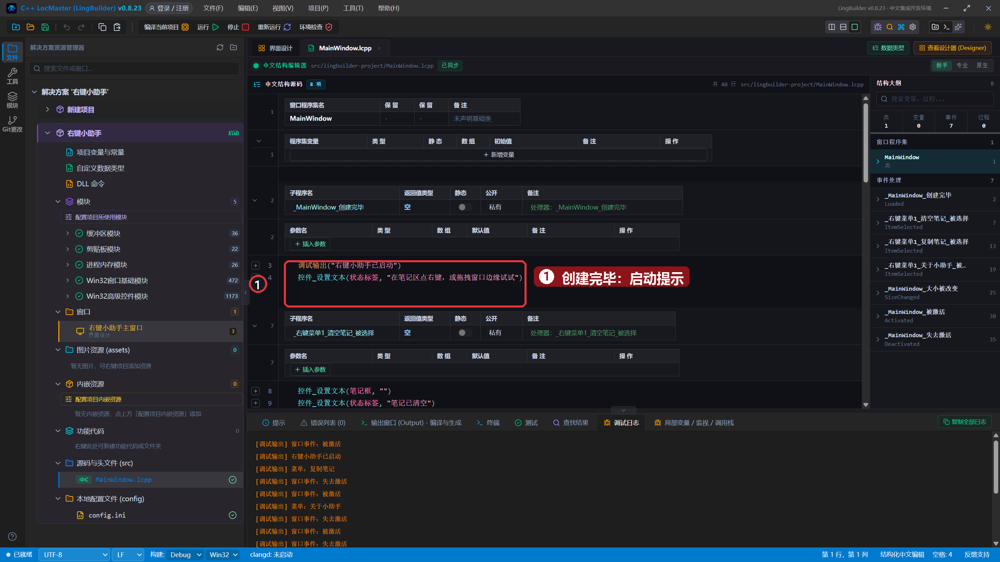

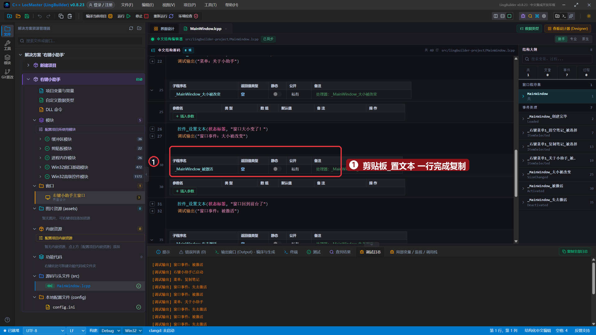

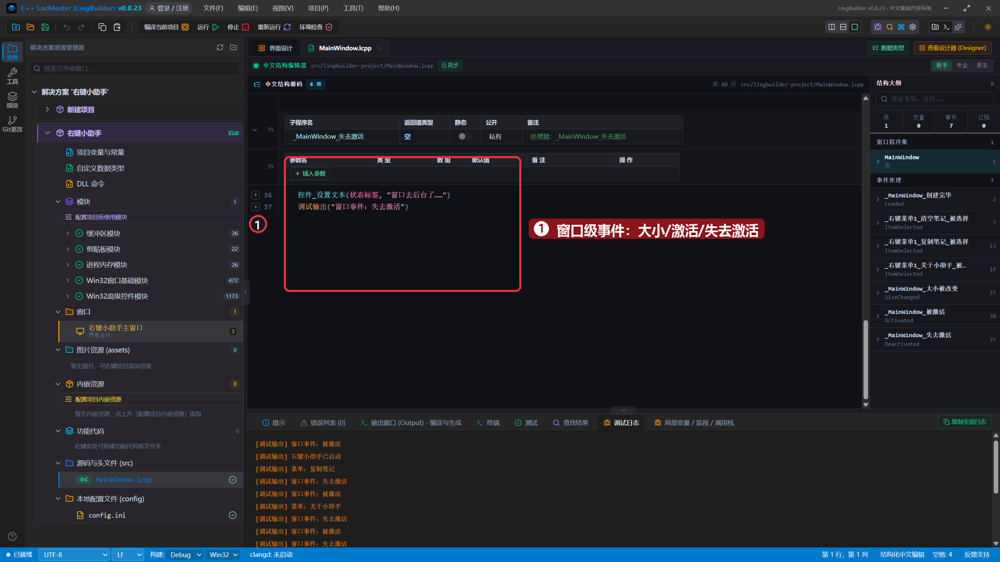

## 7. 运行！

保存，点「运行」。启动提示就位：

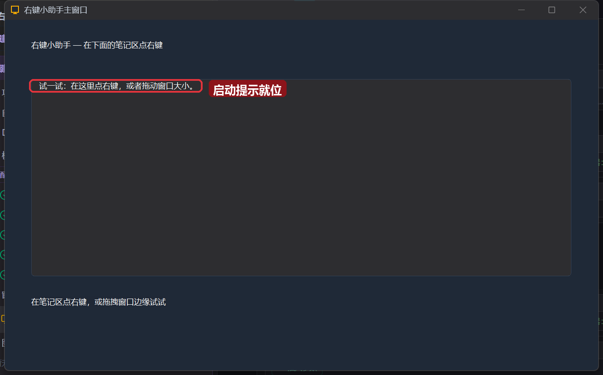

在笔记区**点右键**——菜单弹出来了，清空 / 复制 / ─ / 关于：

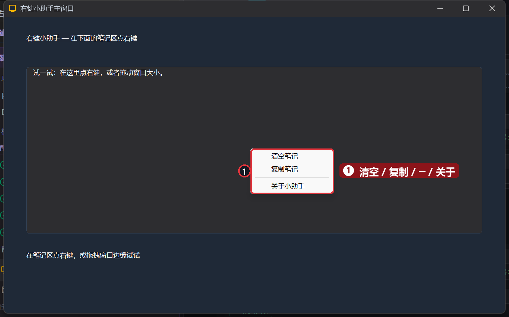

点「复制笔记」——笔记全文进剪贴板，去任意输入框 Ctrl+V 验证：

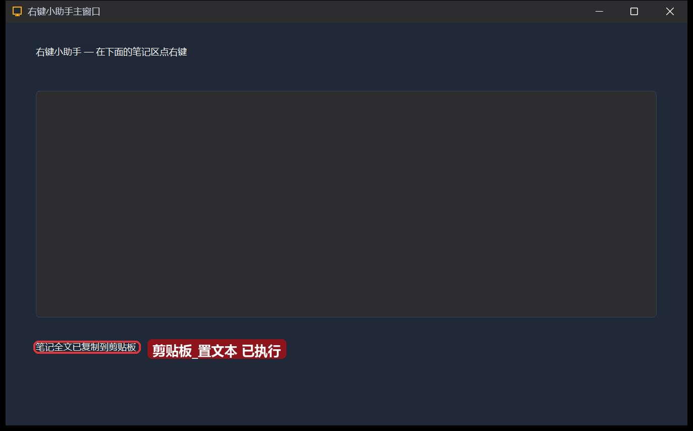

点「关于小助手」——弹出关于对话框，确定后状态栏同步更新：

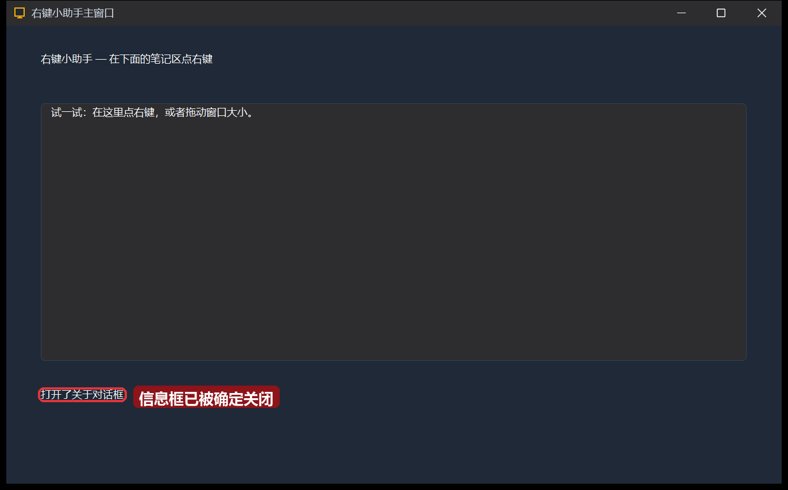

按 **Alt+Tab** 切去别的窗口——「窗口去后台了……」：

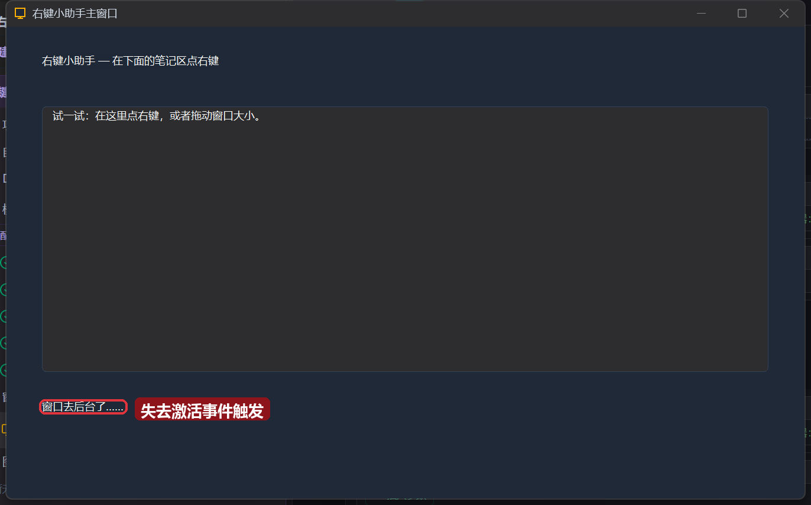

再切回来——「窗口回到前台了」：

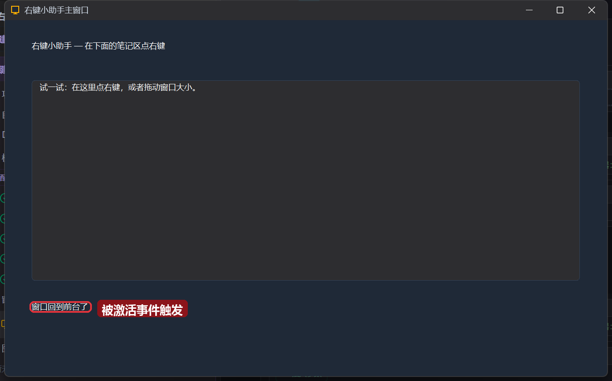

## 本集小结

- **上下文菜单**：非可视组件 + 「右键目标」+ 菜单项列表；每个菜单项一张事件卡片，逐项绑定处理器（命名规律 `_<菜单名>_<菜单项>_被选择`）。
- **剪贴板_置文本**：一行把文字交给系统剪贴板。
- **窗口事件**：`被激活` / `失去激活` / `大小被改变` / `关闭前`……绑定方式是在画布空白处点一下，事件页就变成窗口事件列表。
- 分隔线让菜单分组更清晰；「关于」对话框就是一行 `信息框`。

**下一集预告**：[25 · 托盘图标与通知](/guide/tutorials/beginner)——把程序缩进右下角托盘，还能弹系统通知。
