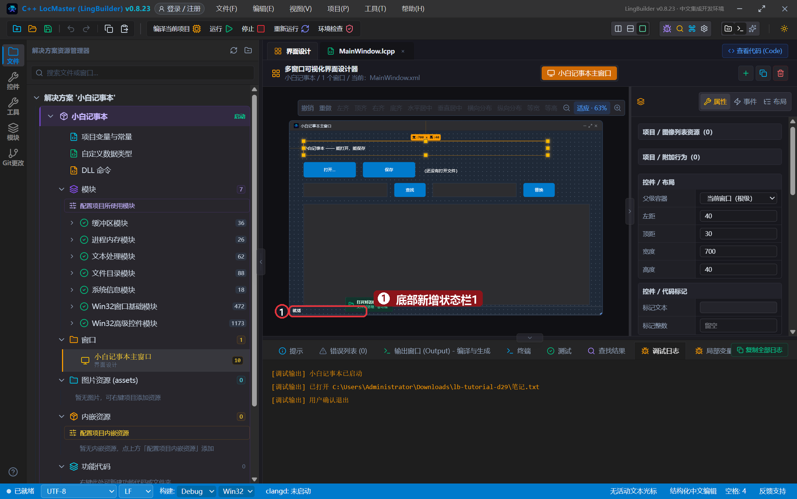
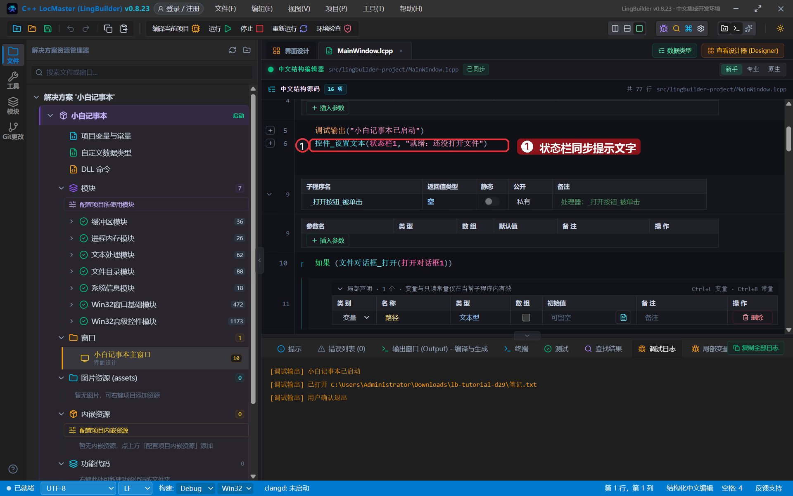
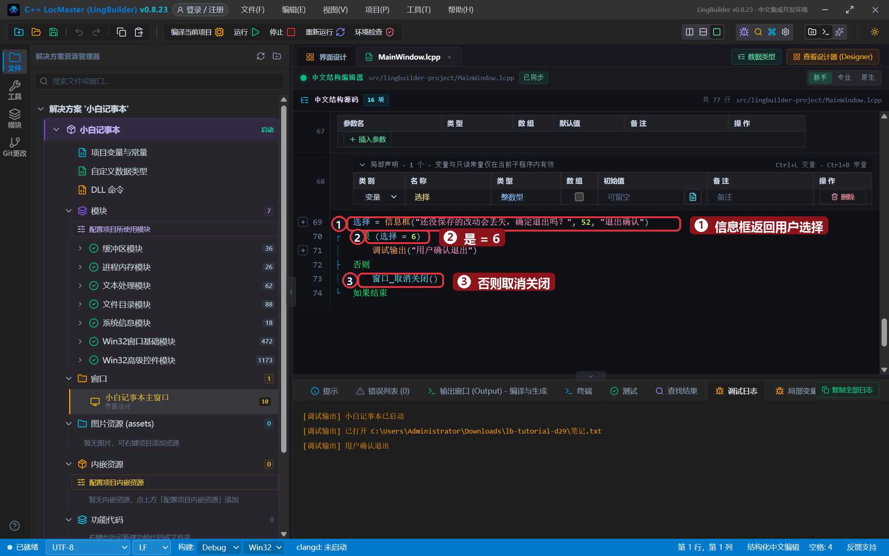
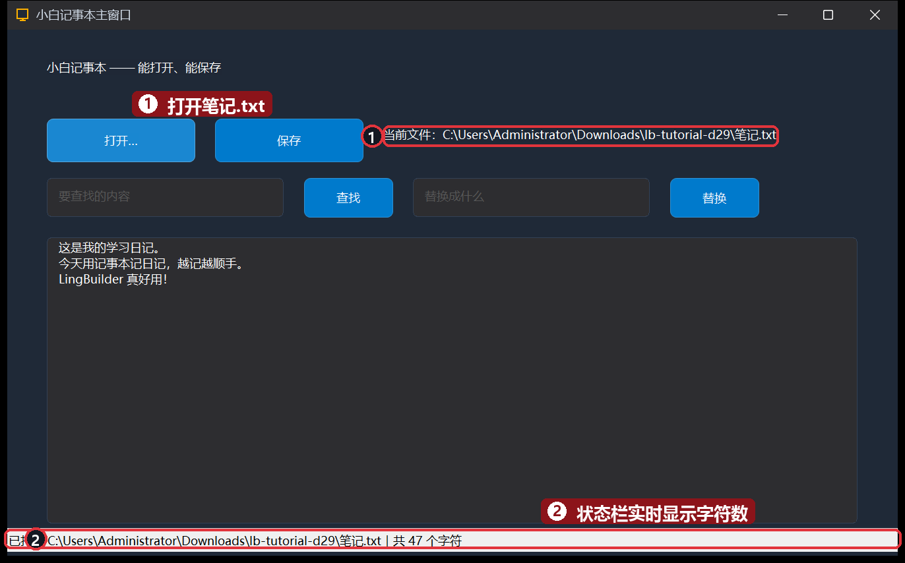
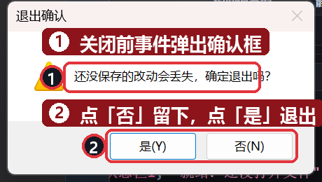
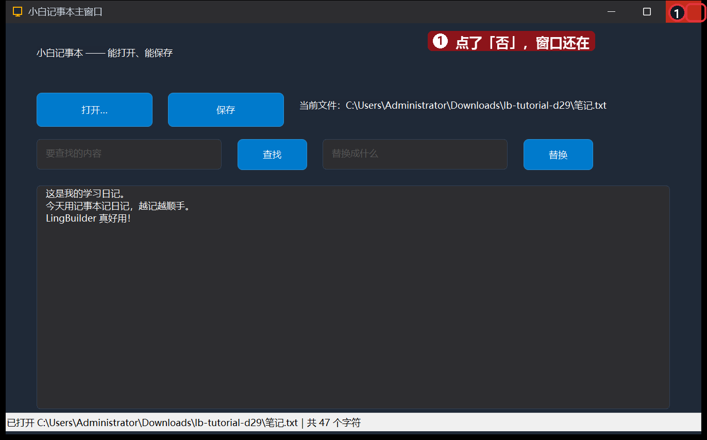

# 29 · 实战 TXT 记事本③：状态栏与退出确认

> 《LingBuilder 零基础入门实战》第 29 集。记事本收官：给窗口底部装一条**状态栏**，打开文件就报告字数；再给「关闭」装一道**退出确认**——点叉叉先问一句「确定退出吗？」，点「否」就稳稳留下。学完你将掌握状态栏联动、窗口「关闭前」事件和 `信息框` 的返回值。全集目录见 [系列总览](/guide/tutorials/beginner)。
>
> 本集目标：加状态栏1 → `文本_取长度` 统计字数 → 窗口 Closing 事件 → `信息框` 返回值 + `窗口_取消关闭`。全程约 12 分钟。

## 1. 加一条状态栏

工具箱「**高级控件**」组 →「**状态栏**」，放到窗口**根级**（别拖进任何容器），位置 `0, 504, 900, 24`，显示内容「就绪」：



> 小知识：窗口高 560，但底部要留出标题栏下沿的空当，状态栏顶到 504+24=528 正好贴住客户区底部（和第 23 集的摆法一致）。位置摆太低（比如 y=536）会落到客户区外面，运行时看不见。

## 2. 状态栏联动：随时报告字数

`文本_取长度(文本)` 返回字符个数。在「创建完毕」和「打开成功」两处更新状态栏：

```lingbuilder
事件 _MainWindow_创建完毕()
    调试输出("小白记事本已启动")
    控件_设置文本(状态栏1, "就绪：还没打开文件")
结束
```

打开成功的那支里加一行：

```lingbuilder
控件_设置文本(状态栏1, "已打开 " + 路径 + "｜共 " + 到文本(文本_取长度(控件_取文本(内容框))) + " 个字符")
```

替换按钮的末尾也可以顺手刷一条：

```lingbuilder
控件_设置文本(状态栏1, "替换完成｜现在共 " + 到文本(文本_取长度(来源)) + " 个字符")
```



## 3. 退出确认：关闭前先问一句

先给窗口绑上「**关闭前 (Closing)**」事件：设计器右侧「事件」页 → 选窗口 → 绑 `_MainWindow_关闭前`（新手编辑器里写 `事件 _MainWindow_关闭前()` 回车也会自动接上）。

`信息框(内容, 标志, 标题)` 会**返回用户点了哪个按钮**：52 = 是/否 + 感叹号图标；点「是」返回 **6**，点「否」返回 **7**。把它接进变量，不是 6 就 `窗口_取消关闭()`：

```lingbuilder
事件 _MainWindow_关闭前()
    局部 整数型 选择
    选择 = 信息框("还没保存的改动会丢失，确定退出吗？", 52, "退出确认")
    如果 (选择 = 6)
        调试输出("用户确认退出")
    否则
        窗口_取消关闭()
    如果结束
结束
```



- `信息框` 的第二个参数是「按钮组合 + 图标」：**52 = 4（是/否）+ 48（感叹号）**。
- 判断「是」用 `选择 = 6` 就够了——不是 6（点了否、或点了叉）一律取消关闭，宁留勿丢。

## 4. 运行！

保存，点「运行」。打开 `笔记.txt`——底部状态栏立刻报告「共 47 个字符」：



点窗口右上角的 **✕**——不再直接消失，而是弹出确认框：



点「**否**」——窗口还在，一个字都没丢：



再点 ✕ 选「是」，程序才真正退出。至此，一个「能打开、能查找替换、能确认退出」的完整记事本就做好了——三集下来，你已经把一个真软件从零做完了。

## 本集小结

- **状态栏是窗口的「回话筒」**：`控件_设置文本(状态栏1, ...)` 想在哪报就在哪报，`文本_取长度` 负责数数。
- **关闭前 (Closing) 事件**：窗口要关先过你这一关，`窗口_取消关闭()` 一句话把叉叉变成「再想想」。
- **信息框有返回值**：52 = 是/否+感叹号；是 = 6、否 = 7，接进变量再判断。
- 三集记事本收官：打开保存 + 查找替换 + 状态栏 + 退出确认——这就是一个能日常使用的软件。

**下一集预告**：[30 · 实战：二维码小工具](/guide/tutorials/beginner-30-qrcode)——用 qrcode 模块生成和识别二维码。
