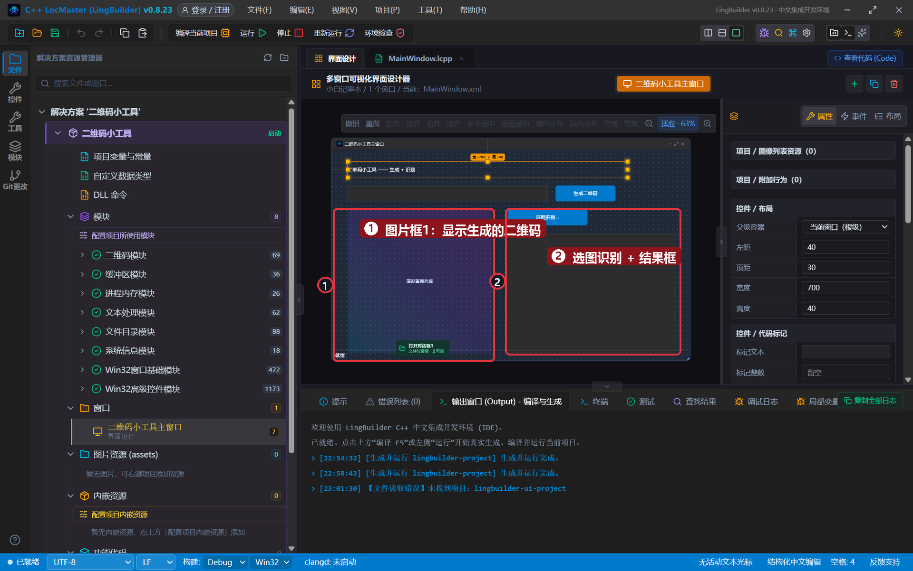
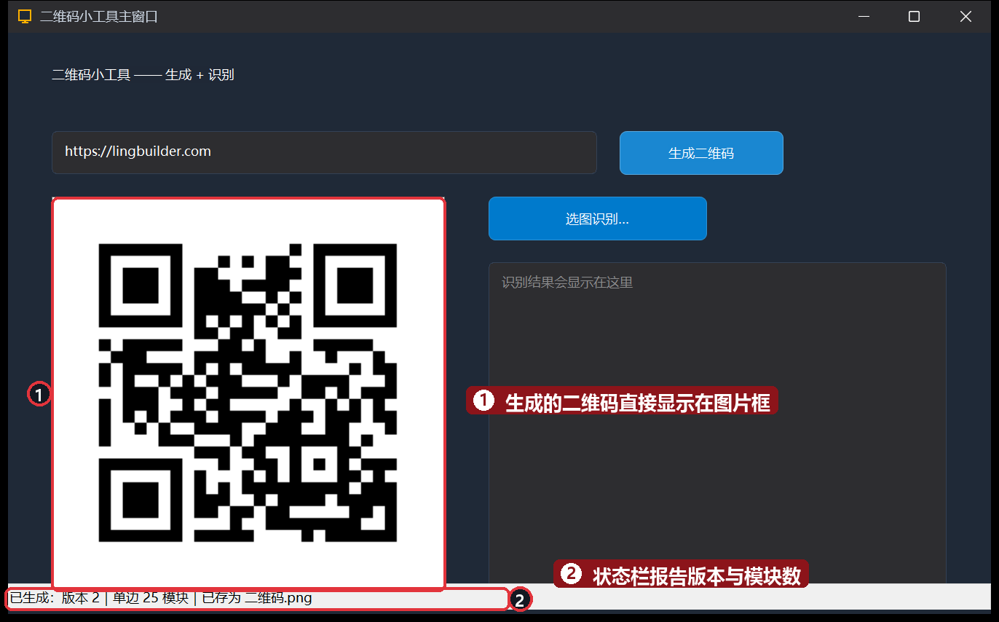
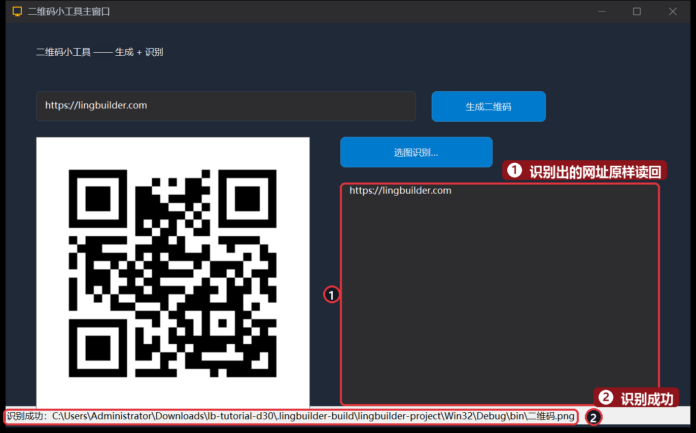

# 30 · 实战：二维码小工具

> 《LingBuilder 零基础入门实战》第 30 集。用内置的**二维码模块**做一个纯本地小工具：输入网址一点生成二维码，再点「选图识别…」把图片里的二维码读回文字——不联网、不调 API，生成和识别全在你电脑里完成。学完你就掌握了「句柄型模块命令」的标准用法。全集目录见 [系列总览](/guide/tutorials/beginner)。
>
> 本集目标：启用二维码模块 → `二维码_生成` + `二维码_保存PNG` + `控件_设置图片` → `二维码_识别PNG` 闭环。全程约 15 分钟。

## 1. 新建项目并启用二维码模块

欢迎页 →「**新建项目**」→ 项目名称 **二维码小工具**。然后到模块面板搜索「**二维码**」→ 启用「**二维码模块**」（69 条命令，生成 13 + 识别 18 加辅助），工具箱和代码补全里马上就能用。

## 2. 搭界面

| 控件 | 中文名称 | 显示内容 | 位置 (左, 顶, 宽, 高) |
| --- | --- | --- | --- |
| 标签 | `标题标签` | 二维码小工具 —— 生成 + 识别 | 40, 30, 700, 40 |
| 编辑框 | `内容框` | （空，占位提示「输入网址或文字」） | 40, 90, 500, 40 |
| 按钮 | `生成按钮` | 生成二维码 | 560, 90, 150, 40 |
| 图片框 | `图片框1` | （空） | 40, 150, 360, 360 |
| 按钮 | `选图识别按钮` | 选图识别… | 440, 150, 200, 40 |
| 编辑框 | `结果框` | （空，勾选「多行」） | 440, 210, 420, 300 |
| 状态栏 | `状态栏1` | 就绪 | 0, 504, 900, 24 |

再从「高级控件」组拖一个**文件对话框**资源（改名 `打开对话框1`，标题「选择图片」，文件类型 `图片文件|*.png;*.jpg;*.jpeg`，「打开控件」留空）。两个按钮各绑「被单击 (Click)」。



## 3. 生成：生成 → 存图 → 显示

`二维码_生成(内容, 纠错级别, 边长像素, 空白边模块数)` 返回一个**二维码句柄**；`二维码_保存PNG` 把它渲染成图片文件；`控件_设置图片` 让图片框显示它（第 13 集的老朋友）。用完记得 `二维码_释放`：

```lingbuilder
事件 _生成按钮_被单击()
    局部 文本型 内容
    内容 = 控件_取文本(内容框)
    如果 (内容 = "")
        控件_设置文本(结果框, "请先输入要生成的内容")
        返回()
    如果结束
    局部 二维码句柄 码
    码 = 二维码_生成(内容, "M", 8, 4)
    如果 (码 = 0)
        控件_设置文本(结果框, "生成失败：" + 二维码_取错误())
        返回()
    如果结束
    如果 (二维码_保存PNG(码, "二维码.png", 4278190080, 4294967295))
        控件_设置图片(图片框1, "二维码.png")
        控件_设置文本(状态栏1, "已生成：版本 " + 到文本(二维码_取版本号(码)) + "｜单边 " + 到文本(二维码_取模块数(码)) + " 模块｜已存为 二维码.png")
    否则
        控件_设置文本(结果框, "保存失败：" + 二维码_取错误())
    如果结束
    二维码_释放(码)
结束
```

- **句柄当「取餐码」**：`二维码_生成` 不直接给图片，而是给一个编号（句柄），后面的保存、读版本号都拿编号去问；用完 `二维码_释放` 归还。
- `4278190080` 和 `4294967295` 是 ARGB 颜色：不透明的黑和不透明的白。
- ⚠️ **「局部 声明」和「赋值」拆成两行写**：`局部 二维码句柄 码` 一行，`码 = 二维码_生成(...)` 另起一行。如果写成 `局部 二维码句柄 码 = 二维码_生成(内容, ...)`，声明会被提前到函数开头，跑在 `内容 = 控件_取文本(...)` 之前——模块收到的是空内容，报「内容为空」。声明带初始化只适合右边不依赖前面语句的场合（比如 `局部 整数型 选择` 这种纯声明）。

## 4. 识别：选图 → 解码 → 显示

`二维码_识别PNG(路径)` 返回**识别结果句柄**，`二维码_识别取文本` 拿到解码文字，没认出来返回 0：

```lingbuilder
事件 _选图识别按钮_被单击()
    如果 (文件对话框_打开(打开对话框1))
        局部 文本型 图片路径
        图片路径 = 文件对话框_取文件(打开对话框1, 0)
        局部 二维码识别结果 结果
        结果 = 二维码_识别PNG(图片路径)
        如果 (结果 != 0)
            控件_设置文本(结果框, 二维码_识别取文本(结果))
            控件_设置文本(状态栏1, "识别成功：" + 图片路径)
            二维码_识别释放(结果)
        否则
            控件_设置文本(结果框, "没认出二维码：" + 二维码_识别取错误())
            控件_设置文本(状态栏1, "识别失败")
        如果结束
    否则
        控件_设置文本(状态栏1, "取消了选图")
    如果结束
结束
```

## 5. 运行！

保存，点「运行」。内容框输入 `https://lingbuilder.com`，点「**生成二维码**」——二维码直接显示在图片框，状态栏报告「版本 2｜单边 25 模块」：



点「**选图识别…**」→ 选中刚生成的 `二维码.png`（在程序旁边的 bin 目录里）——识别结果原样读回：



生成的内容扫一扫、再识别回来，一字不差——一个纯本地的二维码工具就完成了。

## 本集小结

- **句柄型模块三步曲**：`生成` 拿句柄 → 用句柄干活（存图/读信息）→ `释放` 归还；识别侧同款（`二维码_识别PNG` → `识别取文本` → `识别释放`）。
- 返回 0 = 失败，失败原因读对应的 `取错误()`——错误处理就这两招。
- `控件_设置图片(图片框, 路径)` 让程序运行时换图。
- ⚠️ 局部声明与赋值拆两行，避免声明被提前导致「拿到空值」。

**下一集预告**：[31 · 发布与下一步](/guide/tutorials/beginner-31-publish)——把做好的软件打包成安装包发给朋友，以及学完之后去哪。
