# Edge 合集 01 · 初识内嵌浏览器：迷你浏览器

> 《LingBuilder Edge 浏览器合集》第 1 集（基础篇）。从这一集起，我们学习 **EdgeView 浏览器模块（lingbuilder.edgeview）**——它把一整个 Microsoft Edge 浏览器（WebView2 内核）装进你自己的窗口里。本集做一个**迷你浏览器**：地址栏输网址、打开网页、后退、前进、刷新、回主页，五脏俱全。全程约 25 分钟。
>
> 前置要求：会新建窗口项目、会在设计器里摆控件（学过[零基础入门系列](/guide/tutorials/beginner)即可）。Windows 10/11 一般自带 WebView2 运行时。本集源码包见文末。

## 这一集你将学会

- 设计器里的 **Edge浏览器（EdgeBrowser）控件**：把浏览器当普通控件摆进窗口
- `EdgeView_导航控件`：让内嵌浏览器打开任意网址
- `EdgeView_后退控件` / `EdgeView_前进控件` / `EdgeView_刷新控件`：三个最常用的浏览操作
- 地址栏与浏览器的**手动联动**（输入网址→导航；集末解释为什么「自动联动」要等第 3 集）

## 1. 三十秒理解：把浏览器变成一个控件

网页的本质是「一个能显示网页的矩形区域」。EdgeView 把这个区域做成设计器里的一个控件——你从控件面板把它拖进窗口，它就成了你软件的一部分。用户看到的是：你的程序里嵌着一片网页区，能翻页、能刷新，就像一个小号的 Edge。

本集只用到 4 条命令（模块共 660+ 条，慢慢学不着急）：

| 命令 | 作用 |
| --- | --- |
| `EdgeView_导航控件(控件名, 地址)` | 让内嵌浏览器打开一个网址 |
| `EdgeView_后退控件(控件名)` | 退回上一页 |
| `EdgeView_前进控件(控件名)` | 前进到下一页 |
| `EdgeView_刷新控件(控件名)` | 重载当前页面 |

## 2. 新建项目

欢迎页点「新建项目」，项目名称填 **迷你浏览器**，模板选「Windows 界面设计」，创建位置留空（就在当前工作区创建），点「创建项目」：

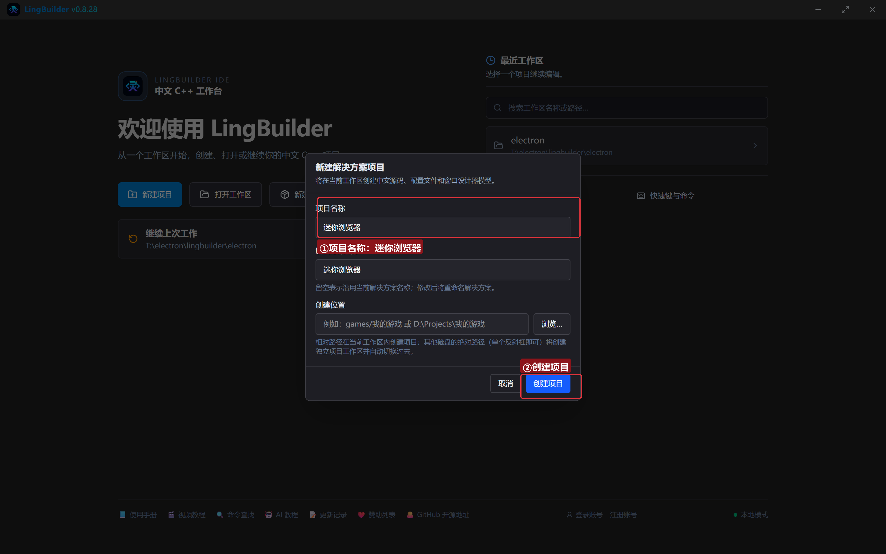

## 3. 启用模块

点左侧活动栏的「模块」图标打开模块生态，确认这三个模块已启用（在「已启用」分组里能看到它们即可）：

- **EdgeView 浏览器模块**——本合集的主角，内嵌浏览器和全部浏览器命令都在这里；
- **Win32窗口基础模块**——窗口、按钮、编辑框等基础控件命令；
- **文本处理模块**——本集会用 `文本_取长度` 判断地址栏是否为空。

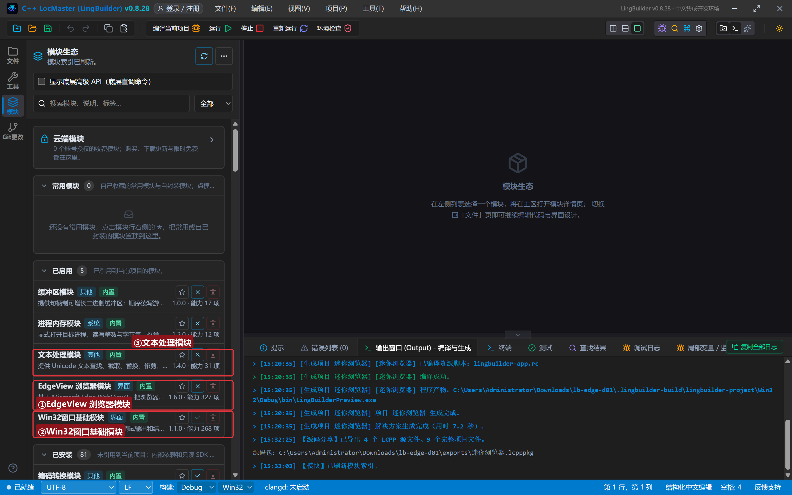

> 小知识：每个命令都有自己的「家」（模块）。编译时报「未知的命令」，第一反应就是查对应模块启用了没有。

## 4. 设计界面

窗口做宽一点（960×700），给网页留足地方。从控件面板把「**Edge浏览器**」拖进窗口——它和按钮、编辑框一样，摆好位置就行：

| 控件 | 名称 | 显示内容 | 左距 | 顶距 | 宽度 | 高度 |
| --- | --- | --- | --- | --- | --- | --- |
| 标签 | 地址标签 | 地址 | 20 | 18 | 50 | 22 |
| 编辑框 | 地址框 | https://example.com | 76 | 14 | 660 | 28 |
| 按钮 | 打开按钮 | 打开网页 | 746 | 12 | 90 | 32 |
| 按钮 | 后退按钮 | 后退 | 20 | 56 | 90 | 30 |
| 按钮 | 前进按钮 | 前进 | 120 | 56 | 90 | 30 |
| 按钮 | 刷新按钮 | 刷新 | 220 | 56 | 90 | 30 |
| 按钮 | 主页按钮 | 主页 | 310 | 56 | 90 | 30 |
| **Edge浏览器** | **浏览器1** | （从控件面板拖入） | 20 | 96 | 920 | 520 |
| 标签 | 状态标签 | 就绪 | 20 | 628 | 920 | 22 |

绑 6 个事件：窗口「创建完毕」+ 5 个按钮的「被单击」。

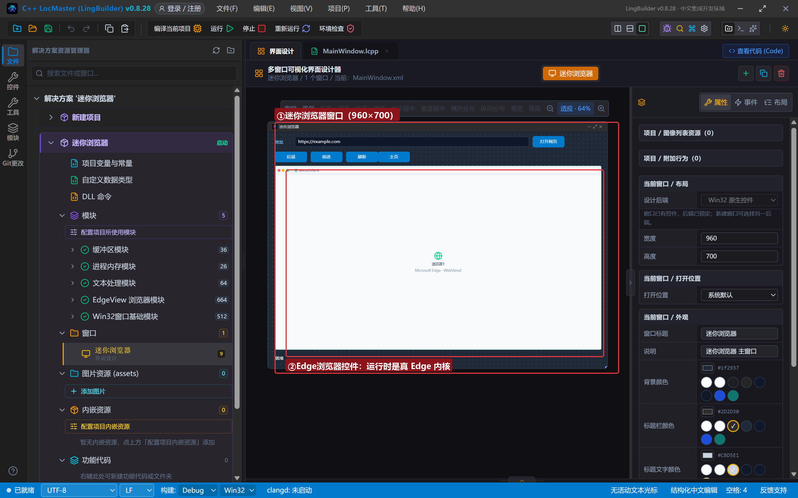

设计器画布上 Edge 浏览器控件只是一张占位图（一个地球图标）；运行起来以后，那个位置就是真·Edge 内核在渲染网页。

## 5. 写代码

### 5.1 窗口创建完毕：直接打开主页

```lcpp
事件 _MainWindow_创建完毕()
    控件_设置文本(地址框, "https://example.com")
    EdgeView_导航控件(浏览器1, "https://example.com")
    控件_设置文本(状态标签, "正在打开主页 example.com……")
结束
```

窗口一打开，就把 example.com 装进内嵌浏览器。`example.com` 是互联网管理机构专门留出来给文档示例用的网址，又快又稳，最适合做教程演示。

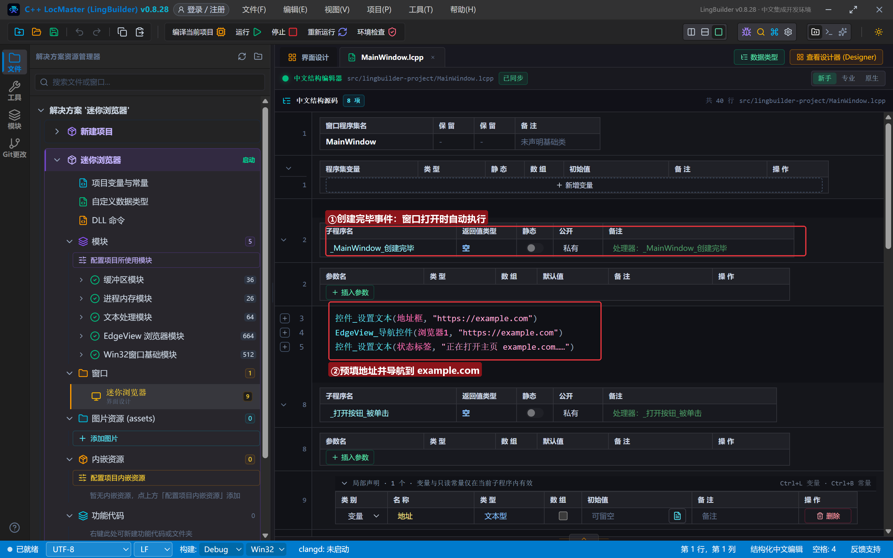

### 5.2 「打开网页」按钮：读地址栏 → 导航

```lcpp
事件 _打开按钮_被单击()
    局部 文本型 地址
    地址 = 控件_取文本(地址框)
    如果 (文本_取长度(地址) = 0)
        控件_设置文本(状态标签, "请先在地址栏输入网址")
        返回()
    如果结束
    EdgeView_导航控件(浏览器1, 地址)
    控件_设置文本(状态标签, "正在打开：" + 地址)
结束
```

先取地址栏文本，判空（`文本_取长度(地址) = 0` 表示一个字都没输），没问题就一条命令导航。**注意判空要用 `文本_取长度`**——不要写 `地址 ≠ ""` 这种字符串比较表达式，中文代码的字符串比较表达式无法翻译成 C++，编译会直接报错。

### 5.3 后退 / 前进 / 刷新 / 主页

```lcpp
事件 _后退按钮_被单击()
    EdgeView_后退控件(浏览器1)
    控件_设置文本(状态标签, "已后退一页")
结束

事件 _前进按钮_被单击()
    EdgeView_前进控件(浏览器1)
    控件_设置文本(状态标签, "已前进一页")
结束

事件 _刷新按钮_被单击()
    EdgeView_刷新控件(浏览器1)
    控件_设置文本(状态标签, "已刷新当前页面")
结束

事件 _主页按钮_被单击()
    EdgeView_导航控件(浏览器1, "https://example.com")
    控件_设置文本(状态标签, "已回到主页")
结束
```

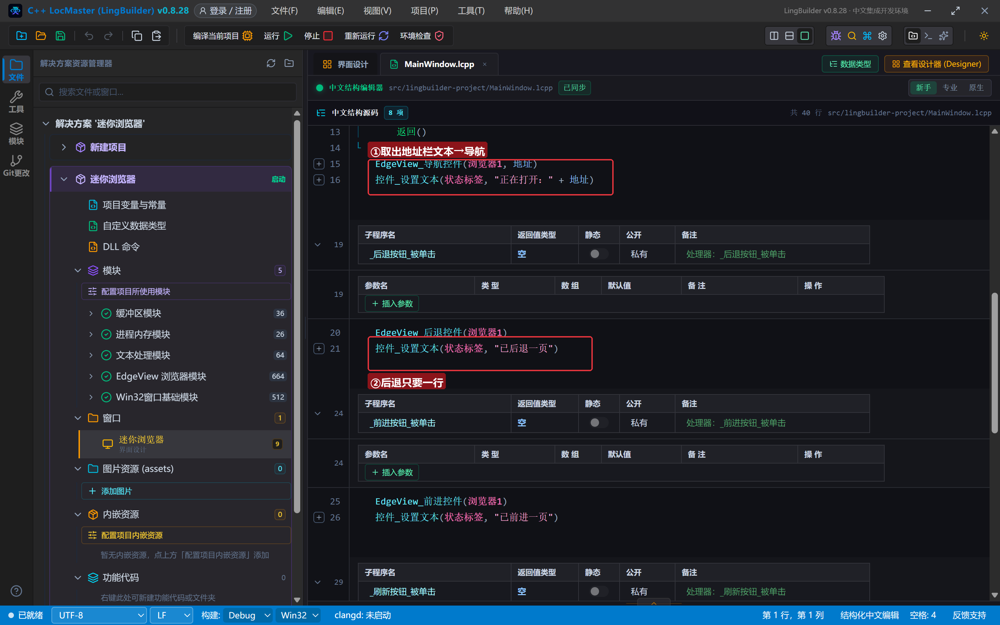

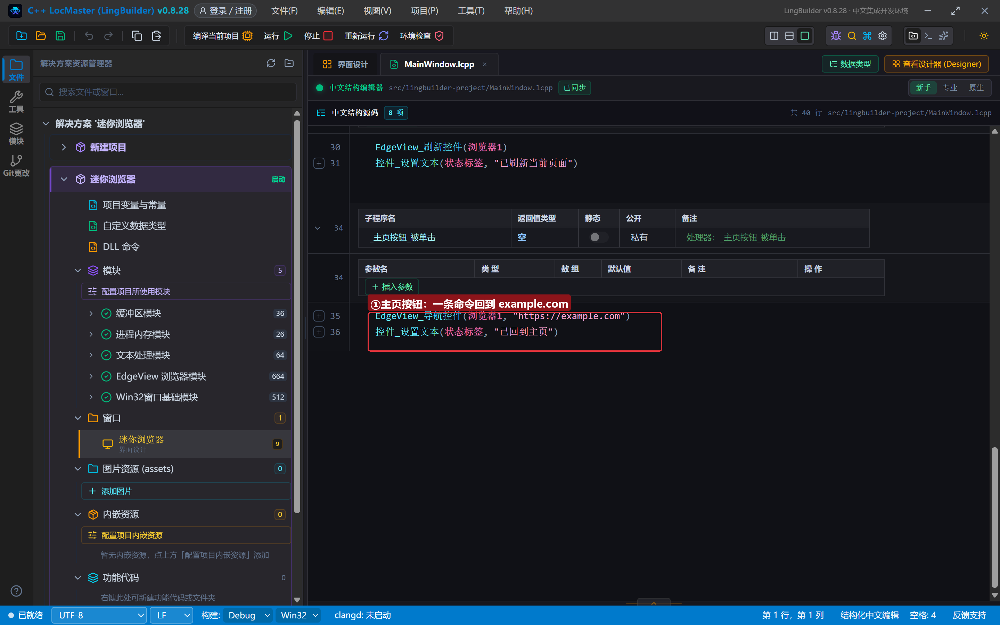

## 6. 编译：先看错误列表

点工具栏「编译当前项目」。**养成习惯：编译完先看底部「错误列表」**——本集是 (0)，提示「未检测到编译障碍」：

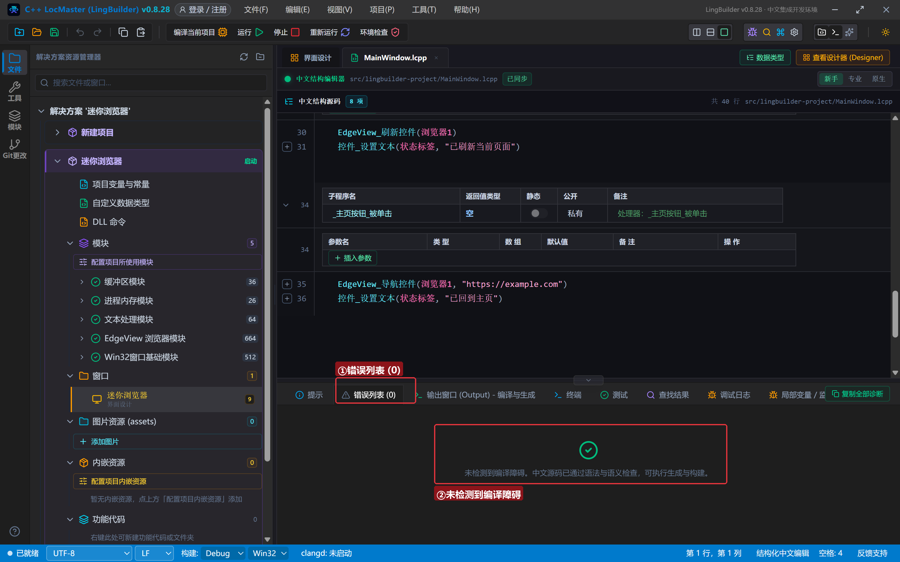

如果有报错，双击错误行就能跳到出问题的代码，改完再编译，**不要带着报错去运行**。

## 7. 运行：你的第一个内嵌浏览器

点「运行」——窗口打开，example.com 已经装在你的程序里了：

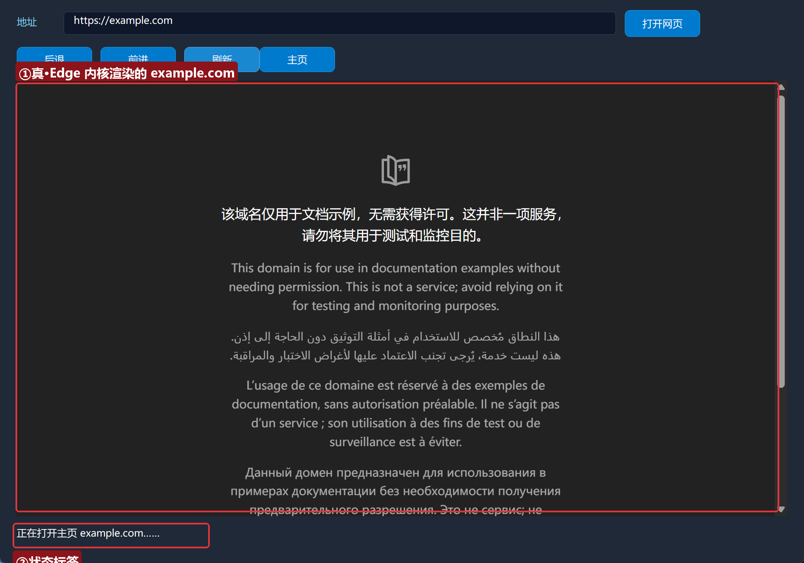

这不是截图、不是模拟，是一颗真·Edge 内核在你的软件里渲染网页。页面可以滚动、可以选中文字，和浏览器里一模一样。

### 7.1 打开新网页

把地址栏改成 `https://www.iana.org`，点「打开网页」：

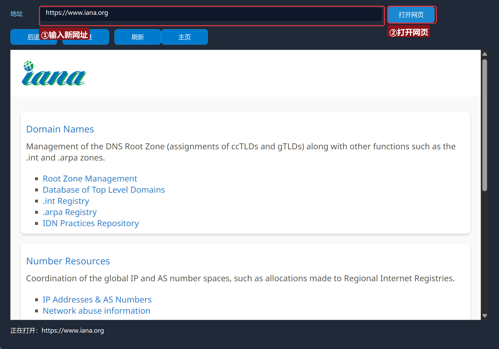

内嵌浏览器切到了 iana.org（互联网号码分配机构，example.com 的管理者）。

### 7.2 后退 / 前进

点「后退」——回到 example.com；再点「前进」——又回到 iana.org：

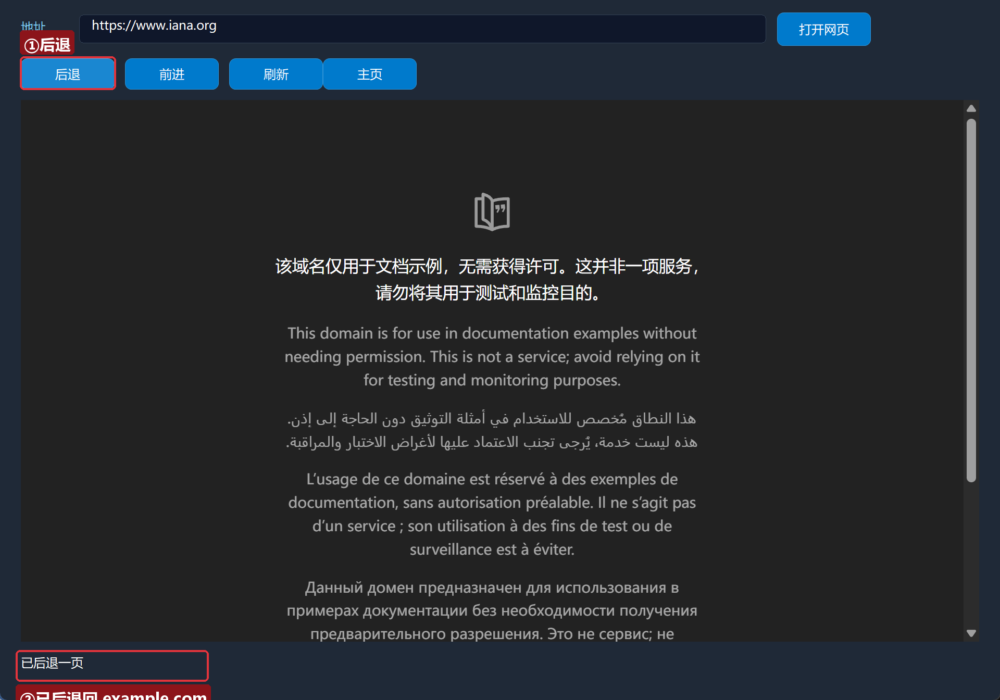

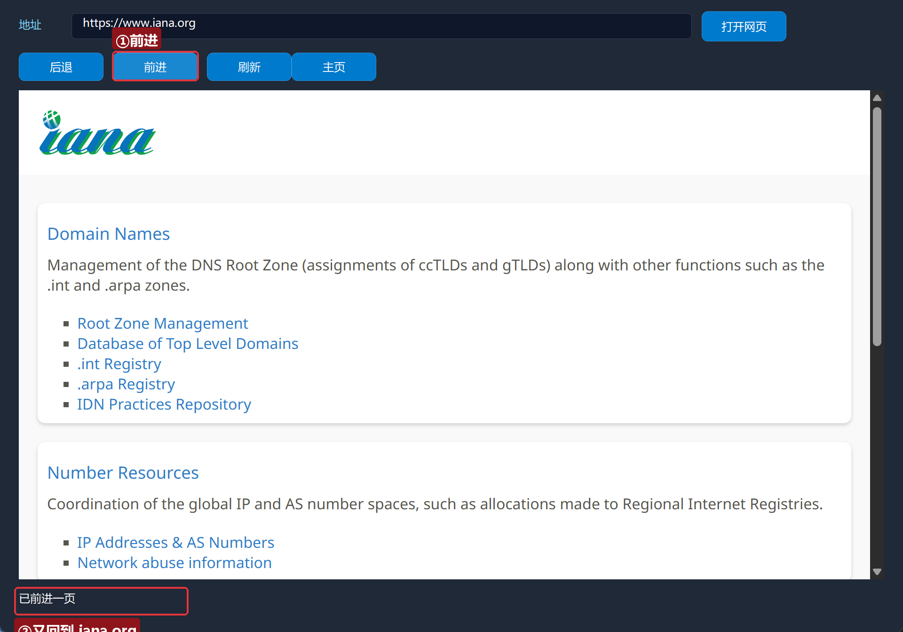

后退、前进浏览的是**历史记录**：只要这个窗口里先后打开过两个页面，后退/前进就有得翻。

### 7.3 刷新

点「刷新」——当前页面重新加载一遍。网页内容更新了想看新版，就按它：

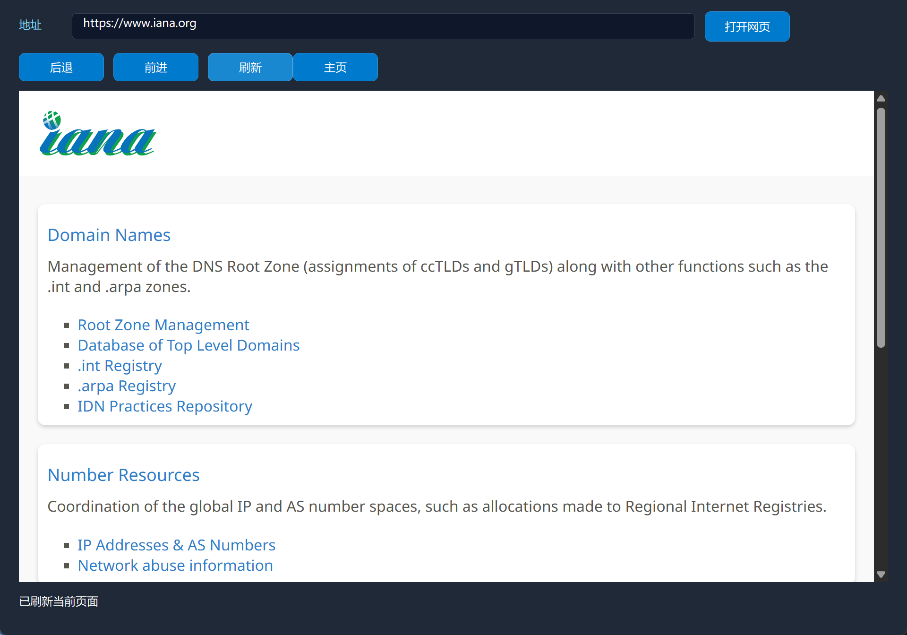

## 8. 留一个「为什么」给下一集

你有没有注意到：点「后退」回到 example.com 之后，**地址栏还停在 iana.org**？

因为我们只调了 `EdgeView_后退控件`，程序并不知道「页面已经换了」——地址栏是我们自己的控件，不刷新它就停在旧文本。想让地址栏**自动**跟着页面变，得让浏览器在「页面变化」时主动通知我们，这就是**事件**。

- 第 2 集：导航族的更多命令（停止加载、取页面标题/地址、导航到内存 HTML）；
- 第 3 集：事件驱动——浏览器一有风吹草动就通知我们，做一个真正的「浏览器状态栏」，把地址栏联动补上。

## 常见问题急救表

| 症状 | 原因 | 解法 |
| --- | --- | --- |
| 编译报「未知的命令 EdgeView_导航控件」 | EdgeView 模块没启用 | 在模块生态里启用 EdgeView 浏览器模块 |
| 编译报「未知的命令 文本_取长度」 | 文本命令归文本处理模块管 | 一并启用文本处理模块 |
| 编译报字符串比较表达式无法翻译 | 写了 `地址 ≠ ""` | 判空改用 `文本_取长度(地址) = 0` |
| 浏览器区域一片空白 | WebView2 运行时缺失 | 到微软官网装「Edge WebView2 Runtime」后重试 |
| 打开网页没反应 | 网址少了 `https://` | 网址要写全，如 `https://example.com` |
| 后退按钮点了没变化 | 历史记录是空的 | 先用「打开网页」访问第二个页面，再后退 |

## 本集小结

- EdgeBrowser 控件把真 Edge 内核嵌进窗口，设计器里是占位图，运行时是真网页。
- 四条命令入门：`导航控件` / `后退控件` / `前进控件` / `刷新控件`。
- 判空用 `文本_取长度`，不要用字符串比较表达式。
- 「页面变了但程序不知道」是下一集事件驱动的引子。

## 源码包

本集完整源码已打包为 **迷你浏览器.lcpppkg**（随本教程同目录分发，官网示例源码区可下载）。在 LingBuilder 欢迎页点「打开工作区」，或直接双击 `.lcpppkg` 文件即可导入运行。

**下一集预告**：《导航进阶》——导航族 11 条命令：停止加载、页面信息、历史状态，还有一个不联网也能跑的绝活：直接把一段 HTML 文本变成页面。

[回合集总览](/guide/tutorials/edge)
