# Edge 合集 03 · 事件驱动：浏览器状态栏

> 《LingBuilder Edge 浏览器合集》第 3 集（基础篇）。前两集的程序有个共同点：**都是我们去「问」浏览器**（点按钮才取标题、取地址）。这一集反过来——**浏览器主动「告诉」我们**：开始加载了、地址变了、标题变了、加载完了。这就是事件驱动。本集做一个真正的「浏览器状态栏」：地址栏自动联动、状态栏自动换字、事件日志自动滚动，还顺手把网页弹窗拦截了。全程约 30 分钟。
>
> 前置要求：学过[第 1 集](/guide/tutorials/edge-01)与[第 2 集](/guide/tutorials/edge-02)。本集源码包见文末。

## 这一集你将学会

- 给 Edge浏览器控件绑定 4 个设计器事件：导航开始 / 地址改变 / 标题改变 / 导航完成
- `EdgeView_绑定控件事件`：用代码绑定事件的另一种方式
- `EdgeView事件_设置动作`：同步事件里「做决定」——本集用它拦截网页弹窗
- 第 1 集留下的「地址栏不联动」问题，本集彻底解决

## 1. 事件是怎么回事

浏览器每时每刻都在发生事情：开始下载网页（导航开始）、地址变了（地址改变）、标题变了（标题改变）、下载渲染完成（导航完成）。**事件**就是浏览器在事情发生的那一刻，回头喊你一声：「嘿，地址变了！」——如果你的程序事先在这件事上「留了电话」（绑定了处理器），这段代码就会自动执行。

EdgeView 模块的浏览器事件分两类：

- **通知类事件**：只报信，不打断。导航开始/地址改变/标题改变/导航完成都属于这类——本集主角；
- **决策类事件**：报信之外还能「做决定」。比如「新窗口请求」——你可以放行，也可以拦截。配合 `EdgeView事件_设置动作` 使用。

## 2. 新建项目

欢迎页点「新建项目」，项目名称填 **浏览器状态栏**，模板「Windows 界面设计」，创建位置留空：

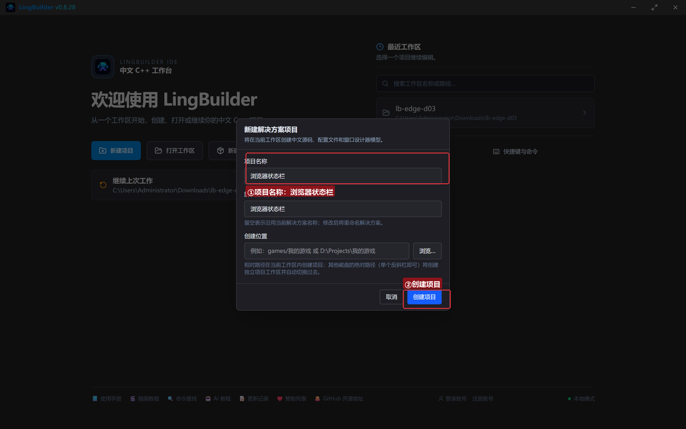

## 3. 启用模块

老三样：**EdgeView 浏览器模块**、**Win32窗口基础模块**、**文本处理模块**：

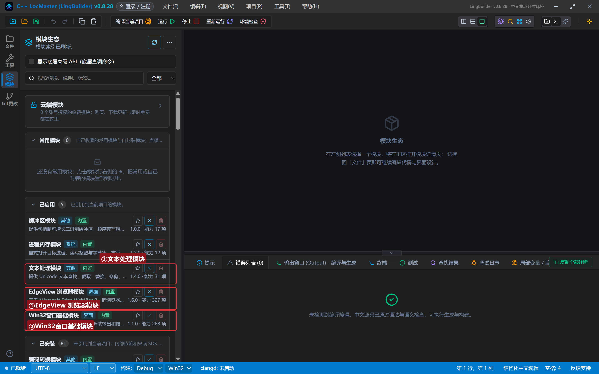

## 4. 设计界面

窗口 960×720，多了一个专门的「事件日志」列表框：

| 控件 | 名称 | 显示内容 | 左距 | 顶距 | 宽度 | 高度 |
| --- | --- | --- | --- | --- | --- | --- |
| 标签 | 地址标签 | 地址 | 20 | 18 | 50 | 22 |
| 编辑框 | 地址框 | https://www.iana.org | 76 | 14 | 560 | 28 |
| 按钮 | 打开按钮 | 打开网页 | 646 | 12 | 90 | 32 |
| 按钮 | 弹窗页按钮 | 弹窗测试页 | 746 | 12 | 110 | 32 |
| 按钮 | 主页按钮 | 打开主页 | 866 | 12 | 84 | 32 |
| **Edge浏览器** | **浏览器1** | （控件面板拖入） | 20 | 56 | 920 | 470 |
| 标签 | 状态标签 | 就绪 | 20 | 540 | 920 | 26 |
| 列表框 | 事件日志 | — | 20 | 580 | 920 | 110 |

绑 4 个按钮的「被单击」+ 窗口「创建完毕」。

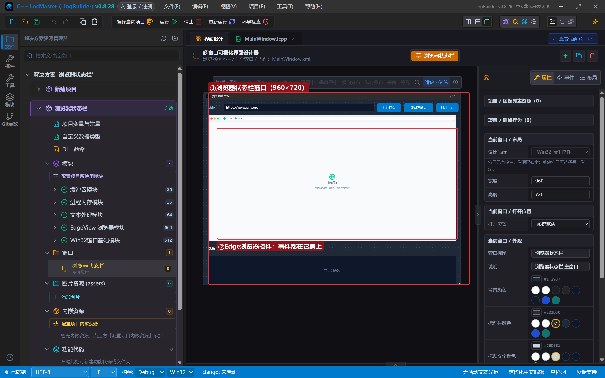

## 5. 绑定浏览器的 4 个事件

选中画布上的「浏览器1」，右侧面板切到「**事件**」页签——这里列出了 Edge 浏览器控件能上报的全部事件。把下面四个的处理器设为对应名字（点「生成并打开」会自动生成处理器骨架）：

| 事件 | 处理器名 |
| --- | --- |
| 导航开始（NavigationStarting） | `_浏览器1_导航开始` |
| 地址改变（SourceChanged） | `_浏览器1_地址改变` |
| 标题改变（DocumentTitleChanged） | `_浏览器1_标题改变` |
| 导航完成（NavigationCompleted） | `_浏览器1_导航完成` |

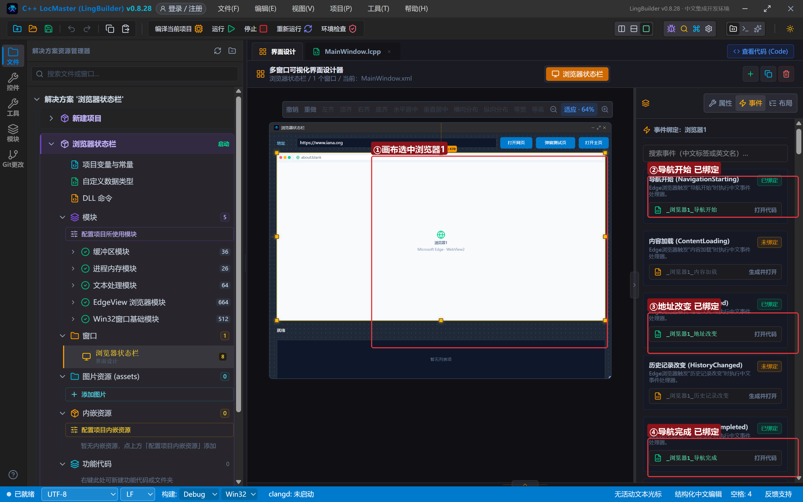

绑完之后，浏览器一「喊人」，这些处理器就会自动执行——不用任何人点按钮。

## 6. 写代码

### 6.1 创建完毕：布防弹窗拦截

```lcpp
事件 _MainWindow_创建完毕()
    控件_设置文本(地址框, "https://www.iana.org")
    EdgeView_绑定控件事件(浏览器1, "新窗口请求", &新窗口来了)
    控件_设置文本(状态标签, "就绪")
    控件_插入项目(事件日志, 0, "新窗口拦截已就位：网页弹不出弹窗")
    控件_插入项目(事件日志, 0, "点「打开主页」看事件自动滚动记录")
结束
```

`EdgeView_绑定控件事件(控件名, 事件名, &处理器名)` 是**用代码绑定事件**的另一种方式（第 5 节是在设计器里绑，效果一样）；「新窗口请求」是决策类事件，事件名按中文写，处理器名前必须带 `&`。

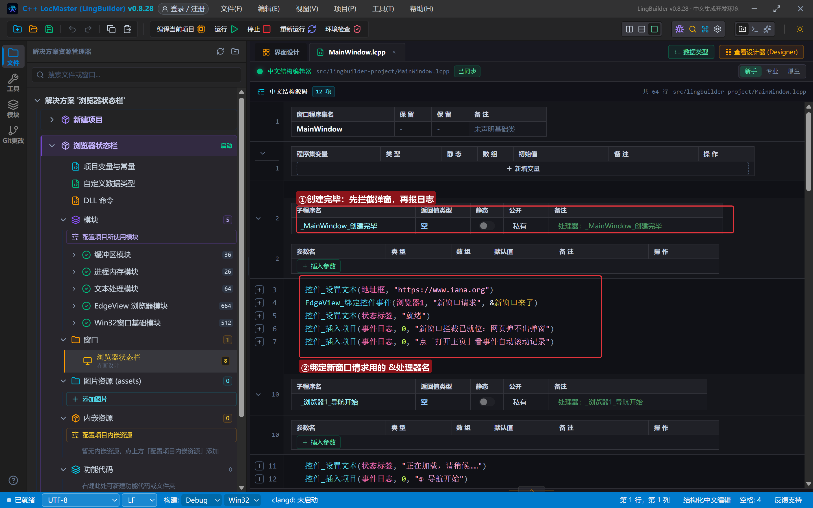

### 6.2 四个通知事件：状态栏自动换字

```lcpp
事件 _浏览器1_导航开始()
    控件_设置文本(状态标签, "正在加载，请稍候……")
    控件_插入项目(事件日志, 0, "① 导航开始")
结束

事件 _浏览器1_地址改变()
    控件_设置文本(地址框, EdgeView导航_取地址(浏览器1))
    控件_插入项目(事件日志, 0, "② 地址改变：" + EdgeView导航_取地址(浏览器1))
结束

事件 _浏览器1_标题改变()
    控件_设置文本(状态标签, "标题：" + EdgeView导航_取标题(浏览器1))
    控件_插入项目(事件日志, 0, "③ 标题改变：" + EdgeView导航_取标题(浏览器1))
结束

事件 _浏览器1_导航完成()
    控件_设置文本(状态标签, "加载完成：" + EdgeView导航_取标题(浏览器1))
    控件_插入项目(事件日志, 0, "④ 导航完成：现在取数是安全的")
结束
```

看「地址改变」里那行：`控件_设置文本(地址框, EdgeView导航_取地址(浏览器1))`——**这就是第 1 集欠我们的地址栏联动**，一行搞定。浏览器每次地址变化都喊我们一声，我们把新地址写进地址框，从此地址栏永远和页面一致。

日志用的是 `控件_插入项目(事件日志, 0, 文本)`——**插到最顶上**，最新事件永远在列表第一行，不用滚动就能看到。注意「导航开始」里**不要**去取地址：那一刻新地址还没生效，取到的是旧值（上一集的坑）；地址要等「地址改变」事件再取。

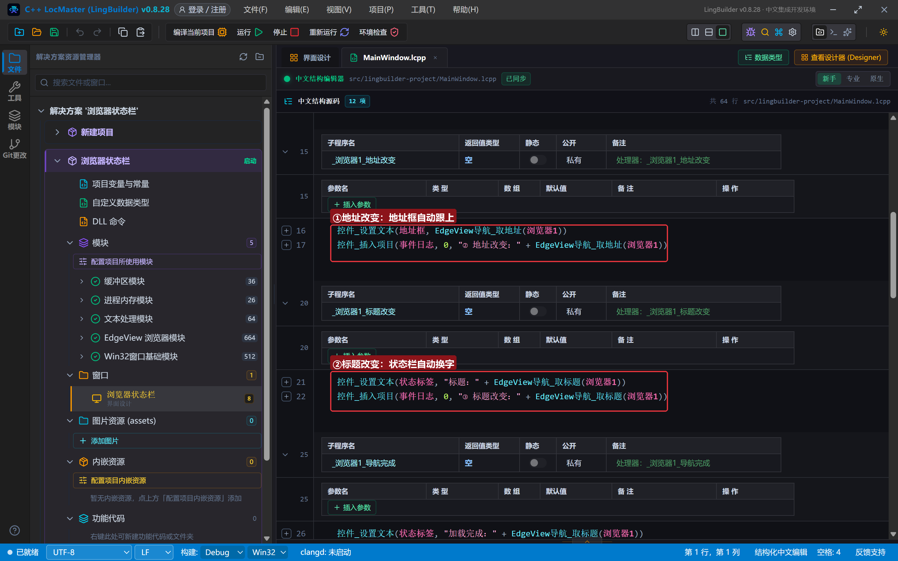

### 6.3 新窗口拦截：决策类事件

```lcpp
事件 新窗口来了()
    EdgeView事件_设置动作(浏览器1, 1)
    控件_插入项目(事件日志, 0, "⑤ 新窗口请求被拦截（事件_设置动作 = 1）")
结束
```

`EdgeView事件_设置动作(控件, 1)` 的意思是「这次请求我来做主：拦下」。动作值 1 = 拦截/接管；不设置就保持浏览器默认行为（真弹出新窗口）。广告弹窗、强制跳转，理论上都能在这一行里按住。

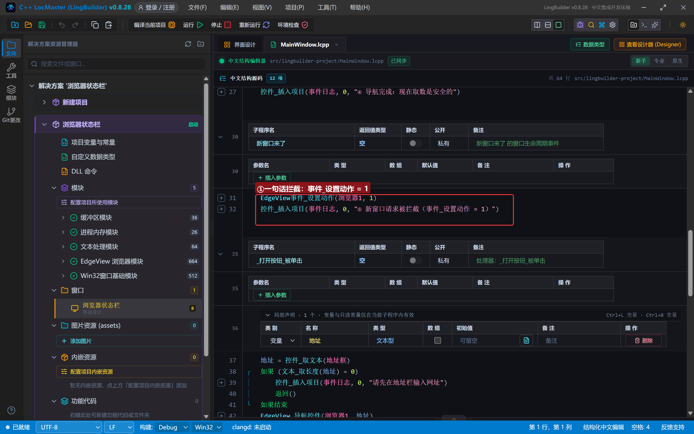

### 6.4 打开网页与弹窗测试页

```lcpp
事件 _打开按钮_被单击()
    局部 文本型 地址
    地址 = 控件_取文本(地址框)
    如果 (文本_取长度(地址) = 0)
        控件_插入项目(事件日志, 0, "请先在地址栏输入网址")
        返回()
    如果结束
    EdgeView_导航控件(浏览器1, 地址)
结束

事件 _主页按钮_被单击()
    EdgeView_导航控件(浏览器1, "https://www.iana.org")
结束

事件 _弹窗页按钮_被单击()
    局部 文本型 页面
    页面 = """
<html><head><title>弹窗测试页</title></head>
<body style="font-family:'Microsoft YaHei UI';padding:28px;background:#f8fafc;color:#0f172a">
<h2>点下面这颗大按钮：它想开一个新窗口（target=_blank）</h2>
<a href="https://www.iana.org" target="_blank"
   style="display:inline-block;margin-top:20px;font-size:26px;padding:26px 52px;background:#2563eb;color:#ffffff;border-radius:10px;text-decoration:none">点我试试弹窗</a>
</body></html>
"""
    EdgeView导航_HTML(浏览器1, 页面)
    控件_插入项目(事件日志, 0, "已打开弹窗测试页：点页面里的大按钮")
结束
```

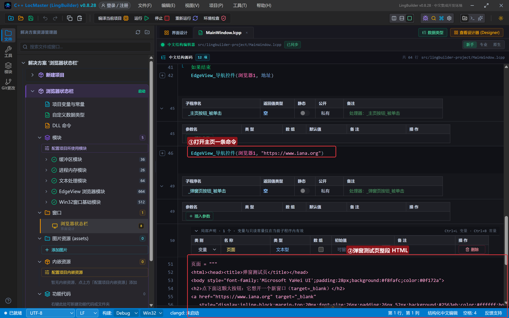

## 7. 编译：错误列表 (0)

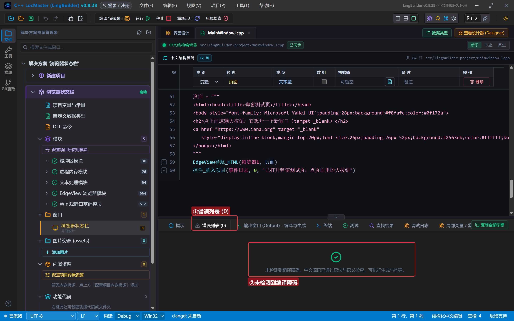

## 8. 运行：全部自动化

### 8.1 启动就绪

程序一打开，事件日志报出「新窗口拦截已就位」：

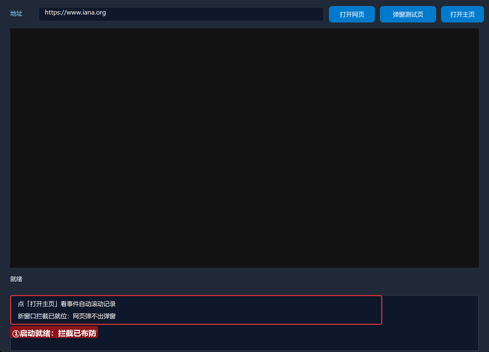

### 8.2 打开主页：看事件自动跑

点「打开主页」，**不许再点别的**——观察底部：

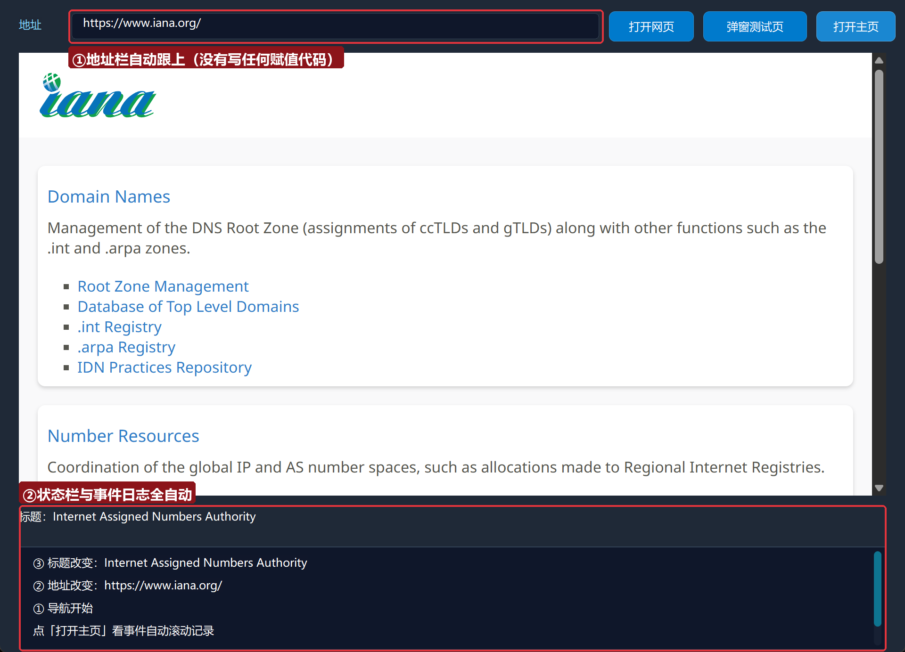

iana.org 加载完成后：地址栏自动变成了带斜杠的规范地址 `https://www.iana.org/`，状态栏自动显示「标题：Internet Assigned Numbers Authority」，事件日志里 ①②③④ 按顺序出现。**我们只写了几行赋值，其余全是浏览器主动通知的。**

### 8.3 弹窗测试页

点「弹窗测试页」——第 2 集的内存 HTML 变成了一颗大按钮：

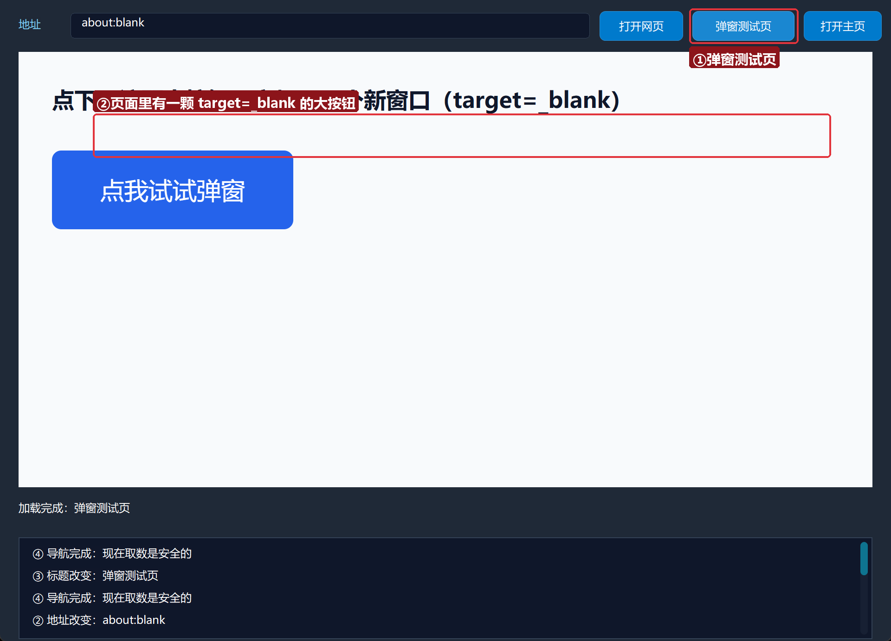

### 8.4 真实点击：弹窗被拦

用真鼠标点页面里那颗「点我试试弹窗」大按钮（它带着 `target=_blank`，正常浏览器会开新窗口）：

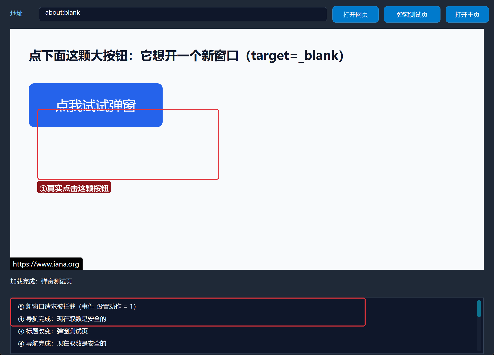

事件日志置顶出现「⑤ 新窗口请求被拦截（事件_设置动作 = 1）」——没有新窗口弹出来，页面纹丝不动。弹窗拦截，一行代码。

> 小知识：`EdgeView导航_HTML` 的页面地址是 `about:blank`，地址栏会如实显示——内存页面没有网址，这是正常现象。

### 8.5 换个网址：再来一遍

地址栏输入 `https://www.baidu.com`（任意网站都行），点「打开网页」：

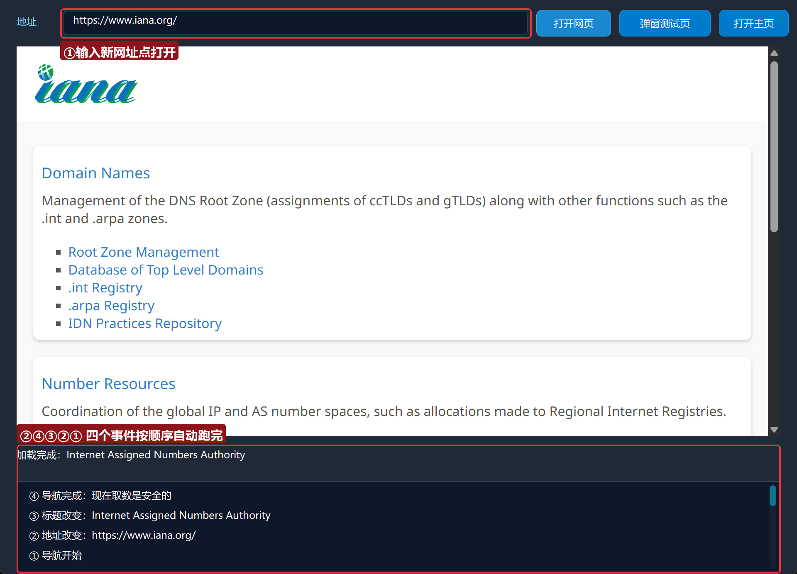

①②③④ 又按顺序自动跑了一遍。事件不会累、不会忘，每次都准时。

## 常见问题急救表

| 症状 | 原因 | 解法 |
| --- | --- | --- |
| 事件处理器从不执行 | 处理器名和绑定名没对上一字 | 设计器事件表与代码里的名字必须一字不差（`_浏览器1_地址改变`） |
| 导航开始里取地址是旧值 | 事件刚发生，新地址还没生效 | 地址到「地址改变」事件再取 |
| `&新窗口来了` 编译报错 | 处理器引用少了 `&` 或名字不一致 | `EdgeView_绑定控件事件` 第三个参数必须是 `&处理器名` |
| 弹窗没被拦住 | 忘了调 `EdgeView事件_设置动作(浏览器1, 1)` | 不设置动作 = 保持默认行为（真弹窗） |
| 日志新行看不到 | `控件_添加项目` 追加在末尾 | 改用 `控件_插入项目(日志, 0, 文本)` 插到最前 |
| 弹窗测试页地址显示 about:blank | 内存 HTML 没有网址 | 正常现象，不是 bug |

## 本集小结

- 通知类事件四件套：导航开始 / 地址改变 / 标题改变 / 导航完成——状态栏、地址栏、日志全自动。
- 设计器「事件」页签绑定与 `EdgeView_绑定控件事件` 代码绑定等价，按场景选用。
- 决策类事件 + `EdgeView事件_设置动作(控件, 1)` = 一行拦截弹窗。
- 事件处理器的名字必须与绑定一字不差；「导航开始」里不取新地址。

## 源码包

本集完整源码已打包为 **浏览器状态栏.lcpppkg**（随本教程同目录分发，官网示例源码区可下载），导入即可运行。

**下一集预告**：《执行 JavaScript》——往页面里派一个「内应」：脚本族 7 条命令，JS 返回值怎么读、怎么兜错，让网页替我们干活。

[回合集总览](/guide/tutorials/edge)
