# Edge 合集 05 · 网页取数实战：从网页里把数据「拿」出来

> 《LingBuilder Edge 浏览器合集》第 5 集（网页操作篇）。前四集学会了把浏览器嵌进窗口、导航、监听事件、执行 JavaScript；这一集开始做**真正有用的事**：从网页里提取数据，拆开、解析、展示成自己的表格。我们用一个不联网的「果蔬店行情页」做靶子，把「取数 → 清洗 → 拆分 → 上列表」这条最常用的数据流水线走通。全程约 30 分钟。
>
> 前置要求：学过[基础篇 01~04 集](/guide/tutorials/edge)（会摆 EdgeBrowser 控件、会执行 JavaScript）。本集源码包见文末。

## 这一集你将学会

- `EdgeView导航_HTML`：把一段 HTML 文本直接变成页面（不需要联网、不需要文件）
- 用 JavaScript 的 `querySelector` 做 **DOM 查询**：按 id 取文本、按 class 数元素
- `文本_替换`：清洗取回来的字符串（去掉 JSON 的引号）
- `文本_分割` + `数组_取成员`：把「一行数据」拆成「一个字段一个变量」
- `控件_清空项目` / `控件_添加项目`：结果列表的清空与填充

## 1. 取数的标准姿势：一段四步流水线

网页数据藏在 DOM 里。取数永远是这四步：

1. **执行 JS 拿原始文本**——`EdgeView_执行JS控件(浏览器1, "document.getElementById('行情').innerText")`，把行情牌上的整段文字读回来；
2. **清洗**——返回值是 JSON 字符串，首尾带引号，用 `文本_替换` 把引号删掉；
3. **拆行**——按分隔符 `文本_分割` 成数组；
4. **拆字段**——每一行再 `文本_分割` 一次，用 `数组_取成员` 取第 0/1/2 个字段。

本集就做这四步，并且每一步都让你在界面上看到中间结果。

## 2. 新建项目

欢迎页点「新建项目」，项目名称填 **网页取数助手**，模板选「Windows 界面设计」，创建位置留空，点「创建项目」：

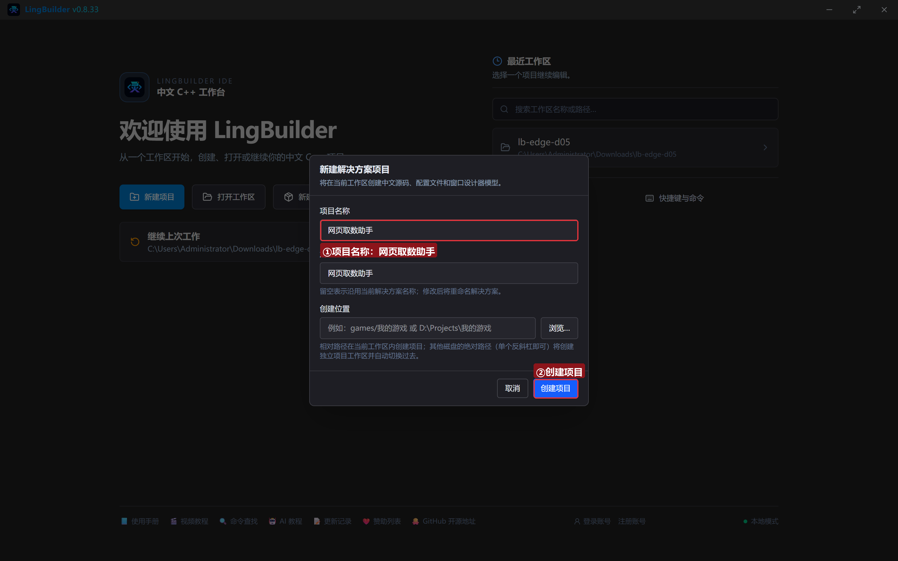

## 3. 启用模块

点左侧活动栏「模块」图标，确认这四个模块在「已启用」分组里：

- **EdgeView 浏览器模块**——浏览器控件与全部取数命令；
- **数组操作模块**——`数组_取成员` / `数组_取成员数` 在这里；
- **文本处理模块**——`文本_替换` / `文本_分割` / `文本_取长度` 在这里；
- **Win32窗口基础模块**——按钮、列表框等界面控件命令。

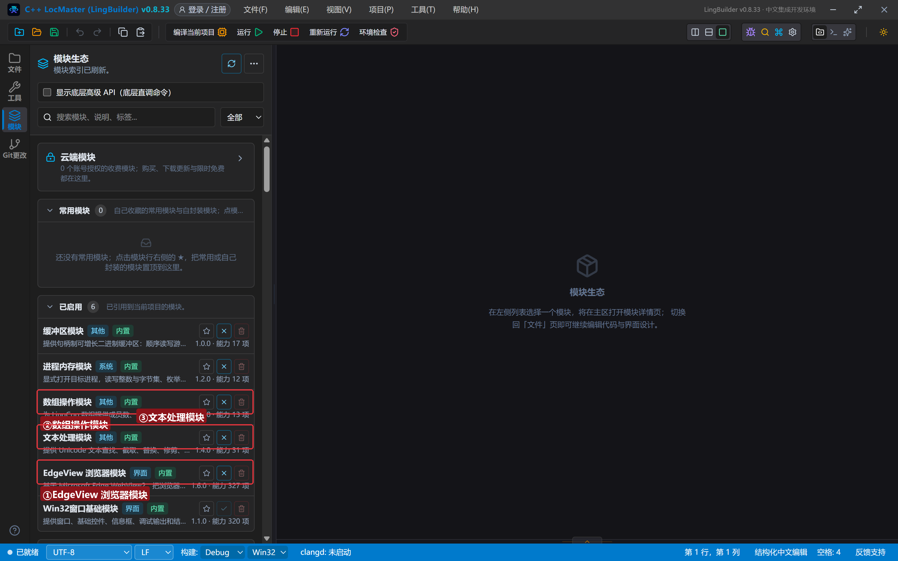

## 4. 设计界面

窗口 960×700。上面一排按钮，中间一片浏览器（数据源），下面是解析结果列表：

| 控件 | 名称 | 显示内容 | 左距 | 顶距 | 宽度 | 高度 |
| --- | --- | --- | --- | --- | --- | --- |
| 按钮 | 取行情按钮 | 取今日行情 | 20 | 16 | 150 | 34 |
| 按钮 | 取时间按钮 | 取更新时间 | 185 | 16 | 130 | 34 |
| 按钮 | 数品项按钮 | 数一数品项 | 330 | 16 | 130 | 34 |
| 按钮 | 取标题按钮 | 取页面标题 | 475 | 16 | 130 | 34 |
| 标签 | 日期标签 | 更新时间：—— | 620 | 22 | 320 | 22 |
| **Edge浏览器** | **浏览器1** | （从控件面板拖入） | 20 | 66 | 920 | 400 |
| 标签 | 结果标题 | 解析结果（品名 · 价格 · 库存） | 20 | 480 | 300 | 22 |
| 列表框 | 结果列表 | （清空） | 20 | 508 | 920 | 130 |
| 标签 | 状态标签 | 就绪。等页面加载完，点「取今日行情」 | 20 | 646 | 920 | 22 |

> 注意状态标签的顶距 646：窗口高 700 含 28 的标题栏，客户区只有 672 高，控件顶距 + 高度不能超过 672，否则运行时会被窗口底边裁掉。

绑 5 个事件：窗口「创建完毕」+ 4 个按钮的「被单击」。

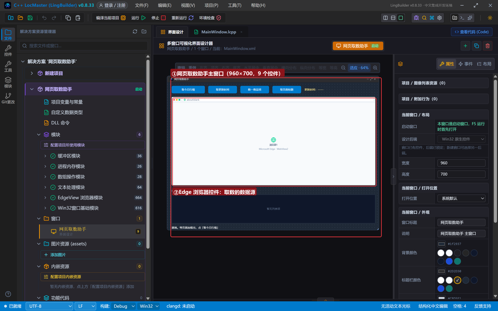

## 5. 写代码

### 5.1 创建完毕：用内存 HTML 造一个演示页

```lcpp
事件 _MainWindow_创建完毕()
    局部 文本型 页面
    页面 = "<!DOCTYPE html><html><head><meta charset='utf-8'><title>阳光果蔬店·今日行情</title>"
    页面 = 页面 + "<style>body{font-family:'Microsoft YaHei';background:#f8fafc;padding:26px}h1{color:#166534;margin:0 0 6px}#日期{color:#64748b}#行情{margin-top:16px;padding:14px 18px;background:#ecfdf5;border:1px solid #86efac;border-radius:8px;font-size:19px;letter-spacing:1px}</style></head><body>"
    页面 = 页面 + "<h1>阳光果蔬店 · 今日行情</h1><p id='日期'>更新时间：2026-10-25 08:30</p>"
    页面 = 页面 + "<div id='行情'><span class='item'>白菜,2.5,120</span>　<span class='item'>萝卜,1.8,80</span>　<span class='item'>土豆,3.2,200</span>　<span class='item'>西红柿,6.8,45</span>　<span class='item'>黄瓜,4.5,60</span></div>"
    页面 = 页面 + "</body></html>"
    EdgeView导航_HTML(浏览器1, 页面)
    控件_设置文本(状态标签, "已打开演示行情页（内存 HTML，不联网）")
结束
```

`EdgeView导航_HTML` 是导航族里最方便的一条：**一段 HTML 字符串直接变成页面**。行情牌上每个品项是一个 `<span class='item'>`，内容格式统一是「品名,价格,库存」，品项之间用全角空格「　」隔开——这两个约定就是待会儿拆分的依据。

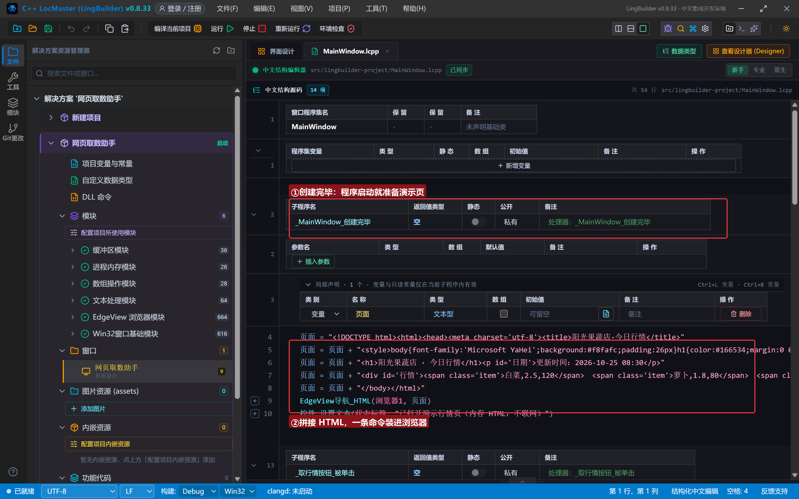

### 5.2 「取今日行情」：四步流水线

```lcpp
事件 _取行情按钮_被单击()
    局部 文本型 行情
    局部 文本型 行数组[]
    局部 文本型 字段[]
    局部 文本型 行
    局部 文本型 一条
    控件_清空项目(结果列表)
    行情 = EdgeView_执行JS控件(浏览器1, "document.getElementById('行情').innerText")
    行情 = 文本_替换(行情, "\"", "")
    如果 (文本_取长度(行情) = 0)
        控件_设置文本(状态标签, "没取到行情文本，先等页面创建完毕")
        返回()
    如果结束
    文本_分割(行情, "　", 行数组, 真)
    枚举循环首 (行数组, 行)
        文本_分割(行, ",", 字段)
        一条 = 数组_取成员(字段, 0) + "　　价格 ¥" + 数组_取成员(字段, 1) + "　　库存 " + 数组_取成员(字段, 2)
        控件_添加项目(结果列表, 一条)
    枚举循环尾 ()
    控件_设置文本(状态标签, "取数完成：共 " + 到文本(数组_取成员数(行数组)) + " 个品项")
结束
```

逐段拆解：

- `控件_清空项目(结果列表)`：每次取数前先清空，避免旧数据残留；
- `EdgeView_执行JS控件(...innerText)`：DOM 查询，拿整个行情牌的文字；
- `文本_替换(行情, "\"", "")`：**清洗**。JavaScript 的返回值按 JSON 约定带首尾引号，把 `\"`（一个引号字符）替换成空文本；
- `文本_取长度(行情) = 0` 判空：页面还没加载完时取不到东西，给用户一句提示而不是静默失败；
- `文本_分割(行情, "　", 行数组, 真)`：按全角空格**拆行**，第 4 个参数传 真 表示「忽略末尾空段」；
- 枚举循环里对每一行再 `文本_分割(行, ",", 字段)` **拆字段**，然后 `数组_取成员(字段, 0/1/2)` 取品名、价格、库存（下标从 0 起）；
- 最后 `到文本(数组_取成员数(行数组))` 把段数转成文本拼进状态栏。

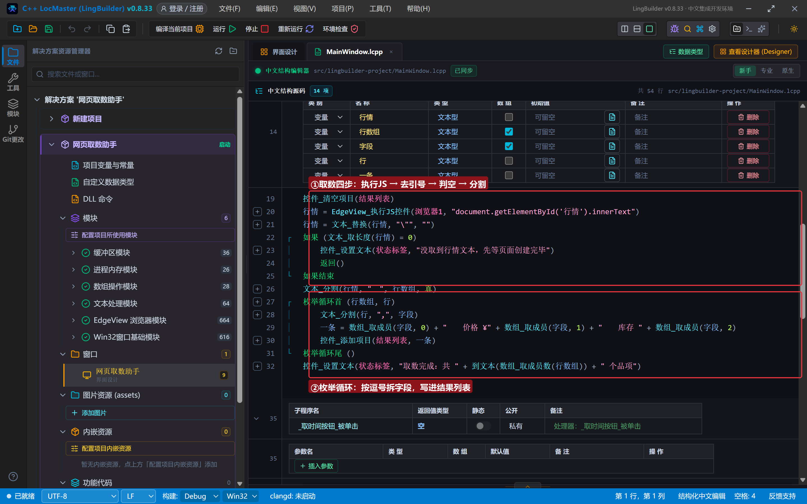

### 5.3 另外三个按钮：各有各的取法

```lcpp
事件 _取时间按钮_被单击()
    局部 文本型 时间
    时间 = EdgeView_执行JS控件(浏览器1, "document.getElementById('日期').innerText")
    时间 = 文本_替换(时间, "\"", "")
    控件_设置文本(日期标签, 时间)
    控件_设置文本(状态标签, "已把页面上的更新时间读到窗口右上角")
结束

事件 _数品项按钮_被单击()
    局部 文本型 数量
    数量 = EdgeView_执行JS控件(浏览器1, "document.querySelectorAll('.item').length")
    控件_设置文本(状态标签, "页面上 class='item' 的元素共 " + 数量 + " 个（JSON 数字没有引号）")
结束

事件 _取标题按钮_被单击()
    控件_设置文本(状态标签, "页面标题：" + EdgeView导航_取标题(浏览器1))
结束
```

三个细节值得记住：

- `querySelectorAll('.item').length` 是**按 class 数元素**——DOM 统计的标配写法；
- 数字类型的返回值（JSON 数字）**没有引号**，不需要 `文本_替换` 清洗，只有字符串返回值才带引号；
- `EdgeView导航_取标题` 是导航族的现成命令，取页面标题不用写 JS。

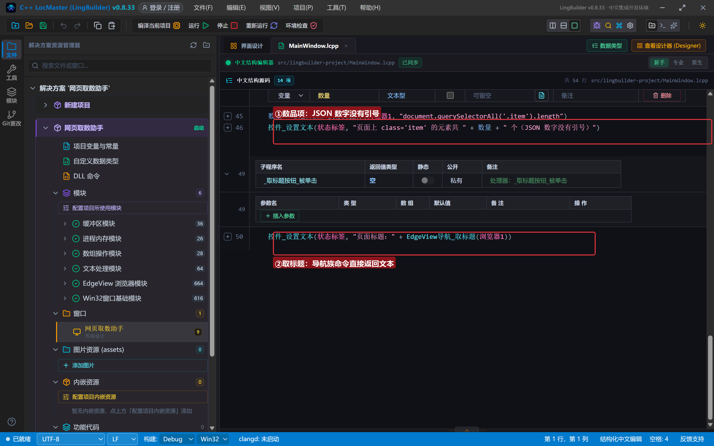

## 6. 编译：先看错误列表

点工具栏「编译当前项目」，先看底部「错误列表」——(0)，没有任何报错；输出窗口最后一行「生成完成」：

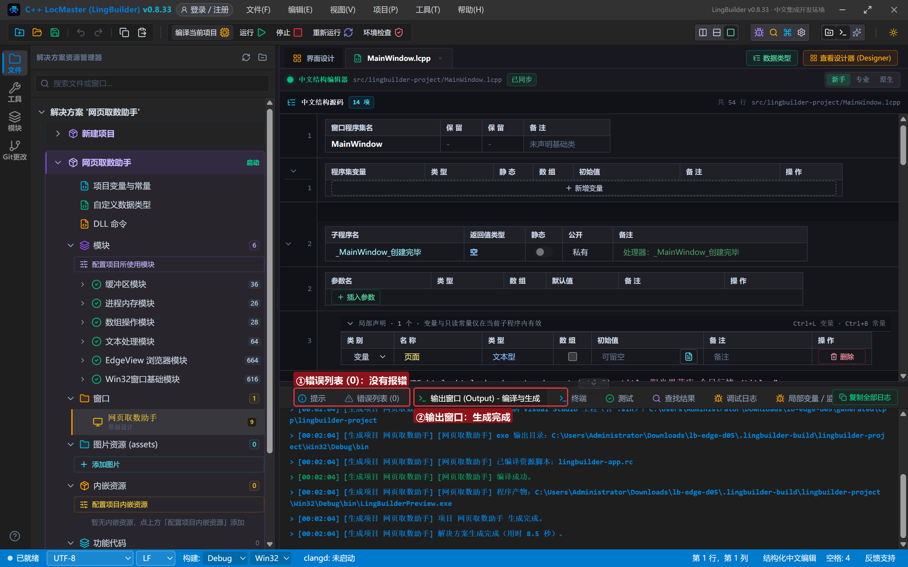

## 7. 运行：数据流水线跑起来

点「运行」。窗口打开，演示行情页已经装在浏览器里（内存 HTML，不联网）：

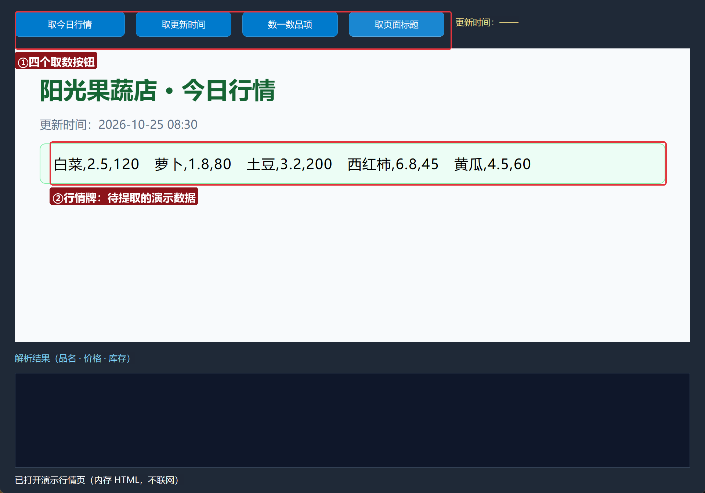

### 7.1 取今日行情

点「取今日行情」——解析结果列表一次填入 5 行，每行是「品名 · 价格 · 库存」；状态栏显示共 5 个品项：

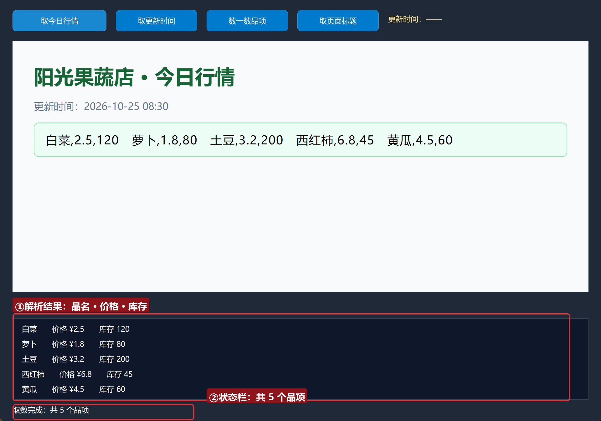

注意列表里的数据和行情牌的对应关系：`白菜,2.5,120` 被拆成了品名「白菜」、价格「¥2.5」、库存「120」——这就是两次 `文本_分割` 的成果。

### 7.2 取更新时间

点「取更新时间」——页面里的「更新时间：2026-10-25 08:30」被读到了窗口右上角的日期标签：

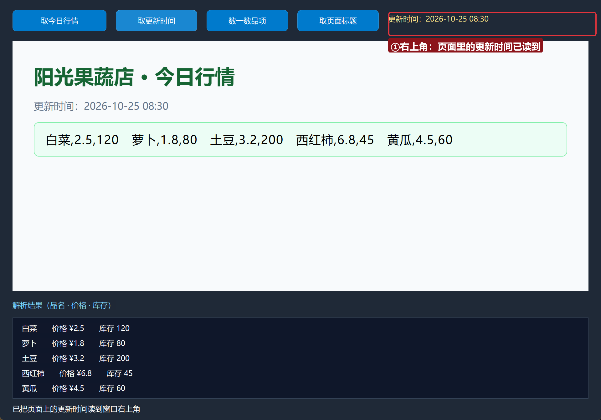

### 7.3 数一数品项

点「数一数品项」——状态栏显示「页面上 class='item' 的元素共 5 个」。这次 JS 返回的是数字，JSON 里数字没有引号：

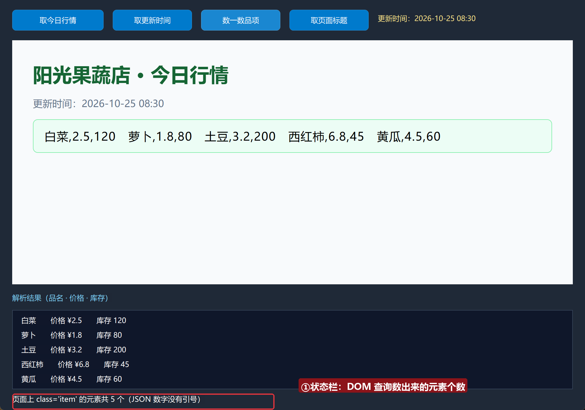

### 7.4 取页面标题

点「取页面标题」——状态栏显示「页面标题：阳光果蔬店·今日行情」。`<title>` 里的字，一条导航族命令直接拿回来：

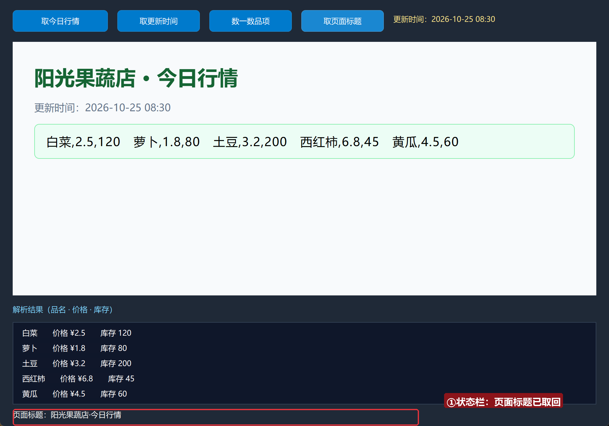

## 8. 换成真网页怎么办？

流水线一步都不用变，只有两处换料：

1. 创建完毕里改用 `EdgeView_导航控件(浏览器1, "https://你要取数的网址")`；
2. 执行 JS 里的选择器换成目标页面的真实结构（按 F12 看网页的 id / class）。

记住一个原则：**先在浏览器 F12 里确认选择器能选中目标，再写进代码**。选择器写错时取回来是空文本——这就是我们在 5.2 里教判空提示的原因。

## 常见问题急救表

| 症状 | 原因 | 解法 |
| --- | --- | --- |
| 状态栏提示「没取到行情文本」 | 页面还没加载完就点了取数 | 等页面显示出来再点；真实网页可在「导航完成」事件里再取 |
| 取回来的内容带着引号 | 忘了清洗 JSON 字符串 | `文本_替换(结果, "\"", "")` |
| 列表里每行都是完整一串没拆开 | 分隔符不匹配 | 检查页面里品项之间到底是全角空格还是别的字符 |
| 数组_取成员 取出来是空 | 下标越界（页面字段比预期少） | 先用 状态标签 把整段原始文本显示出来核对 |
| 编译报「未知的命令 数组_取成员」 | 数组操作模块没启用 | 模块生态里启用「数组操作模块」 |

## 本集小结

- `EdgeView导航_HTML`：内存 HTML 直接变页面，做取数实验不依赖任何网站。
- 取数四步流水线：**执行 JS → 清洗 → 拆行 → 拆字段**，配套命令 `EdgeView_执行JS控件` / `文本_替换` / `文本_分割` / `数组_取成员`。
- 字符串返回值带 JSON 引号要清洗；数字返回值不用。
- 控件顶距 + 高度不能超过客户区高（窗口高 − 标题栏 28）。

## 源码包

本集完整源码已打包为 **网页取数助手.lcpppkg**（随本教程同目录分发，官网示例源码区可下载）。在 LingBuilder 欢迎页点「打开工作区」，或直接双击 `.lcpppkg` 文件即可导入运行。

**下一集预告**：《网页填表（一）》——填表族 22 条命令登场：按 CSS 选择器自动输入、自动点击，让程序替你在网页上「动手」。

[回合集总览](/guide/tutorials/edge)
