# Edge 合集 08 · 网页填表（三）：自动登录实战（含执行JS 兜底）

> 《LingBuilder Edge 浏览器合集》第 8 集（网页操作篇收官）。前三集的零件——赋值、勾选、点击、取值、拆信封——这一集全部拧成一台整机：**自动登录流水线**。还会教你一招保命绝技：当填表命令「使不上劲」时，用一条 `EdgeView_执行JS控件` 的 IIFE（立即执行函数）兜底，一次调用完成「填表 + 点击 + 读回执」。全程约 30 分钟。
>
> 前置要求：学过[第 5~7 集](/guide/tutorials/edge)。本集源码包见文末。

## 这一集你将学会

- **自动登录五连发**：赋值账号 → 赋值密码 → 勾「记住我」→ 点登录 → 取回执
- 用**完成处理器**把登录回执读回窗口状态栏
- 故意填错密码，看页面如何拒绝（负向验证是自动化的一部分）
- **执行JS 兜底写法**：一条 IIFE 里完成整套动作
- 读回执的三步拆法在第 7 集已学，本集直接复用

## 1. 自动登录的五连发与「队列顺序」

```lcpp
EdgeView填表_赋值(浏览器1, 0, "#user", -1, "admin")
EdgeView填表_赋值(浏览器1, 0, "#pass", -1, "lb2026")
EdgeView填表_置选择框(浏览器1, 0, "#remember", -1, 真)
EdgeView填表_点击元素(浏览器1, 0, "#login", -1)
EdgeView填表_取值(浏览器1, 0, "#tip", -1, &回执完成)
```

五条命令**按书写顺序排队执行**：前三条写入，第四条触发页面校验，第五条的取值排在点击之后——所以读到的 `#tip` 已经是**登录后的回执**。这就是「顺序队列」的妙处：不用等待函数，把取值排在最后即可。

## 2. 新建项目与启用模块

欢迎页「新建项目」，项目名称 **自动登录助手**，「Windows 界面设计」：

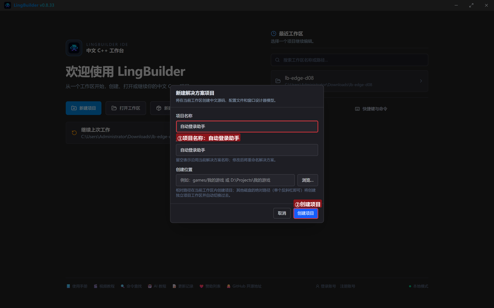

模块确认四个已启用：**EdgeView 浏览器模块**、**文本处理模块**、**数组操作模块**、**Win32窗口基础模块**：

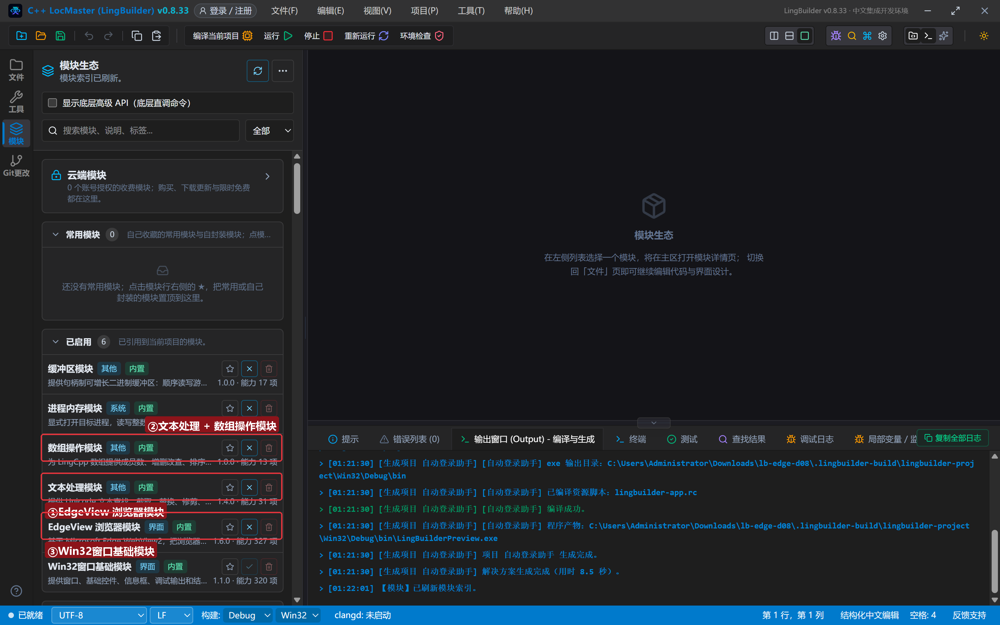

## 3. 设计界面

| 控件 | 名称 | 显示内容 | 左距 | 顶距 | 宽度 | 高度 |
| --- | --- | --- | --- | --- | --- | --- |
| 按钮 | 一键登录按钮 | 一键登录（admin） | 20 | 14 | 170 | 32 |
| 按钮 | 错误密码按钮 | 错误密码演示 | 202 | 14 | 150 | 32 |
| 按钮 | 兜底按钮 | 执行JS兜底登录 | 364 | 14 | 160 | 32 |
| 按钮 | 读回执按钮 | 读登录回执 | 536 | 14 | 130 | 32 |
| 按钮 | 清空按钮 | 清空重填 | 678 | 14 | 110 | 32 |
| **Edge浏览器** | **浏览器1** | （从控件面板拖入） | 20 | 100 | 920 | 420 |
| 标签 | 日志标题 | 执行日志 | 20 | 532 | 120 | 20 |
| 列表框 | 日志列表 | （清空） | 20 | 556 | 920 | 100 |
| 标签 | 状态标签 | 就绪。页面加载完点「一键登录」 | 20 | 664 | 920 | 20 |

5 个按钮各绑「被单击」，窗口绑「创建完毕」。

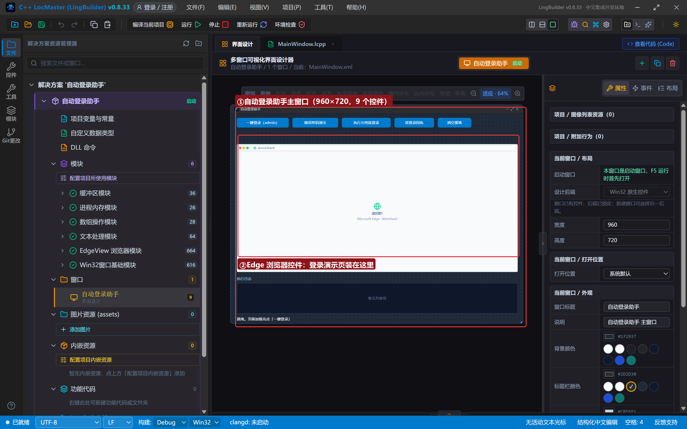

## 4. 写代码

### 4.1 创建完毕：一个会「认真校验」的登录页

```lcpp
事件 _MainWindow_创建完毕()
    局部 文本型 页面
    页面 = "<!DOCTYPE html><html><head><meta charset='utf-8'><title>后台管理系统 · 登录</title>"
    页面 = 页面 + "<style>…（样式）…</style></head><body>"
    页面 = 页面 + "<h2>后台管理系统 · 登录</h2><div class='row'><label>账号</label><input id='user' placeholder='请输入账号'></div><div class='row'><label>密码</label><input id='pass' type='password'></div><div class='row'><label class='chk'><input type='checkbox' id='remember'> 记住我 7 天</label></div><button id='login' onclick='doLogin()'>登 录</button><div id='tip'>等待登录……</div>"
    页面 = 页面 + "<script>function doLogin(){…账号 admin 且密码 lb2026 则欢迎，否则报错…}</script>"
    页面 = 页面 + "</body></html>"
    EdgeView导航_HTML(浏览器1, 页面)
    控件_插入项目(日志列表, 0, "登录演示页已打开（正确账号 admin / lb2026）")
结束
```

页面 JS `doLogin()` 会真的校验账号密码：对则 `#tip` 显示绿色欢迎语，错则显示红色错误提示。**有正反两个分支**，自动化才有「成功」和「失败」两种可验证的结果。

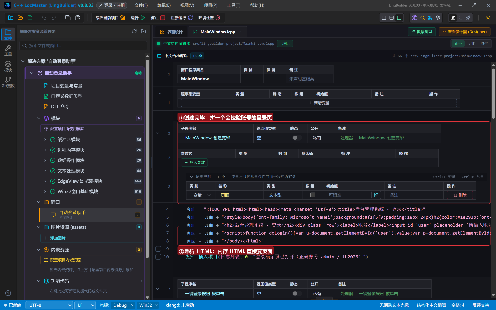

### 4.2 一键登录与错误密码演示

```lcpp
事件 _一键登录按钮_被单击()
    EdgeView填表_赋值(浏览器1, 0, "#user", -1, "admin")
    EdgeView填表_赋值(浏览器1, 0, "#pass", -1, "lb2026")
    EdgeView填表_置选择框(浏览器1, 0, "#remember", -1, 真)
    EdgeView填表_点击元素(浏览器1, 0, "#login", -1)
    EdgeView填表_取值(浏览器1, 0, "#tip", -1, &回执完成)
    控件_插入项目(日志列表, 0, "一键登录：五连发，回执稍后由完成处理器带回")
结束

事件 _错误密码按钮_被单击()
    EdgeView填表_赋值(浏览器1, 0, "#user", -1, "admin")
    EdgeView填表_赋值(浏览器1, 0, "#pass", -1, "wrong123")
    EdgeView填表_点击元素(浏览器1, 0, "#login", -1)
    EdgeView填表_取值(浏览器1, 0, "#tip", -1, &回执完成)
    控件_插入项目(日志列表, 0, "错误密码演示：故意填错，看页面拒绝")
结束
```

两个事件共用同一个 `&回执完成` 处理器——谁触发的取值，处理器都把回执送上状态栏。

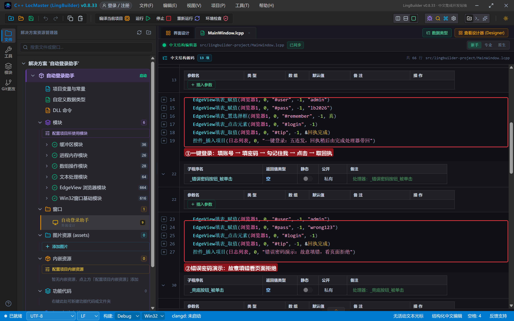

### 4.3 回执解析（第 7 集三步法直接复用）

```lcpp
事件 回执完成()
    局部 文本型 结果
    局部 文本型 部件[]
    局部 文本型 字段[]
    结果 = EdgeView任务_取结果(EdgeView任务_取当前任务ID())
    结果 = 文本_替换(结果, "\"", "")
    结果 = 文本_替换(结果, "\\", "")
    文本_分割(结果, "value:", 部件, 真)
    如果 (数组_取成员数(部件) > 1)
        文本_分割(数组_取成员(部件, 1), "}", 字段, 真)
        控件_设置文本(状态标签, "登录回执：" + 数组_取成员(字段, 0))
    否则
        控件_设置文本(状态标签, "登录回执原始：" + 结果)
    如果结束
结束
```

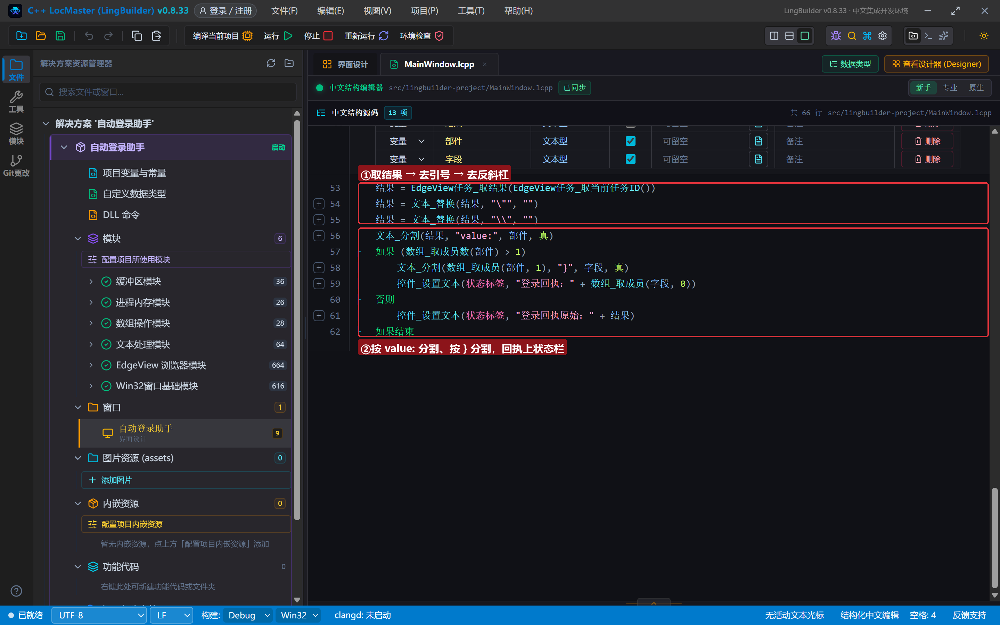

### 4.4 执行JS 兜底：一条 IIFE 搞定全部

```lcpp
事件 _兜底按钮_被单击()
    局部 文本型 结果
    结果 = EdgeView_执行JS控件(浏览器1, "(function(){document.getElementById('user').value='admin';document.getElementById('pass').value='lb2026';document.getElementById('remember').checked=true;doLogin();return document.getElementById('tip').innerText;})()")
    结果 = 文本_替换(结果, "\"", "")
    控件_插入项目(日志列表, 0, "执行JS兜底 → " + 结果)
结束
```

要点三个：**整个脚本包在 `(function(){ … })()` 里**——JavaScript 只有「表达式」能直接返回值，这样包装后最后一句 `return` 的内容就是返回值，外层还要配一对调用括号；页内引用一律用**单引号**（外层字符串已占用双引号）；纯字符串返回值只需**去引号一步**清洗（没有嵌套信封，反斜杠那步可以省）。遇到填表命令覆盖不到的奇怪页面（自定义组件、动态渲染），这招几乎万能。

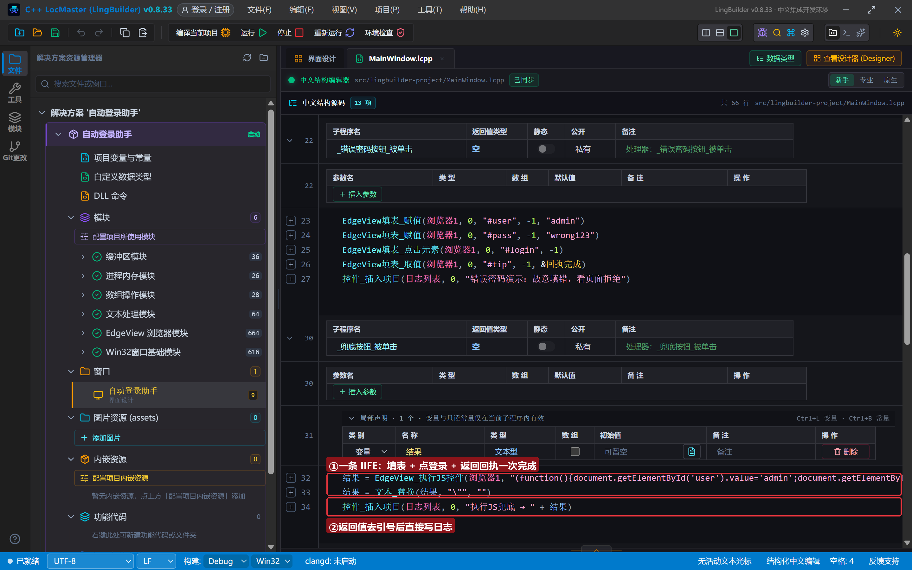

### 4.5 清空重填

```lcpp
事件 _清空按钮_被单击()
    EdgeView填表_赋值(浏览器1, 0, "#user", -1, "")
    EdgeView填表_赋值(浏览器1, 0, "#pass", -1, "")
    EdgeView填表_置选择框(浏览器1, 0, "#remember", -1, 假)
    控件_插入项目(日志列表, 0, "已清空账号、密码并取消记住我")
结束
```

写空文本即清空；`置选择框` 传 假 取消勾选——写侧命令的反向用法。

## 5. 编译：先看错误列表

错误列表 (0)，输出窗口「生成完成」：

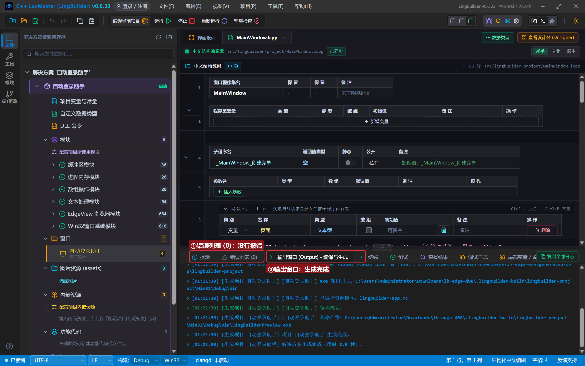

## 6. 运行：成功与失败都看得见

点「运行」。登录页就位，提示等待登录：

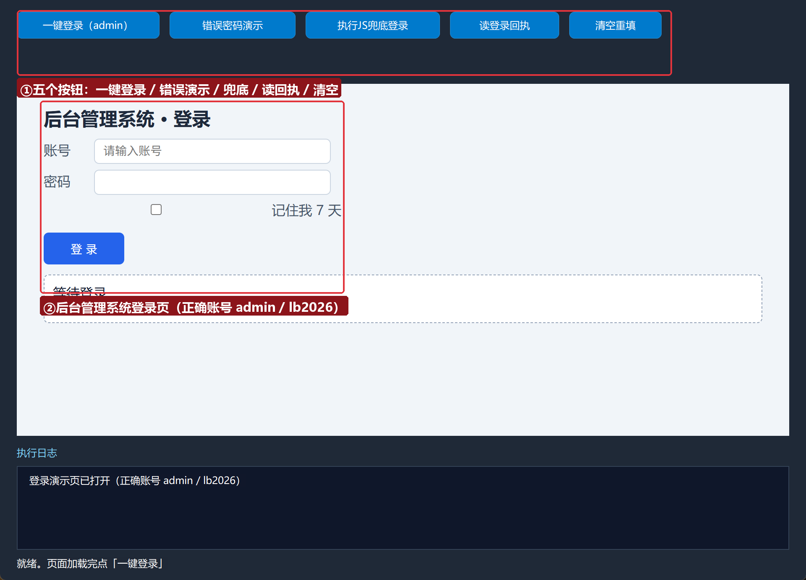

### 6.1 一键登录成功

点「一键登录（admin）」——页面回执变绿「登录成功，欢迎 admin（记住我已勾选）」，状态栏由完成处理器带回同样内容：

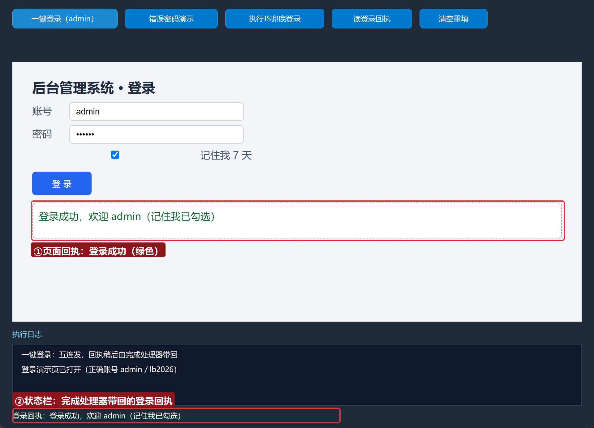

### 6.2 错误密码被拒绝

点「错误密码演示」——页面回执变红「账号或密码错误」：

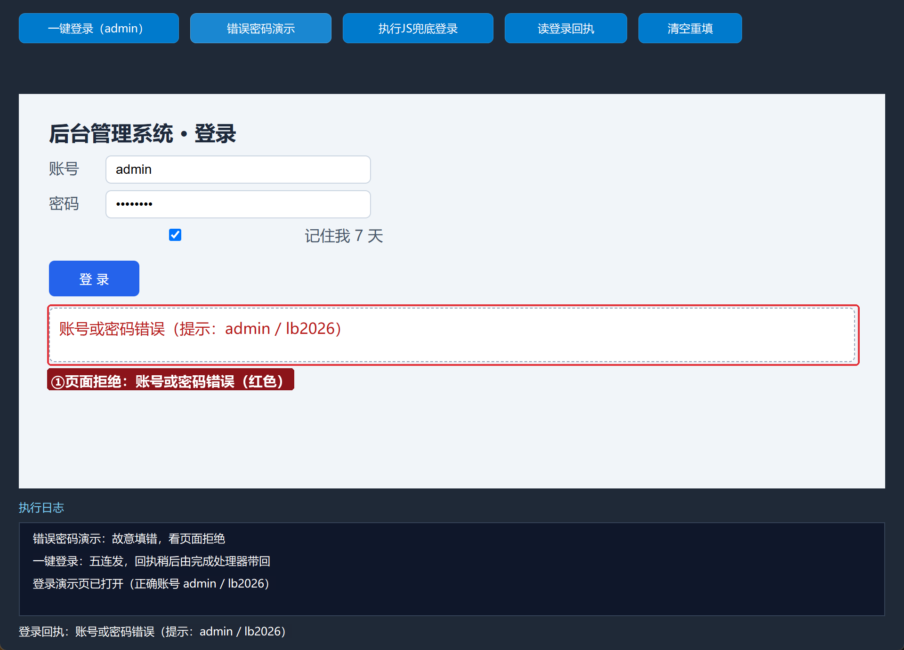

### 6.3 执行JS 兜底

点「执行JS兜底登录」——日志显示「执行JS兜底 → 登录成功，欢迎 admin（记住我已勾选）」，一条命令完成整套动作：

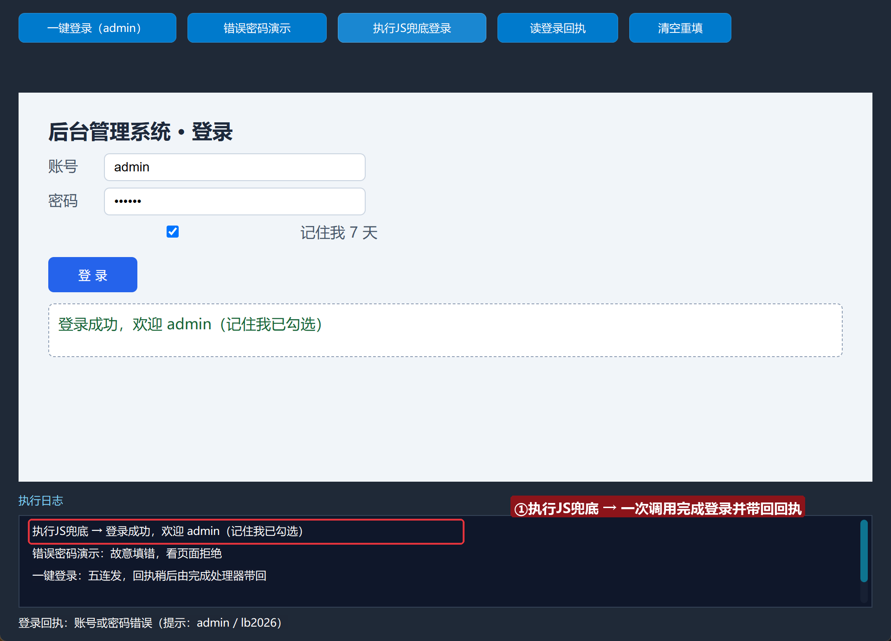

### 6.4 清空重填

点「清空重填」——账号密码清空、记住我取消：

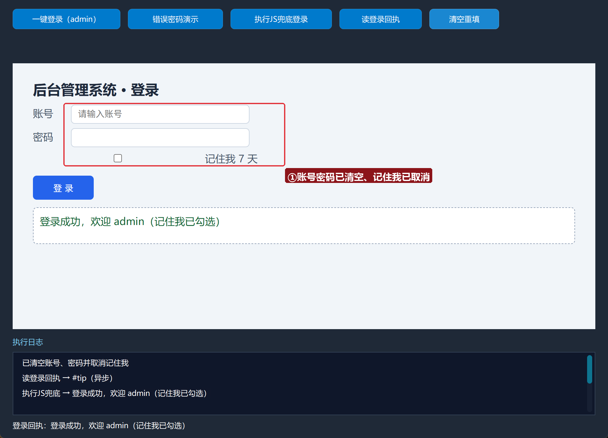

## 7. 网页操作篇收官

三集填表 + 两集取数/查找，你已经掌握了用 EdgeView 操控网页的完整基本功：

| 能力 | 命令 |
| --- | --- |
| 写 | 填表_赋值 / 置选择框 / 置选择项 / 触发事件 |
| 点 | 填表_点击元素 / 聚焦元素 / 滚动到元素 |
| 读 | 填表_取值 / 取选择框 / 取选择项 / 元素是否存在 / 取坐标 |
| 兜底 | EdgeView_执行JS控件（IIFE） |
| 解析 | 文本_替换 ×2 → 文本_分割 → 数组_取成员 |

从下一集起进入 **JS 双向桥篇**：网页里的脚本可以反过来调用你的程序（postMessage 桥），双向通信的大门打开。

## 常见问题急救表

| 症状 | 原因 | 解法 |
| --- | --- | --- |
| 取值读到的是点击前的旧回执 | 取值排在点击之前 | 保持五连发顺序：取值必须最后 |
| IIFE 报语法错误 | 少了外层括号或双引号冲突 | `(function(){ … })()` 三对括号一个不能少；页内用单引号 |
| 兜底返回空 | 忘了 return | IIFE 里最后一句必须 return 要带回的内容 |
| 页面框架不认赋值 | 只监听 keypress | 填表_触发事件 补发键盘事件，或直接走 IIFE |
| 回执解析出原始串 | 信封结构变化 | 把「原始结果」分支的输出贴出来核对格式 |

## 本集小结

- 自动登录 = **五连发 + 顺序队列**：写入三条 → 点击 → 取回执，无需任何等待函数。
- 负向验证同样重要：故意填错，确认页面会拒绝。
- **执行JS 兜底**：`(function(){ … })()` + 单引号 + return，一条命令覆盖填表命令够不着的场景。
- 拆信封三步法已可复用为固定套路。

## 源码包

本集完整源码已打包为 **自动登录助手.lcpppkg**（随本教程同目录分发，官网示例源码区可下载）。在 LingBuilder 欢迎页点「打开工作区」，或直接双击 `.lcpppkg` 文件即可导入运行。

**下一集预告**：《页内查找与定位》——查找族 5 条命令，给程序装上「页面内 Ctrl+F」。

[回合集总览](/guide/tutorials/edge)
