# Edge 合集 10 · 页面调原生：postMessage 双向桥

> 《LingBuilder Edge 浏览器合集》第 10 集（JS 双向桥篇）。从这一集起，网页里的 JavaScript 第一次可以**主动给你的程序打电话**：网页按钮 → `chrome.webview.postMessage` → 你的中文事件处理器收到信 → 干活 → 再回信给网页。这条「postMessage 双向桥」是所有「网页壳 + 原生能力」应用（比如把网页打包成桌面软件）的通信基石。全程约 25 分钟。
>
> 前置要求：学过[第 3 集](/guide/tutorials/edge-03)（事件驱动）。本集源码包见文末。

## 这一集你将学会

- **网页 → 原生**：页面 JS 用 `chrome.webview.postMessage('消息')` 寄信
- **设计器事件绑定**：给 EdgeBrowser 控件绑「网页消息」（WebMessageReceived）事件
- `EdgeView事件_取字段(控件, "message")`：在事件处理器里拆信
- **原生 → 网页**：`EdgeView脚本_发送字符串消息(控件, "回信")`
- 页面侧用 `chrome.webview.addEventListener('message', …)` 收原生回信

## 1. 双向桥长什么样

```
网页按钮 ──chrome.webview.postMessage('打开灯光')──▶ 网页消息事件 ──▶ 你的中文代码
   ▲                                                        │
   └──────addEventListener('message') ◀──发送字符串消息 ◀────┘
```

两个方向各一条命令，中间靠「消息」这个名字对上暗号。本集做一个「设备控制台」：网页上三个按钮（开灯 / 关灯 / 状态报告），原生收到信后改窗口状态灯，并回信让页面显示。

## 2. 新建项目与启用模块

欢迎页「新建项目」，项目名称 **消息指令台**，「Windows 界面设计」：

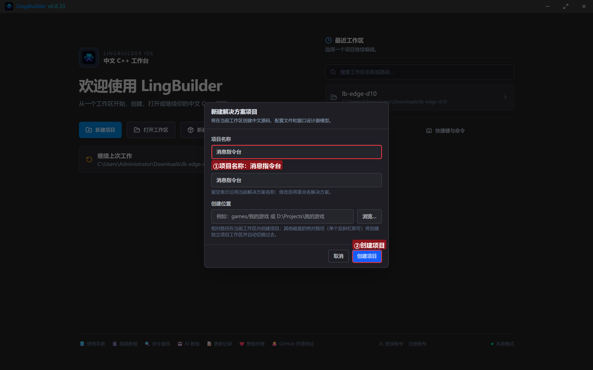

模块确认三个已启用：**EdgeView 浏览器模块**、**文本处理模块**、**Win32窗口基础模块**：

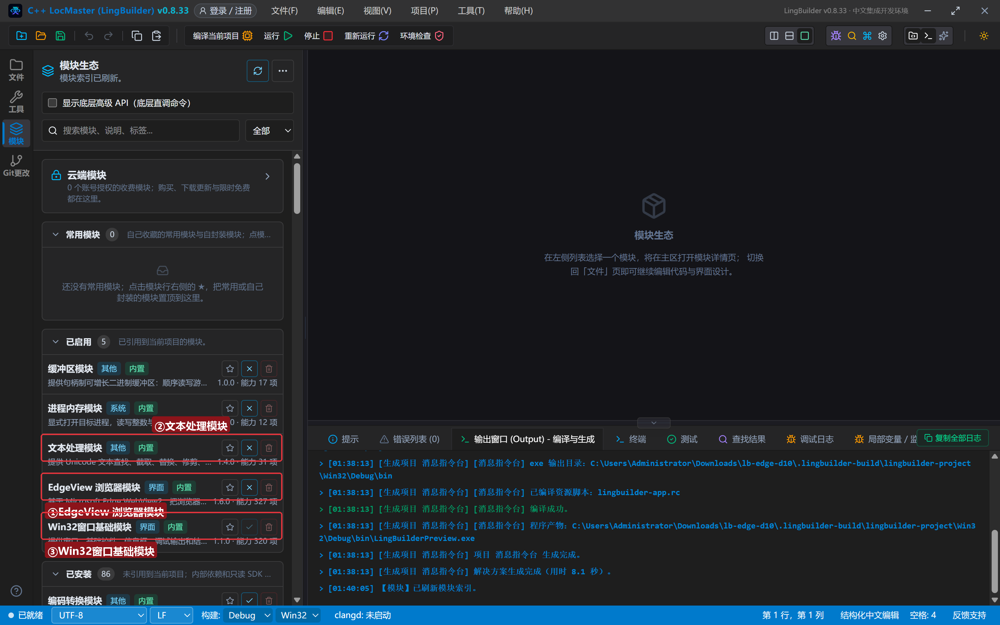

## 3. 设计界面（重点是给浏览器绑事件）

| 控件 | 名称 | 显示内容 | 左距 | 顶距 | 宽度 | 高度 |
| --- | --- | --- | --- | --- | --- | --- |
| 按钮 | 问候按钮 | 原生发条消息 | 20 | 14 | 150 | 32 |
| 按钮 | 清空按钮 | 清空日志 | 182 | 14 | 110 | 32 |
| 标签 | 状态灯标签 | 💡 就绪。点页面里的三个按钮试试 | 304 | 19 | 620 | 22 |
| **Edge浏览器** | **浏览器1** | （拖入）**事件页签里绑「网页消息」→ `_浏览器1_网页消息`** | 20 | 60 | 920 | 470 |
| 标签 | 日志标题 | 通信日志 | 20 | 542 | 120 | 20 |
| 列表框 | 日志列表 | （清空） | 20 | 566 | 920 | 96 |
| 标签 | 状态标签 | 网页 → 原生：chrome.webview.postMessage… | 20 | 664 | 920 | 20 |

**本集的关键一步**：选中浏览器控件 → 右侧属性面板切到「事件」页签 → 找到「网页消息」（WebMessageReceived）→ 填入处理器名 `_浏览器1_网页消息`。

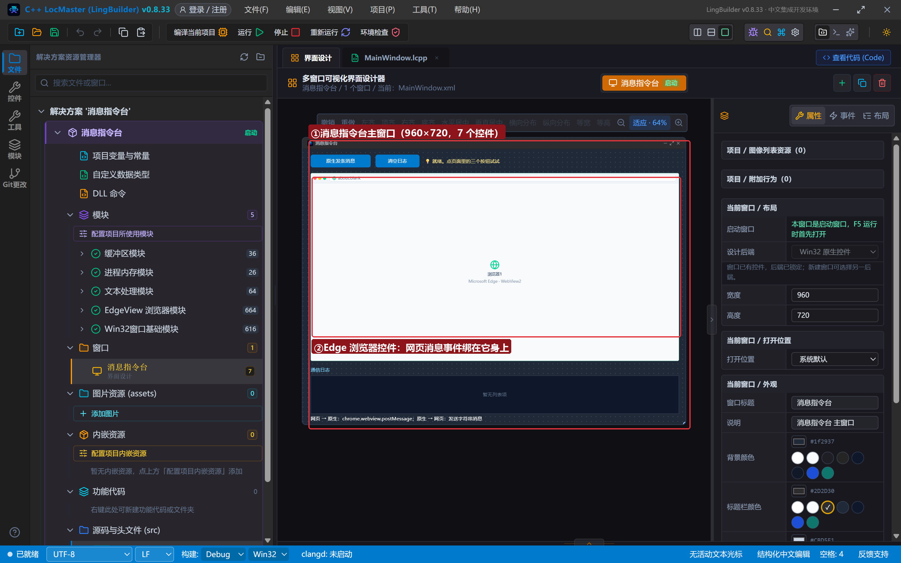

## 4. 写代码

### 4.1 创建完毕：会寄信、也会收信的页面

```lcpp
事件 _MainWindow_创建完毕()
    局部 文本型 页面
    页面 = "<!DOCTYPE html><html><head><meta charset='utf-8'><title>设备控制台</title>"
    页面 = 页面 + "<style>…（按钮与回执样式）…</style></head><body>"
    页面 = 页面 + "<h2>设备控制台</h2><button id='b1' onclick='send(1)'>💡 打开灯光</button><button id='b2' class='off' onclick='send(2)'>🌑 关闭灯光</button><button id='b3' onclick='send(3)'>📊 状态报告</button><div id='reply'>原生还没来信……</div>"
    页面 = 页面 + "<script>function send(n){var m=n===1?'打开灯光':(n===2?'关闭灯光':'状态报告');chrome.webview.postMessage(m);}window.chrome.webview.addEventListener('message',function(e){document.getElementById('reply').innerText='原生回信：'+e.data;});</script>"
    页面 = 页面 + "</body></html>"
    EdgeView导航_HTML(浏览器1, 页面)
    控件_插入项目(日志列表, 0, "设备控制台已打开（点页面按钮发消息给原生）")
结束
```

页面侧只有两句话要认识：**寄信** `chrome.webview.postMessage(m)`；**收信** `chrome.webview.addEventListener('message', 函数)`（回信内容在 `e.data` 里）。`chrome.webview` 是 WebView2 环境里网页默认就有的桥对象，不需要额外注入。

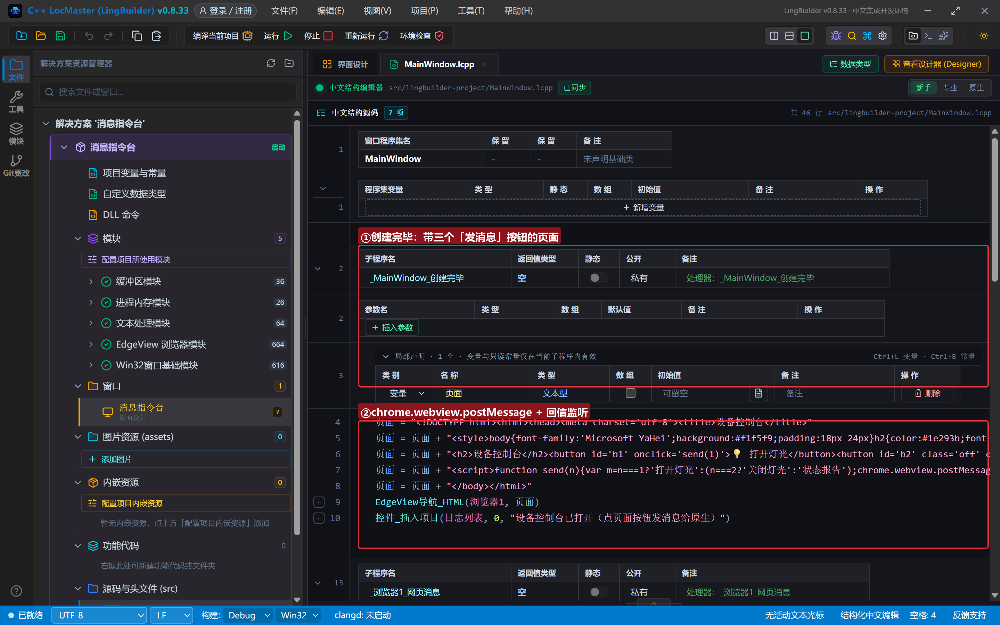

### 4.2 网页消息事件：拆信、分派、回信

```lcpp
事件 _浏览器1_网页消息()
    局部 文本型 消息
    消息 = EdgeView事件_取字段(浏览器1, "message")
    控件_插入项目(日志列表, 0, "网页来信：" + 消息)
    如果 (消息 = "打开灯光")
        控件_设置文本(状态灯标签, "💡 灯已打开（网页按钮触发）")
        EdgeView脚本_发送字符串消息(浏览器1, "灯已打开，正在照亮房间")
    否则
        如果 (消息 = "关闭灯光")
            控件_设置文本(状态灯标签, "🌑 灯已关闭（网页按钮触发）")
            EdgeView脚本_发送字符串消息(浏览器1, "灯已关闭，晚安")
        否则
            如果 (消息 = "状态报告")
                控件_设置文本(状态灯标签, "📊 已向页面报告运行状态")
                EdgeView脚本_发送字符串消息(浏览器1, "运行正常：CPU 12%，内存 86MB，已稳定运行 42 分钟")
            否则
                控件_插入项目(日志列表, 0, "未知指令：" + 消息)
            如果结束
        如果结束
    如果结束
结束
```

三个要点：**取字段** `"message"` 拿到网页寄来的字符串（还有 `"source"` 可以拿到来信页面地址）；`如果` 嵌套做**指令分派**（消息内容就是协议）；`发送字符串消息` 是回信的唯一动作——网页那边 `e.data` 收到的就是这串文本。

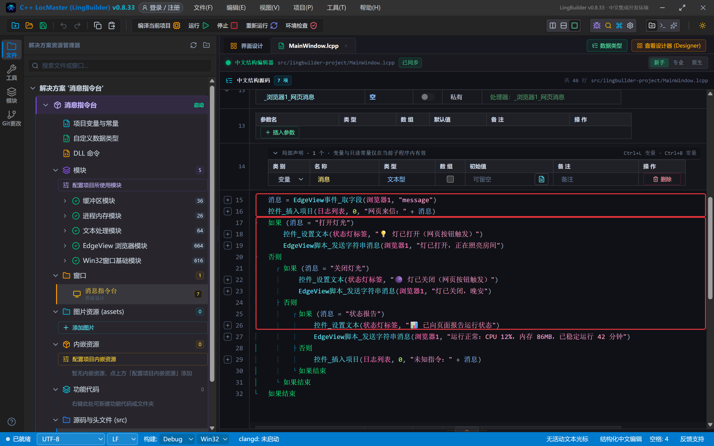

### 4.3 原生主动推送

```lcpp
事件 _问候按钮_被单击()
    EdgeView脚本_发送字符串消息(浏览器1, "来自原生的问候：你好，网页！")
    控件_插入项目(日志列表, 0, "原生 → 网页：发送字符串消息 已调用")
结束
```

原生不只能「回信」，还能**主动**推送——页面监听器随时能收到。配合时钟，就能做「网页实时刷新本地数据」（下一集的主题）。

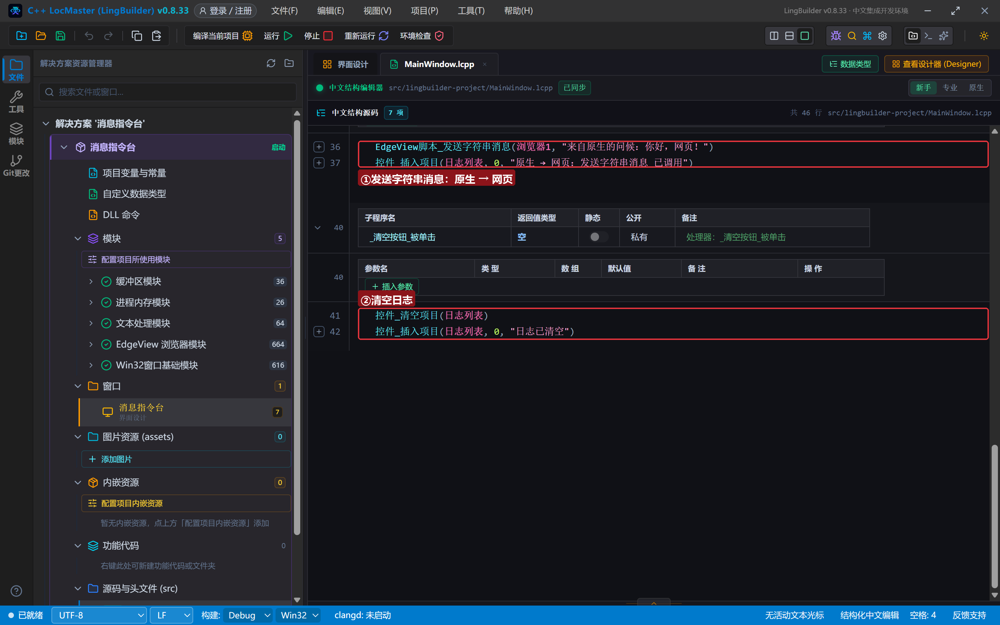

## 5. 编译：先看错误列表

错误列表 (0)，输出窗口「生成完成」：

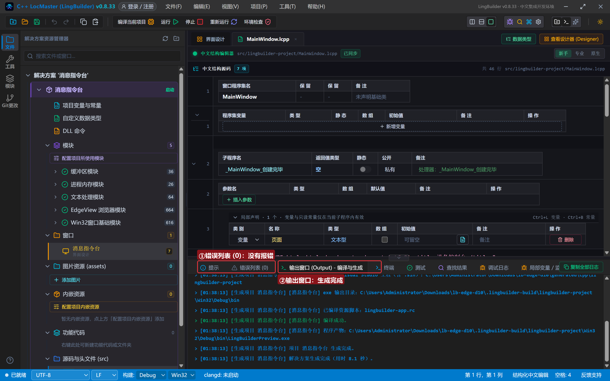

## 6. 运行：一来一回全链演示

点「运行」。设备控制台就位：

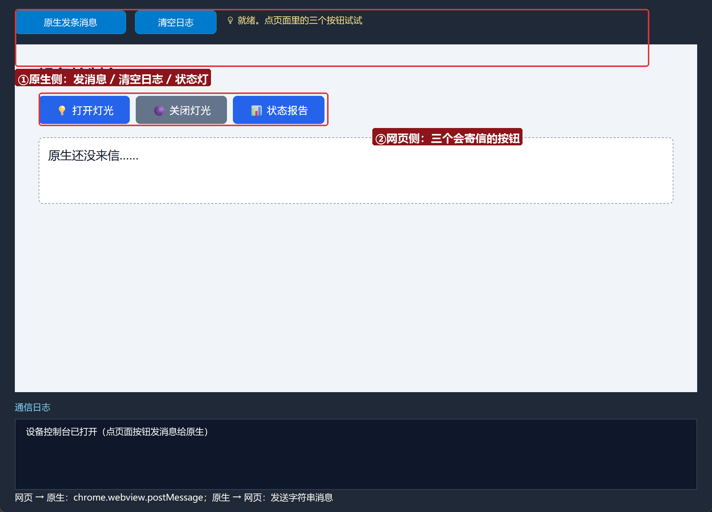

### 6.1 点页面「打开灯光」——全链三秒

点页面里的「💡 打开灯光」：网页来信记进日志 → 状态灯变「💡 灯已打开」→ 页面回执区收到原生回信。**一条链路三个位置同时有反应**：

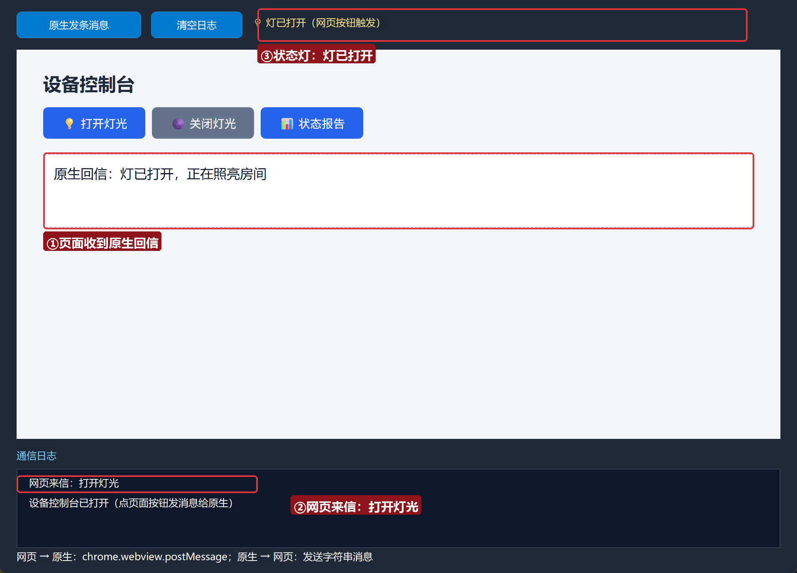

### 6.2 状态报告

点「📊 状态报告」——原生把运行状态数据回给页面：

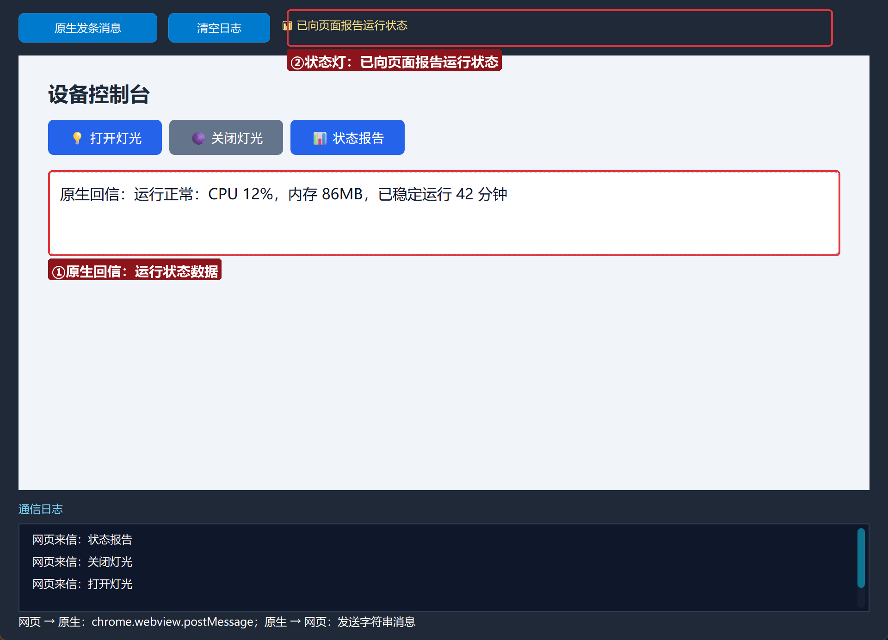

### 6.3 原生主动推送

点窗口上的「原生发条消息」——页面回执区显示「原生回信：来自原生的问候」：

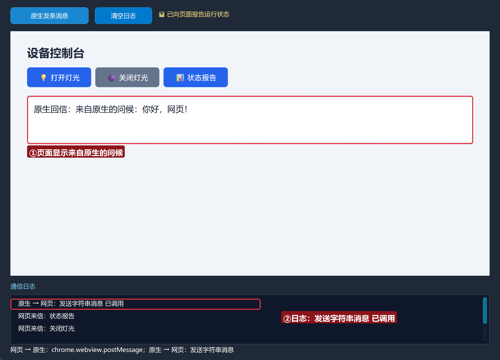

## 常见问题急救表

| 症状 | 原因 | 解法 |
| --- | --- | --- |
| 点页面按钮没反应 | 网页消息事件没绑 | 事件页签里绑「网页消息」，处理器名一字不差 |
| 取字段拿到空 | 字段名不对 | 网页消息的字段是 `message`（内容）和 `source`（来源页） |
| 页面收不到回信 | 页面没挂监听器 | `chrome.webview.addEventListener('message', …)` 必须在寄信前注册 |
| 回信内容是 JSON 不是文本 | 原生发的是对象 | 用 发送字符串消息 发字符串；发 JSON 用 发送JSON消息 + JSON.parse |
| 事件处理器没被调用 | 处理器名不一致 | 设计器事件表与 `事件` 名一字不差 |

## 本集小结

- 双向桥四件套：`postMessage`（网页寄）、网页消息事件 + `事件_取字段`（原生收）、`发送字符串消息`（原生回/推）、`addEventListener('message')`（网页收）。
- 消息内容就是**协议**——按字符串分派动作，简单可靠。
- 这是「网页壳 + 原生能力」应用的通信基石。

## 源码包

本集完整源码已打包为 **消息指令台.lcpppkg**（随本教程同目录分发，官网示例源码区可下载）。在 LingBuilder 欢迎页点「打开工作区」，或直接双击 `.lcpppkg` 文件即可导入运行。

**下一集预告**：《原生应答与推送》——时钟 + JSON 消息，让网页里的仪表盘实时刷新本地数据。

[回合集总览](/guide/tutorials/edge)
