# Edge 合集 12 · 子框架支持：钻进 iframe 里操作另一个世界

> 《LingBuilder Edge 浏览器合集》第 12 集（JS 双向桥篇收官）。很多网页把内容装在 **iframe** 里——广告位、嵌套编辑器、第三方组件都是子框架。这一集用**框架族 6 条命令**突破边界：谁来了记谁（框架创建事件）、列个名册（枚举）、查户口（取信息）、往子框架里派脚本、甚至直接给子框架发消息。全程约 25 分钟。
>
> 前置要求：学过[第 6 集](/guide/tutorials/edge-06)（填表族）和[第 10 集](/guide/tutorials/edge-10)（事件绑定）。本集源码包见文末。

## 这一集你将学会

- `EdgeView框架_枚举JSON`：列出当前已发现的所有子框架
- 设计器事件「**框架创建**」（FrameCreated）：iframe 一出现就拿到它的受管句柄
- `EdgeView框架_取信息JSON`：查框架的户口（句柄、原生 ID、名称、来源）
- `EdgeView框架_执行脚本异步`：往指定框架里派一段脚本——**句柄传 0 就是主文档**
- `EdgeView框架_发送字符串消息` / `发送JSON消息`：给子框架发消息（第 6 条 `发送共享缓冲` 用于高频大块数据，本集只登记不演示）

## 1. 子框架的「句柄」从哪来

主文档不需要句柄（**传 0 即代表主文档**）；iframe 则不同——WebView2 在子框架创建的那一刻触发「框架创建」事件，事件字段里带着这框架的**受管句柄**（handle）和名称（name）。把句柄存进类级变量，之后所有框架命令都靠它指名道姓。

## 2. 新建项目与启用模块

欢迎页「新建项目」，项目名称 **子框架探险家**，「Windows 界面设计」：

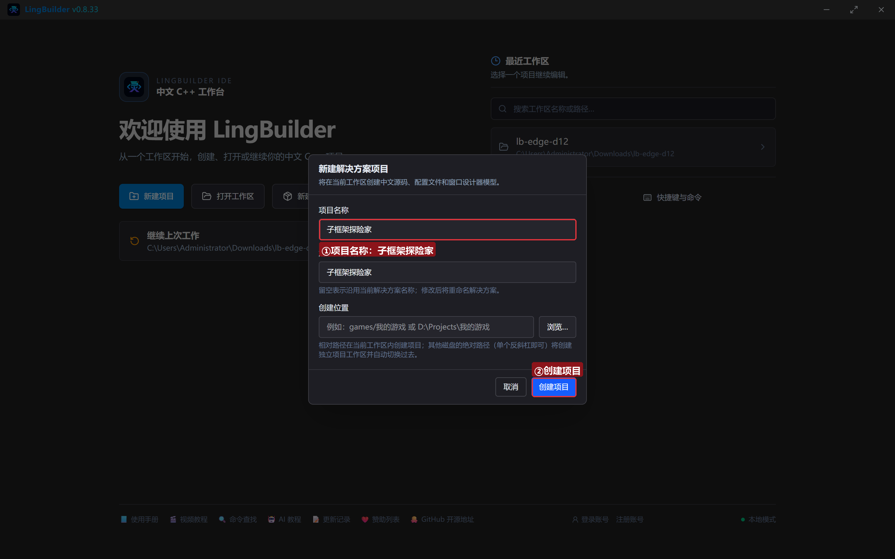

模块确认三个已启用：**EdgeView 浏览器模块**（框架族）、**文本处理模块**、**Win32窗口基础模块**：

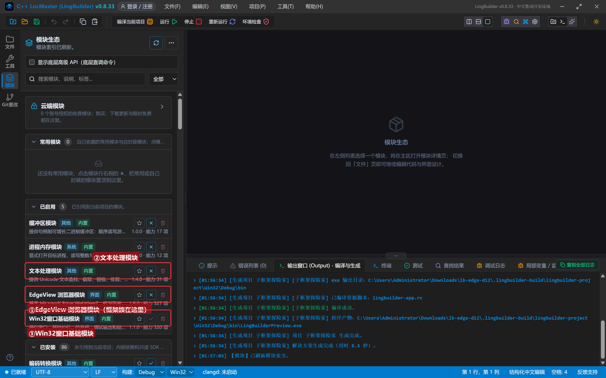

## 3. 设计界面（给浏览器绑「框架创建」）

| 控件 | 名称 | 显示内容 | 左距 | 顶距 | 宽度 | 高度 |
| --- | --- | --- | --- | --- | --- | --- |
| 按钮 | 列出按钮 | 列出框架 | 20 | 14 | 120 | 32 |
| 按钮 | 改公告按钮 | 子框架改公告 | 152 | 14 | 140 | 32 |
| 按钮 | 主文档按钮 | 主文档执行JS | 304 | 14 | 140 | 32 |
| 按钮 | 详情按钮 | 主文档信息 | 456 | 14 | 130 | 32 |
| **Edge浏览器** | **浏览器1** | （拖入）**事件页签绑「框架创建」→ `_浏览器1_框架创建`** | 20 | 60 | 920 | 470 |
| 标签 | 日志标题 | 框架日志 | 20 | 542 | 120 | 20 |
| 列表框 | 日志列表 | （清空） | 20 | 566 | 920 | 96 |
| 标签 | 状态标签 | 就绪。iframe 创建时会自动记进日志 | 20 | 664 | 920 | 20 |

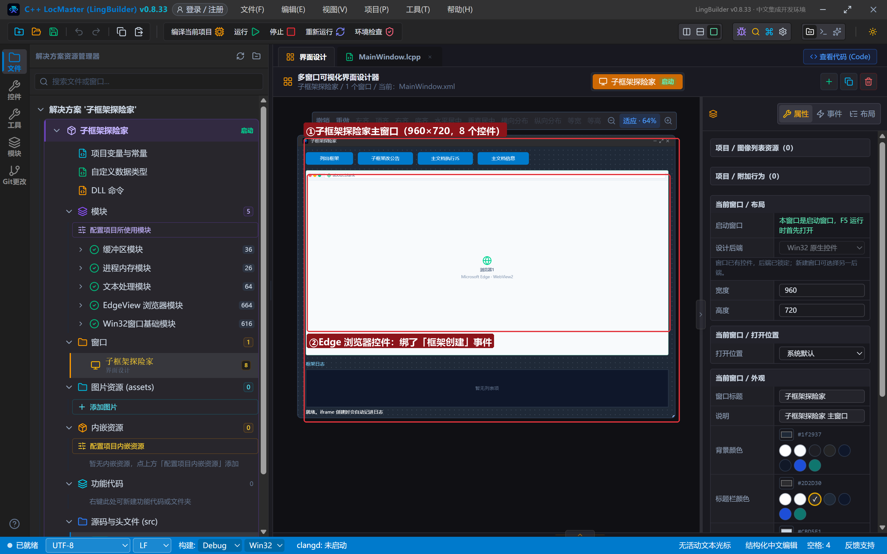

## 4. 写代码

### 4.1 创建完毕：主页里嵌一个 srcdoc iframe

```lcpp
事件 _MainWindow_创建完毕()
    局部 文本型 页面
    页面 = "<!DOCTYPE html><html><head><meta charset='utf-8'><title>子框架演示主页</title>"
    页面 = 页面 + "<style>…（样式）…</style></head><body>"
    页面 = 页面 + "<h2>主文档：下面是一个 iframe 子框架</h2>"
    页面 = 页面 + "<iframe srcdoc='<h1 id=&quot;t&quot; style=&quot;color:#b45309;margin:8px 0&quot;>子框架公告板</h1><p style=&quot;padding:0 12px&quot;>这是 iframe 里的世界，主框架的命令可以钻进来操作。</p><script>chrome.webview.addEventListener(&quot;message&quot;,function(e){document.getElementById(&quot;t&quot;).innerText=e.data;});<\\/script>'></iframe>"
    页面 = 页面 + "</body></html>"
    EdgeView导航_HTML(浏览器1, 页面)
    控件_插入项目(日志列表, 0, "主页已打开，等 iframe 的「框架创建」事件")
结束
```

两个 HTML 小机关：iframe 的内容写在 **srcdoc 属性**里，属性值内部的双引号全部写成 `&quot;` 实体；页面里的 `</script>` 要写成 `<\/script>`，否则它会把外层脚本块提前截断。

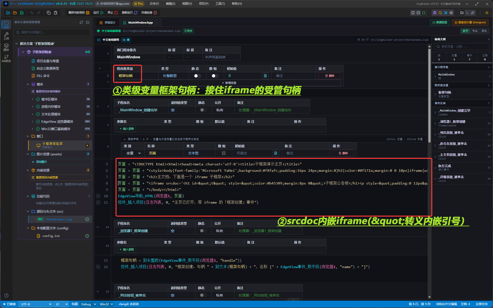

### 4.2 框架创建事件：来一个记一个

```lcpp
长整数型 框架句柄 = 0

事件 _浏览器1_框架创建()
    框架句柄 = 到长整数(EdgeView事件_取字段(浏览器1, "handle"))
    控件_插入项目(日志列表, 0, "框架创建：句柄 " + 到文本(框架句柄) + "，名称 [" + EdgeView事件_取字段(浏览器1, "name") + "]")
结束
```

事件一触发就把 `handle` 存进类级变量 `框架句柄`——之后每个框架按钮都用它。

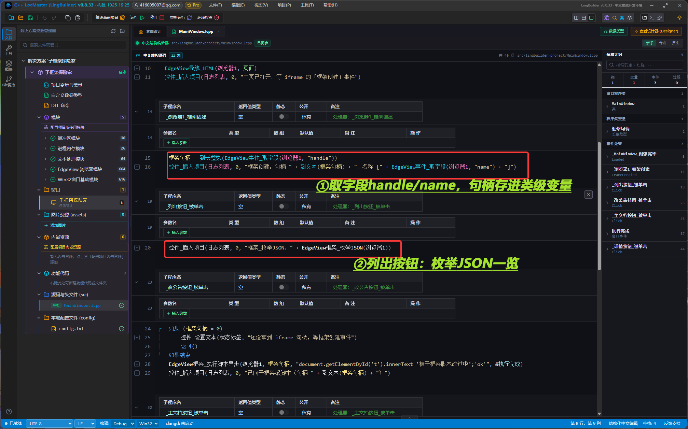

### 4.3 列出框架 / 子框架派脚本 / 主文档验证

```lcpp
事件 _列出按钮_被单击()
    控件_插入项目(日志列表, 0, "框架_枚举JSON：" + EdgeView框架_枚举JSON(浏览器1))
结束

事件 _改公告按钮_被单击()
    如果 (框架句柄 = 0)
        控件_设置文本(状态标签, "还没拿到 iframe 句柄，等框架创建事件")
        返回()
    如果结束
    EdgeView框架_执行脚本异步(浏览器1, 框架句柄, "document.getElementById('t').innerText='被子框架脚本改过啦';'ok'", &执行完成)
    控件_插入项目(日志列表, 0, "已向子框架派脚本（句柄 " + 到文本(框架句柄) + "）")
结束

事件 _主文档按钮_被单击()
    EdgeView框架_执行脚本异步(浏览器1, 0, "document.title", &执行完成)
    控件_插入项目(日志列表, 0, "框架句柄传 0 = 主文档：取 document.title")
结束

事件 执行完成()
    局部 文本型 结果
    结果 = EdgeView任务_取结果(EdgeView任务_取当前任务ID())
    结果 = 文本_替换(结果, "\"", "")
    控件_插入项目(日志列表, 0, "脚本结果：" + 结果)
结束
```

注意「句柄 0 = 主文档」是框架族的**通用约定**：`执行脚本异步`、`发送字符串消息`、`发送JSON消息`、`取信息JSON` 都认它。判 0 守卫（句柄还没来就不派脚本）是写自动化脚本的好习惯。

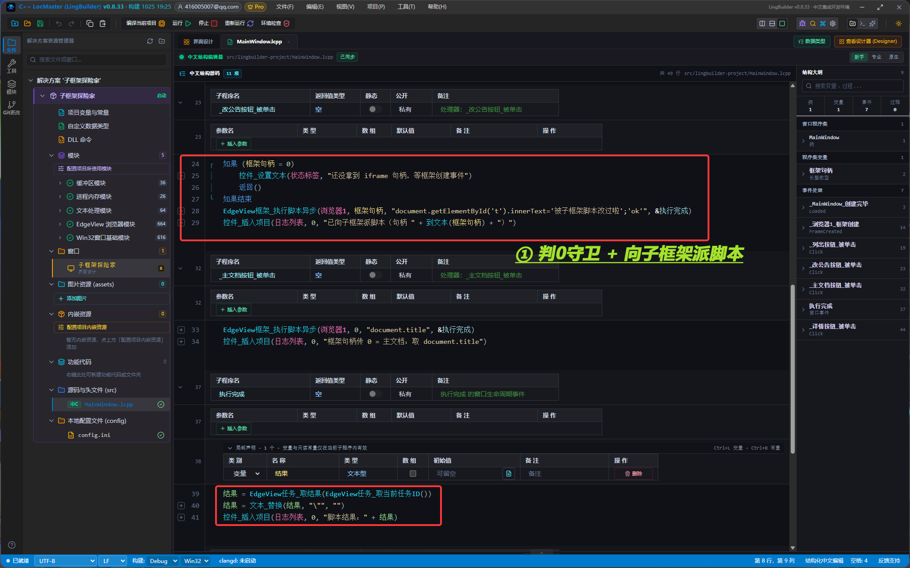

### 4.4 主文档信息

```lcpp
事件 _详情按钮_被单击()
    控件_插入项目(日志列表, 0, "主文档信息：" + EdgeView框架_取信息JSON(浏览器1, 0))
结束
```

传 0 查主文档户口，返回里带 `source`（当前地址）字段。

## 5. 编译：先看错误列表

错误列表 (0)，输出窗口「生成完成」：

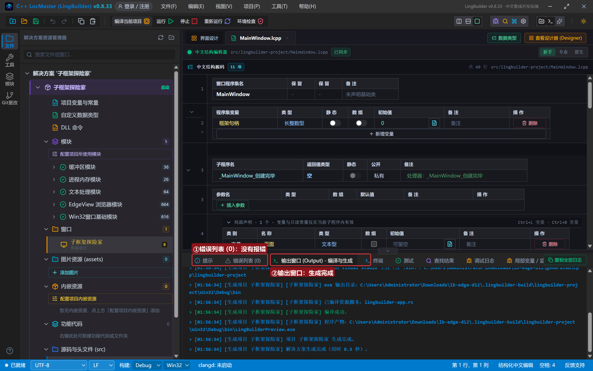

## 6. 运行：跨越框架边界

点「运行」。主页 + iframe 公告板就位：

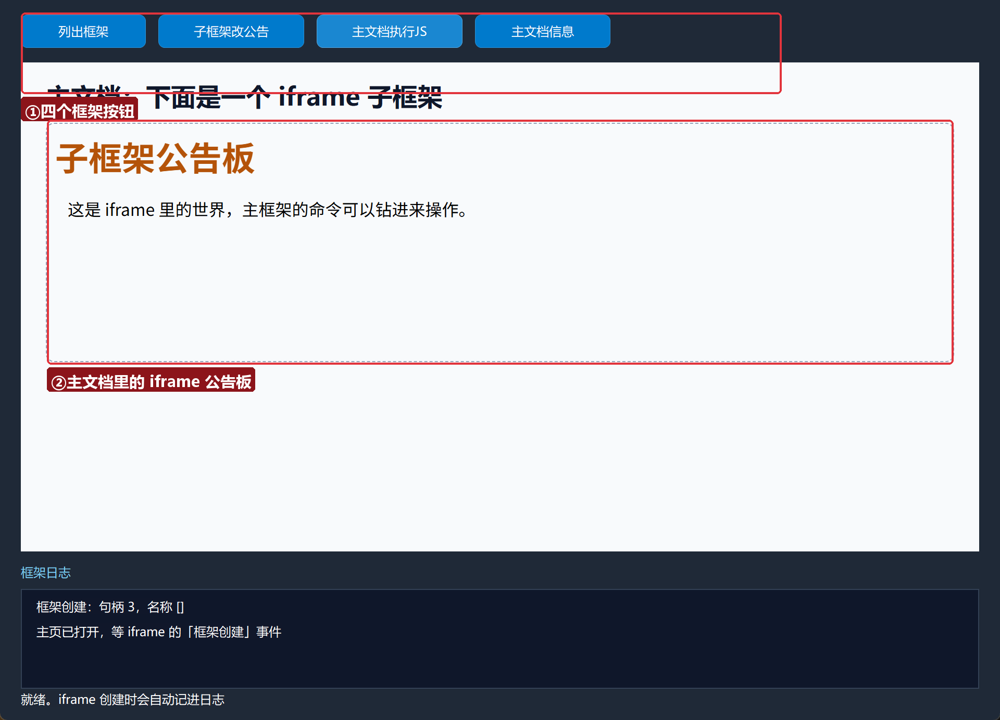

### 6.1 列出框架

点「列出框架」——枚举JSON 给出 `[{"handle":"3","name":"","destroyed":"false"}]`：

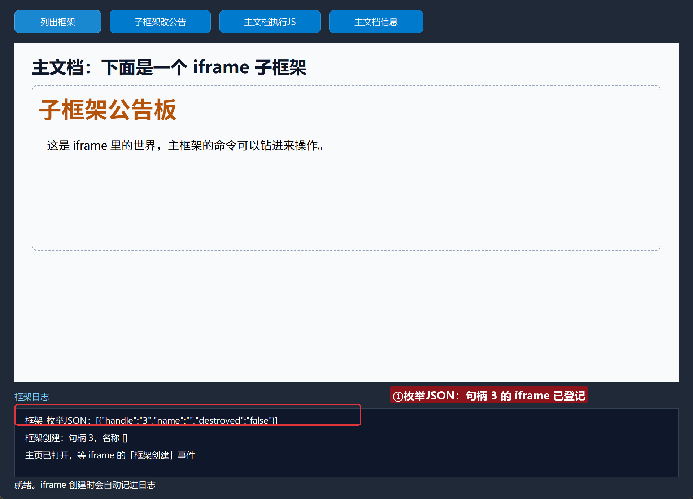

### 6.2 子框架改公告

点「子框架改公告」——**iframe 里的标题当场被改**成「被子框架脚本改过啦」，日志带回脚本结果 ok：

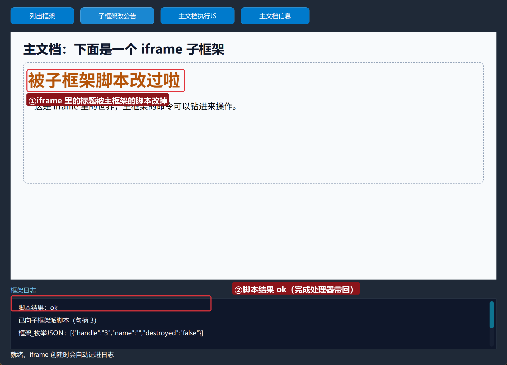

### 6.3 主文档执行 JS

点「主文档执行JS」——句柄传 0，取回主文档标题：

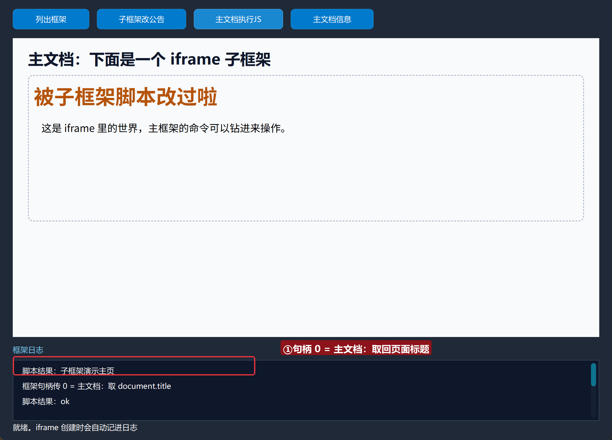

### 6.4 主文档信息

点「主文档信息」——主文档户口（含 source 地址）进日志：

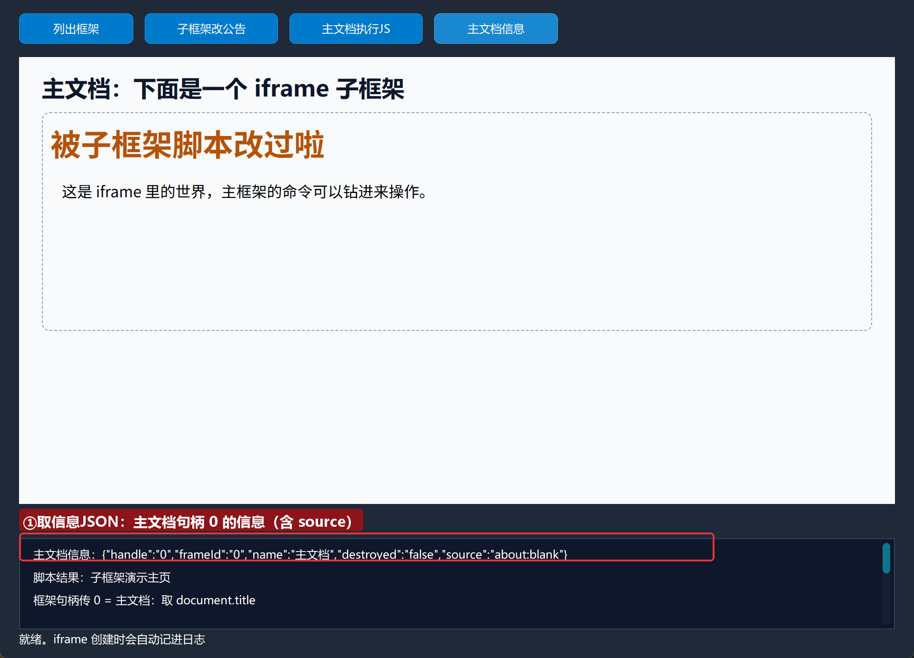

## 常见问题急救表

| 症状 | 原因 | 解法 |
| --- | --- | --- |
| 枚举结果是 `[]` | 页面没有 iframe，或还没创建完 | 等框架创建事件触发后再枚举 |
| 派脚本没生效 | 句柄过期（iframe 被销毁重建） | 重新靠框架创建事件拿新句柄 |
| srcdoc 内容没渲染 | 引号没转义 | 属性值内部双引号全部写成 &quot; |
| `</script>` 截断了页面 | 外层脚本块被提前闭合 | 写成 `<\/script>` |
| 主文档执行返回空 | 网页同源策略/时机太早 | 主文档直接用 传 0（本集已验证）；时机上等导航完成 |

## 本集小结

- iframe 句柄的唯一来源：「框架创建」事件（或 枚举JSON）；存进类级变量备用。
- **句柄 0 = 主文档** 是框架族通用约定；真句柄只管 iframe。
- `框架_执行脚本异步` 能钻进任意子框架干活；`发送字符串/JSON消息` 向子框架广播。
- 第 6 条 `发送共享缓冲` 服务高频大块数据场景，配 `EdgeView缓冲_*` 使用。

## 源码包

本集完整源码已打包为 **子框架探险家.lcpppkg**（随本教程同目录分发，官网示例源码区可下载）。在 LingBuilder 欢迎页点「打开工作区」，或直接双击 `.lcpppkg` 文件即可导入运行。

**下一集预告**：《Cookie 管理（一）》——进入会话与多开篇：会话族 21 条命令，读、设、删 Cookie。

[回合集总览](/guide/tutorials/edge)
