# Edge 合集 13 · Cookie 管理（一）：读、设、删与「按域隔离」

> 《LingBuilder Edge 浏览器合集》第 13 集（会话与多开篇）。从这一集起进入**会话族**——浏览器最值钱的家底：Cookie、登录状态、浏览数据。本集先打通最常用的四件事：**写入 Cookie、按地址读取、删指定、删全部**，并且用一个「读不到」的实验让你亲眼看见 Cookie 的**按域隔离**规则。全程约 25 分钟。
>
> 前置要求：学过[第 5 集](/guide/tutorials/edge-05)（执行JS 拆信封）。本集源码包见文末。

## 这一集你将学会

- `EdgeView会话_置Cookie(控件, 名称, 值, 域, 路径)`：创建/更新一条 Cookie
- `EdgeView会话_取Cookie异步(控件, 地址, &完成处理器)`：按地址读取，返回 JSON 列表
- `EdgeView会话_删除Cookie(控件, 名称, 域, 路径)`：三元组精确定位删除
- `EdgeView会话_删除全部Cookie(控件)`：清空当前 Profile
- 理解 **Cookie 按域隔离**：页面只能读到「自己域」的 Cookie

## 1. Cookie 的三个身份字段

每条 Cookie 由三件东西定位：**名称 + 域（domain）+ 路径（path）**。同名的两条 Cookie 只要域或路径不同就是两条不同的 Cookie——所以「删除」必须三元组一起给。还有一条铁律：**网页只能读到与自己同域的 Cookie**（HttpOnly 的连读都读不到），本集会用实验证明它。

## 2. 新建项目与启用模块

欢迎页「新建项目」，项目名称 **Cookie管理器**，「Windows 界面设计」：

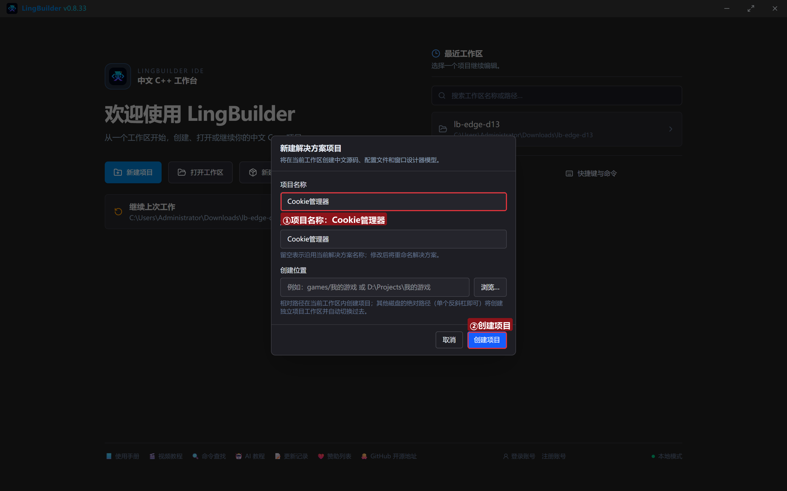

模块确认四个已启用：**EdgeView 浏览器模块**（会话族）、**文本处理模块**、**数组操作模块**、**Win32窗口基础模块**：

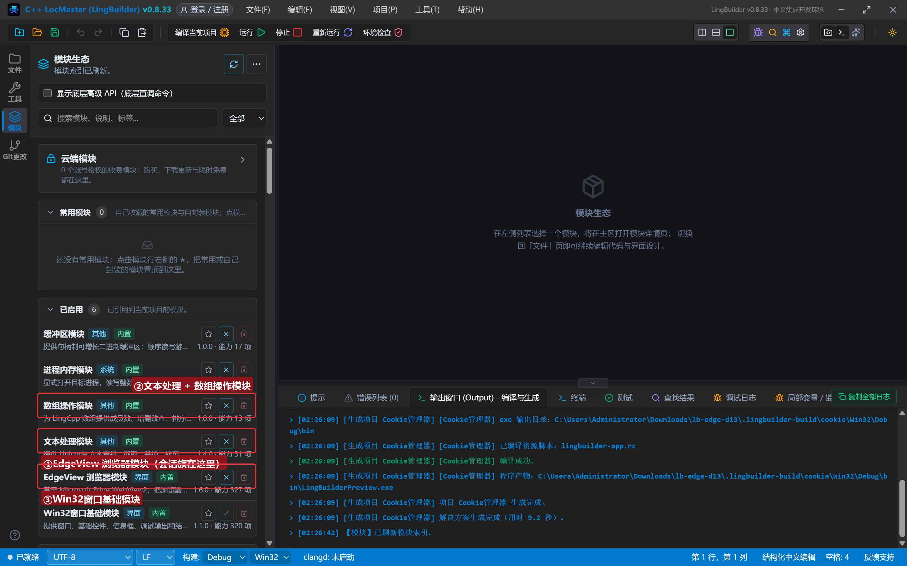

## 3. 设计界面

| 控件 | 名称 | 显示内容 | 左距 | 顶距 | 宽度 | 高度 |
| --- | --- | --- | --- | --- | --- | --- |
| 按钮 | 写入按钮 | 写入 Cookie | 20 | 14 | 130 | 32 |
| 按钮 | 读取按钮 | 读取全部 | 162 | 14 | 120 | 32 |
| 按钮 | 页面验证按钮 | 页面读一读 | 294 | 14 | 120 | 32 |
| 按钮 | 删除按钮 | 删除指定 | 426 | 14 | 120 | 32 |
| 按钮 | 清空按钮 | 删除全部 | 558 | 14 | 120 | 32 |
| **Edge浏览器** | **浏览器1** | （拖入） | 20 | 60 | 920 | 470 |
| 标签 | 日志标题 | Cookie 日志 | 20 | 542 | 120 | 20 |
| 列表框 | 日志列表 | （清空） | 20 | 566 | 920 | 96 |
| 标签 | 状态标签 | 就绪。先写入，再读给页面看 | 20 | 664 | 920 | 20 |

5 个按钮各绑「被单击」，窗口绑「创建完毕」。

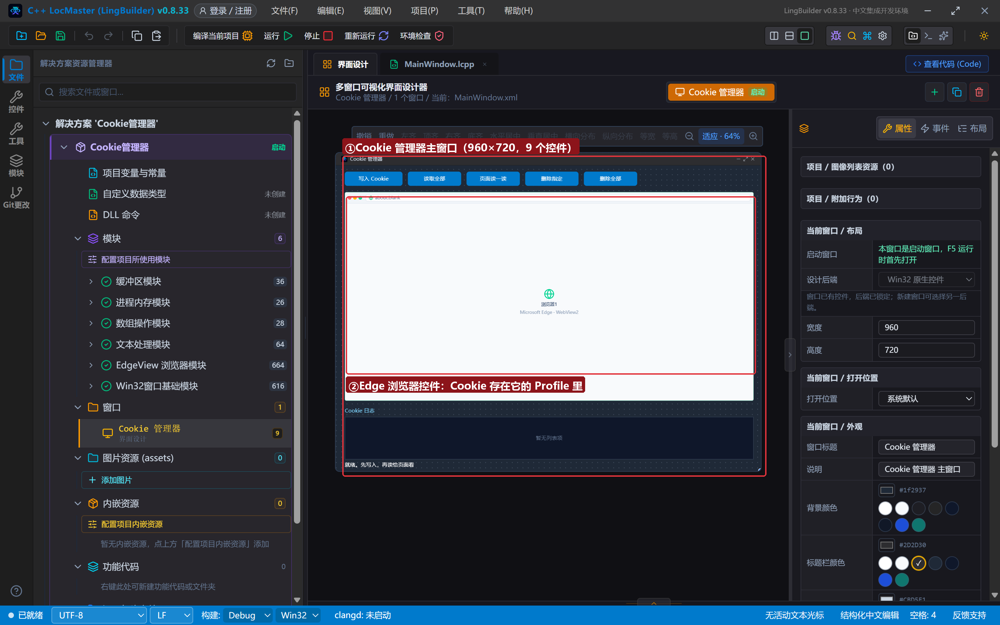

## 4. 写代码

### 4.1 创建完毕：一个能展示 document.cookie 的页面

```lcpp
事件 _MainWindow_创建完毕()
    局部 文本型 页面
    页面 = "<!DOCTYPE html><html><head><meta charset='utf-8'><title>Cookie 展示窗</title>"
    页面 = 页面 + "<style>…（样式）…</style></head><body>"
    页面 = 页面 + "<h2>Cookie 展示窗（document.cookie 只读非 HttpOnly）</h2><button onclick='show()'>读我的 Cookie</button><div id='out'>点上面按钮看结果……</div>"
    页面 = 页面 + "<script>function show(){document.getElementById('out').innerText=document.cookie||'(空)';}</script>"
    页面 = 页面 + "</body></html>"
    EdgeView导航_HTML(浏览器1, 页面)
    控件_插入项目(日志列表, 0, "展示页已打开（内存 HTML）")
结束
```

页面里那句 `document.cookie` 是网页侧读 Cookie 的唯一入口——记住它只读「**当前域**」且「**非 HttpOnly**」的 Cookie。

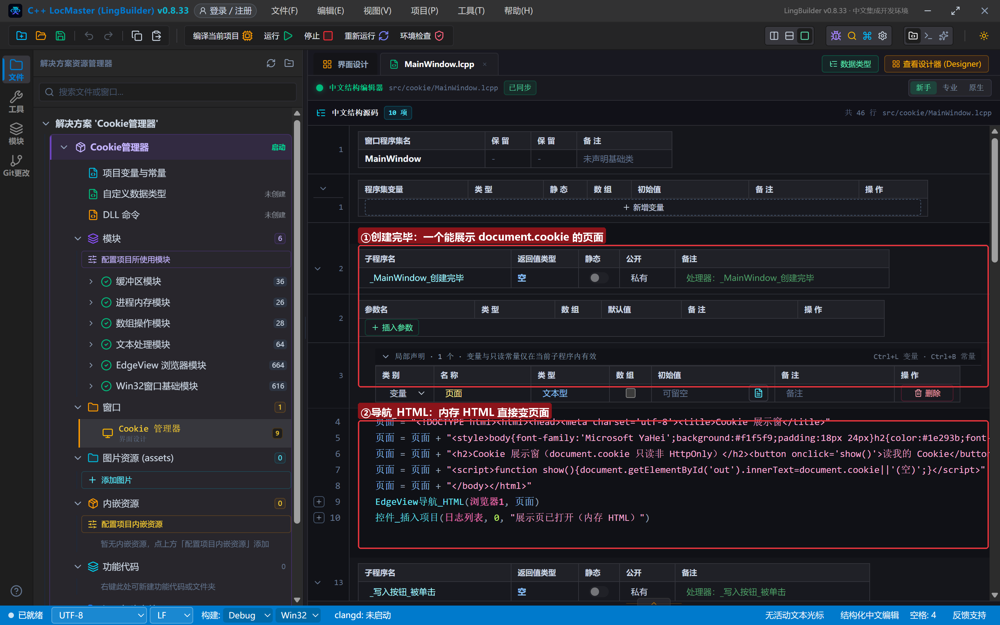

### 4.2 写入与读取

```lcpp
事件 _写入按钮_被单击()
    EdgeView会话_置Cookie(浏览器1, "lingbuilder_token", "A-1234", "example.local", "/")
    EdgeView会话_置Cookie(浏览器1, "lingbuilder_theme", "dark", "example.local", "/")
    控件_插入项目(日志列表, 0, "已写入 2 条 Cookie（lingbuilder_token / lingbuilder_theme）")
结束

事件 _读取按钮_被单击()
    EdgeView会话_取Cookie异步(浏览器1, "https://example.local/", &读取完成)
    控件_插入项目(日志列表, 0, "取Cookie异步 → https://example.local/（异步）")
结束

事件 读取完成()
    控件_插入项目(日志列表, 0, "Cookie 列表：" + EdgeView任务_取结果(EdgeView任务_取当前任务ID()))
结束
```

`置Cookie` 五个参数一次到位；`取Cookie异步` 的「地址」参数决定**按哪个域取**——传 `https://example.local/` 取的就是 example.local 家的。列表结果是 JSON 数组，每项带 name/value/domain/path/expires/secure/httpOnly 等字段。

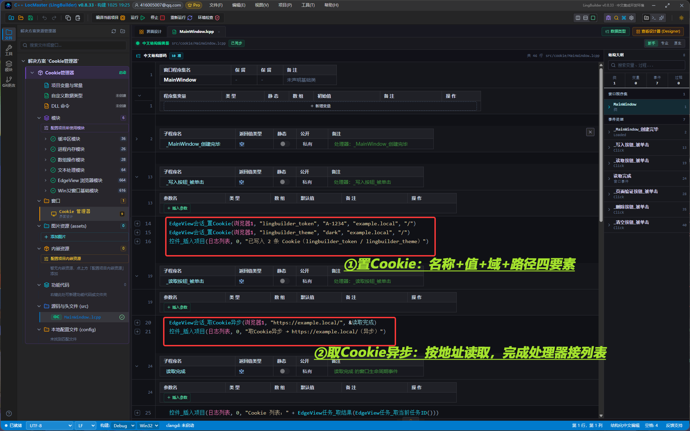

### 4.3 删除指定与删除全部

```lcpp
事件 _删除按钮_被单击()
    EdgeView会话_删除Cookie(浏览器1, "lingbuilder_token", "example.local", "/")
    控件_插入项目(日志列表, 0, "已删除 lingbuilder_token（名称+域+路径 三元组定位）")
结束

事件 _清空按钮_被单击()
    EdgeView会话_删除全部Cookie(浏览器1)
    控件_插入项目(日志列表, 0, "已删除当前 Profile 全部 Cookie")
结束
```

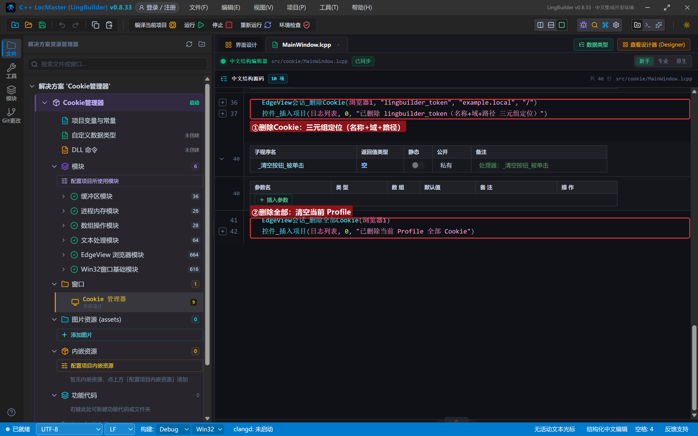

## 5. 编译：先看错误列表

错误列表 (0)，输出窗口「生成完成」：

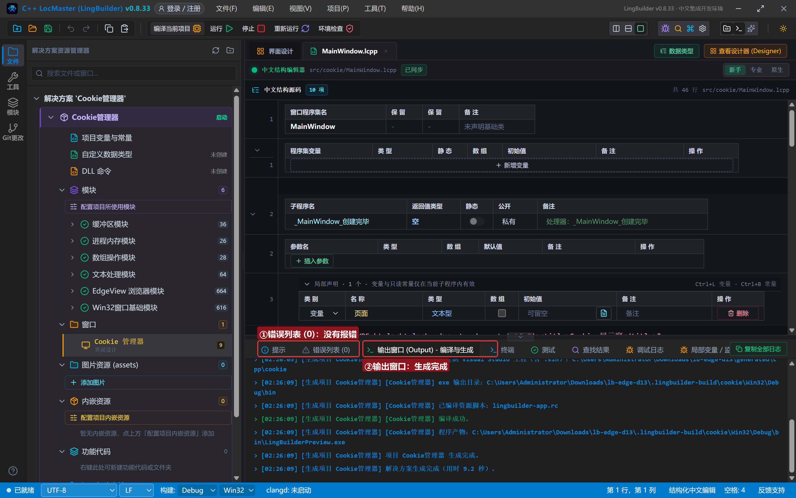

## 6. 运行：写入、读取与「读不到」

点「运行」：

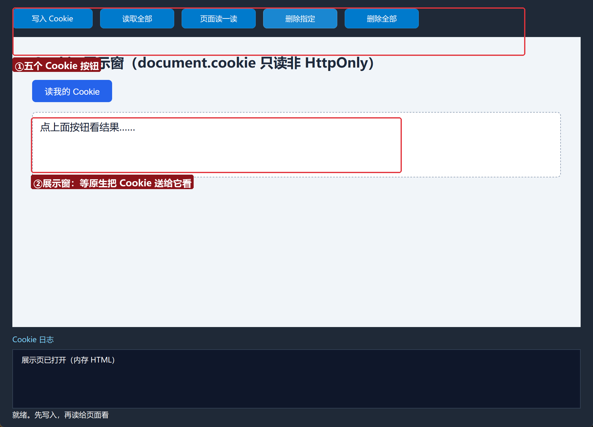

### 6.1 写入并读取

点「写入 Cookie」再点「读取全部」——日志给出 JSON 列表：`lingbuilder_token=A-1234`、`lingbuilder_theme=dark`，域都是 example.local：

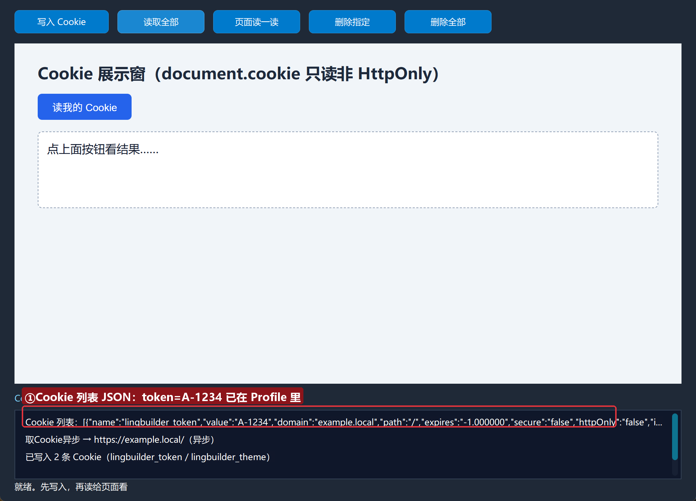

### 6.2 页面读一读：亲眼看见「按域隔离」

点「页面读一读」——原生执行 `document.cookie`，结果是 **null**！Cookie 明明在 Profile 里，页面却读不到——因为页面是内存 HTML（来源不是 example.local），**网页只能读自己域的 Cookie**：

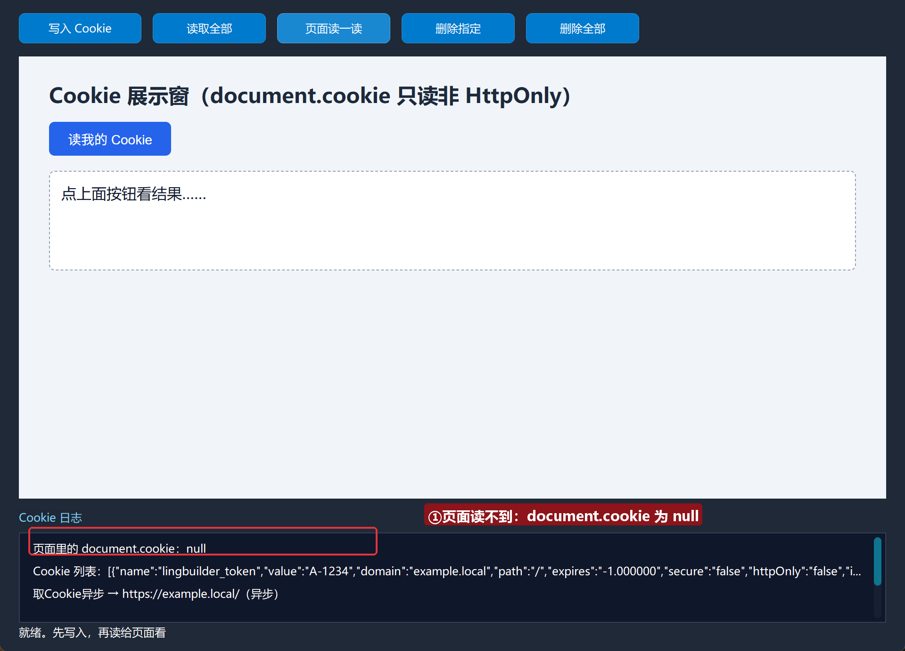

这不是 Bug，是浏览器的安全根基。想让页面读到，就把 Cookie 写到页面的真实域上（下一集会演示实例级 Cookie + 真实站点）。

### 6.3 删除指定与删除全部

点「删除指定」——三元组定位删掉 token；再点「删除全部」——Profile 清空：

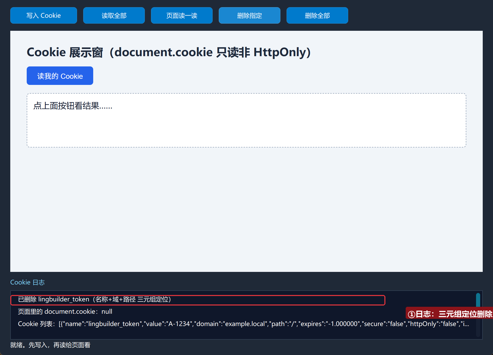

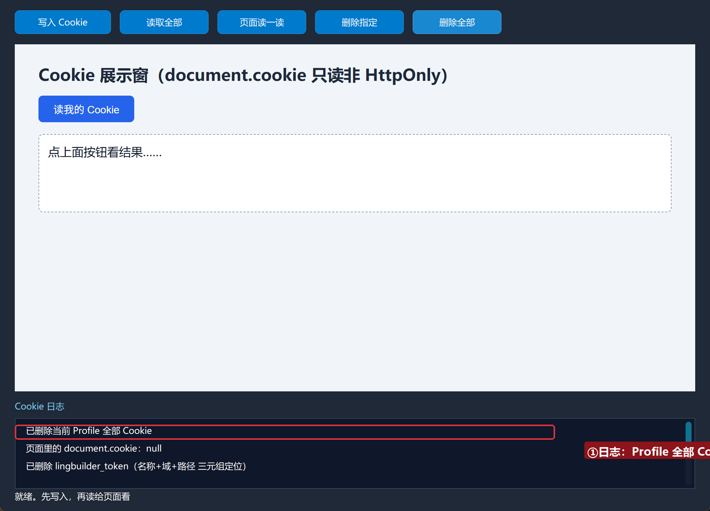

## 常见问题急救表

| 症状 | 原因 | 解法 |
| --- | --- | --- |
| 取回的列表是 `[]` | 地址与写入时的域不匹配 | 取Cookie异步 的地址要覆盖写入时的域 |
| 页面 document.cookie 是 null | Cookie 域 ≠ 页面域，或是 HttpOnly | 按域隔离是设计如此；写同域或走原生读取 |
| 删除后还在 | 三元组没对准（域或路径差一点） | 先 取Cookie异步 看真实的 domain/path 再删 |
| 会话 Cookie 重启就没了 | 没设 expires | 用 置Cookie带属性 设过期时间（下一集） |
| 编译报「未知的命令 EdgeView会话_置Cookie」 | EdgeView 模块没启用 | 模块生态里启用 EdgeView 浏览器模块 |

## 本集小结

- 会话族四件套：`置Cookie` / `取Cookie异步`（+完成处理器）/ `删除Cookie`（三元组）/ `删除全部Cookie`。
- **Cookie 按域隔离**：网页只读自己域的非 HttpOnly Cookie——原生读取不受此限。
- Profile 是 Cookie 的家：同一 Profile 内共享，跨 Profile 隔离（下一集多开就靠它）。

## 源码包

本集完整源码已打包为 **Cookie管理器.lcpppkg**（随本教程同目录分发，官网示例源码区可下载）。在 LingBuilder 欢迎页点「打开工作区」，或直接双击 `.lcpppkg` 文件即可导入运行。

**下一集预告**：《Cookie 管理（二）与实例级 Cookie》——带属性写入（过期/Secure/HttpOnly/SameSite）+ 多账号同时在线。

[回合集总览](/guide/tutorials/edge)
