# Edge 合集 14 · Cookie 管理（二）：带属性写入、批量注入与导出

> 《LingBuilder Edge 浏览器合集》第 14 集（会话与多开篇）。上一集会了「一条一条」管 Cookie；这一集上强度：**带属性写入**（过期时间 / Secure / HttpOnly / SameSite 一次设齐）、**批量注入**（一段 JSON 一次写进一串登录态，多账号场景的根基）、**导出成 JSON**（注入与导出格式互通，Cookie 保险柜闭环）。全程约 25 分钟。
>
> 前置要求：学过[第 13 集](/guide/tutorials/edge-13)。本集源码包见文末。

## 这一集你将学会

- `EdgeView会话_批量置Cookie(控件, Cookie列表JSON)`：一次写入一组 Cookie
- `EdgeView会话_置Cookie带属性(控件, 名称, 值, 域, 路径, 过期时间, 安全, 仅HTTP, 同源策略)`：完整属性的写入
- `EdgeView会话_取Cookie异步` 的结果与批量注入**格式互通**——导出即可存档，存档即可重放
- 多账号管理的正确姿势：**一实例一 Profile**，Cookie 互不串味

## 1. 两个命令，两种场景

| 命令 | 参数 | 适用 |
| --- | --- | --- |
| `置Cookie` | 名称, 值, 域, 路径 | 快速写一条会话 Cookie |
| `置Cookie带属性` | 名称, 值, 域, 路径, 过期时间(秒, -1=会话), 安全(Secure), 仅HTTP(HttpOnly), 同源策略(0 None/1 Lax/2 Strict) | 要控时效与安全标记的正式登录态 |
| `批量置Cookie` | Cookie列表JSON | 一次写入一组（多账号/多店铺） |

**批量格式**与 `取Cookie异步` 的输出同构：`[{"name":"…","value":"…","domain":"…","path":"…"}]`，可带 `expires`（UTC 秒）、`secure`、`httpOnly`、`sameSite`。这意味着「读出来 → 存文件 → 下次写回去」的登录态保活链路不需要任何格式转换。

## 2. 新建项目与启用模块

欢迎页「新建项目」，项目名称 **多账号保险柜**，「Windows 界面设计」：

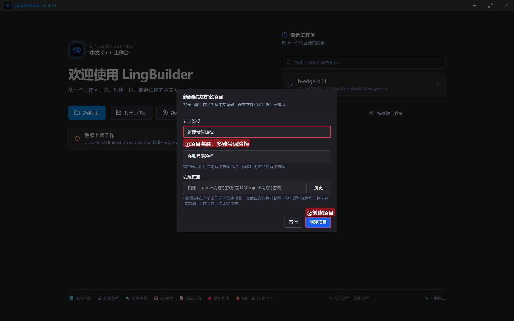

模块确认三个已启用：**EdgeView 浏览器模块**、**文本处理模块**、**Win32窗口基础模块**：

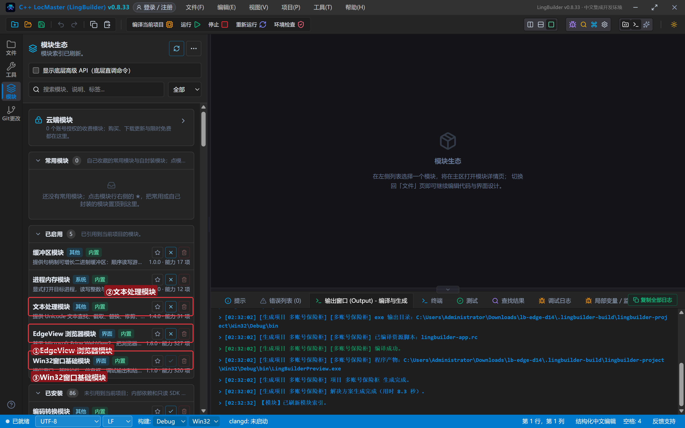

## 3. 设计界面

| 控件 | 名称 | 显示内容 | 左距 | 顶距 | 宽度 | 高度 |
| --- | --- | --- | --- | --- | --- | --- |
| 按钮 | 注入按钮 | 批量注入会话Cookie | 20 | 14 | 170 | 32 |
| 按钮 | 带属性按钮 | 带属性写入 | 202 | 14 | 140 | 32 |
| 按钮 | 导出按钮 | 导出成JSON | 354 | 14 | 130 | 32 |
| 按钮 | 清空按钮 | 清空重放 | 496 | 14 | 120 | 32 |
| **Edge浏览器** | **浏览器1** | （拖入） | 20 | 60 | 920 | 470 |
| 标签 | 日志标题 | 保险柜日志 | 20 | 542 | 120 | 20 |
| 列表框 | 日志列表 | （清空） | 20 | 566 | 920 | 96 |
| 标签 | 状态标签 | 就绪。批量注入 = 一次调用写一串登录态 | 20 | 664 | 920 | 20 |

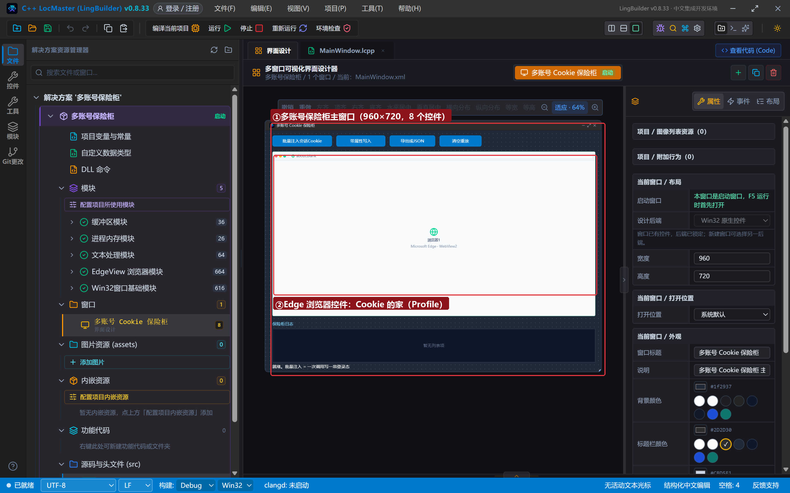

## 4. 写代码

### 4.1 创建完毕：逐行展示登录态的页面

```lcpp
事件 _MainWindow_创建完毕()
    局部 文本型 页面
    页面 = "<!DOCTYPE html><html><head><meta charset='utf-8'><title>登录态展示窗</title>"
    页面 = 页面 + "<style>…（样式）…</style></head><body>"
    页面 = 页面 + "<h2>登录态展示窗</h2><button onclick='show()'>读我的 Cookie</button><div id='out'>点上面按钮……</div>"
    页面 = 页面 + "<script>function show(){var c=document.cookie.split(';').map(function(x){return x.trim();}).filter(function(x){return x.length>0;});document.getElementById('out').innerText=c.length?c.join('\\n'):'(空)';}</script>"
    页面 = 页面 + "</body></html>"
    EdgeView导航_HTML(浏览器1, 页面)
    控件_插入项目(日志列表, 0, "展示页已打开（内存 HTML，同源 Cookie 可见）")
结束
```

页面把 `document.cookie` 按分号拆行展示——注入进去的每一条都一目了然。

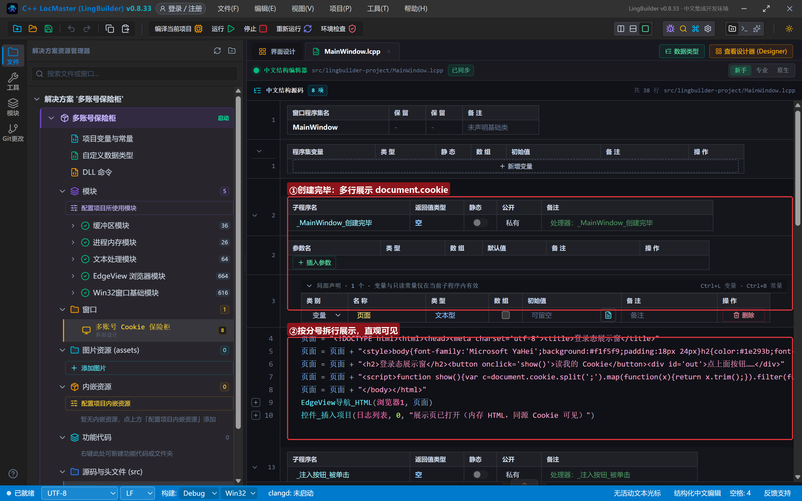

### 4.2 批量注入与带属性写入

```lcpp
事件 _注入按钮_被单击()
    EdgeView会话_批量置Cookie(浏览器1, "[{\"name\":\"shopA_session\",\"value\":\"SESSION-A-8888\",\"domain\":\"example.local\",\"path\":\"/\"},{\"name\":\"shopB_session\",\"value\":\"SESSION-B-6666\",\"domain\":\"example.local\",\"path\":\"/\"},{\"name\":\"shopC_session\",\"value\":\"SESSION-C-2026\",\"domain\":\"example.local\",\"path\":\"/\"}]")
    控件_插入项目(日志列表, 0, "批量置Cookie：3 个店铺会话一次写入")
结束

事件 _带属性按钮_被单击()
    EdgeView会话_置Cookie带属性(浏览器1, "remember_me", "yes", "example.local", "/", 3600, 真, 真, 1)
    控件_插入项目(日志列表, 0, "置Cookie带属性：1 小时过期 + Secure + HttpOnly + SameSite=Lax")
结束
```

JSON 字符串里的双引号在中文代码里写成 `\"` 转义，建议先在文本里把 JSON 写好再贴进代码。`置Cookie带属性` 的**过期时间是「从现在的秒数」**（3600 = 一小时），`同源策略` 传 1 是 Lax（None 必须同时开 Secure）。

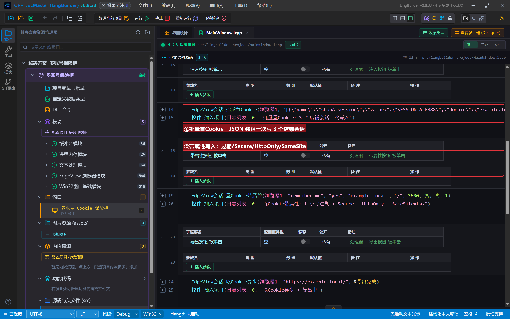

### 4.3 导出与清空

```lcpp
事件 _导出按钮_被单击()
    EdgeView会话_取Cookie异步(浏览器1, "https://example.local/", &导出完成)
    控件_插入项目(日志列表, 0, "取Cookie异步 → 导出中")
结束

事件 导出完成()
    控件_插入项目(日志列表, 0, "导出JSON：" + EdgeView任务_取结果(EdgeView任务_取当前任务ID()))
结束

事件 _清空按钮_被单击()
    EdgeView会话_删除全部Cookie(浏览器1)
    控件_插入项目(日志列表, 0, "已清空，可重新注入")
结束
```

导出的 JSON 直接就是「批量注入」认的格式——把它存进文件，下次启动写回去，登录态就保住了。真实项目里把这两条命令接上 `文件_写入文本` / `文件_读取文本`（fs.core 模块）即可。

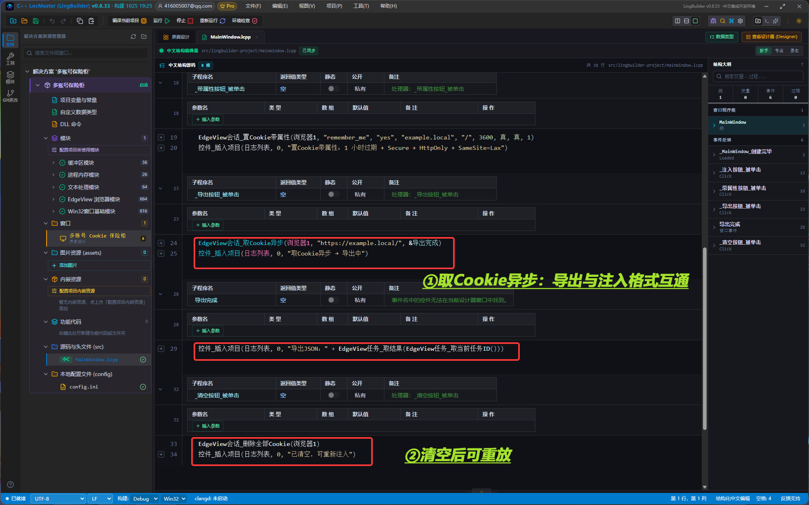

## 5. 编译：先看错误列表

错误列表 (0)，输出窗口「生成完成」：

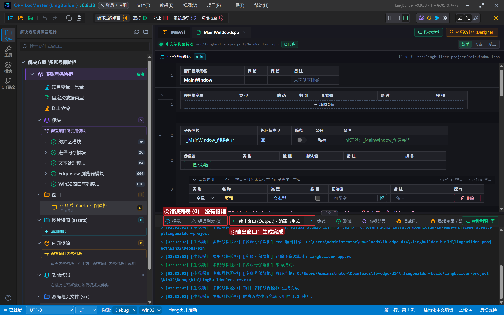

## 6. 运行：保险柜三连

点「运行」：

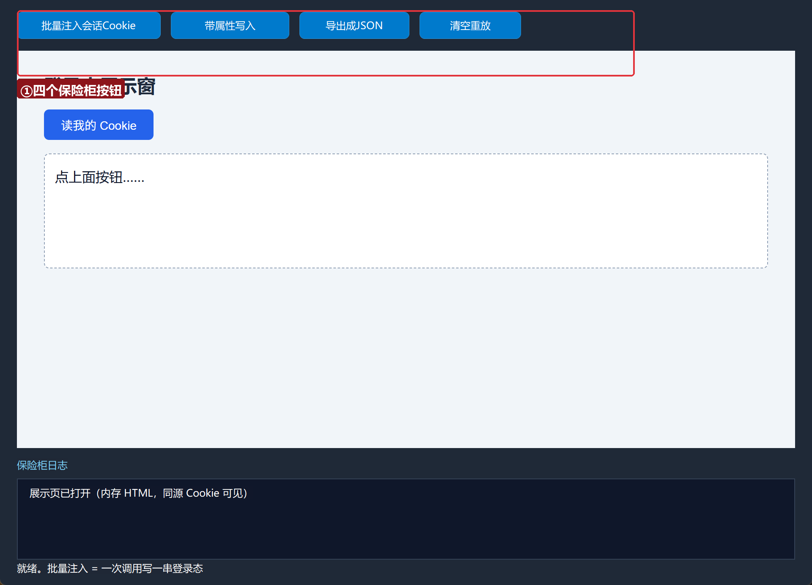

### 6.1 批量注入

点「批量注入会话Cookie」——三个店铺会话一次写入：

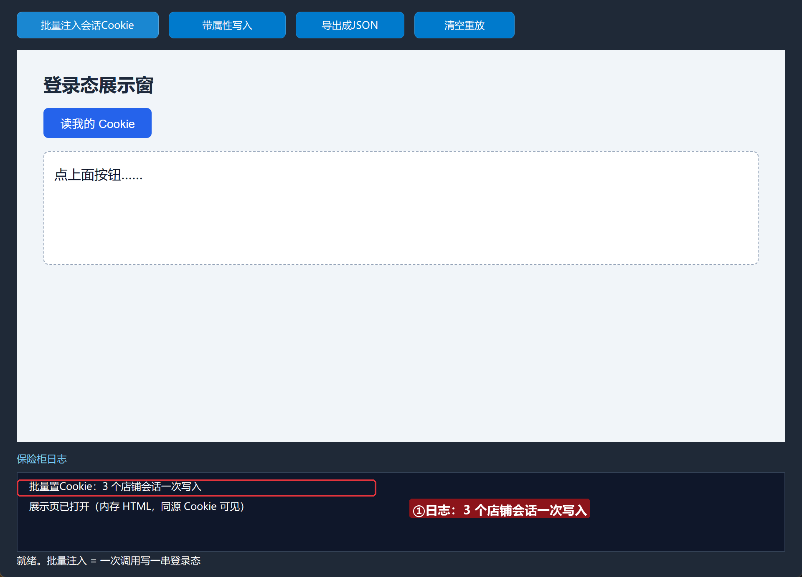

### 6.2 导出 JSON

点「导出成JSON」——日志给出完整 JSON 数组（name/value/domain/path/expires/secure/httpOnly 全带）：

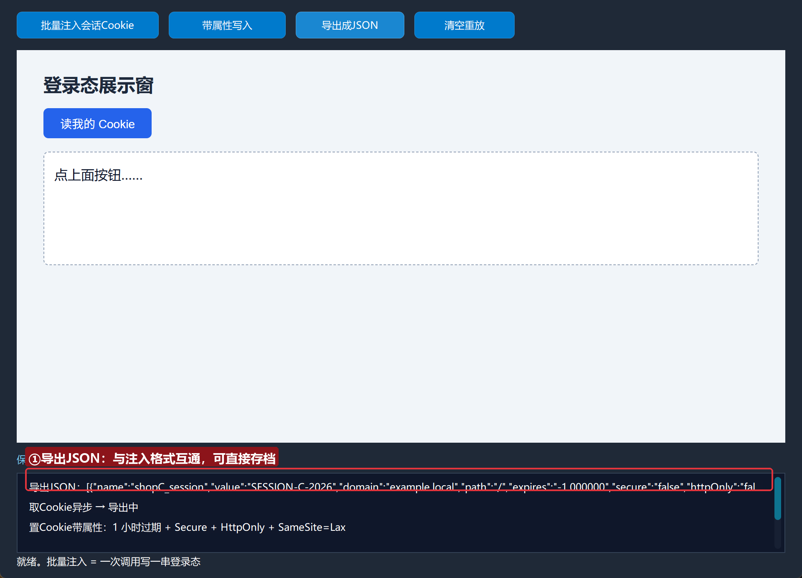

### 6.3 清空重放

点「清空重放」——删全部后可再注入：

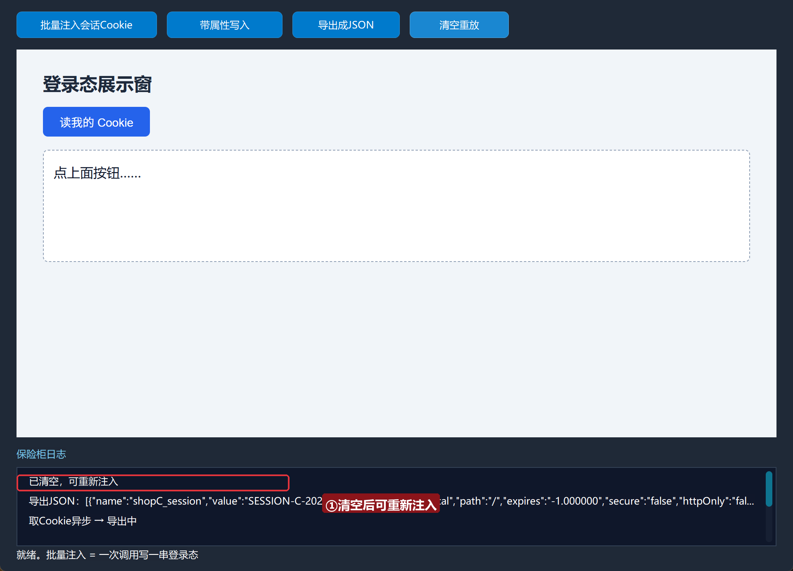

## 常见问题急救表

| 症状 | 原因 | 解法 |
| --- | --- | --- |
| 批量注入返回 0 | JSON 格式错误（缺引号/逗号） | 先在文本工具里校验 JSON，再贴进代码 |
| 带属性 Cookie 立刻消失 | 过期时间给成了过去的时间点 | 过期参数是「从现在的秒数」，-1 为会话 Cookie |
| SameSite=None 不生效 | None 必须同时 Secure | 同源策略传 0 时，安全参数必须传 真 |
| 页面读不到 HttpOnly Cookie | HttpOnly 本就不让页面读 | 设计如此；HttpOnly 是给请求头用的 |
| 注入的 Cookie 页面看不见 | 域不匹配 | 页面域要与 Cookie 域一致（本集展示窗是内存 HTML） |

## 本集小结

- **批量置Cookie** 是多账号场景的核心：一段 JSON 一串登录态。
- **置Cookie带属性** 五件套：过期/Secure/HttpOnly/SameSite/路径。
- 导出与注入**格式互通**，Cookie 保活只需「读 → 存 → 回放」。
- 多账号隔离的真正边界是 Profile（实例级 Cookie，后面实例篇展开）。

## 源码包

本集完整源码已打包为 **多账号保险柜.lcpppkg**（随本教程同目录分发，官网示例源码区可下载）。在 LingBuilder 欢迎页点「打开工作区」，或直接双击 `.lcpppkg` 文件即可导入运行。

**下一集预告**：《多店铺弹窗》——一个程序同时开多个独立浏览器实例（1.4 新能力），店铺 A/B/C 各登各的号。

[回合集总览](/guide/tutorials/edge)
