# Edge 合集 17 · 设置族（二）：创建期选项——启动参数、跨域开关与重建

> 《LingBuilder Edge 浏览器合集》第 17 集（会话与多开篇）。有一类设置很特殊：它们写进浏览器的「出生证明」，**创建之后再改一律无效**——这就是创建期选项（创建选项族）。本集做一台「实验室」：附加 Chromium 启动参数、跨域限制开关，并学会唯一能让它们生效的动作——**应用并重建控件**。全程约 25 分钟。
>
> 前置要求：学过[第 16 集](/guide/tutorials/edge-16)（运行期设置）。本集源码包见文末。

## 这一集你将学会

- `EdgeView创建选项_置附加参数` / `取附加参数`：Chromium 启动参数文本
- `EdgeView创建选项_置跨域限制关闭` / `取跨域限制关闭`：同源策略开关（红线上墙）
- `EdgeView创建选项_重建控件`：让创建期选项真正落地的唯一动作
- 创建期 vs 运行期设置的边界

## 1. 创建期 vs 运行期：一张表分清

| | 运行期设置（第 16 集） | 创建期选项（本集） |
| --- | --- | --- |
| 例子 | UA、脚本开关、缩放 | 启动参数、跨域开关、独占用户目录 |
| 生效 | 立即或下次导航 | **必须重建控件** |
| 存储 | WebView 运行态 | 环境/浏览器进程启动配置 |

**红线**：跨域限制关闭（`--disable-web-security`）只用于**受控内网页面**场景；对外部网站开启等于裸奔，且会连带影响同进程的所有实例。

## 2. 新建项目与启用模块

欢迎页「新建项目」，项目名称 **创建期选项实验室**，「Windows 界面设计」：

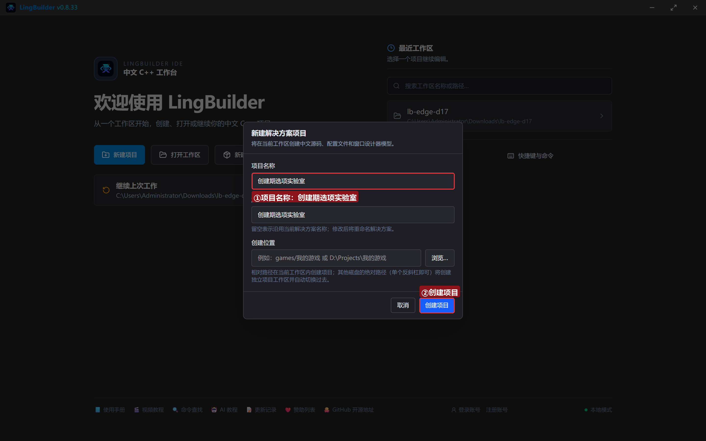

模块确认三个已启用：**EdgeView 浏览器模块**、**文本处理模块**、**Win32窗口基础模块**：

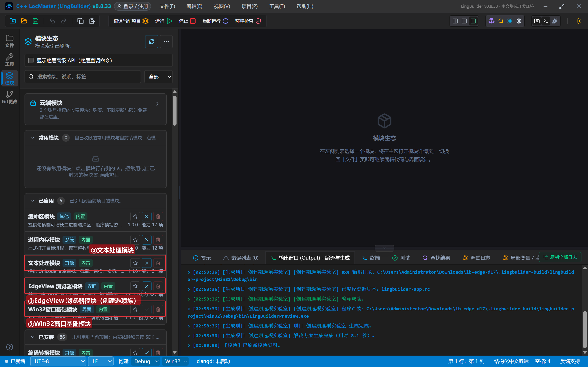

## 3. 设计界面

| 控件 | 名称 | 显示内容 | 左距 | 顶距 | 宽度 | 高度 |
| --- | --- | --- | --- | --- | --- | --- |
| 按钮 | 读参数按钮 | 读当前启动参数 | 20 | 14 | 150 | 32 |
| 按钮 | 加参数按钮 | 附加启动参数 | 182 | 14 | 150 | 32 |
| 按钮 | 跨域按钮 | 开启跨域开关 | 344 | 14 | 150 | 32 |
| 按钮 | 读跨域按钮 | 读跨域状态 | 506 | 14 | 140 | 32 |
| 按钮 | 重建按钮 | 应用并重建 | 658 | 14 | 140 | 32 |
| **Edge浏览器** | **浏览器1** | （拖入） | 20 | 60 | 920 | 470 |
| 标签 | 日志标题 | 实验日志 | 20 | 542 | 120 | 20 |
| 列表框 | 日志列表 | （清空） | 20 | 566 | 920 | 96 |
| 标签 | 状态标签 | 就绪。创建期选项改完必须「应用并重建」 | 20 | 664 | 920 | 20 |

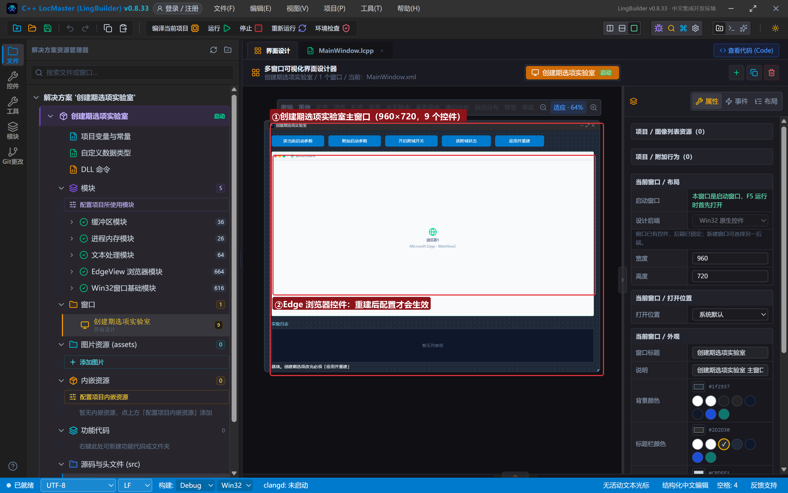

## 4. 写代码

### 4.1 打开页面 + 实验守则

```lcpp
事件 _MainWindow_创建完毕()
    EdgeView_导航控件(浏览器1, "https://www.iana.org")
    控件_插入项目(日志列表, 0, "实验室就绪：改创建期选项 → 应用并重建 → 重新导航")
结束
```

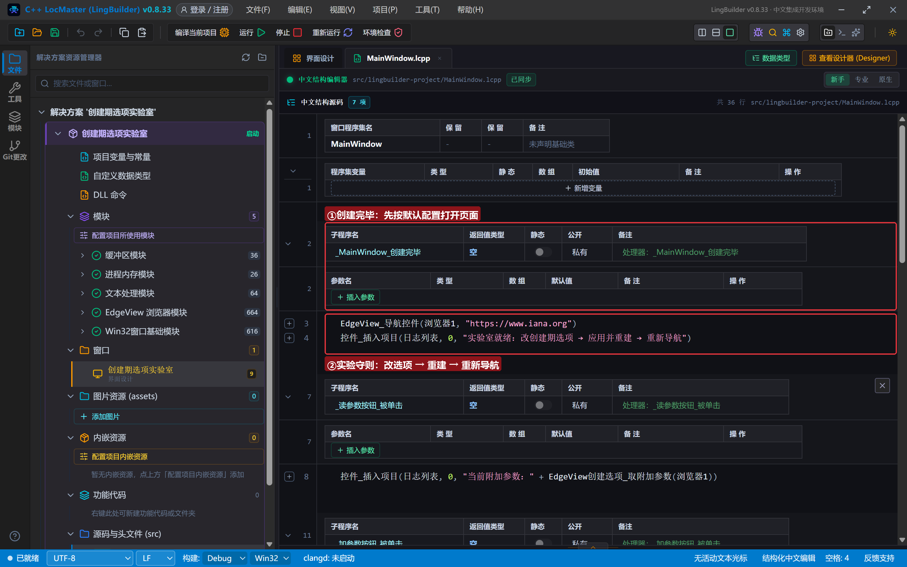

### 4.2 附加启动参数：写、读、重建

```lcpp
事件 _读参数按钮_被单击()
    控件_插入项目(日志列表, 0, "当前附加参数：" + EdgeView创建选项_取附加参数(浏览器1))
结束

事件 _加参数按钮_被单击()
    EdgeView创建选项_置附加参数(浏览器1, "--force-color-profile=srgb")
    控件_插入项目(日志列表, 0, "已写入附加参数 --force-color-profile=srgb（未生效，等重建）")
结束

事件 _重建按钮_被单击()
    EdgeView创建选项_重建控件(浏览器1)
    控件_插入项目(日志列表, 0, "已应用创建期选项并重建控件，重新导航验证")
    EdgeView_导航控件(浏览器1, "https://www.iana.org")
结束
```

附加参数是**多个 Chromium 开关用空格分隔**的文本（不带 `--` 前缀以外的装饰、每个开关自带 `--`）。注意安全类开关（如 disable-web-security）会被 release SDK 过滤——真正要放开跨域请用下面这条专用命令。

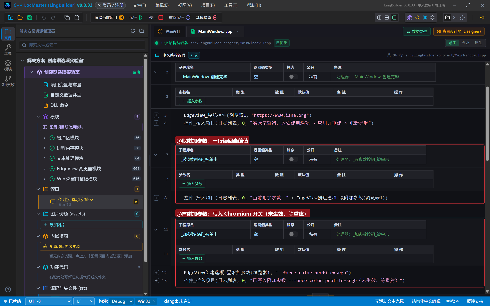

### 4.3 跨域开关：登记、读回

```lcpp
事件 _跨域按钮_被单击()
    EdgeView创建选项_置跨域限制关闭(浏览器1, 真)
    控件_插入项目(日志列表, 0, "已登记跨域限制关闭（仅限受控内网页面场景）")
结束

事件 _读跨域按钮_被单击()
    如果 (EdgeView创建选项_取跨域限制关闭(浏览器1) = 1)
        控件_插入项目(日志列表, 0, "跨域限制关闭：已登记（待重建生效）")
    否则
        控件_插入项目(日志列表, 0, "跨域限制关闭：未登记")
    如果结束
结束
```

这条命令同样要**重建控件**才落地；读回的 1/0 是「登记状态」。它通过环境变量 `WEBVIEW2_ADDITIONAL_BROWSER_ARGUMENTS` 双通道补加开关——AdditionalBrowserArguments 单通道会被 SDK 过滤安全类开关，两者都保留。

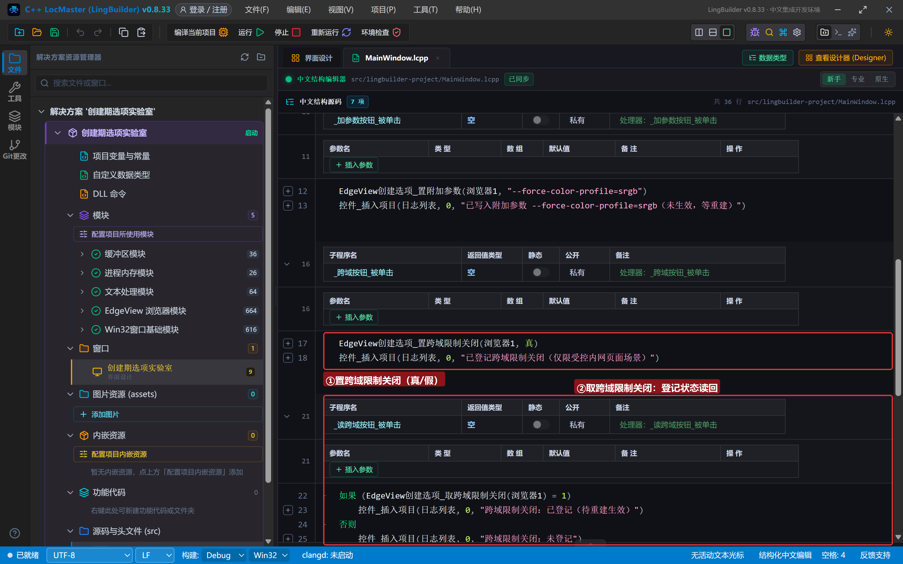

## 5. 编译：先看错误列表

错误列表 (0)，输出窗口「生成完成」：

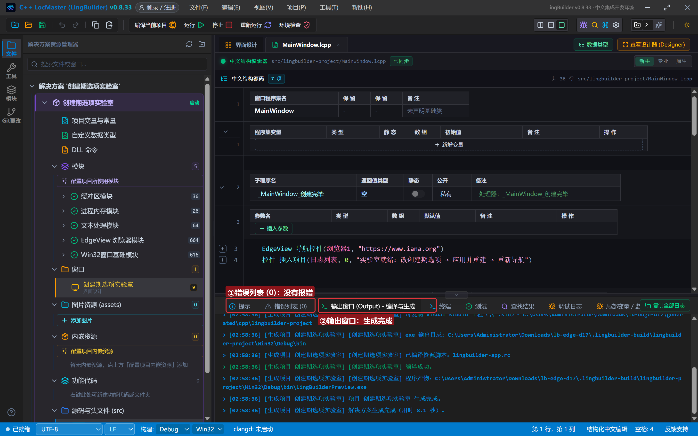

## 6. 运行：登记 → 重建 → 生效

点「运行」：

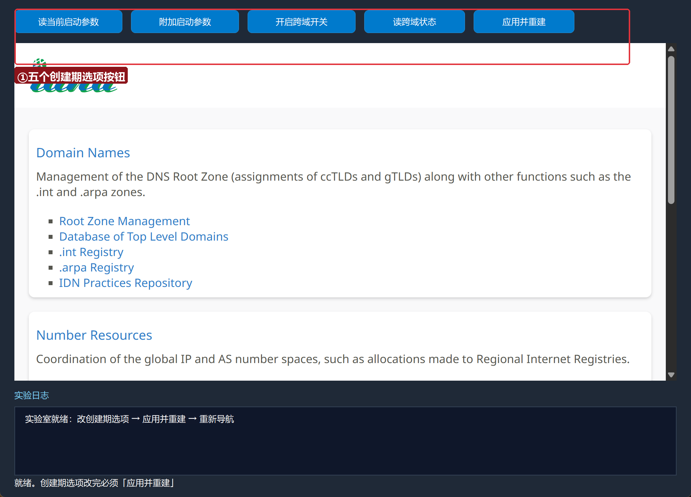

### 6.1 读当前参数

点「读当前启动参数」——空文本（未设置过）：

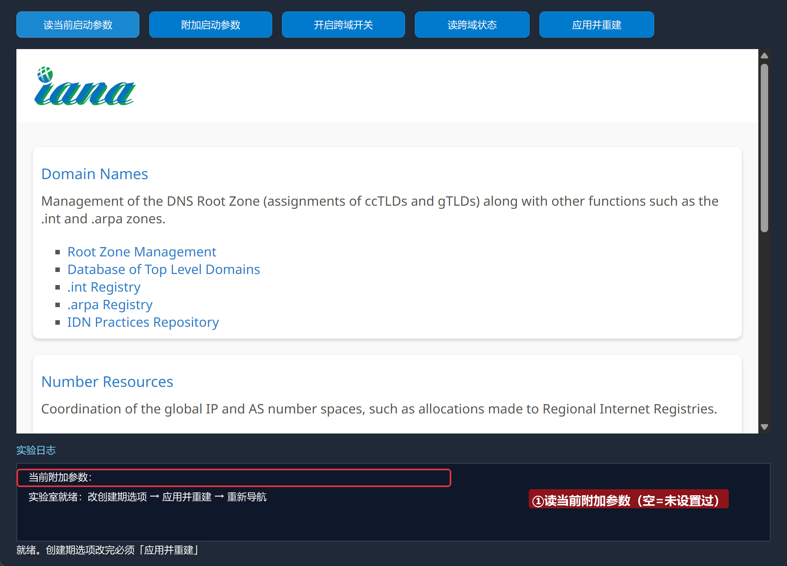

### 6.2 登记附加参数与跨域

点「附加启动参数」「开启跨域开关」——都只是「登记」，日志明确提示等重建：

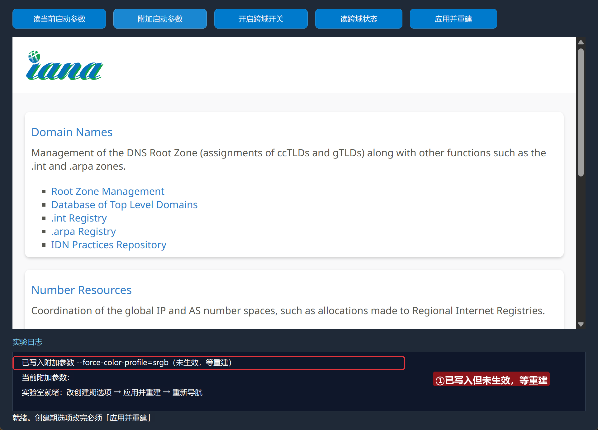

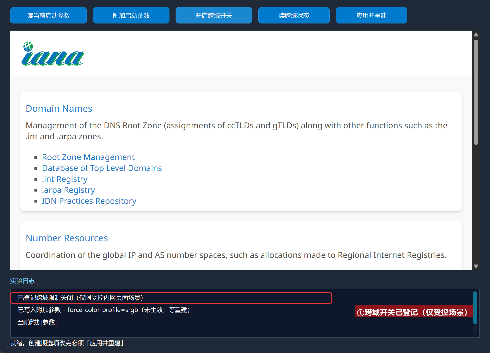

### 6.3 应用并重建

点「应用并重建」——控件按新配置重生，重新导航验证：

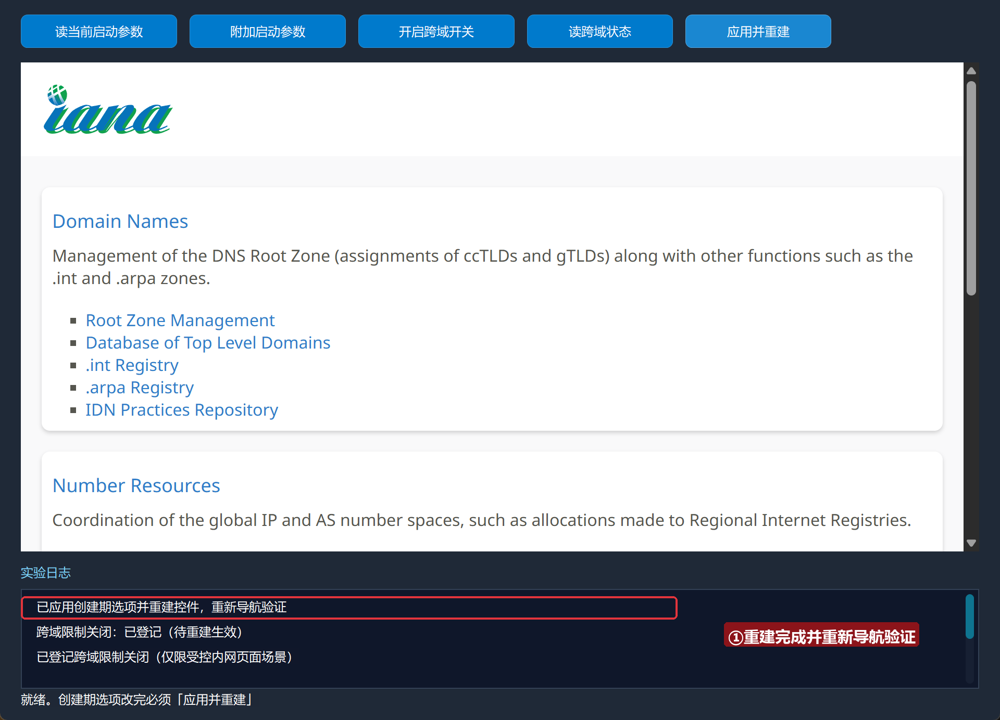

## 常见问题急救表

| 症状 | 原因 | 解法 |
| --- | --- | --- |
| 置了附加参数没效果 | 没有重建控件 | 创建期选项必须 重建控件 才生效 |
| disable-web-security 不生效 | release SDK 过滤安全类开关 | 用 置跨域限制关闭（环境变量双通道） |
| 重建后页面空白 | 重建后需要重新导航 | 重建命令后紧跟 导航控件 |
| 跨域后页面互相读数据仍失败 | 对方站点还有 CORS 服务端校验 | 跨域开关只放开浏览器侧策略 |
| 编译报「未知的命令 EdgeView创建选项_置附加参数」 | EdgeView 模块没启用 | 模块生态里启用 EdgeView 浏览器模块 |

## 本集小结

- 创建期选项的**唯一生效路径**：置选项 → `EdgeView创建选项_重建控件` → 重新导航。
- 附加参数 = Chromium 开关文本（空格分隔，各带 `--`）；安全类开关走 置跨域限制关闭。
- 跨域红线：只用于受控内网页面；对公网站点裸奔等于把用户数据交出去。

## 源码包

本集完整源码已打包为 **创建期选项实验室.lcpppkg**（随本教程同目录分发，官网示例源码区可下载）。在 LingBuilder 欢迎页点「打开工作区」，或直接双击 `.lcpppkg` 文件即可导入运行。

**下一集预告**：《文件下载》——下载族 10 条命令，做「下载管理器」：进度、完成、取消。

[回合集总览](/guide/tutorials/edge)
