# Edge 合集 18 · 文件下载：下载族命令与「下载管理器」

> 《LingBuilder Edge 浏览器合集》第 18 集（下载与媒体篇）。下载族 10 条命令管两件事：**下载的 UI**（默认下载窗口的开/关/位置）与**下载任务本身**（状态、进度、暂停恢复取消——任务级命令在「下载开始」事件里拿 ID 后使用）。本集先把 UI 这一半跑通，任务级事件挂钩在实例篇继续深挖。全程约 20 分钟。
>
> 前置要求：学过[第 1 集](/guide/tutorials/edge-01)（导航控件）。本集源码包见文末。

## 这一集你将学会

- `EdgeView下载_显示默认窗口` / `关闭默认窗口`：浏览器原生下载 UI
- `EdgeView下载_置窗口角对齐` / `置窗口边距`：窗口贴哪儿、离边多远
- 下载族全景：状态JSON / 暂停 / 恢复 / 取消（任务级，配合「下载开始」事件）

## 1. 下载族 10 条地图

| 组 | 命令 |
| --- | --- |
| 窗口 UI | 显示默认窗口 / 关闭默认窗口 / 置窗口角对齐 / 取窗口角对齐 / 置窗口边距 / 取窗口边距JSON |
| 任务 | 取状态JSON（进度/地址/落点）/ 暂停 / 恢复 / 取消 |

任务级命令的「下载ID」来自**「下载开始」事件**字段 `downloadId`——事件挂钩用 `EdgeView_绑定控件事件(控件, "下载开始", &处理器)`。

## 2. 新建项目与启用模块

欢迎页「新建项目」，项目名称 **下载管理器**，「Windows 界面设计」：

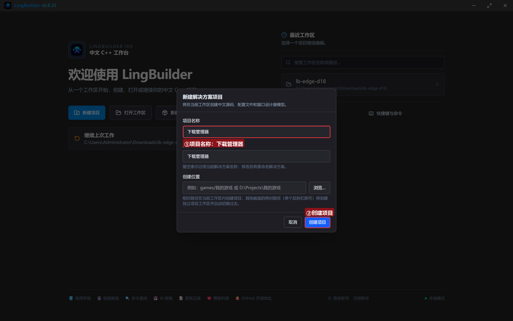

模块确认三个已启用：**EdgeView 浏览器模块**（下载族）、**文本处理模块**、**Win32窗口基础模块**：

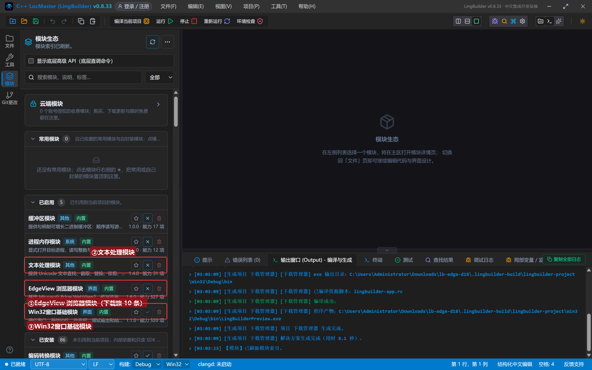

## 3. 设计界面

| 控件 | 名称 | 显示内容 | 左距 | 顶距 | 宽度 | 高度 |
| --- | --- | --- | --- | --- | --- | --- |
| 按钮 | 下载按钮 | 开始下载 | 20 | 14 | 130 | 32 |
| 按钮 | 状态按钮 | 读下载状态 | 162 | 14 | 140 | 32 |
| 按钮 | 默认窗口按钮 | 默认下载窗口 | 314 | 14 | 150 | 32 |
| 按钮 | 对齐按钮 | 窗口角对齐 | 476 | 14 | 130 | 32 |
| **Edge浏览器** | **浏览器1** | （拖入） | 20 | 60 | 920 | 470 |
| 标签 | 日志标题 | 下载日志 | 20 | 542 | 120 | 20 |
| 列表框 | 日志列表 | （清空） | 20 | 566 | 920 | 96 |
| 标签 | 状态标签 | 就绪。点「开始下载」触发浏览器原生下载 | 20 | 664 | 920 | 20 |

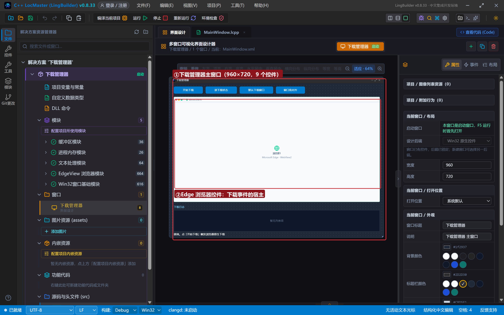

## 4. 写代码

### 4.1 打开带下载资源的页面

```lcpp
事件 _MainWindow_创建完毕()
    EdgeView_导航控件(浏览器1, "https://www.iana.org")
    控件_插入项目(日志列表, 0, "下载管理器就绪。下载事件在「绑定事件」里挂钩")
结束

事件 _下载按钮_被单击()
    EdgeView_导航控件(浏览器1, "https://www.iana.org/about/")
    控件_插入项目(日志列表, 0, "已打开 about 页（含可下载资源）")
结束
```

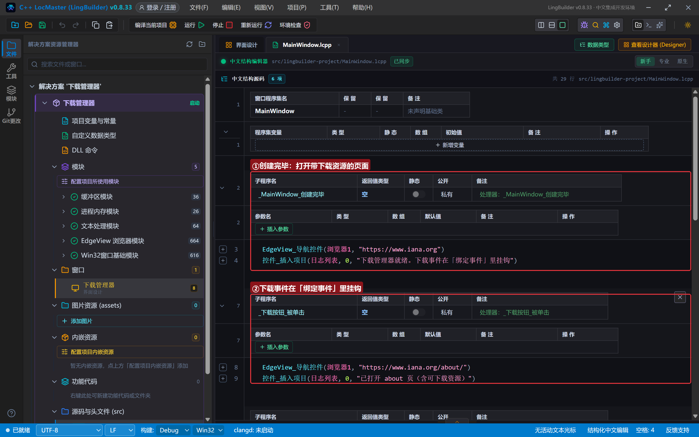

### 4.2 默认下载窗口：开、摆位、关

```lcpp
事件 _状态按钮_被单击()
    EdgeView下载_显示默认窗口(浏览器1)
    控件_插入项目(日志列表, 0, "已打开浏览器默认下载窗口")
结束

事件 _默认窗口按钮_被单击()
    EdgeView下载_置窗口角对齐(浏览器1, 1)
    EdgeView下载_置窗口边距(浏览器1, 12, 12)
    控件_插入项目(日志列表, 0, "默认下载窗口：右上对齐 + 12px 边距")
结束

事件 _对齐按钮_被单击()
    EdgeView下载_关闭默认窗口(浏览器1)
    控件_插入项目(日志列表, 0, "默认下载窗口已关闭")
结束
```

角对齐枚举：0 左上、1 右上、2 左下、3 右下；边距是横向/纵向两个像素值。这是 WebView2 的**原生**下载 UI——样式不可改但零成本；要自定义下载 UI，用「下载开始」事件 + `事件_设置下载路径` 接管（实例篇展开）。

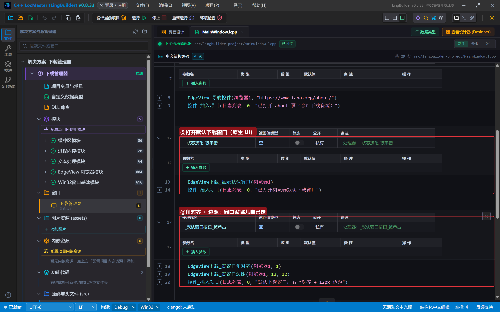

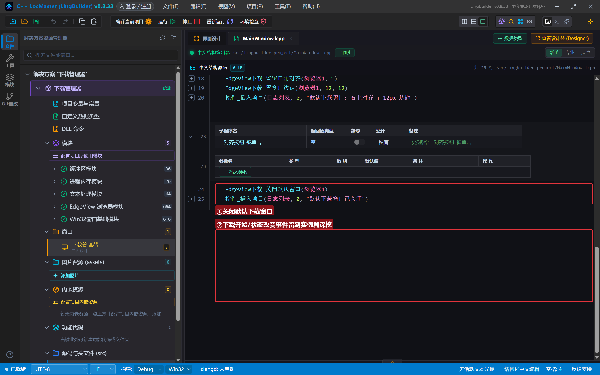

## 5. 编译：先看错误列表

错误列表 (0)，输出窗口「生成完成」：

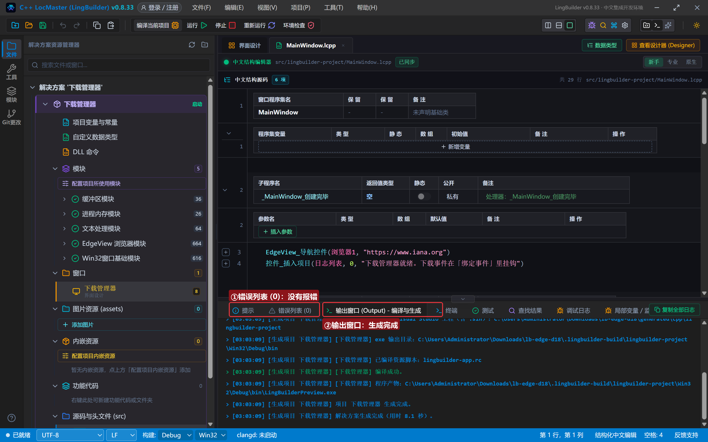

## 6. 运行：原生下载窗口

点「运行」：

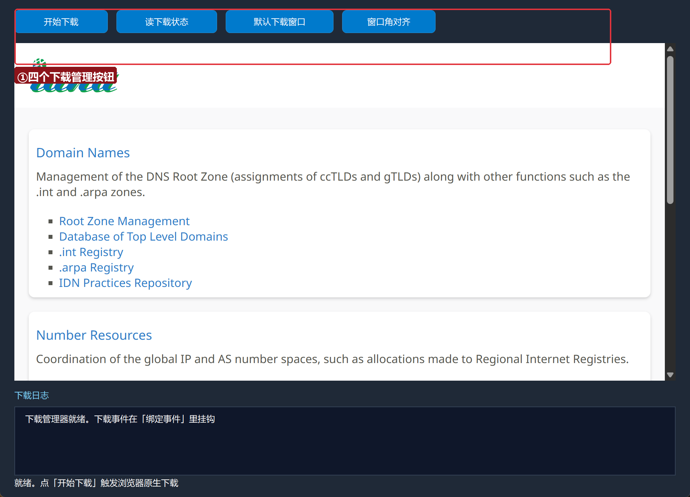

### 6.1 打开默认下载窗口

点「读下载状态」（打开默认窗口）——浏览器右上角弹出原生下载面板：

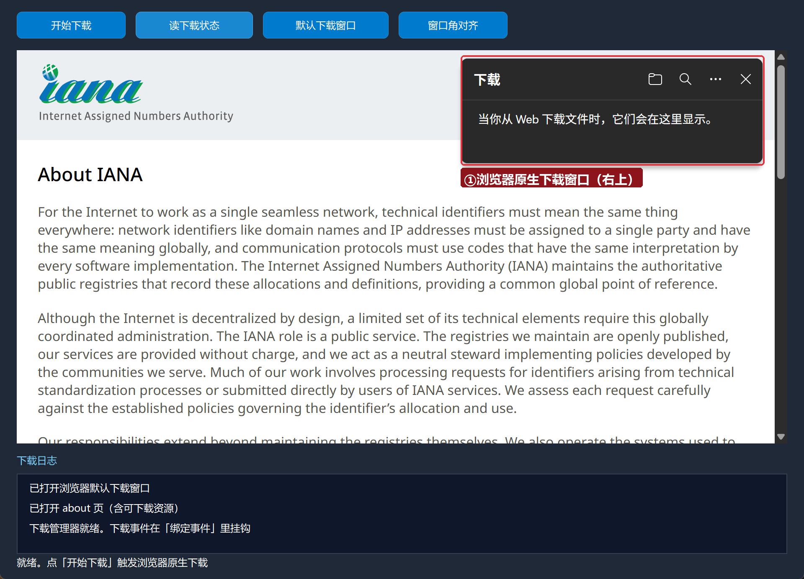

### 6.2 调整位置后关闭

先「窗口角对齐」设右上+12px，再「关闭窗口」：

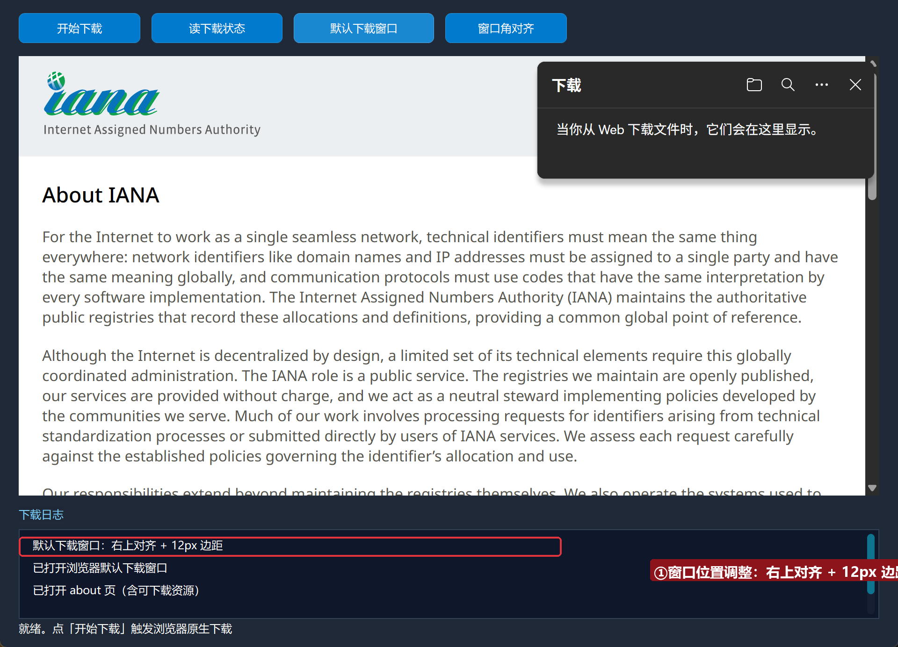

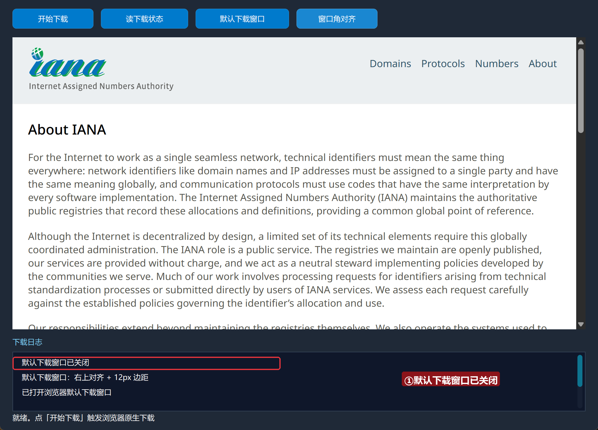

## 常见问题急救表

| 症状 | 原因 | 解法 |
| --- | --- | --- |
| 默认窗口打不开 | 当前没有下载任务也可打开，若失败多为控件未就绪 | 等「导航完成」后再调 |
| 看不到下载进度 | 触发的页面本身没有下载 | 到含真实下载资源的页面再触发 |
| 想接管下载而不是弹窗 | 原生 UI 不可定制 | 「下载开始」事件 + 事件_设置下载路径 接管 |
| 编译报「未知的命令 EdgeView下载_显示默认窗口」 | EdgeView 模块没启用 | 模块生态里启用 EdgeView 浏览器模块 |

## 本集小结

- 下载族两半：**窗口 UI**（本集）+ **任务管理**（状态/暂停/恢复/取消，靠「下载开始」事件的 downloadId）。
- 默认下载窗口支持角对齐（0~3）与边距，原生零成本。
- 自定义下载 UI 的接管点：`下载开始` 同步事件 + `EdgeView事件_设置下载路径`。

## 源码包

本集完整源码已打包为 **下载管理器.lcpppkg**（随本教程同目录分发，官网示例源码区可下载）。在 LingBuilder 欢迎页点「打开工作区」，或直接双击 `.lcpppkg` 文件即可导入运行。

**下一集预告**：《打印与 PDF 导出》——打印族 4 条：打印界面、直接打印、页面导出 PDF。

[回合集总览](/guide/tutorials/edge)
