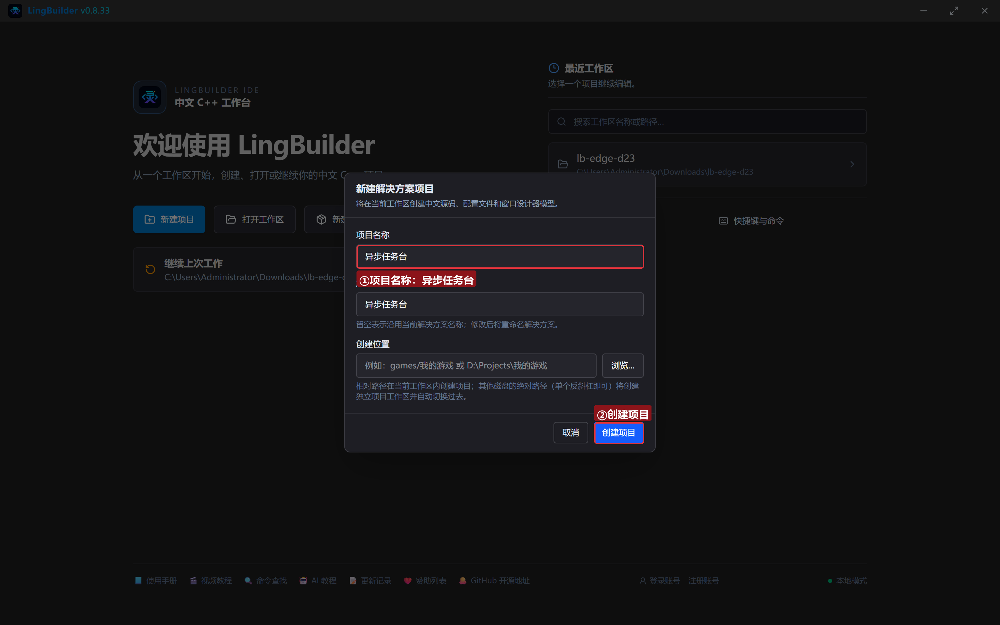
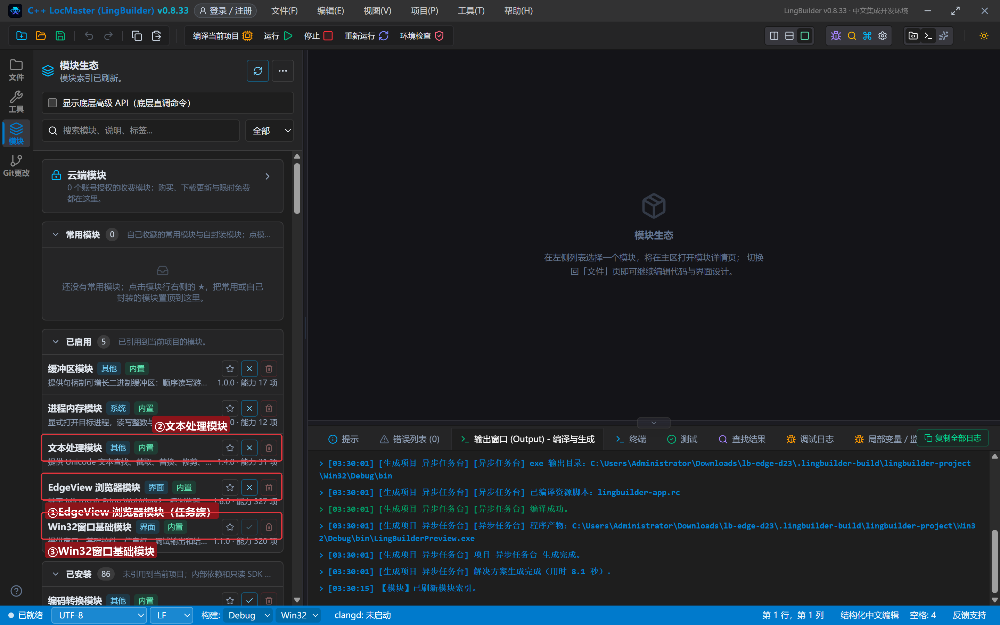
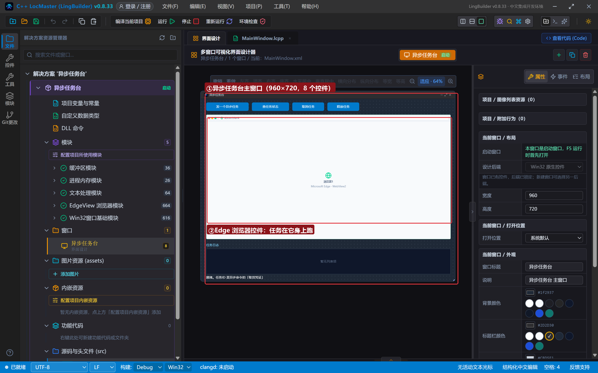
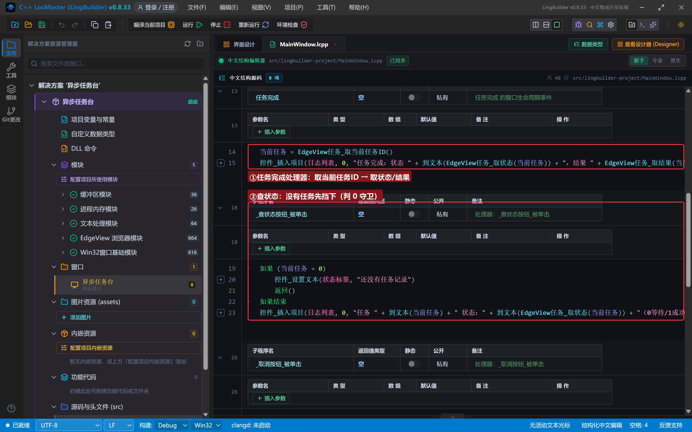
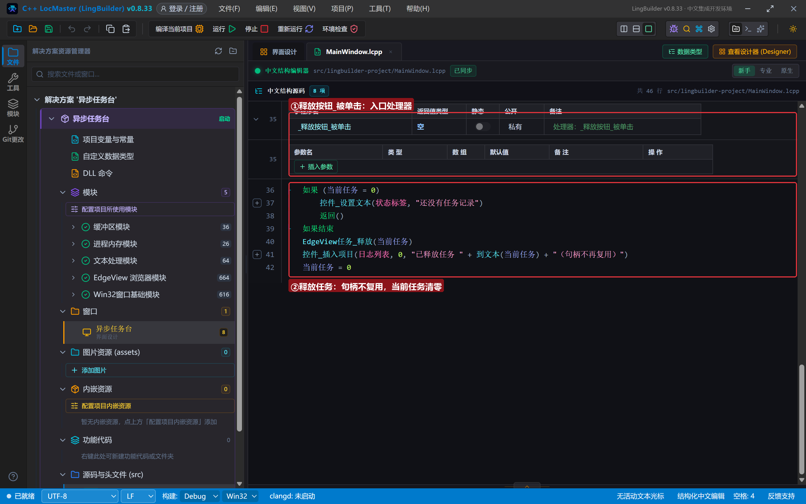
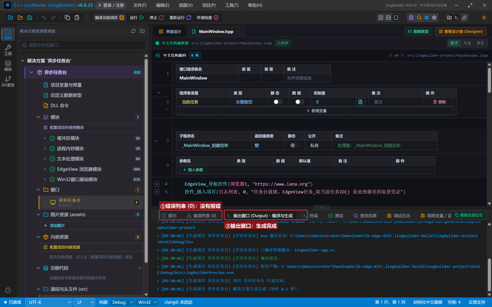
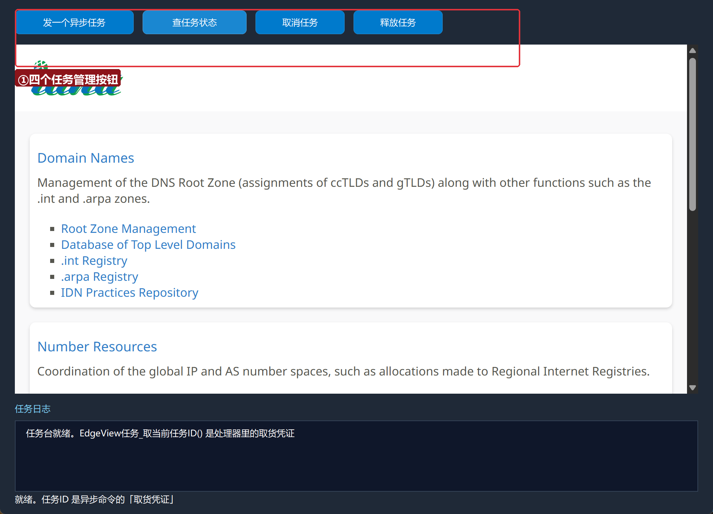
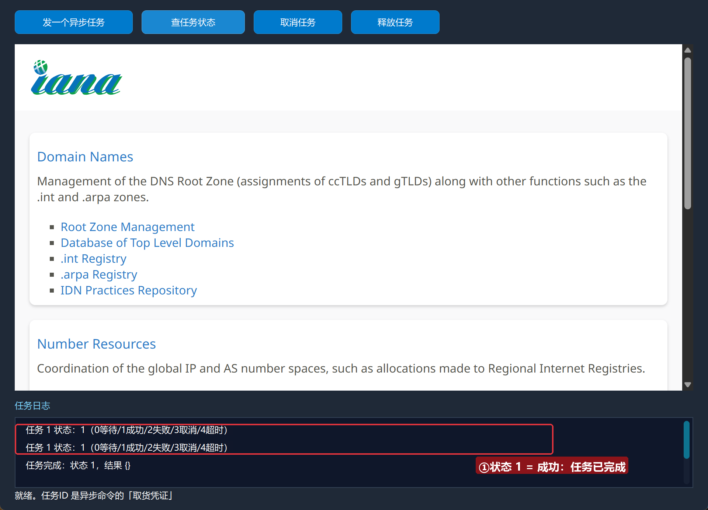
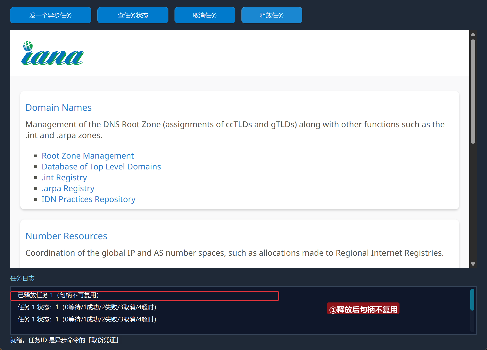

# Edge 合集 23 · 异步任务与工作线程：不卡界面的批量取数

> 《LingBuilder Edge 浏览器合集》第 23 集（高级篇）。前面各集你已经用过很多「异步命令 + 完成处理器」；这一集把**任务族 6 条**补齐——拿到任务 ID 之后还能**查状态、取消、释放**，配合页面侧的 Promise 就能做「可取消的批量取数」。同时介绍**工作线程族 6 条**：查看页面背后的 Service Worker / Shared Worker。全程约 25 分钟。
>
> 前置要求：学过[第 5 集](/guide/tutorials/edge-05)（异步命令）。本集源码包见文末。

## 这一集你将学会

- 任务生命周期：发起（返回任务ID）→ 完成（处理器）→ **取状态/取结果** → **取消/释放**
- 页面侧 `new Promise` 制造可感知的异步任务
- 状态码速记：**0 等待 / 1 成功 / 2 失败 / 3 已取消 / 4 已超时**
- 工作线程族：枚举异步 + 取信息JSON + 发送消息

## 1. 任务族 6 条地图

| 命令 | 作用 |
| --- | --- |
| `EdgeView任务_取当前任务ID()` | **完成处理器内**取得正在消费的任务 ID |
| `EdgeView任务_取状态(任务ID)` | 0 等待 / 1 成功 / 2 失败 / 3 已取消 / 4 已超时 |
| `EdgeView任务_取结果(任务ID)` | UTF-16 文本或 JSON 结果 |
| `EdgeView任务_取错误(任务ID)` | 中文错误 + HRESULT |
| `EdgeView任务_取消(任务ID)` | 取消尚未完成的任务 |
| `EdgeView任务_释放(任务ID)` | 释放句柄（**不再复用**） |

## 2. 新建项目与启用模块

欢迎页「新建项目」，项目名称 **异步任务台**，「Windows 界面设计」：



模块确认三个已启用：**EdgeView 浏览器模块**、**文本处理模块**、**Win32窗口基础模块**：



## 3. 设计界面

| 控件 | 名称 | 显示内容 | 左距 | 顶距 | 宽度 | 高度 |
| --- | --- | --- | --- | --- | --- | --- |
| 按钮 | 发任务按钮 | 发一个异步任务 | 20 | 14 | 160 | 32 |
| 按钮 | 查状态按钮 | 查任务状态 | 192 | 14 | 140 | 32 |
| 按钮 | 取消按钮 | 取消任务 | 344 | 14 | 120 | 32 |
| 按钮 | 释放按钮 | 释放任务 | 476 | 14 | 120 | 32 |
| **Edge浏览器** | **浏览器1** | （拖入） | 20 | 60 | 920 | 470 |
| 标签 | 日志标题 | 任务日志 | 20 | 542 | 120 | 20 |
| 列表框 | 日志列表 | （清空） | 20 | 566 | 920 | 96 |
| 标签 | 状态标签 | 就绪。任务ID 是异步命令的「取货凭证」 | 20 | 664 | 920 | 20 |



## 4. 写代码

### 4.1 类级变量 + 发起任务

```lcpp
长整数型 当前任务 = 0

事件 _发任务按钮_被单击()
    EdgeView脚本_执行异步(浏览器1, "new Promise(function(r){setTimeout(function(){r('任务干完了');}, 3000);})", &任务完成)
    控件_插入项目(日志列表, 0, "已发起 3 秒延时任务（页面侧 Promise）")
结束

事件 任务完成()
    当前任务 = EdgeView任务_取当前任务ID()
    控件_插入项目(日志列表, 0, "任务完成：状态 " + 到文本(EdgeView任务_取状态(当前任务)) + "，结果 " + EdgeView任务_取结果(当前任务))
结束
```

页面侧的 `new Promise` 3 秒后才 resolve——这就是一个可感知的异步任务。完成处理器里**第一件事**是取当前任务 ID 存进类级变量，后面的查/取消/释放都靠它。



### 4.2 查状态、取消、释放

```lcpp
事件 _查状态按钮_被单击()
    如果 (当前任务 = 0)
        控件_设置文本(状态标签, "还没有任务记录")
        返回()
    如果结束
    控件_插入项目(日志列表, 0, "任务 " + 到文本(当前任务) + " 状态：" + 到文本(EdgeView任务_取状态(当前任务)) + "（0等待/1成功/2失败/3取消/4超时）")
结束

事件 _取消按钮_被单击()
    EdgeView任务_取消(当前任务)
    控件_插入项目(日志列表, 0, "已请求取消任务 " + 到文本(当前任务))
结束

事件 _释放按钮_被单击()
    EdgeView任务_释放(当前任务)
    控件_插入项目(日志列表, 0, "已释放任务 " + 到文本(当前任务) + "（句柄不再复用）")
    当前任务 = 0
结束
```

`取消` 只对「等待中」的任务有效（已完成任务的取消是空操作）；`释放` 后句柄**不再复用**——把类级变量清 0 是好习惯。



## 5. 编译：先看错误列表

错误列表 (0)，输出窗口「生成完成」：



## 6. 运行：看着任务走完一生

点「运行」：



### 6.1 发任务、查状态、等完成

点「发一个异步任务」→ 立刻「查任务状态」（状态 0 等待）→ 3 秒后完成处理器自动记账（状态 1 成功）：



### 6.2 释放

点「释放任务」——句柄退役：



## 常见问题急救表

| 症状 | 原因 | 解法 |
| --- | --- | --- |
| 取状态一直是 0 | 任务确实还没完成 | 等 完成处理器 触发再查 |
| 取结果拿到 `{}` | 任务无返回值（页面 Promise resolve 空值） | Promise 里 return 内容 |
| 取消没生效 | 任务已完成 | 取消只对等待中任务有效 |
| 释放后再用句柄崩溃/异常 | 释放后句柄不复用 | 释放后把类级变量清 0 |
| 编译报「未知的命令 EdgeView任务_取当前任务ID」 | 该命令是 advanced | 模块生态勾选「显示底层高级 API」再确认 |

## 本集小结

- 任务 ID 是异步命令的**取货凭证**；完成处理器里用 `取当前任务ID()` 领取。
- 生命周期：发起 → 等待(0) → 成功(1)/失败(2)/取消(3)/超时(4) → 释放。
- 工作线程族同套路：`工作线程_枚举异步` → `取信息JSON` → `发送消息`（页面须有 SW/SharedWorker）。

## 源码包

本集完整源码已打包为 **异步任务台.lcpppkg**（随本教程同目录分发，官网示例源码区可下载）。在 LingBuilder 欢迎页点「打开工作区」，或直接双击 `.lcpppkg` 文件即可导入运行。

**下一集预告**：《通知与扩展》——通知族 4 条＋扩展族 4 条＋对象族 4 条：接管网页通知、加载浏览器扩展。

[回合集总览](/guide/tutorials/edge)
