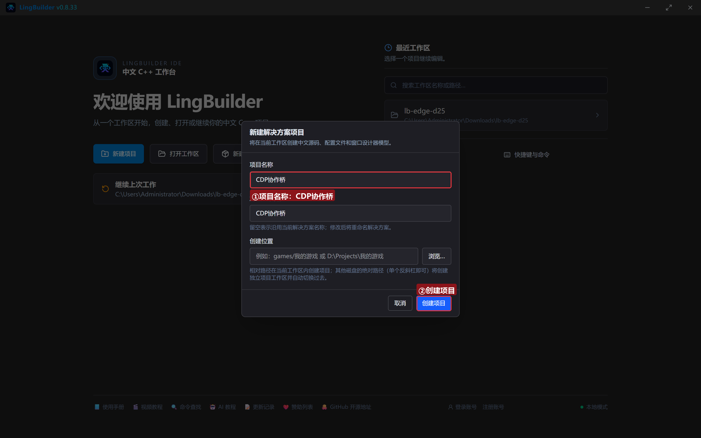
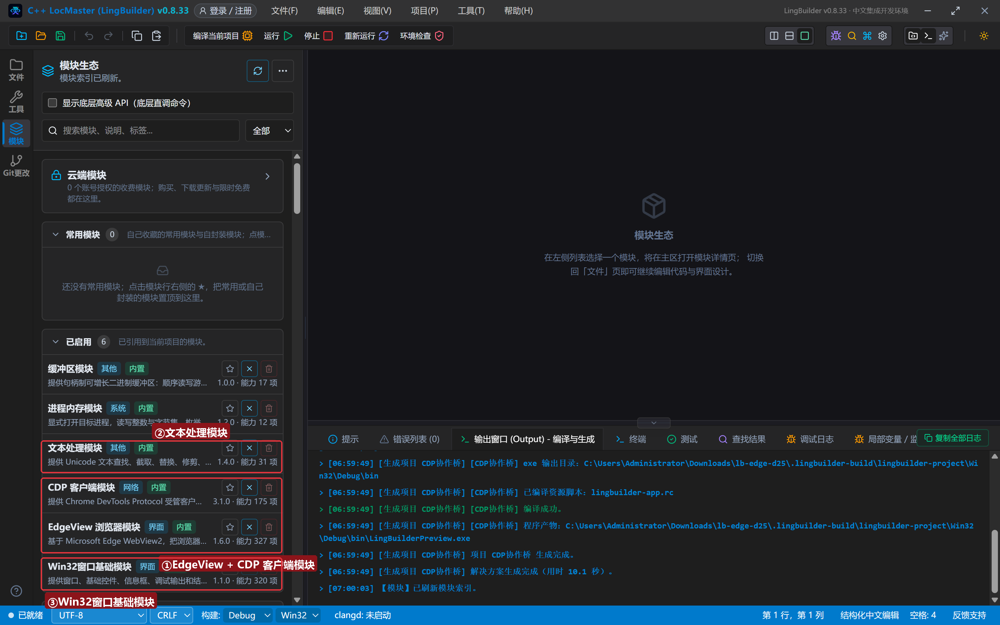
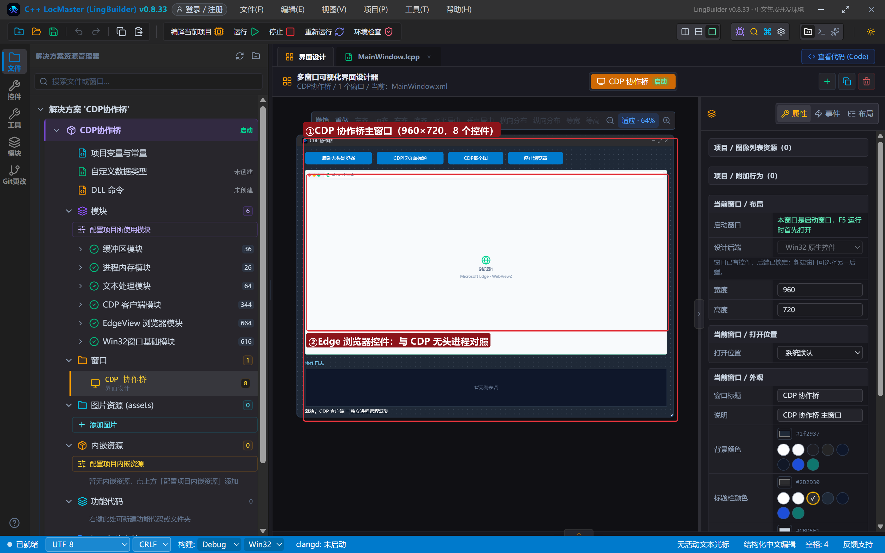
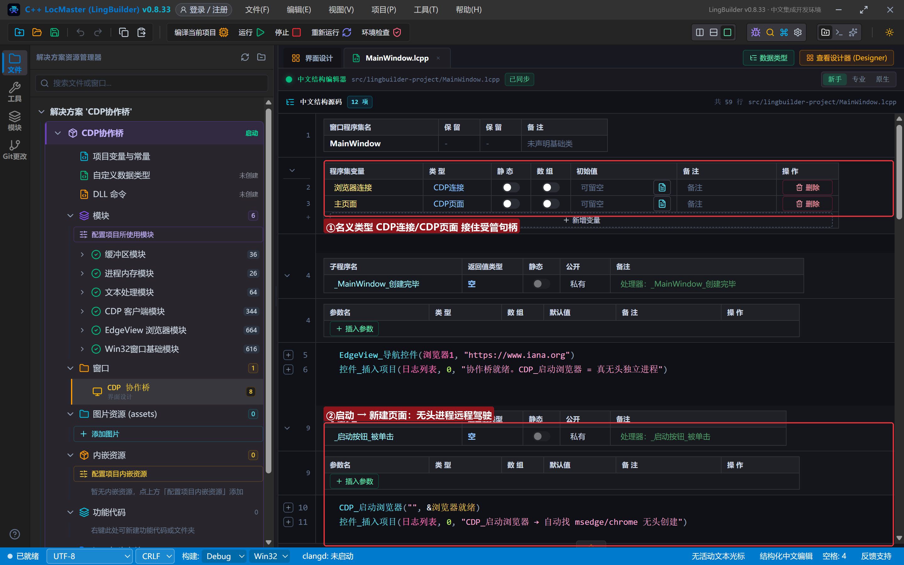
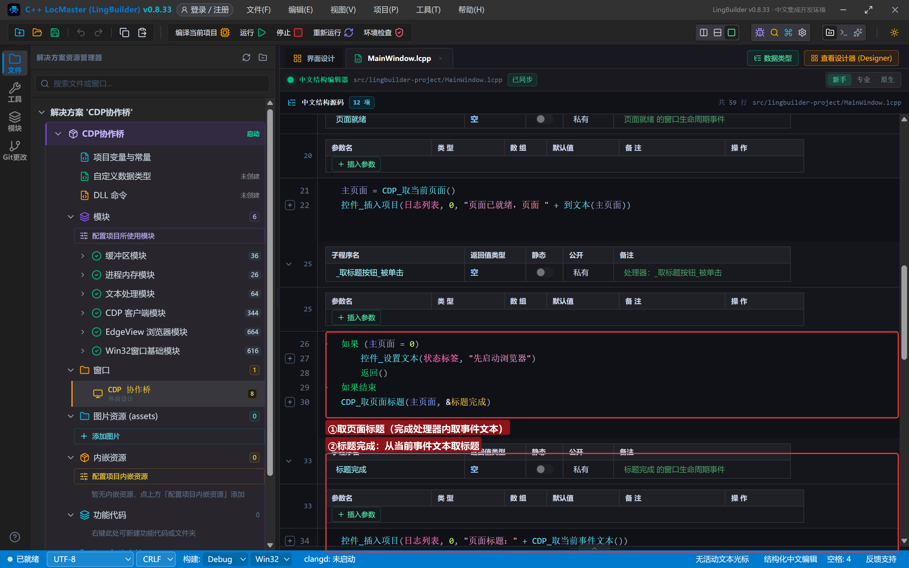
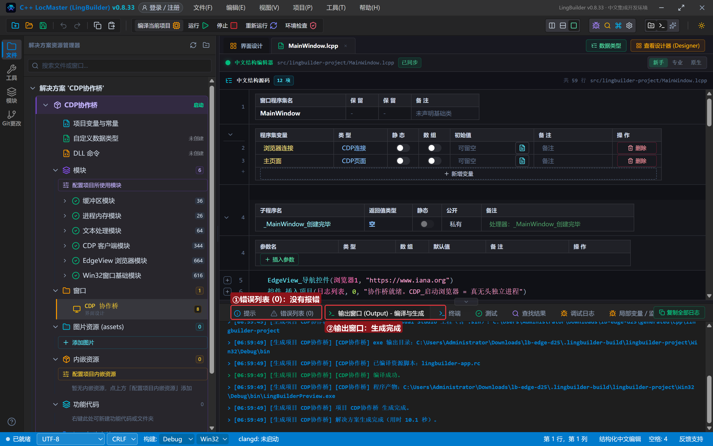
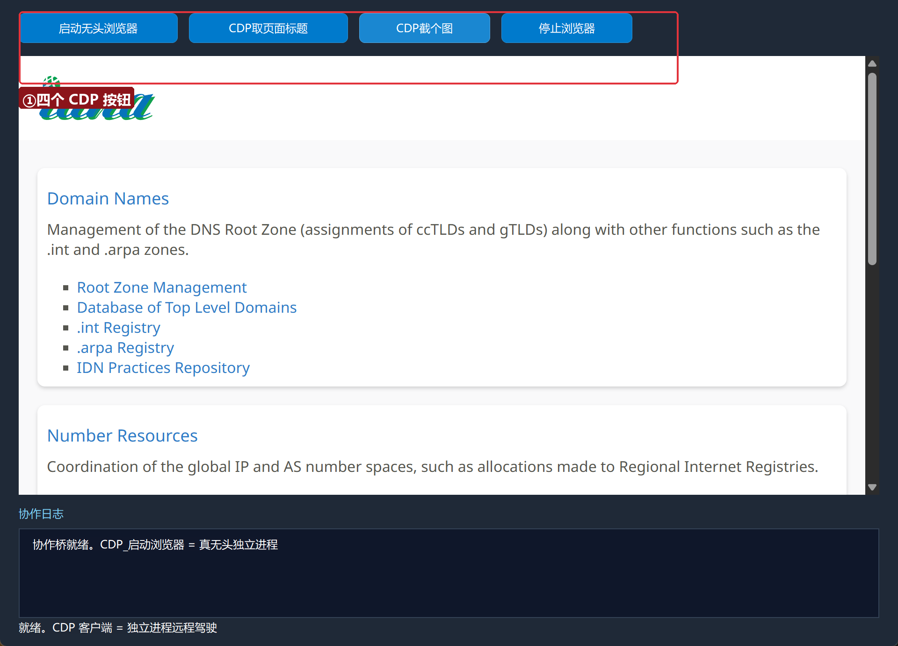
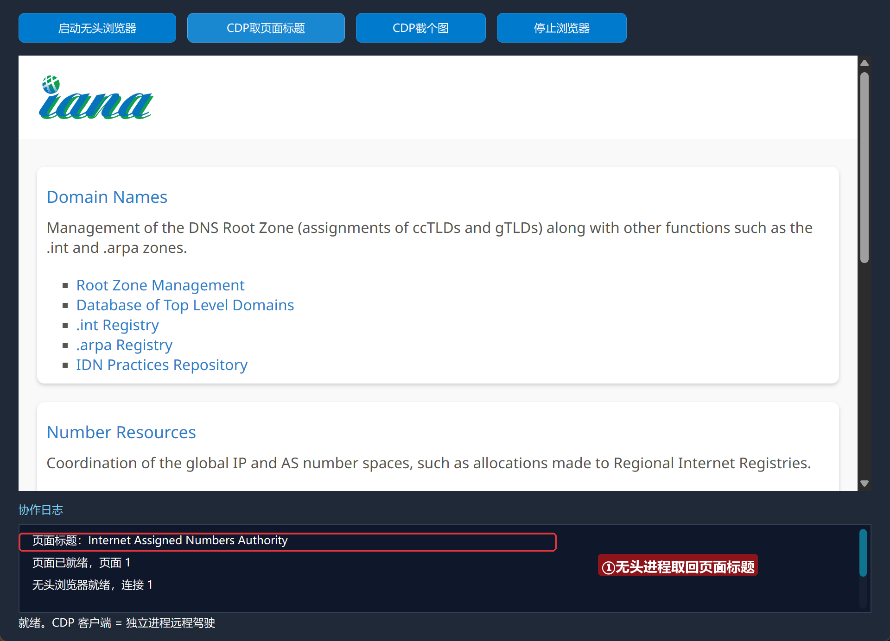
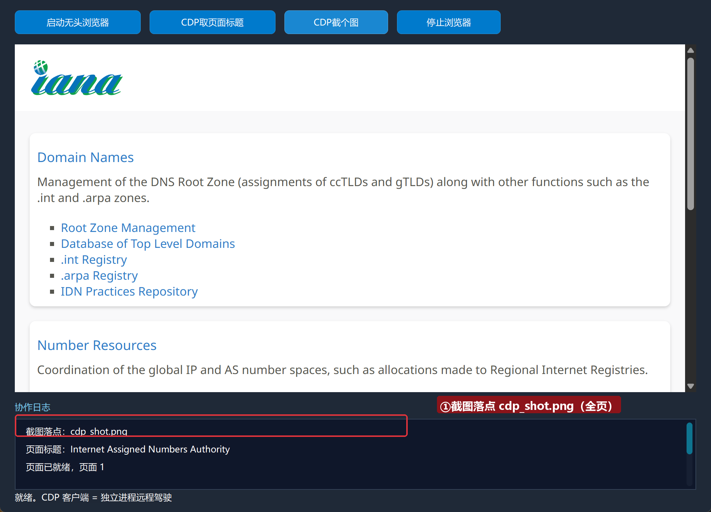
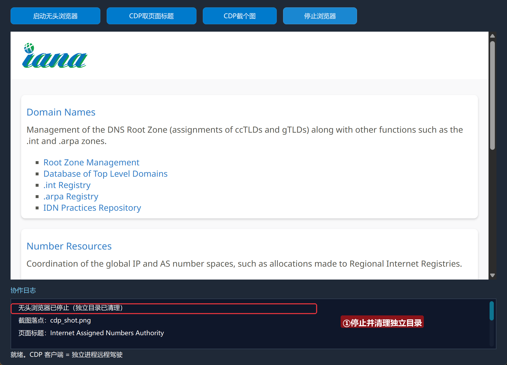

# Edge 合集 25 · 开发者工具协作：CDP 客户端远程驾驶无头浏览器

> 《LingBuilder Edge 浏览器合集》第 25 集（高级篇）。第 21 集的 EdgeView 无头实例「截图不可用」；这一集请出**真无头**方案：`CDP_启动浏览器` 拉起一个独立的 Edge/Chrome 无头进程，用 **CDP 客户端模块**远程驾驶它——导航、取标题、**全页截图**全能跑。本集做出「启动 → 建页 → 取标题 → 截图 → 停止」的完整协作链。全程约 25 分钟。
>
> 前置要求：学过[第 21 集](/guide/tutorials/edge-21)（无头边界）。本集源码包见文末。

## 这一集你将学会

- `CDP_启动浏览器(参数JSON, &就绪处理器)`：真无头独立进程（自动找 msedge/chrome）
- **名义类型** `CDP连接` / `CDP页面`：受管句柄的类型化变量
- `CDP_新建页面` → `CDP_取页面标题` → `CDP_截图`：页面级协作三连
- `CDP_停止浏览器`：优雅停止并清理独立目录

## 1. 三种「无头」怎么选

| 形态 | 命令 | 截图/PDF | 适合 |
| --- | --- | --- | --- |
| EdgeView 伪无头 | `EdgeView_创建无头实例` | ❌ 不可用 | 纯取文本/取数 |
| **CDP 真无头** | `CDP_启动浏览器` | ✅ 全可用 | 截图、PDF、网络拦截 |
| 真窗口控件 | 设计器 EdgeBrowser | ✅ | 要让用户看见的场景 |

CDP 客户端模块与本合集的 EdgeView 模块**互相独立**：前者驾驶独立浏览器进程，后者管设计器控件。

## 2. 新建项目与启用模块

欢迎页「新建项目」，项目名称 **CDP协作桥**，「Windows 界面设计」：



模块确认四个已启用：**EdgeView 浏览器模块**、**CDP 客户端模块**、**文本处理模块**、**Win32窗口基础模块**：



## 3. 设计界面

| 控件 | 名称 | 显示内容 | 左距 | 顶距 | 宽度 | 高度 |
| --- | --- | --- | --- | --- | --- | --- |
| 按钮 | 启动按钮 | 启动无头浏览器 | 20 | 14 | 170 | 32 |
| 按钮 | 取标题按钮 | CDP取页面标题 | 202 | 14 | 170 | 32 |
| 按钮 | 截图按钮 | CDP截个图 | 384 | 14 | 140 | 32 |
| 按钮 | 停止按钮 | 停止浏览器 | 536 | 14 | 140 | 32 |
| **Edge浏览器** | **浏览器1** | （拖入，对照用） | 20 | 60 | 920 | 470 |
| 标签 | 日志标题 | 协作日志 | 20 | 542 | 120 | 20 |
| 列表框 | 日志列表 | （清空） | 20 | 566 | 920 | 96 |
| 标签 | 状态标签 | 就绪。CDP 客户端 = 独立进程远程驾驶 | 20 | 664 | 920 | 20 |



## 4. 写代码

### 4.1 名义类型：受管句柄的「户口」

```lcpp
CDP连接 浏览器连接
CDP页面 主页面
```

CDP 客户端公开两个**名义类型**：`CDP连接` 和 `CDP页面`。类级变量用它们声明（不要写成长整数型——类型门禁会拦「整数赋给 CDP连接」），编译器帮你盯住每个参数的类型。



### 4.2 启动无头进程并新建页面

```lcpp
事件 _启动按钮_被单击()
    CDP_启动浏览器("", &浏览器就绪)
    控件_插入项目(日志列表, 0, "CDP_启动浏览器 → 自动找 msedge/chrome 无头创建")
结束

事件 浏览器就绪()
    浏览器连接 = CDP_取当前连接()
    控件_插入项目(日志列表, 0, "无头浏览器就绪，连接 " + 到文本(浏览器连接))
    CDP_新建页面(浏览器连接, "https://www.iana.org", &页面就绪)
结束

事件 页面就绪()
    主页面 = CDP_取当前页面()
    控件_插入项目(日志列表, 0, "页面已就绪，页面 " + 到文本(主页面))
结束
```

`CDP_启动浏览器` 参数JSON 传空用全默认（自动找本机 Edge/Chrome、临时独立目录、`--headless=new`）；参数可含 `起始地址`、`可执行文件`、`用户数据目录`、`额外参数`、`等待超时毫秒`。就绪处理器里用 `CDP_取当前连接()` / `CDP_取当前页面()` 领取当前事件对应的受管句柄。

### 4.3 取标题与全页截图

```lcpp
事件 _取标题按钮_被单击()
    CDP_取页面标题(主页面, &标题完成)
结束

事件 标题完成()
    控件_插入项目(日志列表, 0, "页面标题：" + CDP_取当前事件文本())
结束

事件 _截图按钮_被单击()
    CDP_截图(主页面, "cdp_shot.png", 真, &截图完成)
结束

事件 截图完成()
    控件_插入项目(日志列表, 0, "截图落点：" + CDP_取当前事件文本())
结束
```

CDP 模块的完成处理器统一用 `CDP_取当前事件文本()` 读结果（不是 EdgeView任务_取结果——两个模块各自的快照体系）。`CDP_截图` 第三个参数**全页=真**时会捕获超出视口的完整页面——这正是伪无头做不到的。



### 4.4 停止浏览器

```lcpp
事件 _停止按钮_被单击()
    CDP_停止浏览器(浏览器连接)
    控件_插入项目(日志列表, 0, "无头浏览器已停止（独立目录已清理）")
结束
```

只对 `CDP_启动浏览器` 建的进程有效（先发 Browser.close 优雅退出，超时强杀，随后清理独立用户数据目录）；外部连接用 `CDP_断开连接`。

## 5. 编译：先看错误列表

错误列表 (0)，输出窗口「生成完成」：



## 6. 运行：远程驾驶无头进程

点「运行」：



### 6.1 启动、取标题

点「启动无头浏览器」→「CDP取页面标题」——屏幕上依旧什么都没有，但无头进程的页面标题已经取回：



### 6.2 全页截图

点「CDP截个图」——`cdp_shot.png` 落盘（真无头进程的全页截图，伪无头做不到）：



### 6.3 停止

点「停止浏览器」——进程退出、独立目录清理：



## 常见问题急救表

| 症状 | 原因 | 解法 |
| --- | --- | --- |
| 就绪事件一直不来 | 本机没有 Edge/Chrome | CDP 自动查找两者；都没有时装一个 |
| 编译报「不能把 CDP连接 赋值给 长整数型」 | 句柄要用名义类型 | `CDP连接 浏览器连接` 而不是 长整数型 |
| 名义类型赋 0 编译报「空未声明」 | 名义类型无 0 初始化 | 直接声明不赋初值；不再使用就别回赋 |
| CDP_截图 全页参数没生效 | 第三参没传 真 | `CDP_截图(页面, 路径, 真, &处理器)` |
| 处理器里读不到结果 | 用错了快照命令 | CDP 模块用 CDP_取当前事件文本，不是任务_取结果 |

## 本集小结

- `CDP_启动浏览器` = **真无头独立进程**：截图/PDF/网络拦截全能，补齐伪无头的短板。
- 名义类型 `CDP连接`/`CDP页面` 是受管句柄的正确户口；`取当前连接/取当前页面` 在事件内领句柄。
- CDP 模块结果统一走 `CDP_取当前事件文本()`。
- 停止用 `CDP_停止浏览器`（自建进程专属，附带目录清理）。

## 源码包

本集完整源码已打包为 **CDP协作桥.lcpppkg**（随本教程同目录分发，官网示例源码区可下载）。在 LingBuilder 欢迎页点「打开工作区」，或直接双击 `.lcpppkg` 文件即可导入运行。

**下一集预告**：《综合实战：网页监控机器人》——收官集：定时取数＋变化检测＋通知推送，全合集所学一锅端。

[回合集总览](/guide/tutorials/edge)
