# FBro 合集 01 · 什么是指纹浏览器：先看见「网站眼中的你」

> 《LingBuilder FBro 指纹浏览器合集》第 1 集（基础篇）。从这一集起，我们学习 **FBro 指纹浏览器模块（lingbuilder.fbro.browser）**——它基于 CEF 深度定制内核（Chrome 135），核心卖点两句话：**浏览器指纹伪装**＋**多开防关联**。本集先不急着「伪装」，我们先做一个**指纹检测器**：把 BrowserScan 指纹检测页装进自己的窗口，亲眼看一看网站到底能「看见」你什么。全程约 30 分钟。
>
> **模块获取**：FBro 指纹浏览器模块是**收费模块**，在模块生态里点「启用」时按提示登录 LingBuilder 账号购买授权即可；随包的「FBro 内核 SDK 包」会在构建时自动被发现，**不需要**单独启用或下载。
>
> **VIP/非 VIP 边界**：FBro 共 465 条命令，其中 16 条是 `FBroVIP_` 开头的赞助会员命令（指纹 JSON 应用、新窗口转标签页等）。**本集用到的 `FBro_导航` 等命令全部是非 VIP 命令**，普通授权即可完整跟做；VIP 命令从第 7 集起才会登场。
>
> 前置要求：会新建窗口项目、会在设计器里摆控件（学过[零基础入门系列](/guide/tutorials/beginner)即可）。本集源码包见文末。

## 这一集你将学会

- 什么是浏览器指纹：Canvas、WebGL、UA、字体、时区……网站靠这些认出「同一台电脑」
- 为什么需要指纹浏览器：多开防关联的场景
- 设计器里的 **FBro 浏览器（FBroBrowser）控件**：把指纹浏览器当普通控件摆进窗口
- `FBro_导航(控件名, 地址)`：让内嵌浏览器打开一个网址

## 1. 先搞懂：网站凭什么认出你？

你可能以为：只要不上网登录，网站就不知道你是谁。其实不是。现代网站在你打开页面的第一瞬间，就能通过一大堆「不起眼」的信息拼出一个近乎唯一的身份——这就是**浏览器指纹**。

| 指纹来源 | 网站能看到什么 | 为什么难以伪造 |
| --- | --- | --- |
| **User-Agent（UA）** | 浏览器内核与版本、操作系统 | 要与真实内核行为一致，写错反而露馅 |
| **Canvas 画布** | 显卡渲染一段图形后的像素哈希 | 同一块显卡渲染结果几乎不变 |
| **WebGL** | 显卡型号、驱动渲染器字符串 | 直接暴露你的硬件 |
| **字体列表** | 你系统装了哪些字体、按什么顺序 | 装过的字体很难「假装没有」 |
| **时区 / 语言** | 与 IP 归属地是否一致 | 对不上就是「用了代理」的信号 |
| **屏幕 / 硬件** | 分辨率、内存大小、CPU 线程数 | 组合起来近似唯一 |

单独看每一项都不算什么，但**几十项拼在一起，就能在十几亿网民里唯一定位到你这台电脑**——这就是指纹的可怕之处。

**什么场景需要「指纹浏览器」？** 举例：

- 电商多店铺运营：平台禁止一个卖家有多个账号，而普通浏览器开两个窗口，「指纹」一模一样，立刻被判定关联封号；
- 社媒矩阵运营：几十个账号必须看起来是「几十台不同的电脑、不同的地方」；
- 数据采集：同一个指纹高频访问，很快触发风控。

指纹浏览器的做法是：**给每一个浏览器实例一套完整、自洽、真实的「假身份」**——不同的 Canvas、不同的显卡型号、不同的字体、甚至不同的时区和代理 IP。这就是 FBro 模块的立身之本。本合集 29 集会把它讲透，本集先让我们「看见」指纹本身。

## 2. 新建项目

打开 LingBuilder，欢迎页点「新建项目」，项目名称填 **指纹检测器**，模板选「Windows 界面设计」，点「创建项目」：

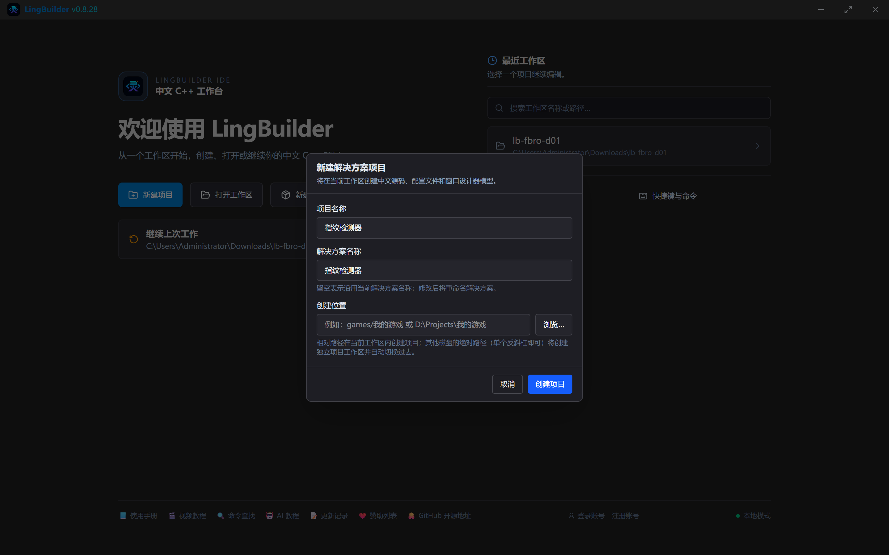

## 3. 启用模块

点左侧活动栏的「模块」图标打开模块生态，搜索「FBro」：

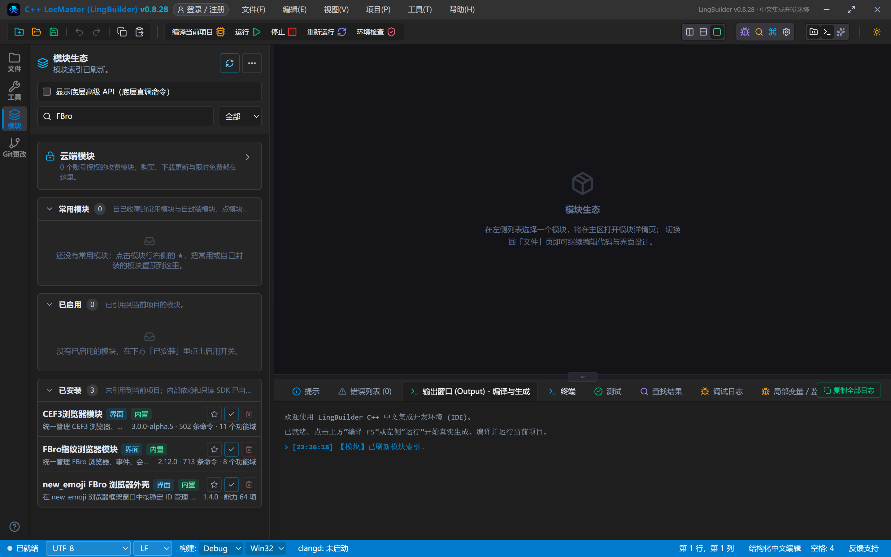

确认 **FBro指纹浏览器模块**（共 300 条命令）已经启用——新项目的 Windows 界面设计模板默认已把它加进项目，在「已启用」分组里能看到即可。同一项目里还会用到：

- **Win32窗口基础模块**——窗口、按钮、标签等基础控件命令；
- **文本处理模块**——本系列后面会用到。

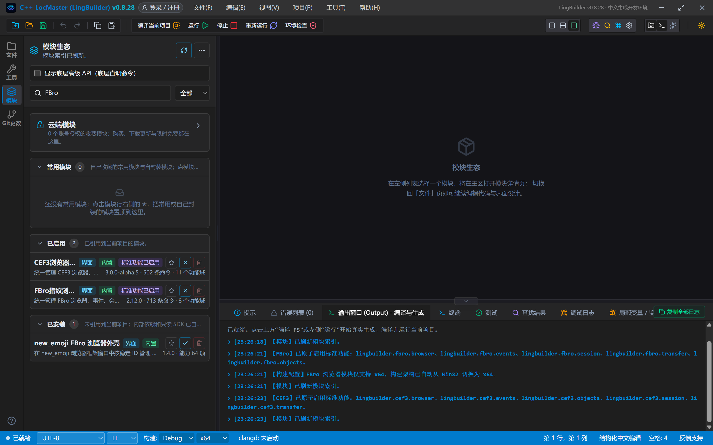

> 小知识：「FBro 内核 SDK 包」是随包分发的底层支撑（含 Chrome 135 内核运行时），构建时会自动物化进 exe 目录，**不要**手动启用它，也不要手动往 bin 目录拷文件。

## 4. 设计界面

打开「界面设计」，窗口做宽一点（1200×820），给检测页留足地方。从控件面板把「**FBro浏览器**」拖进窗口——它和按钮、标签一样，摆好位置就行：

| 控件 | 名称 | 显示内容/关键属性 | 左距 | 顶距 | 宽度 | 高度 |
| --- | --- | --- | --- | --- | --- | --- |
| 按钮 | 检测按钮 | 重新检测 | 16 | 14 | 120 | 32 |
| 标签 | 状态标签 | 就绪 | 150 | 20 | 800 | 22 |
| FBro浏览器 | 浏览器1 | 打开地址 = `https://www.browserscan.net/` | 16 | 56 | 1168 | 716 |

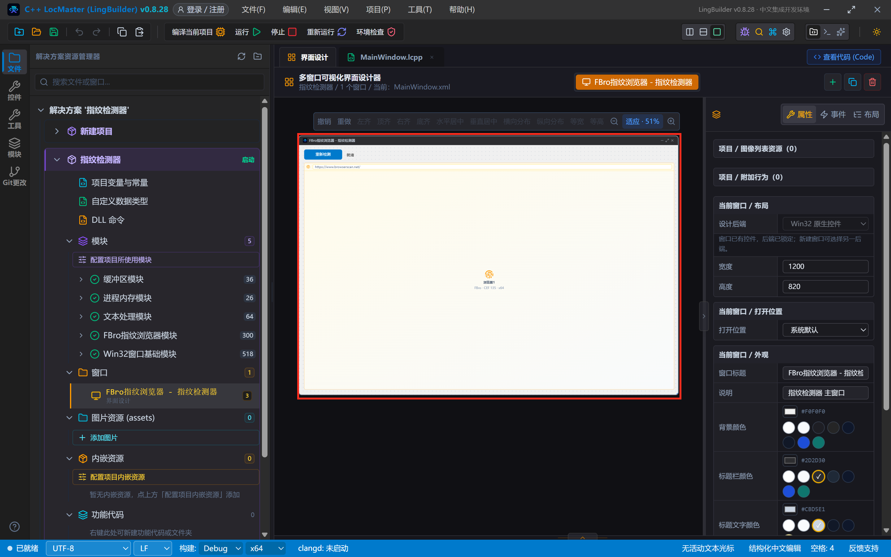

三个要点：

1. **FBroBrowser 控件的「打开地址」属性**：填了网址，程序一启动就会自动打开这个页面（本集填 BrowserScan 指纹检测站）。
2. **宿主模式属性**默认「进程内」。FBro 还有「独立进程嵌入」「独立顶层窗口」两种模式，是第 2 集的主角，本集保持默认。
3. 浏览器控件本质是个「窗口里的窗口」，摆多大它就占多大，拖拽缩放和普通控件完全一样。

## 5. 写代码

切换到 MainWindow.lcpp，本集只需要给两个事件写代码。点「检测按钮」控件的事件面板添加 `_检测按钮_被单击` 事件，窗口本身的 `_MainWindow_创建完毕` 用于在启动时更新状态文字。完整代码如下：

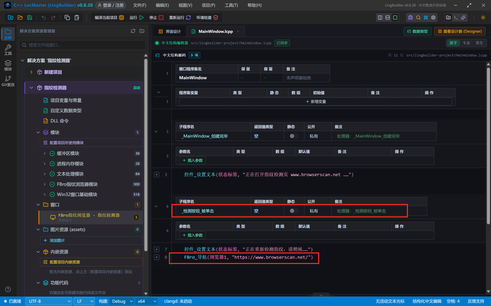

```
类 MainWindow
    事件 _MainWindow_创建完毕()
        控件_设置文本(状态标签, "正在打开指纹检测页 www.browserscan.net ……")
    结束

    事件 _检测按钮_被单击()
        控件_设置文本(状态标签, "正在重新检测指纹，请稍候……")
        FBro_导航(浏览器1, "https://www.browserscan.net/")
    结束
结束类
```

逐行解释：

- `控件_设置文本(状态标签, "……")`：把一段文字写到「状态标签」上。第一个参数是**控件名**（不带引号，直接写设计器里起的名字），第二个参数是要显示的文本（带引号）。
- `FBro_导航(浏览器1, "https://www.browserscan.net/")`：本集唯一的新命令，让内嵌的 FBro 浏览器导航到指定网址。第一个参数同样是**控件名**（浏览器1），第二个参数是目标地址。

> 注意：本集没有写 `FBro_创建`——从设计器拖入的 FBroBrowser 控件会按设计器属性**自动创建**。什么时候需要手动创建、三种创建模式有什么区别，正是下一集的主题。

## 6. 编译前先看错误列表

按工具栏「编译当前项目」之前，先养成习惯：看底部「错误列表」。显示「未检测到编译障碍」、错误数是 0 再动手：

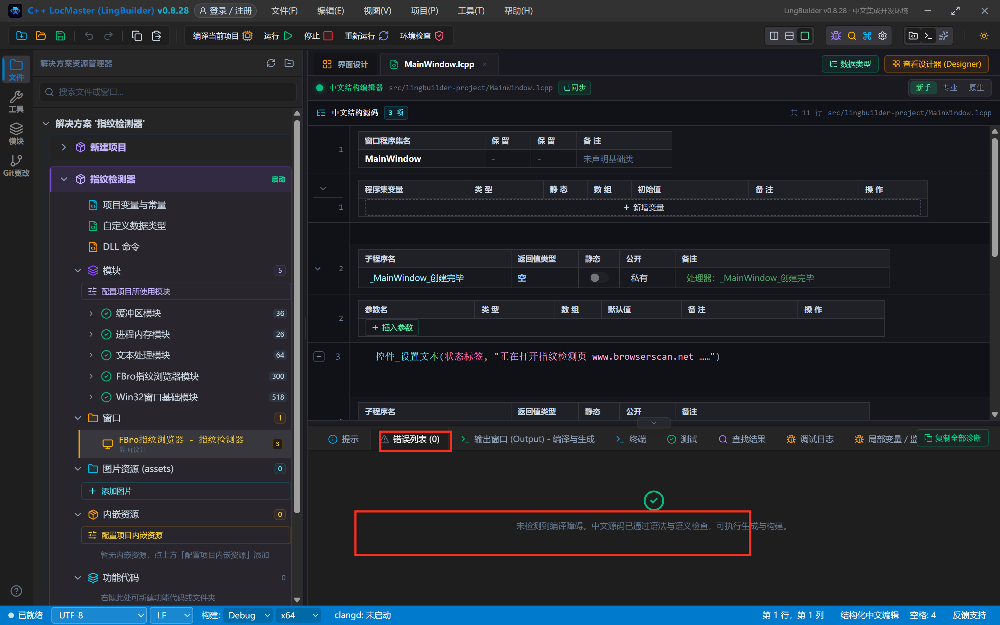

编译完成，`x64\Debug\bin\` 下生成 `LingBuilderPreview.exe`，FBro 的内核运行时（`FBrowserCEF3lib.dll`、`LingBuilderFbroBridge.dll` 等）会自动出现在旁边——这是 SDK 包自动物化的结果。

## 7. 运行：看见「网站眼中的你」

直接运行程序。窗口顶部的状态标签先显示「正在打开指纹检测页……」，页面还在加载时检测项都是「--」：

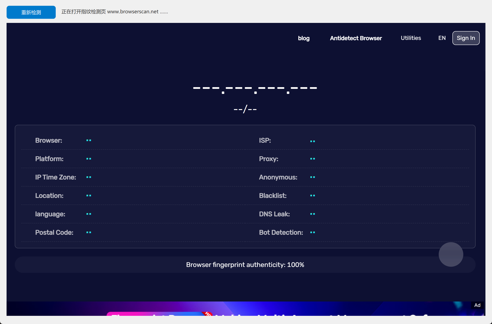

几秒后检测完成，BrowserScan 给出完整报告，底部一条绿色横幅：**Browser fingerprint authenticity: 100%**（指纹真实性 100%）——意思是「这台浏览器看起来完全正常」：

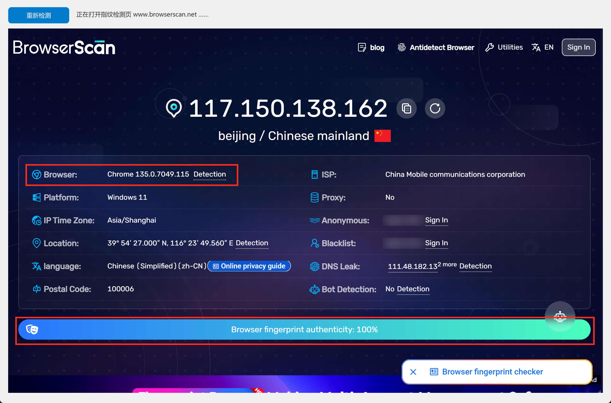

红框里就是网站第一眼看到的东西：你的公网 IP 和归属地、**浏览器内核 Chrome 135**、操作系统 Windows 11、语言 zh-CN、DNS 甚至还测了机器人特征（Bot Detection: No，看起来不像脚本）。

点一下「重新检测」按钮，状态标签立刻变成「正在重新检测指纹，请稍候……」，页面重新走一遍检测流程：

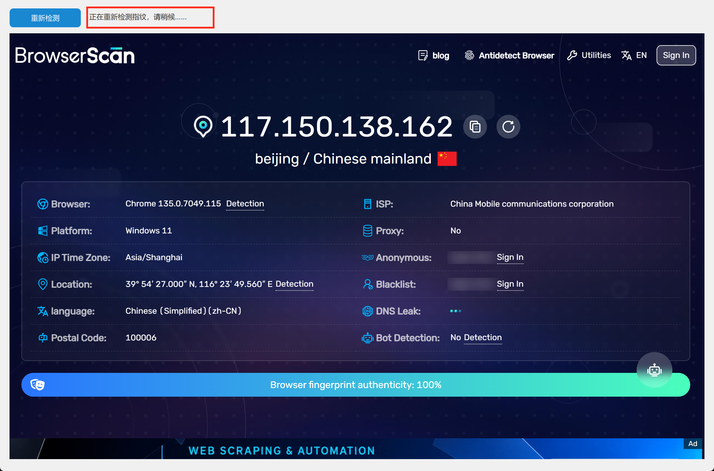

检测完成后一切照旧（指纹真实性仍是 100%）：

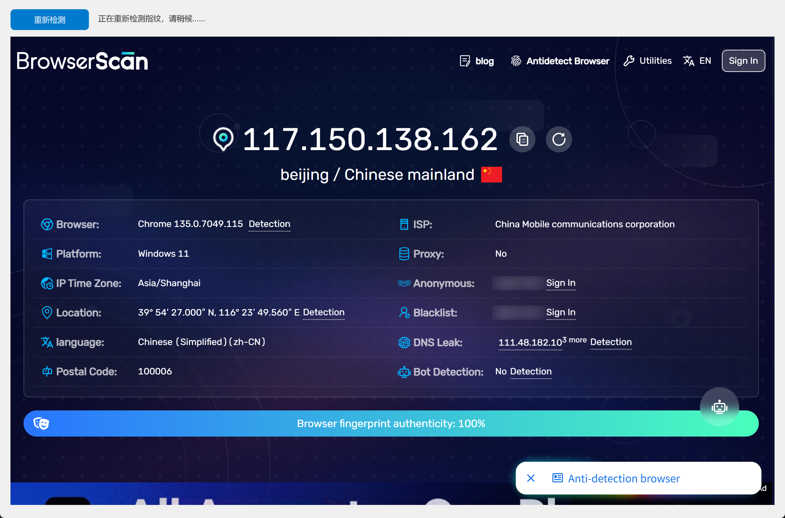

## 8. 读懂检测报告：一个「指纹」由几十项拼成

往下滚动页面，逐段看这份报告，每一项都是本合集后面要「伪装」的对象。

**浏览器与环境画像**：UA 字符串里明晃晃写着 Windows 10.0 + Chrome/135（Header 与 JavaScript 两处读到的 UA 完全一致）；左下角 IP / WebRTC / WebRTC STUN 三个地址一模一样，说明没有「代理泄漏」：

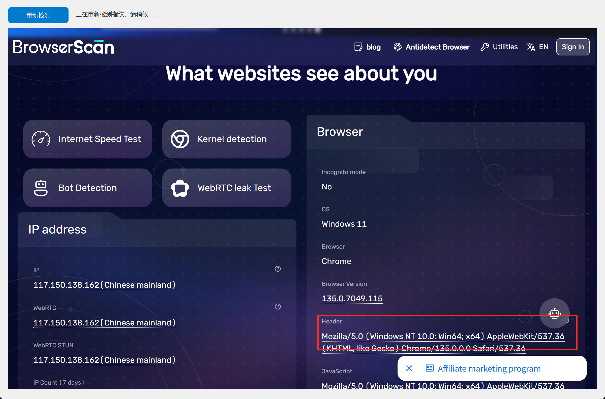

**时区与语言一致性**：Time From IP（按 IP 推算的时区）与 Time From Javascript（浏览器实际时区）**分秒不差**，都是 GMT+0800；语言 zh-CN、Accept-Language 头、国际化 API 三处一致。风控最爱查的就是这种「交叉一致性」：

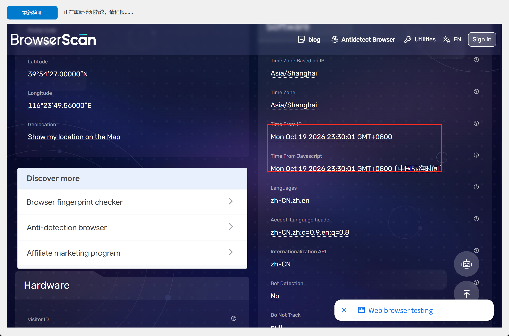

**Canvas 与 WebGL 哈希**：这是指纹的核心。Canvas 渲染哈希 `3C6BB1BC`、WebGL 哈希 `FD24271B`、WebGL Report `0055F960`——显卡是 AMD Radeon（ANGLE 渲染器字符串写得清清楚楚）；右侧还有音频指纹 `0B09CAEB`、字体指纹 `9AEB2C39`。**同一台电脑上这些哈希几乎永远不变**，所以网站拿它认人：

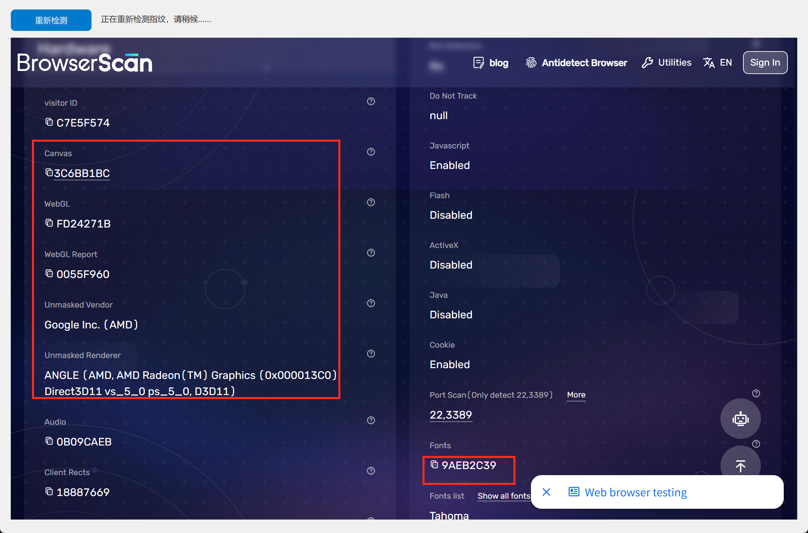

**硬件与字体**：屏幕 3840×2160、内存 8GB、CPU 24 线程、字体列表 134 个（Tahoma、Arial、Helvetica……）——每一项单独都不致命，合起来就是「准身份证」：

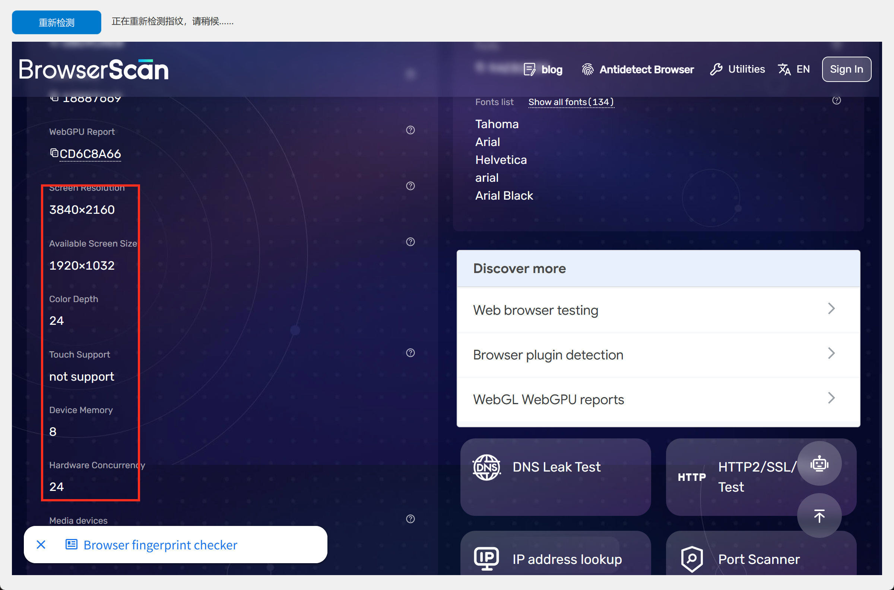

看到这里你就明白了：**指纹浏览器要做的，就是把上面每一项都换成一套自洽的假数据**。怎么换？这正是后面 28 集的内容。

## 9. 红线预警（先记住，后面逐集展开）

- **指纹 JSON 必须是桥 schema**（第 6 集详解）：UI 表单里抄来的「形状键」会被**静默跳过**，键名错＝没设；应用返回 ≥0 也不等于生效。权威键表只有一处：`LingBuilderFbroBridge.cpp` 的 `LB_FBro_ApplyFingerprintJson`。
- **内核版本号要钳在 116~135**（第 6 集）：指纹 JSON 里的 `kernel` 等四个内核键取值跟 UA 的 Chrome 版本挂钩，写死 135 会被 BrowserScan 把 Browser 行标红。
- **`webdriver` 是 navigator.webdriver 的虚拟值**：想隐藏自动化痕迹要传 `false`（第 12 集 CDP 自动化时详解）。
- **`clearAllData: true` 只用于槽位重置**（第 4 集）：独立缓存目录多开要保登录态，就千万不要发它。

## 本集源码包

- 本集源码包已上架官网「[示例源码](https://lingbuilder.com/demos)」区，按名称「FBro合集01-指纹检测器」即可下载（每集一个 `.lcpppkg`，配套预览图与图文教程直链）。
- 导入：LingBuilder 欢迎页 →「**导入源码包**」，选中 `.lcpppkg` 一键还原整个项目（含窗口设计与全部源码）。
- FBro 指纹浏览器模块为**收费模块**：导入后如未启用，在模块面板启用并用 LingBuilder 账号登录授权即可（和制作时是同一个账号体系，授权一次全合集通用）；FBro 运行时由随包 SDK 自动补齐。


## 下集预告

**02 集 · 创建模式**：进程内、独立进程嵌入、独立顶层窗口——三种宿主模式各适合什么场景？`FBro_后台创建` 悄悄拉起的宿主进程 `LingBuilderFbroHost.exe` 又是怎么回事？我们做实验见分晓。
