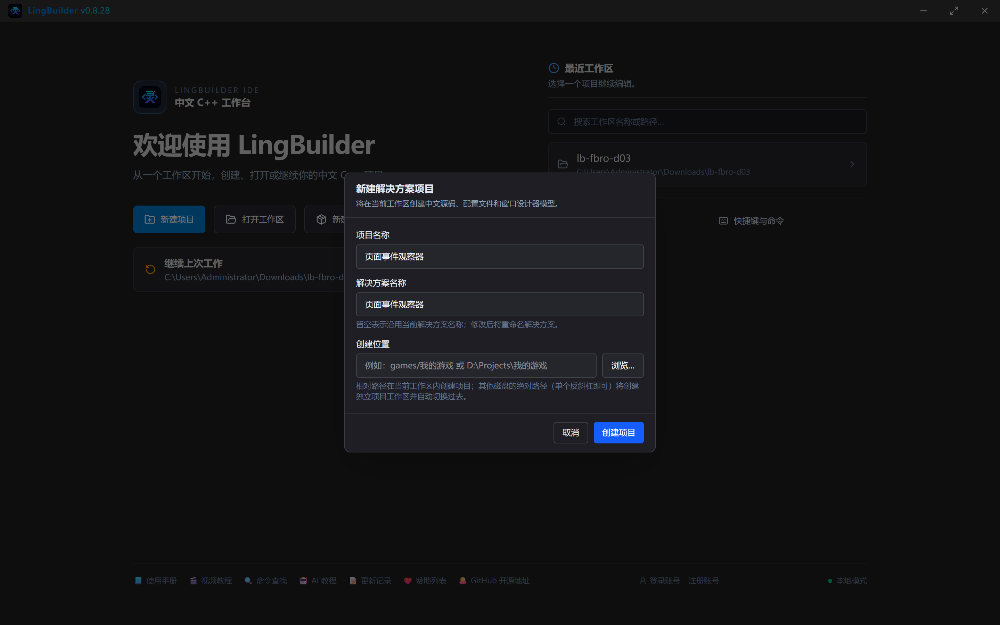
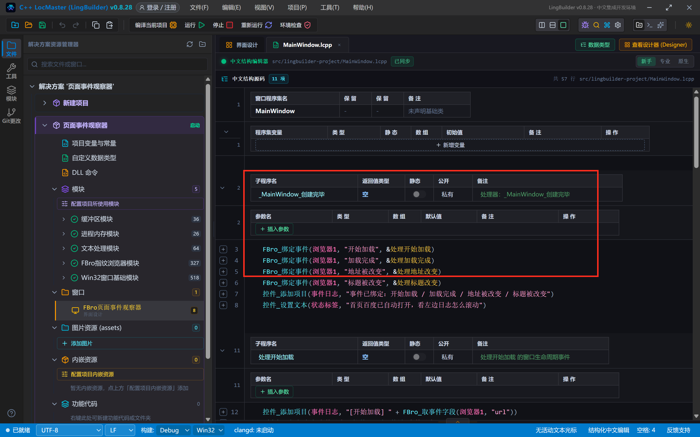
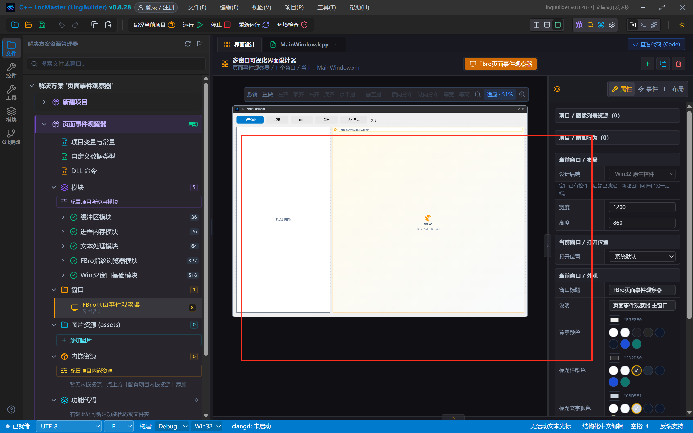
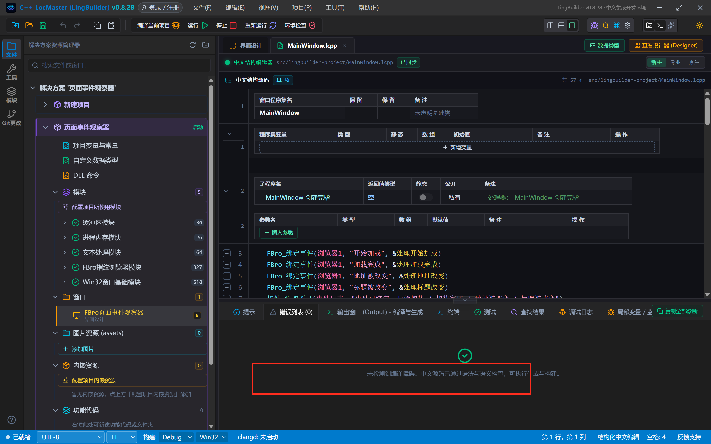
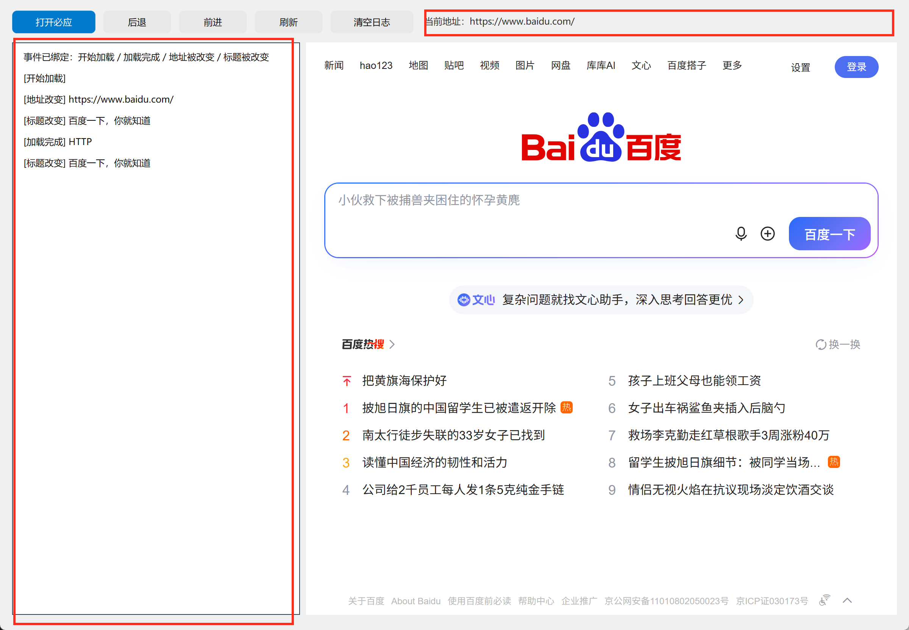
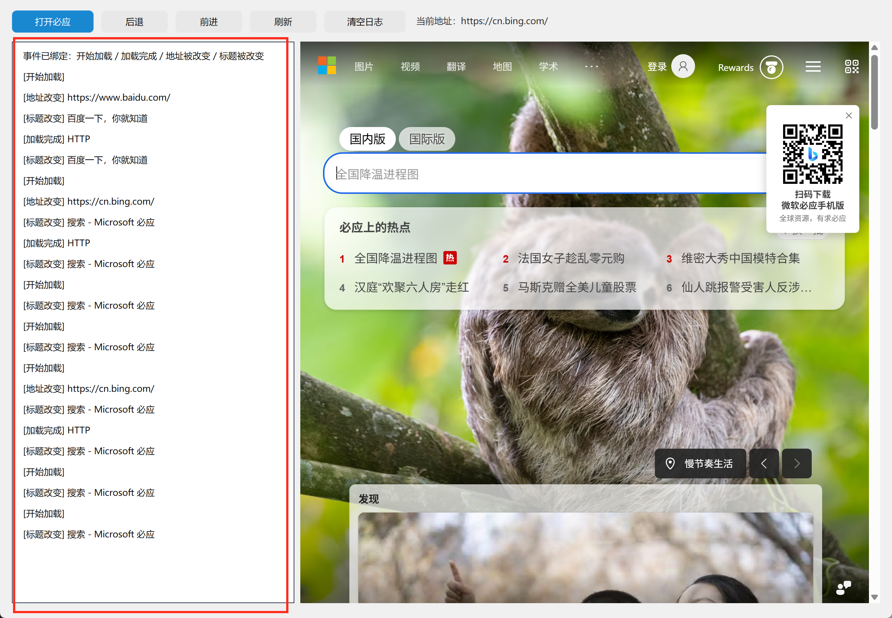
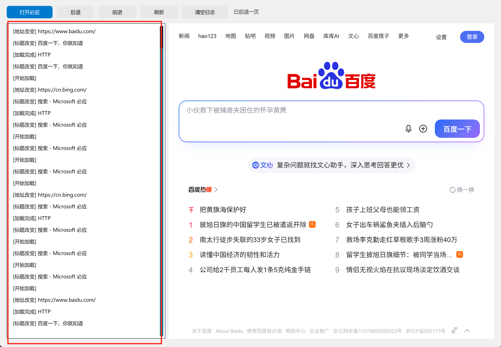
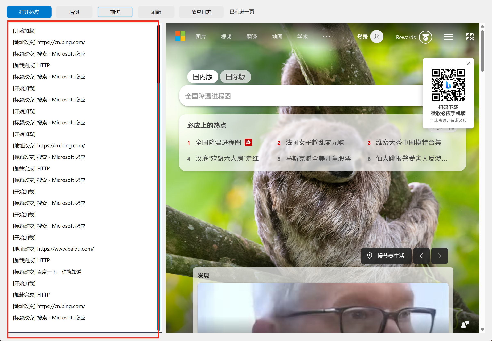

# FBro 合集 03 · 导航与页面事件：让浏览器向你的代码「汇报」

> 《LingBuilder FBro 指纹浏览器合集》第 3 集（基础篇）。前两集我们一直在「命令浏览器」——让它开网页、后退、刷新。本集反过来：**浏览器主动向你汇报**。页面开始加载了、加载完了、地址变了、标题变了——每件事都是一个**事件**，你的代码可以逐个接住。我们做一个「页面事件观察器」：左边一列日志实时滚动，右边浏览器怎么动，左边就怎么记。全程约 35 分钟。
>
> **模块获取**：FBro 指纹浏览器模块是**收费模块**（启用方式见第 1 集）。本集命令（`FBro_绑定事件` 等）为非 VIP 命令，普通授权即可完整跟做。
>
> 前置要求：完成第 1、2 集。本集源码包见文末。

## 这一集你将学会

- FBro 的**事件模型**：绑定（`FBro_绑定事件`）→ 处理器（`&处理器名`）→ 读字段（`FBro_取事件字段`）
- 四个最常用的导航类事件：**开始加载 / 加载完成 / 地址被改变 / 标题被改变**
- 列表框当日志窗口：`控件_添加项目` 追加、`列表框_滚动到项` 自动滚到最新
- 事件驱动 vs 轮询：为什么「等页面加载完」不要写死延迟

## 1. 先搞懂：事件是什么？

第 1 集我们写过 `FBro_导航(浏览器1, 网址)`——命令发出去就完事，页面什么时候加载完？你不知道，只能 `延迟` 个十秒碰运气。**事件**就是解决这个问题的正规军：

```
浏览器里发生了一件事（页面加载完成）
        ↓
FBro 把这件事打包成「事件包」投给你的处理器
        ↓
你的处理器代码自动执行（读字段、写日志、做决策）
```

用事件的代码是「**被通知**」而不是「去猜」：加载完成事件一到，你立刻知道 HTTP 状态码是 200 还是 404；地址一变，你立刻知道用户（或网页脚本）跳去了哪。写自动化、做监控、防跳转劫持，全靠它。

FBro 的公开浏览器事件有 89 个，本集挑导航类最常用的 4 个入门：

| 事件名（绑定用中文名） | 什么时候触发 | 事件包里有什么 |
| --- | --- | --- |
| 开始加载 | 每个页面（含 iframe）开始加载 | `url`、`transition_type` |
| 加载完成 | 页面加载结束 | `httpStatusCode`（200/404…） |
| 地址被改变 | 地址栏地址变化 | `url` |
| 标题被改变 | 页面标题变化 | `title` |

## 2. 新建项目

项目名称填 **页面事件观察器**，模板「Windows 界面设计」：



## 3. 设计界面：左日志右浏览器

窗口 1200×860，顶部一排按钮，左边日志、右边浏览器：

| 控件 | 名称 | 说明 | 位置尺寸 |
| --- | --- | --- | --- |
| 按钮×5 | 必应按钮 / 后退按钮 / 前进按钮 / 刷新按钮 / 清空按钮 | 130~90 宽一排 | 顶距 14 |
| 标签 | 状态标签 | 显示当前地址 | 560,20 |
| 列表框 | **事件日志** | 本集主角，日志窗口 | 16,56 380×756 |
| FBro浏览器 | 浏览器1 | 打开地址 = 百度首页；**缓存目录** = `.fbro/ep03` | 404,56 780×756 |


两个细节：

- 「打开地址」填 `https://www.baidu.com/`——程序一启动就自动打开首页，事件马上就能看到，不用先点按钮；
- 「缓存目录」给了个独立目录 `.fbro/ep03`——跟第 2 集的实验场互不弄脏对方缓存，这个参数的完整意义是下一集的主题。

## 4. 写代码：绑定 → 处理器 → 读字段

事件代码三步走。**第一步**，窗口创建完毕时把四个事件绑到四个处理器（注意处理器名前面的 `&`——它是「处理器引用」，不是字符串）：



**第二步**，写四个处理器。每个处理器干两件事：从事件包里读字段、往日志里加一行：



完整代码：

```
类 MainWindow
    事件 _MainWindow_创建完毕()
        FBro_绑定事件(浏览器1, "开始加载", &处理开始加载)
        FBro_绑定事件(浏览器1, "加载完成", &处理加载完成)
        FBro_绑定事件(浏览器1, "地址被改变", &处理地址改变)
        FBro_绑定事件(浏览器1, "标题被改变", &处理标题改变)
        控件_添加项目(事件日志, "事件已绑定：开始加载 / 加载完成 / 地址被改变 / 标题被改变")
        控件_设置文本(状态标签, "首页百度已自动打开，看左边日志怎么滚动")
    结束

    事件 处理开始加载()
        控件_添加项目(事件日志, "[开始加载] " + FBro_取事件字段(浏览器1, "url"))
        列表框_滚动到项(事件日志, 控件_取项目数量(事件日志) - 1)
    结束

    事件 处理加载完成()
        控件_添加项目(事件日志, "[加载完成] HTTP " + FBro_取事件字段(浏览器1, "httpStatusCode"))
        列表框_滚动到项(事件日志, 控件_取项目数量(事件日志) - 1)
        控件_设置文本(状态标签, "当前地址：" + FBro_取地址(浏览器1))
    结束

    事件 处理地址改变()
        控件_添加项目(事件日志, "[地址改变] " + FBro_取事件字段(浏览器1, "url"))
        列表框_滚动到项(事件日志, 控件_取项目数量(事件日志) - 1)
    结束

    事件 处理标题改变()
        控件_添加项目(事件日志, "[标题改变] " + FBro_取事件字段(浏览器1, "title"))
        列表框_滚动到项(事件日志, 控件_取项目数量(事件日志) - 1)
    结束

    事件 _必应按钮_被单击()
        FBro_导航(浏览器1, "https://cn.bing.com")
        控件_设置文本(状态标签, "正在打开 cn.bing.com ……")
    结束

    事件 _后退按钮_被单击()
        FBro_后退(浏览器1)
        控件_设置文本(状态标签, "已后退一页")
    结束

    事件 _前进按钮_被单击()
        FBro_前进(浏览器1)
        控件_设置文本(状态标签, "已前进一页")
    结束

    事件 _刷新按钮_被单击()
        FBro_刷新(浏览器1)
        控件_设置文本(状态标签, "已刷新当前页面")
    结束

    事件 _清空按钮_被单击()
        控件_清空项目(事件日志)
        控件_设置文本(状态标签, "日志已清空")
    结束
结束类
```

**第三步**看懂三行关键句法：

- `FBro_绑定事件(浏览器1, "开始加载", &处理开始加载)`——把浏览器1 的「开始加载」事件接到名为「处理开始加载」的事件处理器上。**事件名用中文引号字符串，处理器名用 & 引用**，两者千万别写反形态。
- `FBro_取事件字段(浏览器1, "url")`——在处理器**里面**调用，读当前这个事件包的字段。字段名见上文表格（`url`、`httpStatusCode`、`title`）。
- `列表框_滚动到项(事件日志, 控件_取项目数量(事件日志) - 1)`——列表框追加项目后**不会自动滚动**，新日志会藏在可视区外面；这行让它始终滚到最新一条（索引从 0 数，所以减 1）。

> 注意：处理器也是 `事件` 关键字定义，但名字不是 `_控件名_被单击` 这种自动接线格式，而是自定义名——它们由 `FBro_绑定事件` 手工接线。

## 5. 编译前先看错误列表

照例确认 0 报错再编译：



## 6. 运行：看事件流滚起来

启动程序。首页百度自动打开的过程中，左边日志已经滚出了一串事件——先是「事件已绑定」提示，然后 [开始加载]、[地址改变]、[标题改变]、[加载完成] HTTP 200 一条接一条：



点「打开必应」：日志马上追加必应的四个事件，状态标签变成「当前地址：https://cn.bing.com/」——这个地址不是你写的，是**「加载完成」事件处理器现场从浏览器里读出来的**：



点「后退」：回到百度，日志又滚一轮。注意看 [加载完成] 的 HTTP 状态码——百度、必应都是 200，说明页面都完整拿到了：



点「前进」：再到必应，还是那熟悉的四连事件：



看懂这张「事件流」，你就掌握了所有浏览器自动化的底层逻辑：**下一步操作永远跟着事件走**——加载完成了我再去取标题、地址变了我就更新界面。永远不要写「延迟 5 秒碰运气」。

## 7. 红线与坑（本集实测）

- **事件绑定要在浏览器创建之前或之时**：我们放在 `_MainWindow_创建完毕` 里，此刻设计器控件尚未开始导航，绑定一定赶得上事件。放太晚（比如放到某个按钮里）可能漏掉早期事件。
- **处理器引用必须带 `&`**：写成 `"处理开始加载"`（字符串）绑定会失败——这是模块层的硬规则，适用于所有 FBro 事件命令。
- **高频事件要限流**：本集 4 个事件都是低频事件，随便记日志没问题。以后用到「加载进度改变」这类高频事件（默认每秒 10 次）时，用 `FBro_设置事件采样率` 限流，否则界面会被刷爆。
- **列表框不自动滚动**：追加后必须 `列表框_滚动到项`，否则新日志在可视区外（第 1 集的教训在 exe 里也适用）。
- **事件包只在处理器内有效**：`FBro_取事件字段` 读的是「当前正在处理的这个事件」，出了处理器再调用读不到东西。

## 本集源码包

- 本集源码包已上架官网「[示例源码](https://lingbuilder.com/demos)」区，按名称「FBro合集03-页面事件观察器」即可下载（每集一个 `.lcpppkg`，配套预览图与图文教程直链）。
- 导入：LingBuilder 欢迎页 →「**导入源码包**」，选中 `.lcpppkg` 一键还原整个项目（含窗口设计与全部源码）。
- FBro 指纹浏览器模块为**收费模块**：导入后如未启用，在模块面板启用并用 LingBuilder 账号登录授权即可（和制作时是同一个账号体系，授权一次全合集通用）；FBro 运行时由随包 SDK 自动补齐。


## 下集预告

**04 集 · 会话隔离与独立缓存目录**：为什么两个浏览器要各用各的缓存目录？「独立缓存」和「登录态保持」是什么关系？我们做实验：两个独立缓存的浏览器各自登录同一个网站，互不串号——这就是指纹浏览器多开的第一块地基。
