# LingBuilder「流程控制」图文教程

> 适用版本：LingBuilder 0.8.21 及以上（含并列分支自动对齐、`fz` 拼音补全「分支」）
> 你将学会：新手模式里全部流程控制语句——条件分支、多路判断、六种循环、异常处理，以及 `跳出循环 / 继续循环` 两个小命令。每个结构都给出「怎么输入 → 长什么样 → 最小示例」。

本教程面向新手模式（结构化中文编辑器）的初学者，不涉及专业模式。全部截图来自真机新手模式，**截图都可以点击放大**。示例都写在 `按钮1_被单击` 事件里，跟在自己的项目里照抄即可。

---

## 第 1 章 先认识新手编辑器

双击解决方案树的 `MainWindow.lcpp`，就进入新手模式的结构化编辑器：左边是**行号**，行号右边一列是**流程导轨**（`┌` 结构开始、`│` 中间、`├` 分支、`└` 结构结束），代码区按中文语句着色。右上角可随时在「新手 / 专业 / 原生」三种模式间切换。

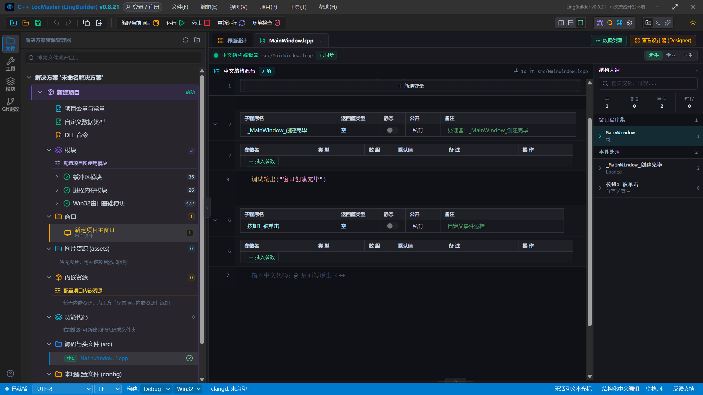

流程导轨是新手模式特有的「护栏」：它按你写的结构自动配对绘制，写错嵌套时一眼就能看出来。本教程每个结构的截图都能看到它。

---

## 第 2 章 流程语句怎么输入：拼音补全

在代码区任意空行直接敲**拼音首字母**或**全拼**，补全面板就会弹出对应结构，`↑↓` 选择、`Enter` 上屏。例如敲 `rg`（如果）：

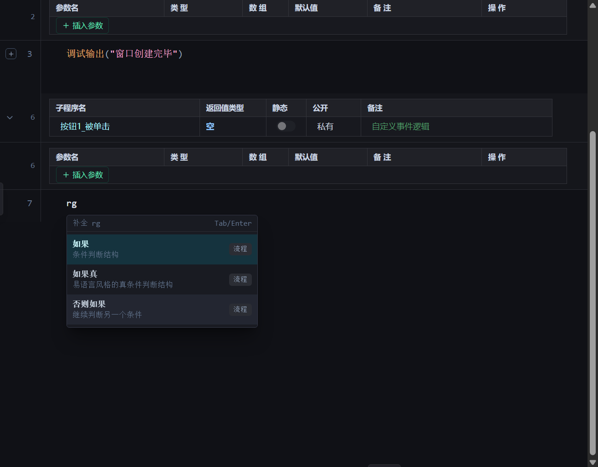

上屏后是一个带占位条件的完整模板，光标自动停在括号里——把「条件」改成你自己的表达式就能用。所有流程语句的拼音键见文末速查表；`Ctrl+空格` 可随时手动呼出补全。

> 小技巧：模板里的占位文字（条件 / 表达式 / 次数…）上屏时处于选中态，直接打字就会整体替换。

---

## 第 3 章 条件分支：如果 / 否则 / 否则如果

敲 `rg` 上屏「如果」模板，填入条件与两个分支的语句：

```
如果 (命令索引 = 1)
    信息框 ("你点了第一个按钮", 64, "提示")
否则
    信息框 ("你点了其他按钮", 64, "提示")
如果结束
```

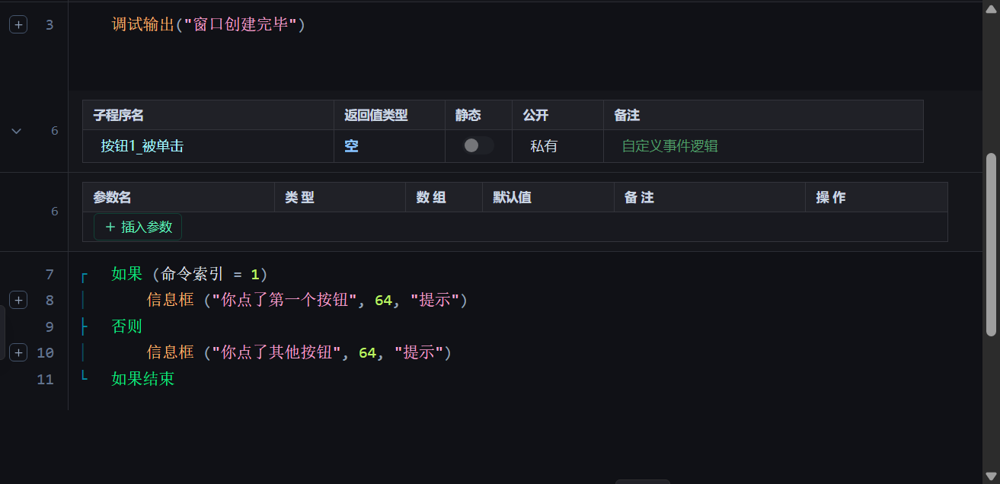

注意「否则」与「如果」在同一条垂直线上（失去焦点时会自动对齐），分支体比它们深一层。

需要多个条件时，在「否则」之前插入 `否则如果 (条件)`，可以写任意多段，从上往下依次匹配，命中一段就跳过其余：

```
如果 (命令索引 = 1)
    调试输出 ("新建文档")
否则如果 (命令索引 = 2)
    调试输出 ("打开文档")
否则
    调试输出 ("其他命令")
如果结束
```

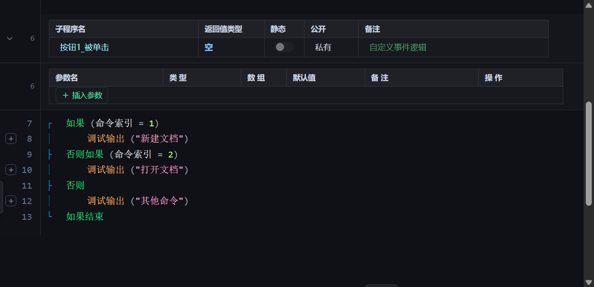

只想「满足才做、不满足拉倒」时，用不带否则的 `如果真`，少一层嵌套：

```
如果真 (命令索引 = 1)
    信息框 ("欢迎回来", 64, "提示")
如果真结束
```

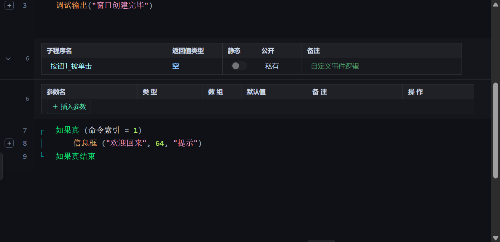

| 语句 | 拼音 | 说明 |
| --- | --- | --- |
| `如果 (条件) … 否则 … 如果结束` | `rg` | 条件成立走如果体，否则走否则体 |
| `否则如果 (条件)` | `fzrg` | 追加多段条件，必须在否则之前 |
| `如果真 (条件) … 如果真结束` | `rgz` | 不带否则的单条件分支 |

---

## 第 4 章 多路判断：选择 / 分支 / 默认

按表达式的值进入匹配的分支。敲 `xz`（或 `pd`）上屏「选择」模板：

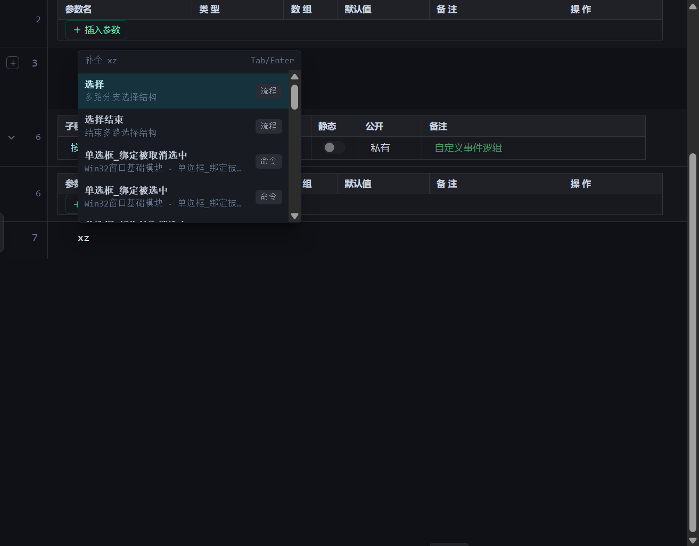

一个「选择」里可以有任意多个 `分支`。把光标放在某个分支体的行尾回车，敲 `fz`（分支）就能补全出下一个分支：

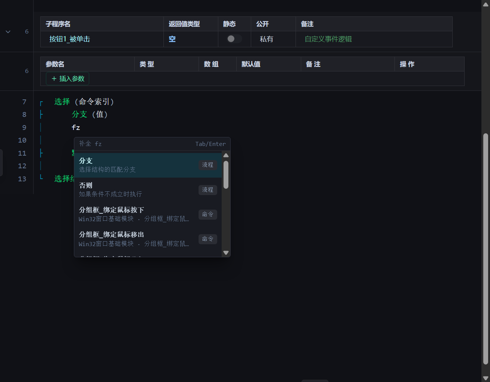

手敲的第二个「分支」继承了上一行的深层缩进也没关系——**失焦提交时会自动吸附回兄弟分支同一列**。写歪时的样子：

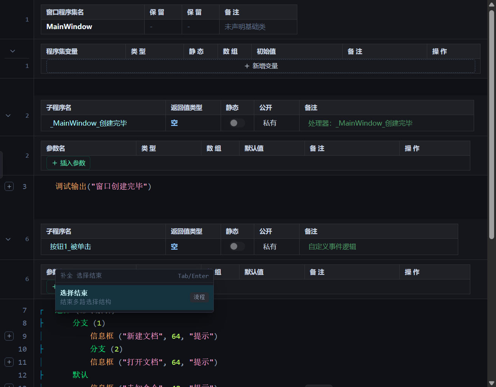

失焦后全部分支自动对齐：

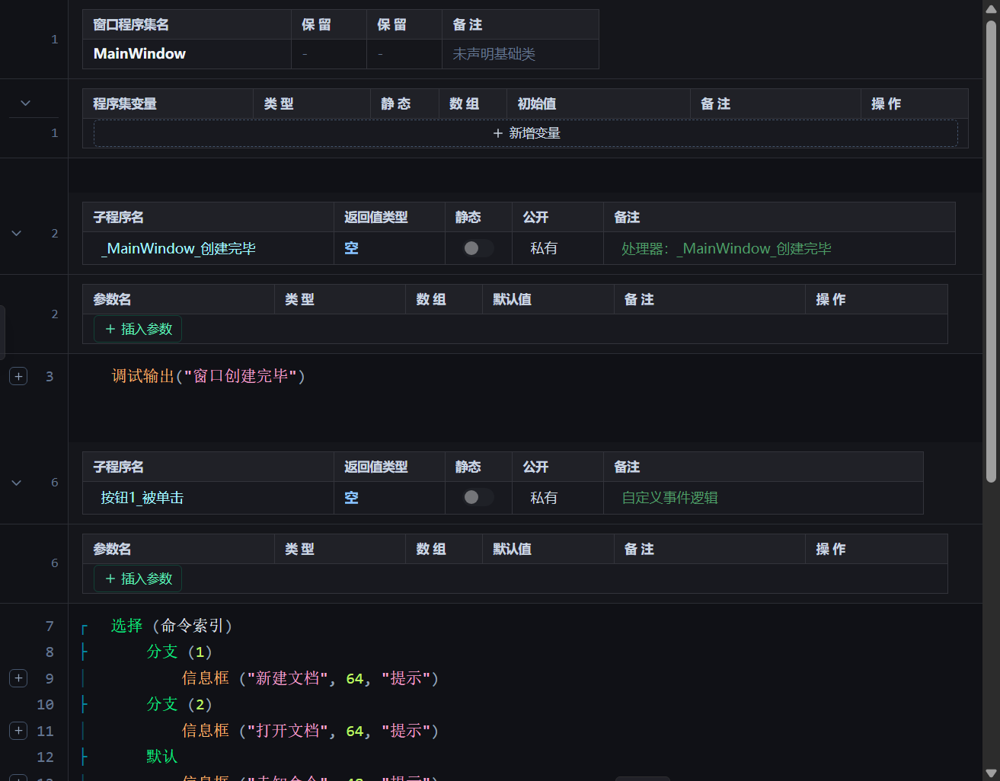

完整示例（`分支 (3, 4)` 表示一个分支匹配多个值，逗号分隔）：

```
选择 (命令索引)
    分支 (1)
        信息框 ("新建文档", 64, "提示")
    分支 (2)
        信息框 ("打开文档", 64, "提示")
    分支 (3, 4)
        信息框 ("保存或另存为", 64, "提示")
    默认
        信息框 ("未知命令", 48, "提示")
选择结束
```

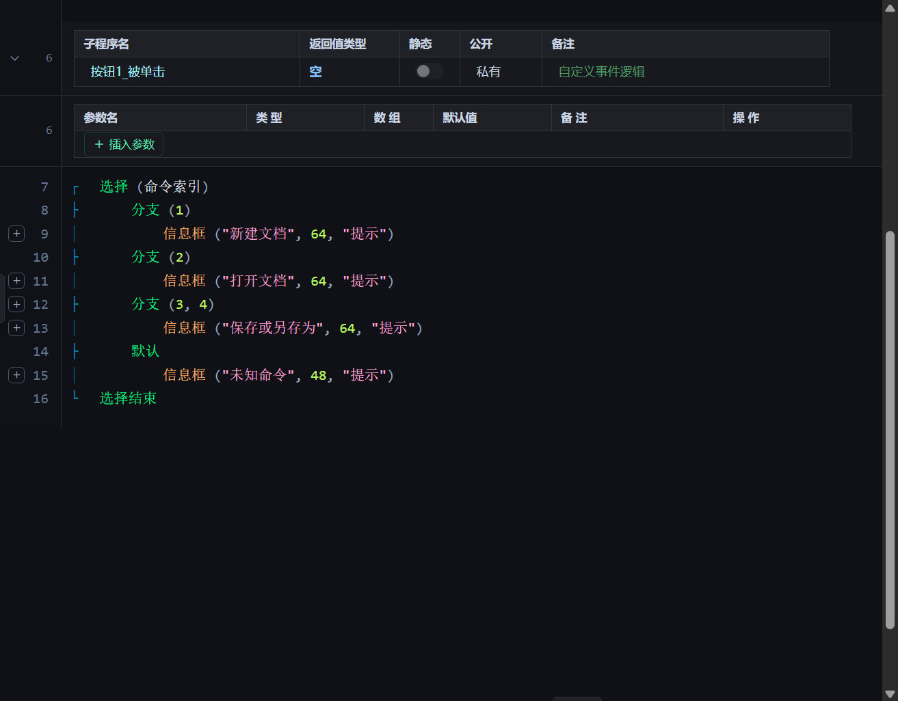

三条规则：`默认` 只能有一个；`判断 … 判断结束` 与 `选择` 完全同义；`情况` 等价于 `分支`。

| 语句 | 拼音 | 说明 |
| --- | --- | --- |
| `选择 (表达式) … 选择结束` | `xz` / `pd` | 多路匹配 |
| `分支 (值1, [值2…])` | `fz` / `fenzhi` | 匹配分支，值可多个 |
| `默认` | `mr` | 没有匹配时进入，最多一个 |

---

## 第 5 章 六种循环

### 5.1 计次循环：按次数执行（最常用）

敲 `jcxh` 上屏模板，第一个参数是总次数，第二个参数是**计次变量**（可省略）。计次从 **1** 开始。

把光标放在这一行行尾按 `Enter`，编辑器会弹出「为 次 选择类型」面板并推荐 `整数型`：

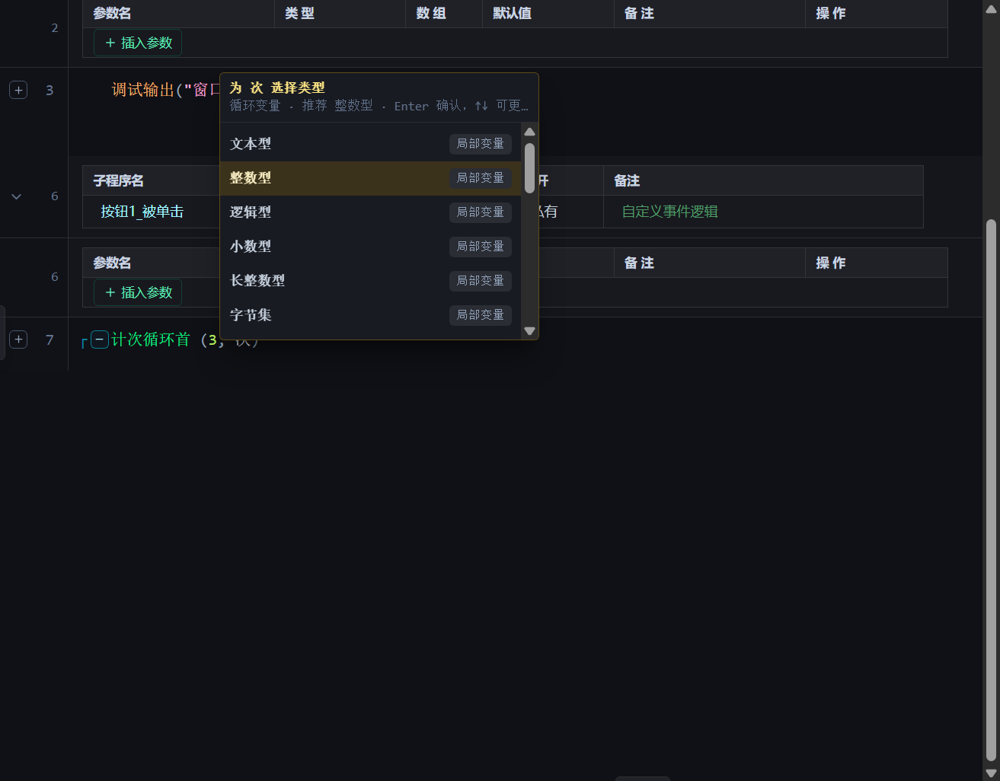

按 `Enter` 确认后，`次` 自动登记进子程序下方的**局部声明**表（不用自己去建变量），光标落到下一行：

```
计次循环首 (3, 次)
    调试输出 ("又跑了一圈")
计次循环尾 ()
```

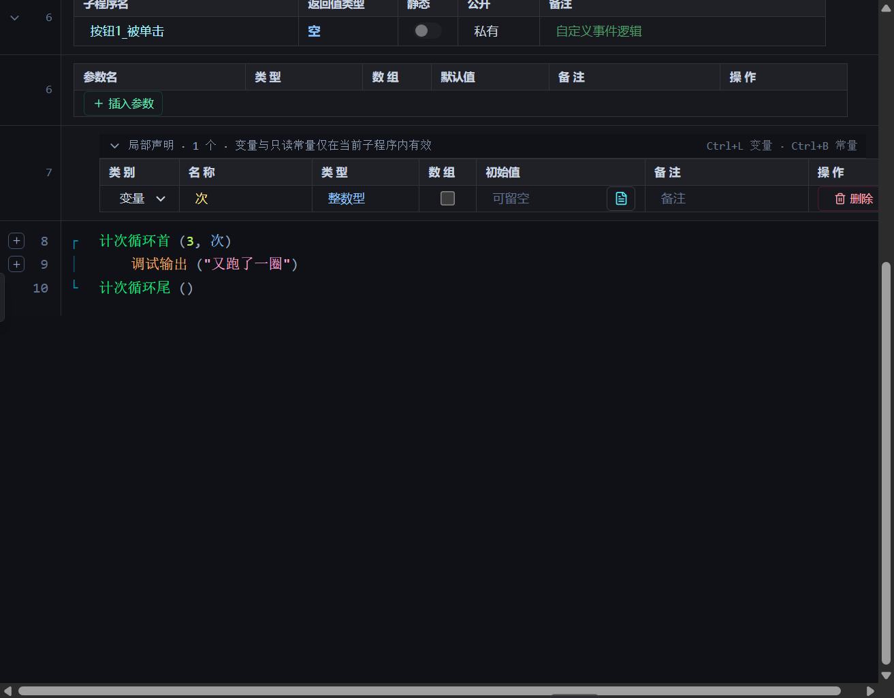

### 5.2 判断循环：先判断再执行（while）

条件成立就反复执行，每次进入循环前重新判断：

```
倒计时 = 3
判断循环首 (倒计时 > 0)
    调试输出 ("倒计时进行中")
    倒计时 = 倒计时 - 1
判断循环尾 ()
```

赋值行尾按 `Enter` 时，`倒计时` 同样会自动登记为局部变量：

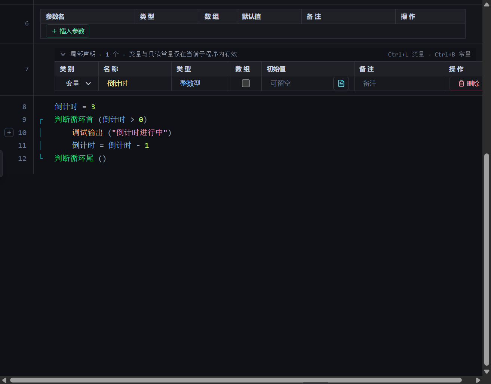

> 别忘了在循环体里改变条件（比如 `倒计时 = 倒计时 - 1`），否则就是死循环。

### 5.3 循环判断：先执行再判断（do-while）

先执行一次循环体，最后再判断条件是否继续：

```
循环判断首 ()
    调试输出 ("至少执行一次")
循环判断尾 (命令索引 = 1)
```

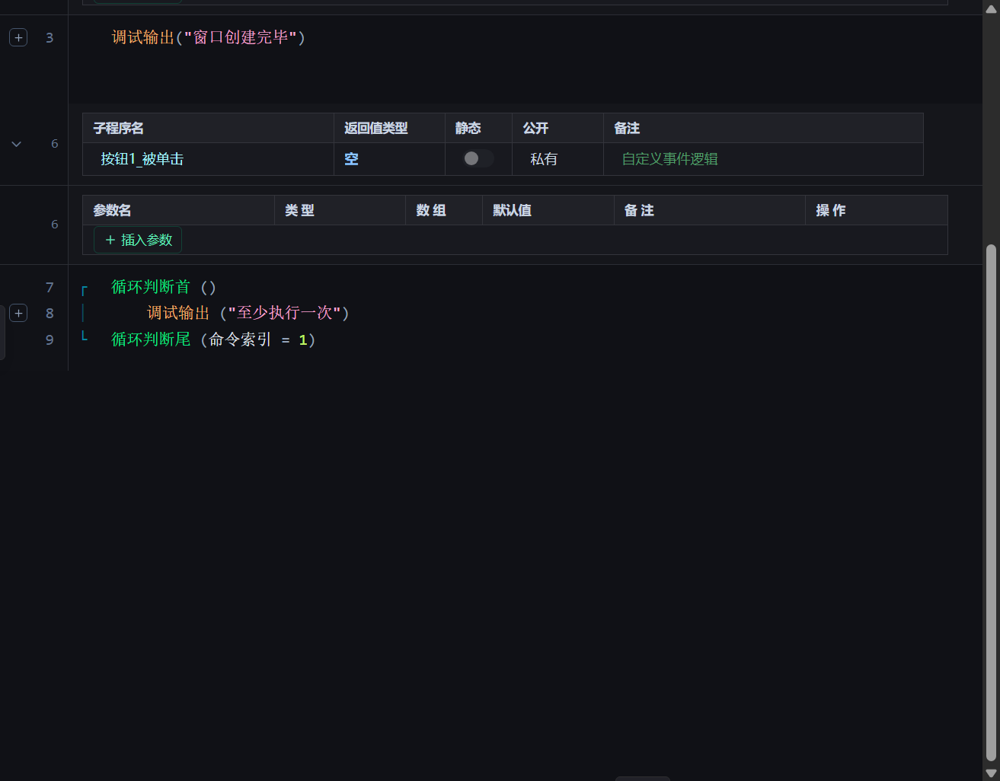

### 5.4 循环：无限循环 + 跳出循环

`循环 … 循环结束` 会一直执行，必须在体内用 `跳出循环`（break）离开：

```
尝试次数 = 0
循环
    尝试次数 = 尝试次数 + 1
    如果真 (尝试次数 >= 3)
        跳出循环
    如果真结束
循环结束
```

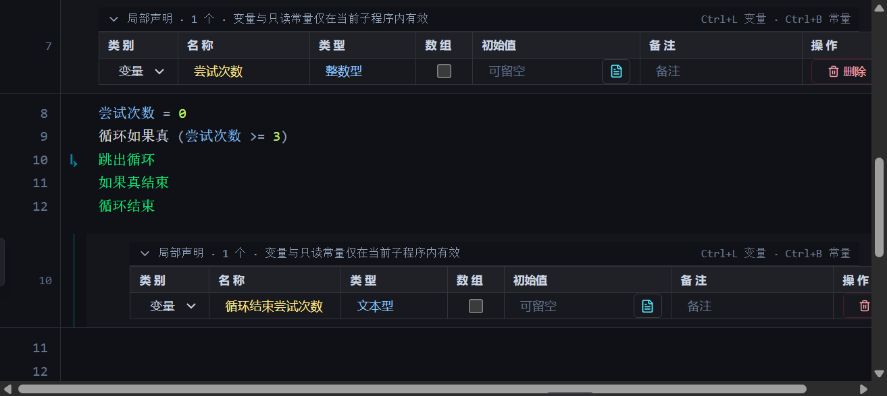

### 5.5 继续循环：跳过这一次

`继续循环`（老写法 `到循环尾`）跳过本次循环剩余语句、直接进入下一次：

```
计次循环首 (5, 序号)
    如果真 (序号 = 3)
        继续循环
    如果真结束
    调试输出 ("处理一个任务")
计次循环尾 ()
```

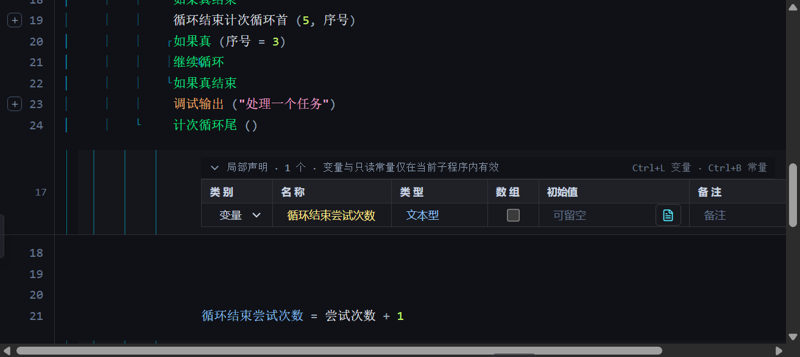

### 5.6 变量循环：按步长遍历数值区间

四个参数：起始值、目标值、递增值（可为负，不能为 0）、循环变量。示例从 1 走到 9、每次加 2：

```
变量循环首 (1, 9, 2, 步进值)
    调试输出 ("向前一步")
变量循环尾 ()
```

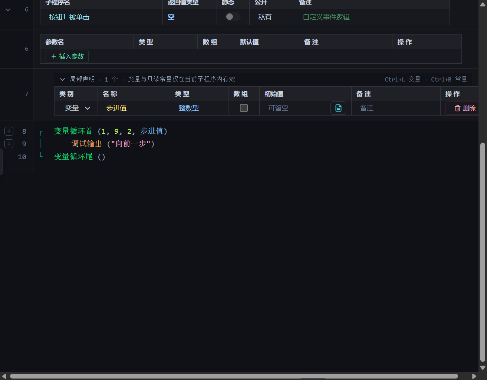

### 5.7 枚举循环：遍历数组 / 集合（foreach）

第一个参数是集合（数组），第二个参数是当前项。`当前名称` 的类型会按集合元素自动推荐并登记：

```
枚举循环首 (名称列表, 当前名称)
    调试输出 ("报到")
枚举循环尾 ()
```


> `名称列表` 是在「项目变量与常量」里声明的文本型数组（`全局 文本型 名称列表[]`）。项目里没有数组时也可以先在局部声明表自己建一个。

| 循环 | 拼音 | 口诀 |
| --- | --- | --- |
| `计次循环首 (次数, [计次变量])` | `jcxh` | 固定次数，计次从 1 开始 |
| `判断循环首 (条件)` | `pdxh` | 先判断后执行（while） |
| `循环判断首 ()` | `xhpd` | 先执行后判断（do-while），条件写在尾上 |
| `循环 … 循环结束` | `xh` | 无限循环，配 `跳出循环` 使用 |
| `变量循环首 (起始, 目标, 递增, 变量)` | `blxh` | 数值区间按步长 |
| `枚举循环首 (集合, 当前项)` | `mjxh` | 遍历数组 / 集合 |

---

## 第 6 章 异常处理：尝试 / 捕获 / 最终 / 抛出

`抛出` 主动抛出一个文本错误；`捕获` 接住它（错误信息是文本型）；`最终` 里的语句无论如何都会执行（放清理代码）：

```
尝试
    抛出 ("模拟一个错误")
捕获 (错误信息)
    信息框 (错误信息, 48, "出错了")
最终
    调试输出 ("无论如何都会执行")
尝试结束
```

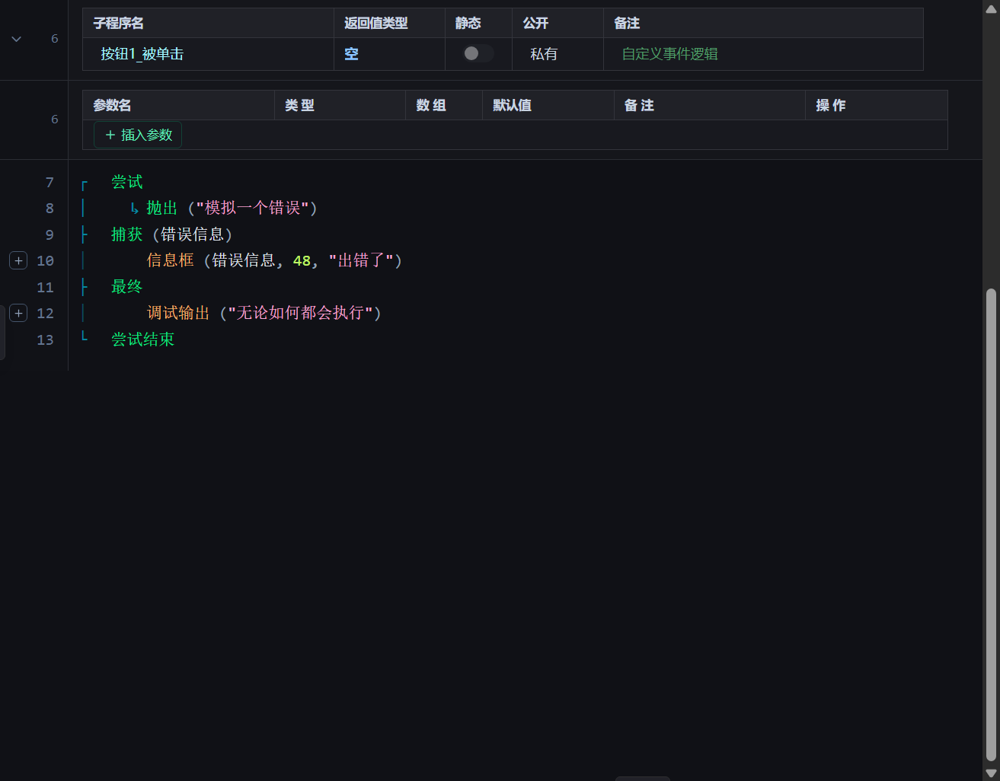

规则：`捕获` 与 `最终` 至少写一个；`最终` 必须在 `捕获` 之后；它们与 `尝试` 同列。敲 `cs`（尝试捕获）一次上屏整套模板，`抛出` 的拼音是 `pc`。

---

## 第 7 章 拼音速查表

| 语句 | 首字母 | 全拼 | 英文 |
| --- | --- | --- | --- |
| 如果 | `rg` | `ruguo` | if |
| 如果真 | `rgz` | `ruguozhen` | iftrue |
| 否则 | `fz` | `fouze` | else |
| 否则如果 | `fzrg` | `fouzeruguo` | elseif |
| 选择 / 判断 | `xz` / `pd` | `xuanze` / `panduan` | switch |
| 分支 | `fz` | `fenzhi` | case |
| 默认 | `mr` | `moren` | default |
| 循环 | `xh` | `xunhuan` | loop |
| 判断循环 | `pdxh` | `panduanxunhuan` | while |
| 循环判断 | `xhpd` | `xunhuanpanduan` | do |
| 计次循环 | `jcxh` | `jicixunhuan` | for |
| 变量循环 | `blxh` | `bianliangxunhuan` | range |
| 枚举循环 | `mjxh` | `meijuxunhuan` | foreach |
| 跳出循环 | `tcxh` | `tiaochuxunhuan` | break |
| 继续循环 / 到循环尾 | `jjxh` / `dxhw` | `jixuxunhuan` / `daoxunhuanwei` | continue |
| 尝试捕获 | `cs` | `changshi` | try / catch / finally |
| 抛出 | `pc` | `paochu` | throw |

---

## 第 8 章 常见问题

**Q：手敲的第二个「分支」比第一个深一层，是坏了吗？**
不是。新手模式回车自动缩进只加不减，手敲的分支行会继承上一行的深层缩进；**失焦提交时编辑器会把所有分支自动吸附到同一列**（见第 4 章图 8 → 图 9），`否则 / 否则如果 / 捕获 / 最终` 则自动与结构首行同列。什么都不用调。

**Q：循环变量一定要先声明吗？**
不用。在 `计次循环首 / 变量循环首 / 枚举循环首` 行尾按回车，编辑器弹出类型面板（自动推荐类型），确认后就登记进局部声明表；给未声明变量赋值（如 `倒计时 = 3`）同理。想手动建变量/常量用 `Ctrl+L` / `Ctrl+B`。

**Q：结构写到一半（还没写「结束」行）能保存吗？**
能。新手模式允许随时保存进行中的代码；生成 C++ 或运行前补全结构即可，错误列表会提示缺哪个结束语句。

**Q：`分支` 后面的值可以是文本吗？**
`选择` 的表达式与分支值按整数处理，文本条件请使用 `如果 / 否则如果` 组合。

---

## 附：配套工程

`流程控制演示` 项目（空白 Win32 窗口模板 + 按钮1），把文中任意示例粘进 `按钮1_被单击` 事件，按 F5 生成运行，点按钮即可验证流程走向。
