# 高阶实战 02 · 文本与 Markdown 排版：把通知写成「人话」

> 《LingBuilder 高阶实战系列》第 2 集，**消息推送专题·企业微信篇**。上一集我们发出了第一行白底黑字；这一集让消息「会说话」：**加粗、引用、行内代码、字体颜色**把构建报告排版得清清爽爽，还要学会 **@ 指定手机号**，并亲手撞一次 **2048 字节上限**，看看运行时的本地预检怎么拦住你。全程约 35 分钟。
>
> 前置要求：学完[第 01 集](/guide/tutorials/gaojie-01-wecom-text)（会申请 webhook、会发第一条文本）。本集源码包见文末。

## 这一集你将学会

- `推送_发企业微信文本` 的后两个参数：**手机号列表**（@ 指定人）与**是否所有人**
- `推送_发企业微信Markdown(地址, 内容)`：两个参数发排版消息
- **三引号文本块**（`"""`）：多行排版内容原样写，不用拼 `#换行符`
- 文本 2048 字节 / Markdown 4096 字节上限，以及「本地预检拦截」意味着什么
- 红线：**企业微信的 Markdown 不能 @ 人**（和钉钉正好相反）

## 1. 三十秒理解：文本和 Markdown 各管什么

| | 文本（text） | Markdown（markdown） |
| --- | --- | --- |
| 擅长 | 简短通知、**@ 人** | 排版：加粗/引用/代码/颜色 |
| @ 人 | ✅ 支持手机号列表 | ❌ 官方限制，写了也不生效 |
| 上限 | 2048 字节（UTF-8） | 4096 字节（UTF-8） |
| 命令 | `推送_发企业微信文本`（4 参数） | `推送_发企业微信Markdown`（2 参数） |

> 「字节」不是「字数」：UTF-8 里一个汉字占 3 字节，2048 字节 ≈ 680 个汉字。超长不是发出去被平台打回，而是**运行时在本地直接拦截**——一个字节都不会发出去，错误信息还会告诉你确切超了多少。

## 2. 新建项目与启用模块

新建窗口项目：名称 **文本与Markdown排版**，模板「Windows 界面设计」，创建位置留空：

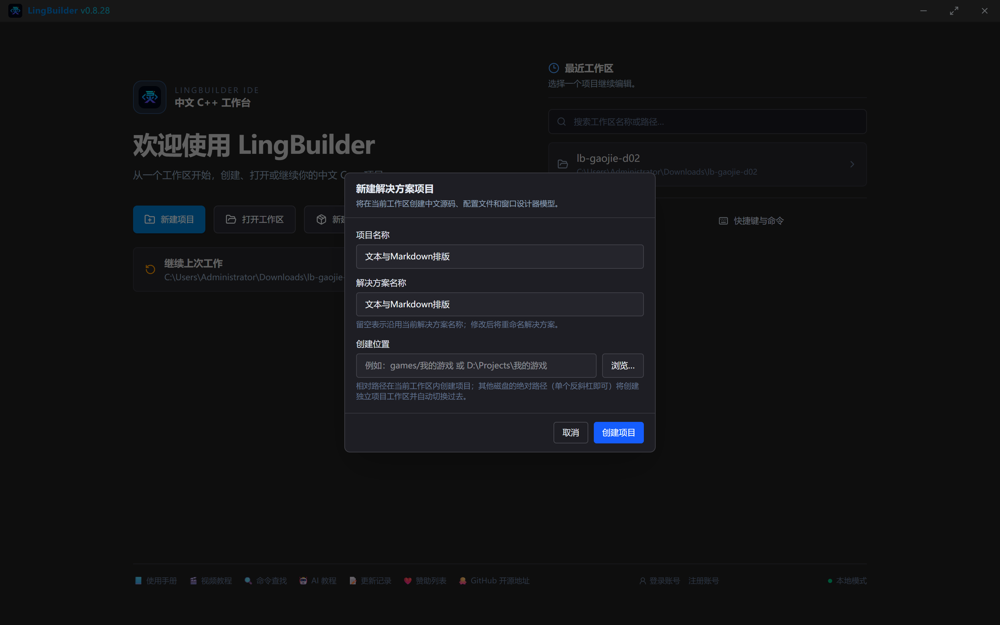

启用模块与第 01 集相同：**消息推送模块** ＋ **Win32窗口基础模块**：

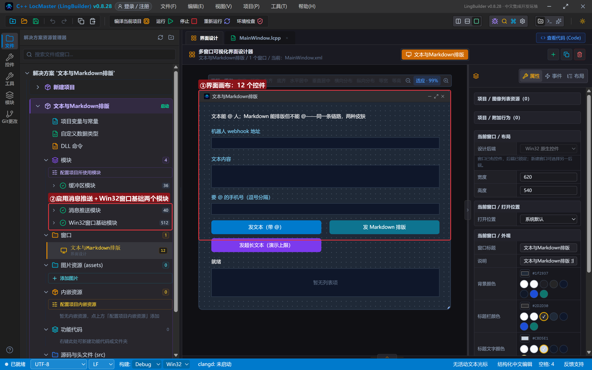

## 3. 设计界面

| 控件 | 名称 | 显示内容 | 左距 | 顶距 | 宽度 | 高度 |
| --- | --- | --- | --- | --- | --- | --- |
| 标签 | 说明标签 | 文本能 @ 人；Markdown 能排版但不能 @——同一条链路，两种皮肤 | 30 | 22 | 560 | 24 |
| 标签 | 地址标签 | 机器人 webhook 地址 | 30 | 60 | 220 | 22 |
| 编辑框 | 地址框 | （空） | 30 | 86 | 560 | 28 |
| 标签 | 文本标签 | 文本内容 | 30 | 128 | 220 | 22 |
| 编辑框 | 文本框 | （空，勾选**多行**） | 30 | 154 | 560 | 56 |
| 标签 | 手机号标签 | 要 @ 的手机号（逗号分隔） | 30 | 222 | 220 | 22 |
| 编辑框 | 手机号框 | （空） | 30 | 248 | 560 | 28 |
| 按钮 | 发文本按钮 | 发文本（带 @） | 30 | 290 | 270 | 34 |
| 按钮 | 发MD按钮 | 发 Markdown 排版 | 320 | 290 | 270 | 34 |
| 按钮 | 超长按钮 | 发超长文本（演示上限） | 30 | 334 | 270 | 34 |
| 标签 | 状态标签 | 就绪 | 30 | 380 | 560 | 22 |
| 列表框 | 结果列表 | — | 30 | 408 | 560 | 70 |

窗口宽 620、高 540。绑 3 个按钮事件 + 窗口「创建完毕」。

## 4. 写代码

### 4.1 创建完毕：预填默认内容

```lcpp
事件 _MainWindow_创建完毕()
    控件_设置文本(文本框, "代码推送完成，请留意构建结果。")
    控件_设置文本(手机号框, "13800001111")
    控件_设置文本(状态标签, "就绪。粘贴 webhook 地址后任选一个按钮")
结束
```

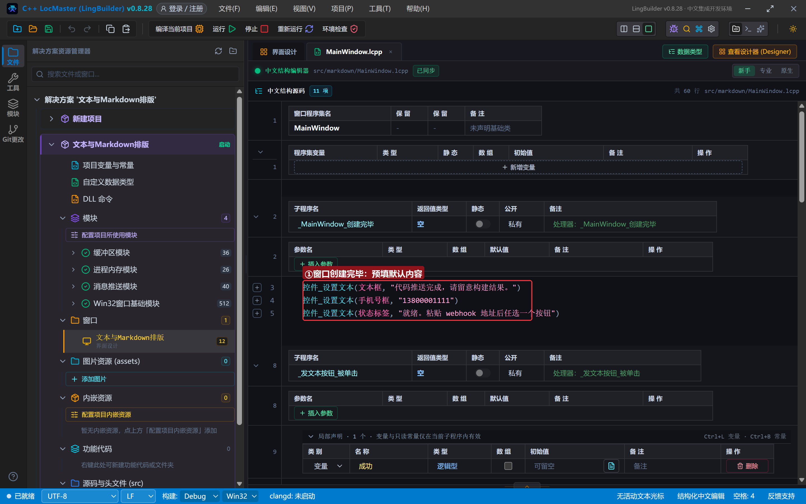

### 4.2 发文本（带 @）：后两个参数登场

```lcpp
事件 _发文本按钮_被单击()
    局部 逻辑型 成功
    成功 = 推送_发企业微信文本(控件_取文本(地址框), 控件_取文本(文本框), 控件_取文本(手机号框), 假)
    控件_清空项目(结果列表)
    如果 (成功)
        控件_添加项目(结果列表, "文本发送成功：" + 推送_取响应文本())
        控件_设置文本(状态标签, "文本已送达，@ 的手机号会高亮")
    否则
        控件_添加项目(结果列表, "发送失败：" + 推送_取错误())
        控件_设置文本(状态标签, "发送失败，先读错误信息")
    如果结束
结束
```

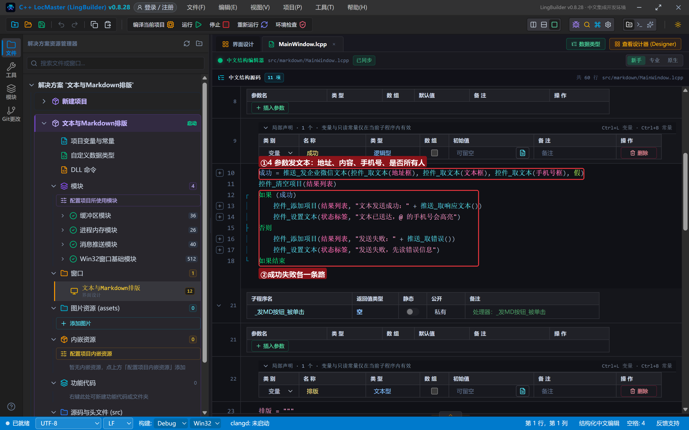

拆解：

- 第 3 个参数**手机号列表**：多个人用逗号分隔，如 `"13800001111,13800002222"`；空文本 `""` 表示不 @ 指定人。
- 第 4 个参数**是否所有人**：逻辑型，`真` = @ 群里所有人（也会占一条限流额度），本集传 `假`。
- ⚠️ 实测须知：@ 高亮只对**群成员的手机号**生效。演示用的 `13800001111` 不在群里，消息正常送达但不会出现 @ 效果——把参数换成你群内同事的手机号就能看到高亮了。

### 4.3 发 Markdown：三引号文本块写排版

Markdown 内容有很多行，还有引号。用**多行文本块**（三引号 `"""`）最舒服：内容**原样**写，引号、`<font>` 标签都不用转义，一行就是一行：

```lcpp
事件 _发MD按钮_被单击()
    局部 文本型 排版
    排版 = """
**构建报告**（第 42 号）
> 任务：夜间数据同步
> 状态：<font color="info">成功</font>
耗时 `128 秒`，详情见控制台。
"""
    局部 逻辑型 成功
    成功 = 推送_发企业微信Markdown(控件_取文本(地址框), 排版)
    控件_清空项目(结果列表)
    如果 (成功)
        控件_添加项目(结果列表, "Markdown 发送成功：" + 推送_取响应文本())
        控件_设置文本(状态标签, "Markdown 已送达，群里看排版效果")
    否则
        控件_添加项目(结果列表, "发送失败：" + 推送_取错误())
        控件_设置文本(状态标签, "发送失败，先读错误信息")
    如果结束
结束
```

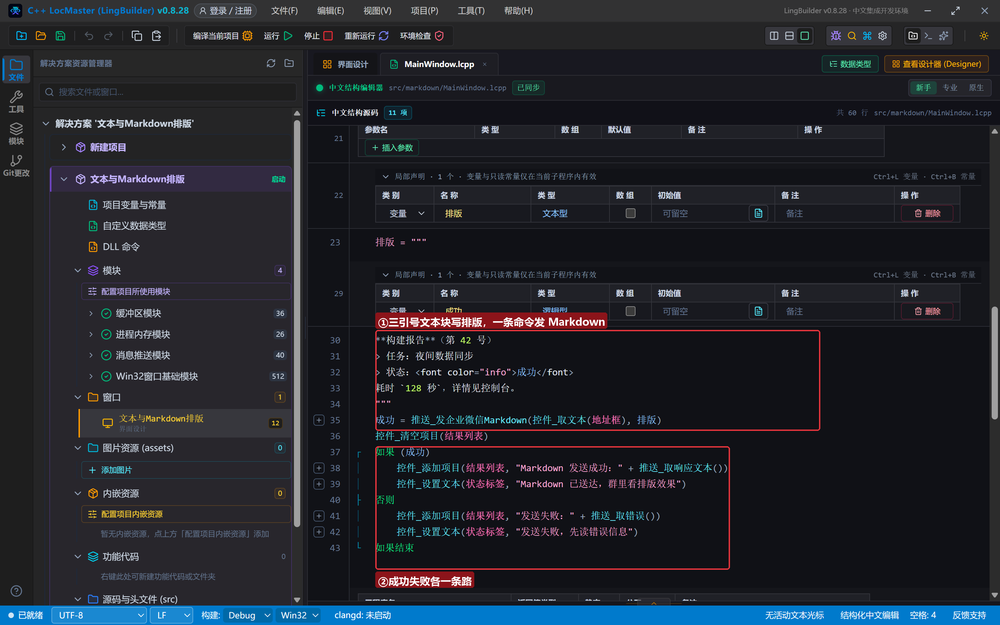

Markdown 语法速查（企业微信支持的部分）：

| 写法 | 效果 | 本例 |
| --- | --- | --- |
| `**文字**` | **加粗** | `**构建报告**` |
| `> 文字` | 引用块（带竖线） | `> 任务：夜间数据同步` |
| `` `文字` `` | 行内代码（等宽+底色） | `` `128 秒` `` |
| `<font color="info">文字</font>` | 绿色字体（还有 warning/comment） | `状态：<font color="info">成功</font>` |

> 为什么用文本块而不是一堆 `#换行符` 拼接？排版内容动辄四五 行，拼起来既难读又容易漏引号；文本块里内容**原样保留**，所见即所得。`<font color="info">` 里的双引号在文本块里**不需要任何转义**——这就是它的价值。

### 4.4 超长文本：计次循环拼出 4300+ 字节

```lcpp
事件 _超长按钮_被单击()
    局部 文本型 长文
    局部 整数型 次
    长文 = "消息推送压测："
    计次循环首 (80, 次)
        长文 = 长文 + "这是一段用于演示字节上限的重复文字。"
    计次循环尾
    局部 逻辑型 成功
    成功 = 推送_发企业微信文本(控件_取文本(地址框), 长文, "", 假)
    控件_清空项目(结果列表)
    如果 (成功)
        控件_添加项目(结果列表, "发送成功（未超限）：" + 推送_取响应文本())
    否则
        控件_添加项目(结果列表, "发送失败：" + 推送_取错误())
        控件_设置文本(状态标签, "超长被本地拦截，一个字节都没发出去")
    如果结束
结束
```

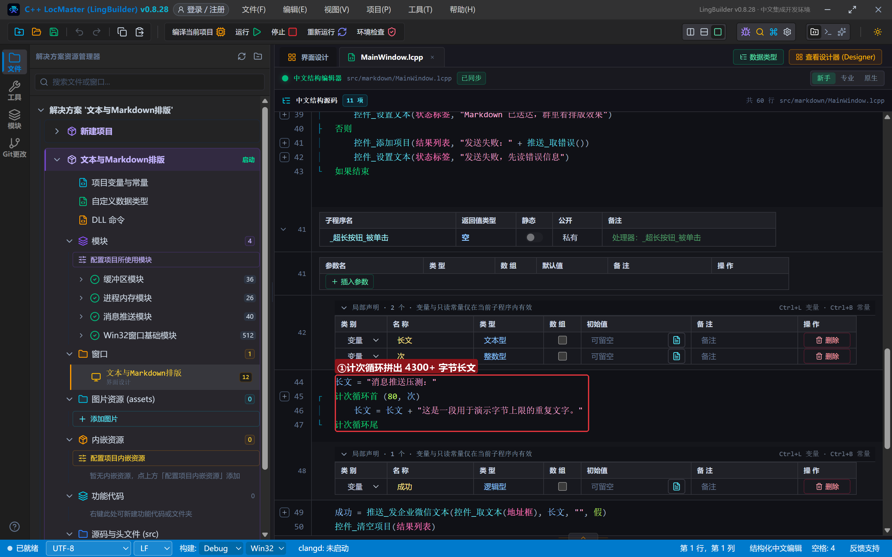

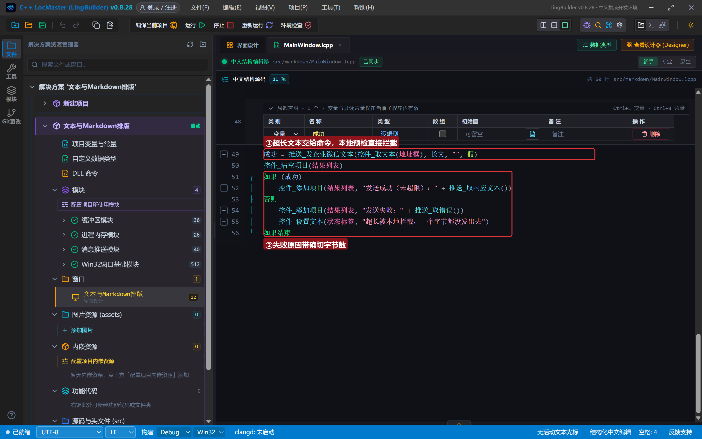

算一笔账：重复段 18 个汉字 × 3 字节 = 54 字节，循环 80 次是 4320 字节，加上开头 21 字节——**4341 字节**，妥妥超过 2048。运行时会给出带确切字节数的中文错误。

## 5. 编译与运行

点「编译当前项目」，错误列表 (0)、输出窗口「编译成功」：

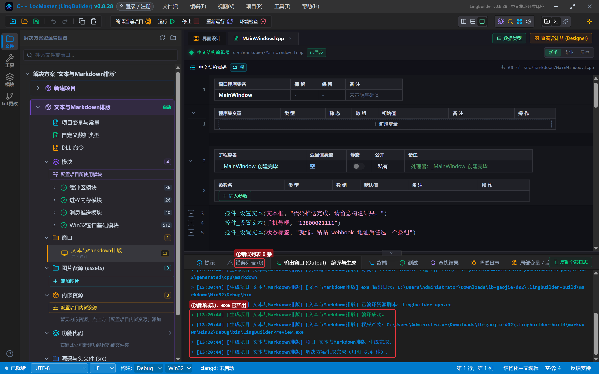

### 5.1 发文本（带 @）

粘入真实 webhook 地址，点「发文本（带 @）」：

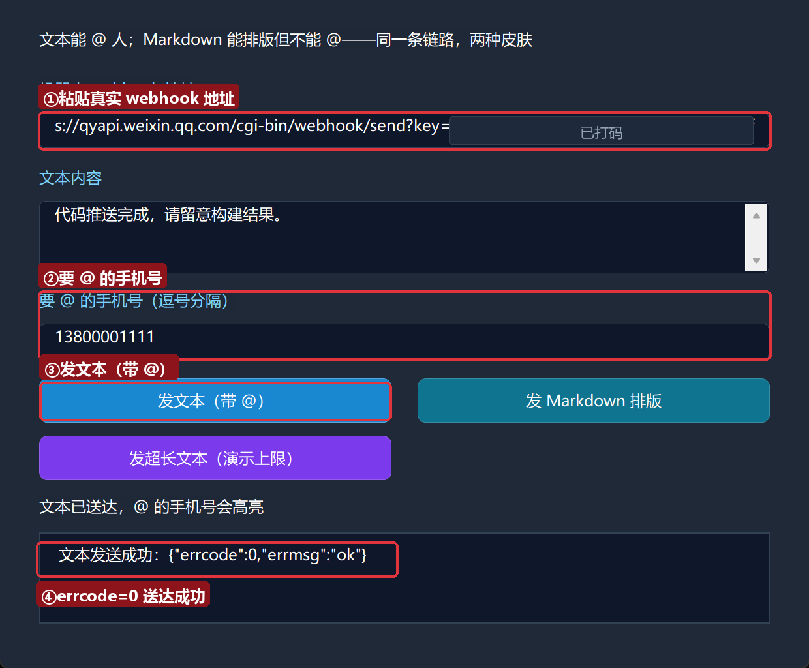

`errcode=0` 送达成功。

### 5.2 发 Markdown：群里看排版

点「发 Markdown 排版」：

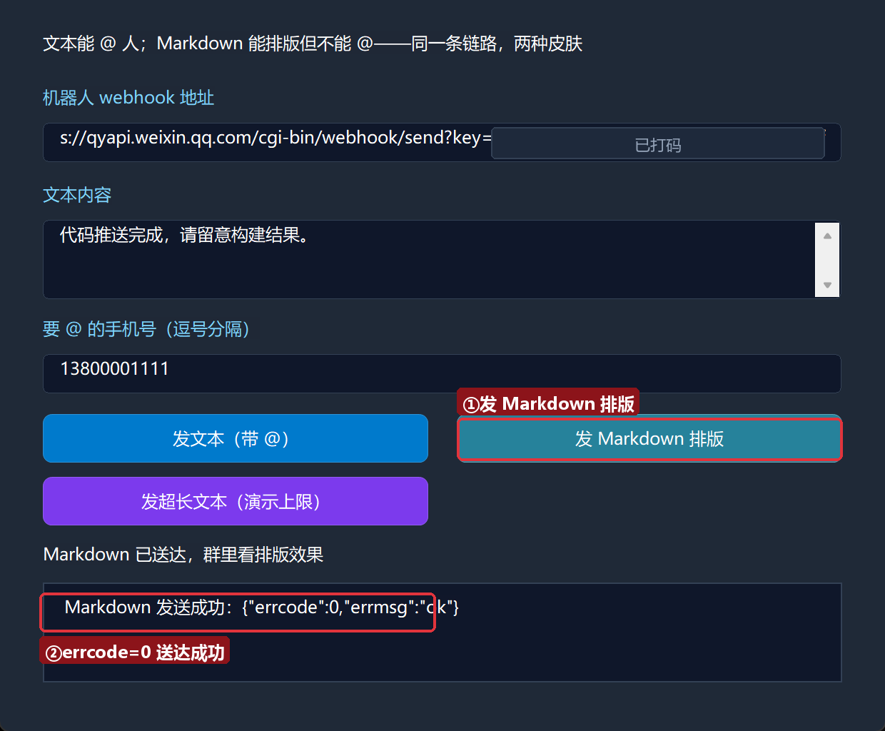

打开手机——同一份内容，观感完全不同：标题加粗、引用块带竖线、「成功」是绿色、「128 秒」是代码样式：

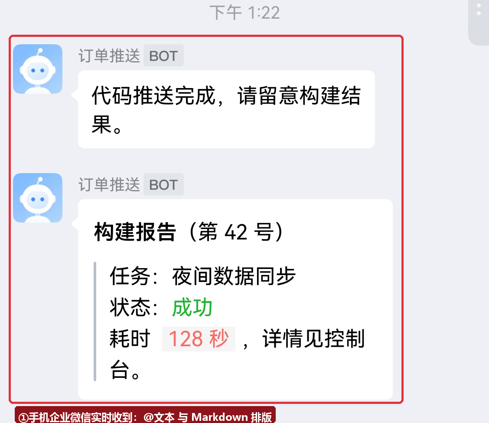

### 5.3 超长拦截：上限是本地预检

点「发超长文本（演示上限）」：

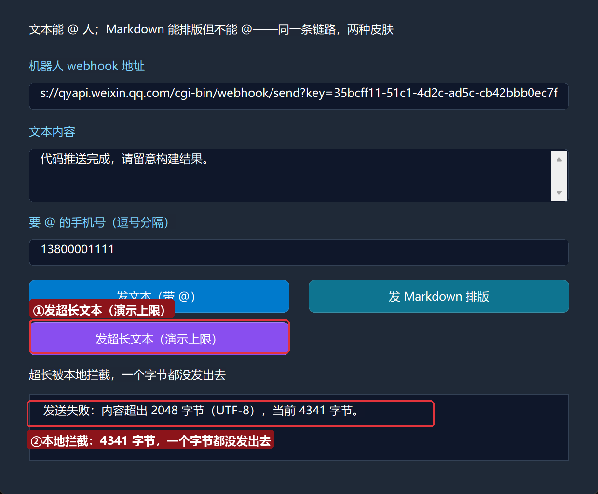

`发送失败：内容超出 2048 字节（UTF-8），当前 4341 字节。`——秒回，根本没走网络。这就是**本地预检**：明确要失败的事，不浪费一次请求，也不给平台留错误记录。把循环次数从 80 改成 20（约 1101 字节），再点一次就发送成功了，读者可以自己试试。

## 6. 红线与提示

- **企微 Markdown 不能 @ 人**：这是企业微信官方限制（钉钉正好相反，第 6 集会对比）。要 @ 人，用文本命令。
- **文本 2048 / Markdown 4096 字节**：按 UTF-8 字节算，汉字 3 字节。超长会被本地预检拦截，错误信息带确切字节数。
- **@ 只认群成员手机号**：不在群里的号码不会有任何显示（也不报错）。@ 所有人（`真`）慎用——深夜跑批的程序 @ 全群，是会被同事移除机器人的。
- **`计次循环首` 的循环变量要先声明**：`局部 整数型 次`，老规矩。

## 7. 常见问题急救表

| 症状 | 原因 | 解法 |
| --- | --- | --- |
| Markdown 发出去了但没有排版效果 | 内容被当纯文本 | 确认命令用的是 `推送_发企业微信Markdown` 而不是文本命令 |
| `<font color="info">` 原样显示 | 双引号被字符串转义吃掉 | 用三引号文本块写排版内容，引号免转义 |
| `内容超出 2048 字节（UTF-8），当前 N 字节。` | 正文超长 | 精简正文或分段推送；N 就是当前正文的确切字节 |
| Markdown 发送失败 `内容超出 4096 字节` | Markdown 上限更宽但也有限 | 同上，上限是 4096 |
| 想在 Markdown 里 @ 人 | 官方限制不支持 | 改用文本命令；或把 @ 的话写在文本消息里另发一条 |

## 本集小结

- 文本管 @、Markdown 管排版；`推送_发企业微信Markdown(地址, 内容)` 只有两个参数。
- 多行排版用三引号文本块：内容原样写，引号免转义。
- 字节上限（2048/4096）由运行时本地预检，错误信息带确切字节数；汉字 3 字节。
- 红线：企微 Markdown 不能 @ 人；@ 只认群成员手机号。

**下一集预告**：《图片推送》——做出**出错自动截图报警器**：任务一出错，程序把自己窗口的「案发现场」截成 PNG，直接推到群里，配 `推送_发企业微信图片` 的 Base64/MD5 自动组包。

## 本集源码包

- 本集源码包已上架官网「[示例源码](https://lingbuilder.com/demos)」区，按名称「高阶实战02-×××」即可下载（每集一个 `.lcpppkg`，配套预览图与图文教程直链）。
- 导入：LingBuilder 欢迎页 →「**导入源码包**」，选中 `.lcpppkg` 一键还原整个项目（含界面设计与源码）。
- 源码包不含任何密钥：导入后粘贴自己的机器人 webhook 地址即可运行。

[回系列总览](/guide/tutorials/gaojie)
