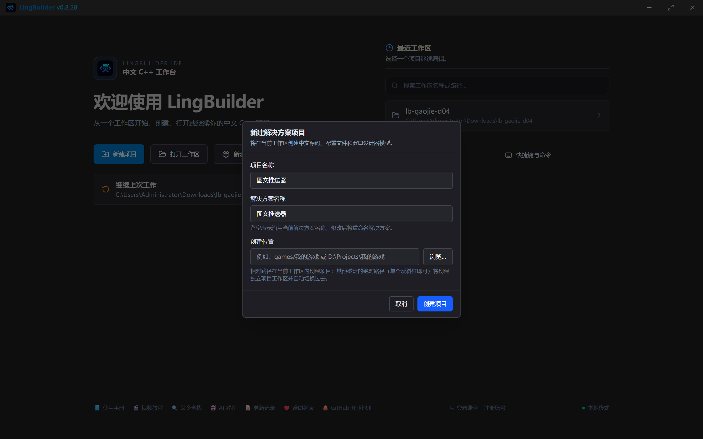
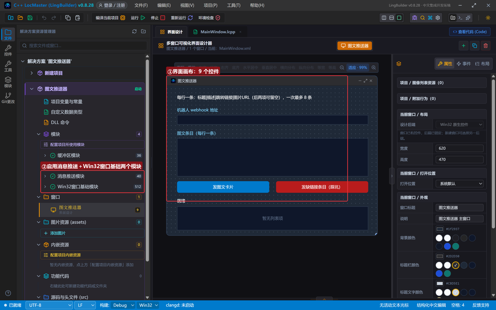
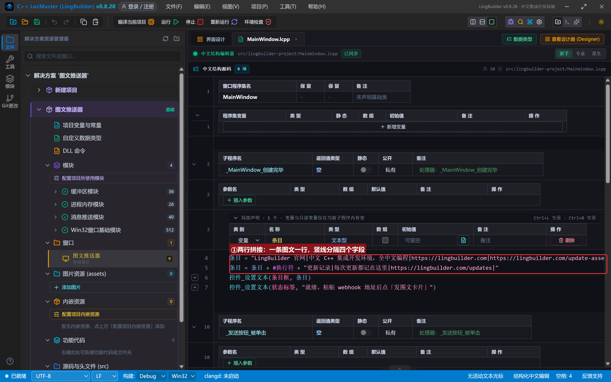
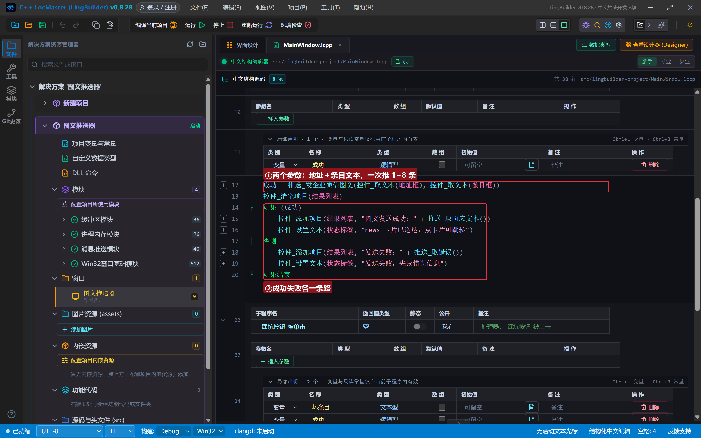
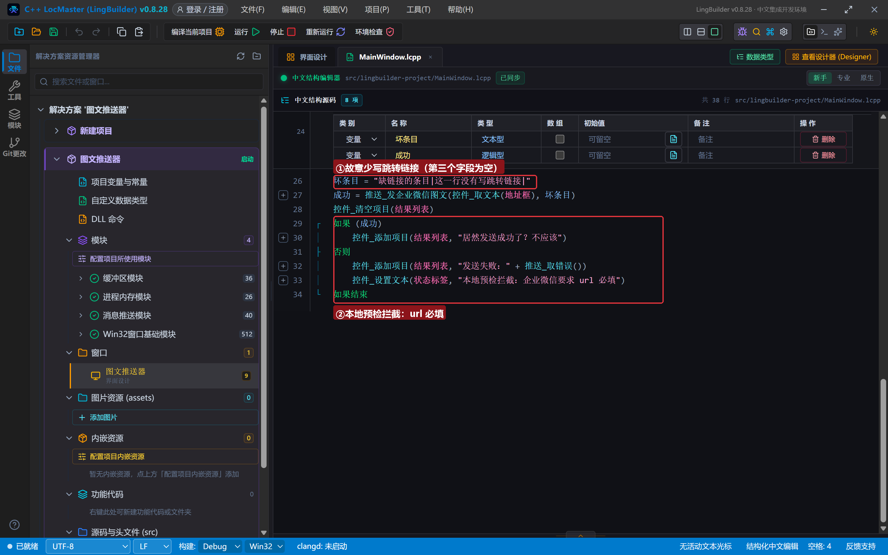
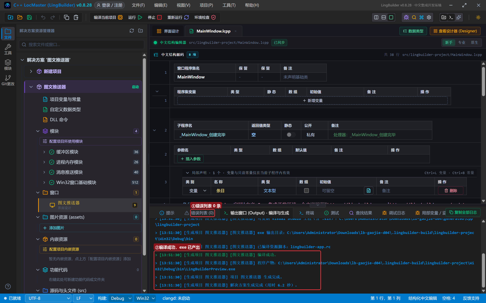
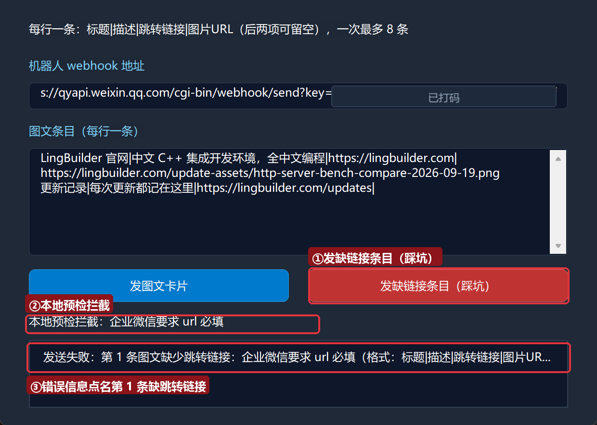
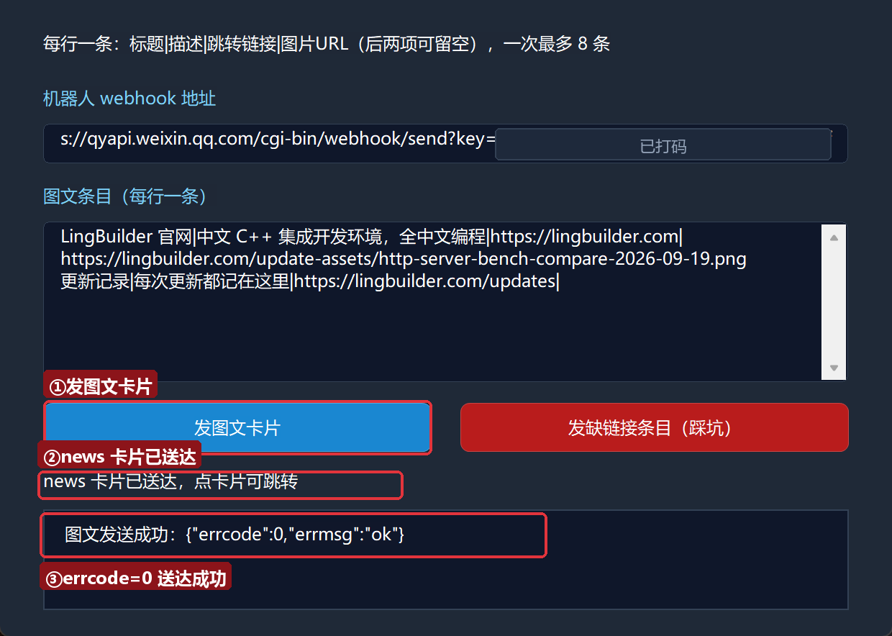
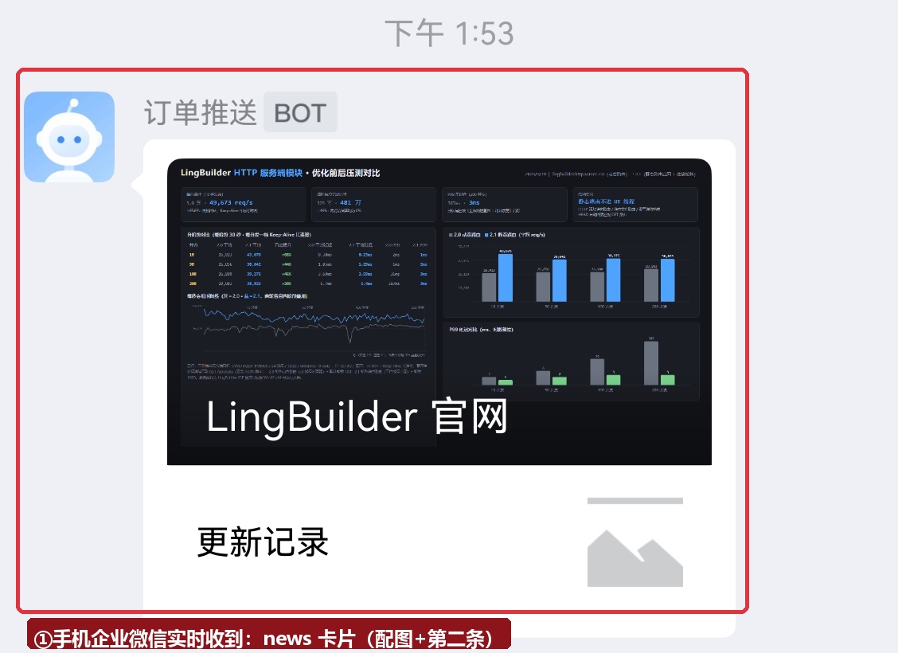

# 高阶实战 04 · 图文推送：news 卡片让消息「可点击」

> 《LingBuilder 高阶实战系列》第 4 集，**消息推送专题·企业微信篇**。文本能 @ 人、Markdown 能排版，这一集上 **news 图文卡片**：一条消息带**标题、描述、跳转链接和配图**，群友点卡片直接跳到你的页面——发版本公告、周报入口、活动链接都用它。本集还会亲手踩一次「**url 必填**」（errcode 40039）的坑，看看本地预检怎么把问题拦在发出去之前。全程约 30 分钟。
>
> 前置要求：学完[第 01 集](/guide/tutorials/gaojie-01-wecom-text)。本集源码包见文末。

## 这一集你将学会

- `推送_发企业微信图文(地址, 图文条目文本)`：两个参数发 news 卡片
- 行格式 **`标题|描述|跳转链接|图片URL`**：竖线分隔（全角｜也认），一条一行，一次 1~8 条
- 哪些字段能留空：描述、图片可空；**跳转链接必填**
- 红线：跳转链接缺失直接本地拦截（企业微信官方 errcode 40039 的前置封堵）

## 1. 三十秒理解：news 卡片长什么样

news 消息是企业微信里的「卡片」：上面一张大图，图下一行标题+描述，整张卡片可点击跳转。一次最多塞 **8 条**（多条时纵向排列，第一条带大图）。程序要做的就是把每条卡片组装成 JSON 里的 `articles` 数组——标题、描述、链接、图片 URL 四个字段一条。拼接 JSON 的活儿运行时代劳，你只交「一行一条」的纯文本：

```text
LingBuilder 官网|中文 C++ 集成开发环境，全中文编程|https://lingbuilder.com|https://.../cover.png
更新记录|每次更新都记在这里|https://lingbuilder.com/updates|
```

竖线是字段分隔符：**标题|描述|跳转链接|图片URL**。描述和图片 URL 可留空（连竖线都可以只写到第三段），但**跳转链接必须有**——企业微信官方规定 news 条目 url 必填，缺了会报 errcode 40039。LingBuilder 的运行时在**发送前**就做本地预检，缺链接直接给中文错误，一个请求都不发。

## 2. 新建项目与启用模块

新建窗口项目：名称 **图文推送器**，模板「Windows 界面设计」，创建位置留空：



启用 **消息推送模块** ＋ **Win32窗口基础模块**（与第 1 集相同）：



## 3. 设计界面

| 控件 | 名称 | 显示内容 | 左距 | 顶距 | 宽度 | 高度 |
| --- | --- | --- | --- | --- | --- | --- |
| 标签 | 说明标签 | 每行一条：标题\|描述\|跳转链接\|图片URL（后两项可留空），一次最多 8 条 | 30 | 22 | 560 | 24 |
| 标签 | 地址标签 | 机器人 webhook 地址 | 30 | 60 | 220 | 22 |
| 编辑框 | 地址框 | （空） | 30 | 86 | 560 | 28 |
| 标签 | 条目标签 | 图文条目（每行一条） | 30 | 128 | 220 | 22 |
| 编辑框 | 条目框 | （空，勾选**多行**） | 30 | 154 | 560 | 112 |
| 按钮 | 发送按钮 | 发图文卡片 | 30 | 280 | 270 | 34 |
| 按钮 | 踩坑按钮 | 发缺链接条目（踩坑） | 320 | 280 | 270 | 34 |
| 标签 | 状态标签 | 就绪 | 30 | 326 | 560 | 22 |
| 列表框 | 结果列表 | — | 30 | 354 | 560 | 70 |

窗口宽 620、高 470。绑 2 个按钮事件 + 窗口「创建完毕」。

## 4. 写代码

### 4.1 创建完毕：预填两条真实图文

两条卡片：第一条带官网配图，第二条不带图（图片 URL 留空，演示「可空」）：

```lcpp
事件 _MainWindow_创建完毕()
    局部 文本型 条目
    条目 = "LingBuilder 官网|中文 C++ 集成开发环境，全中文编程|https://lingbuilder.com|https://lingbuilder.com/update-assets/http-server-bench-compare-2026-09-19.png"
    条目 = 条目 + #换行符 + "更新记录|每次更新都记在这里|https://lingbuilder.com/updates|"
    控件_设置文本(条目框, 条目)
    控件_设置文本(状态标签, "就绪。粘贴 webhook 地址后点「发图文卡片」")
结束
```



拆解：

- 一条图文占一行，四个字段按竖线排；第二条以竖线结尾（图片 URL 留空）。
- 多行用 `#换行符` 拼接（老朋友了，零基础 12 集见过）。图片 URL 必须是**公网可访问**的图片直链——企业微信服务器要去下载它做卡片配图，本机磁盘路径是不行的。
- 配图建议尺寸比例接近大图显示区（约 2.35:1），太大也会被居中裁剪。

### 4.2 发送：就两个参数

```lcpp
事件 _发送按钮_被单击()
    局部 逻辑型 成功
    成功 = 推送_发企业微信图文(控件_取文本(地址框), 控件_取文本(条目框))
    控件_清空项目(结果列表)
    如果 (成功)
        控件_添加项目(结果列表, "图文发送成功：" + 推送_取响应文本())
        控件_设置文本(状态标签, "news 卡片已送达，点卡片可跳转")
    否则
        控件_添加项目(结果列表, "发送失败：" + 推送_取错误())
        控件_设置文本(状态标签, "发送失败，先读错误信息")
    如果结束
结束
```



条目框里有多少行就发多少条（1~8 条之外会本地拦截），拆行、拆字段、转义、组 JSON 全在运行时完成。

### 4.3 踩坑按钮：故意缺链接

```lcpp
事件 _踩坑按钮_被单击()
    局部 文本型 坏条目
    局部 逻辑型 成功
    坏条目 = "缺链接的条目|这一行没有写跳转链接|"
    成功 = 推送_发企业微信图文(控件_取文本(地址框), 坏条目)
    控件_清空项目(结果列表)
    如果 (成功)
        控件_添加项目(结果列表, "居然发送成功了？不应该")
    否则
        控件_添加项目(结果列表, "发送失败：" + 推送_取错误())
        控件_设置文本(状态标签, "本地预检拦截：企业微信要求 url 必填")
    如果结束
结束
```



坏条目只有三段（标题|描述|空链接），第四段干脆不写。这样的条目发给企业微信会被官方打回 errcode 40039；本地预检直接拦下，错误信息还会**点名是第几条**。

## 5. 编译与运行

点「编译当前项目」，错误列表 (0)、输出窗口「编译成功」：



### 5.1 先踩坑：url 必填

粘入真实 webhook 地址，点「发缺链接条目（踩坑）」：



`发送失败：第 1 条图文缺少跳转链接：企业微信要求 url 必填（格式：标题|描述|跳转链接|图片URL）。`——哪一条、缺什么、正确格式是什么，一句话全说清。

### 5.2 正式发送：news 卡片进群

点「发图文卡片」：



`errcode=0` 送达。打开手机看卡片效果——第一条带官网配图，点卡片直接跳官网；第二条没有图，只显示标题：



## 6. 红线与提示

- **跳转链接必填**：每条图文第三段不能为空，否则本地拦截（官方 errcode 40039）。链接要带 `https://`（或 `http://`）完整协议头。
- **图片 URL 是公网直链**：企业微信服务器会去抓这张图，本机路径、内网地址、需要登录的页面都不行；留空则卡片不带图。
- **条数 1~8**：运行时按行拆条目，超出范围本地拦截。
- **字段里的竖线**：正文内容本身要含竖线时，会破坏分隔——把内容里的 `|` 换成全角 `｜` 不行（那也是分隔符），建议换用 `/` 或「、」。
- **每机器人约 20 条/分钟**：news 也占限流额度。

## 7. 常见问题急救表

| 症状 | 原因 | 解法 |
| --- | --- | --- |
| 「第 N 条图文缺少跳转链接…」 | 第三段为空 | 补上完整跳转链接 |
| 卡片发出但没配图 | 图片 URL 留空或不可访问 | 换公网直链；浏览器能单独打开才算数 |
| 卡片配图显示裂图 | 图片链接受防盗链/已失效 | 把图片放到自己的站点或对象存储 |
| 点击卡片没反应/打不开 | 链接少了协议头或拼写错误 | 检查第三段是否 `https://` 开头 |
| 「条数不在 1~8 内」类错误 | 条目行数超限 | 一条一行控制条数，超出拆两次发（注意限流） |

## 本集小结

- `推送_发企业微信图文(地址, 图文条目文本)` 两个参数；行格式 `标题|描述|跳转链接|图片URL`，一条一行，1~8 条。
- 描述、图片可空；**跳转链接必填**（官方 40039，本地预检提前拦）。
- 图片 URL 必须公网直链；第二条起可不带图。
- news 是唯一「可点击」的消息类型，发公告/周报/活动首选。

**下一集预告**：《文件上传与发送》——最后一块拼图：文件先上传换 **media_id**（3 天有效），再凭编号发送。生成一份报告文件，从上传到进群全程演示，顺带看看 media_id 复用和「拿错编号」会发生什么。

## 本集源码包

- 本集源码包已上架官网「[示例源码](https://lingbuilder.com/demos)」区，按名称「高阶实战04-×××」即可下载（每集一个 `.lcpppkg`，配套预览图与图文教程直链）。
- 导入：LingBuilder 欢迎页 →「**导入源码包**」，选中 `.lcpppkg` 一键还原整个项目（含界面设计与源码）。
- 源码包不含任何密钥：导入后粘贴自己的机器人 webhook 地址即可运行。

[回系列总览](/guide/tutorials/gaojie)
