# 高阶实战 05 · 文件上传与发送：media_id 的获取、时效与复用

> 《LingBuilder 高阶实战系列》第 5 集，**消息推送专题·企业微信篇**收官。文本、Markdown、图片、图文卡片都齐了，最后一块拼图是**任意文件**：报表、日志、压缩包。文件推送走的是「两段式」——先**上传**换一个临时编号 `media_id`，再凭编号**发送**。本集把这条链完整跑通，还顺手验证「编号复用」和「拿假编号」两个边界。全程约 35 分钟。
>
> 前置要求：学完[第 01 集](/guide/tutorials/gaojie-01-wecom-text)与[第 03 集](/guide/tutorials/gaojie-03-wecom-image)（会发图片，文件链路与其同源）。本集源码包见文末。

## 这一集你将学会

- `推送_上传企业微信文件(地址, 文件路径)`：上传成功返回 **media_id** 文本，失败返回空文本
- `推送_发企业微信文件(地址, media_id)`：凭编号把文件送进群
- **项目全局变量**：`全局 文本型 media编号 = ""`，让编号跨按钮保存
- `文本_取长度(编号) > 0`：判空的正确姿势（字符串 `≠` 比较暂不支持）
- 红线：文件 ≤20MB；media_id **3 天有效**、只属于上传它的那台机器人

## 1. 三十秒理解：为什么要「先上传、再发送」

给群发图片时（第 3 集），图片内容直接塞进 JSON 的 Base64 就行。但**任意文件**不走这条路：企业微信要求先把文件**上传到临时素材接口**，服务器发你一张「提货单」——`media_id`；发送命令只认这张提货单。规则有三条：

1. **media_id 三天有效**，过期要重新上传；
2. **谁上传的只能谁用**：media_id 绑定上传它的那台机器人（那个 key）；
3. 文件大小 **1 字节 ~ 20MB**。

LingBuilder 把 multipart 组包、字段拼接全部封装进一条上传命令，你只给**地址 + 本地路径**：

```lcpp
编号 = 推送_上传企业微信文件(地址, "月度报告.txt")
如果 (文本_取长度(编号) > 0)
    ' 编号就是 media_id，3 天内可反复用来发送
```

## 2. 新建项目与启用模块

新建窗口项目：名称 **文件推送器**，模板「Windows 界面设计」，创建位置留空：

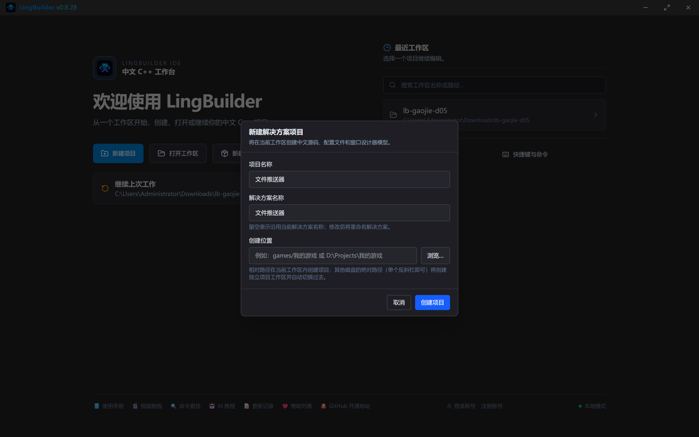

本集在消息推送、Win32窗口基础之外新启用：**文件目录模块**（写报告文件）和**文本处理模块**（判空用 `文本_取长度`）：

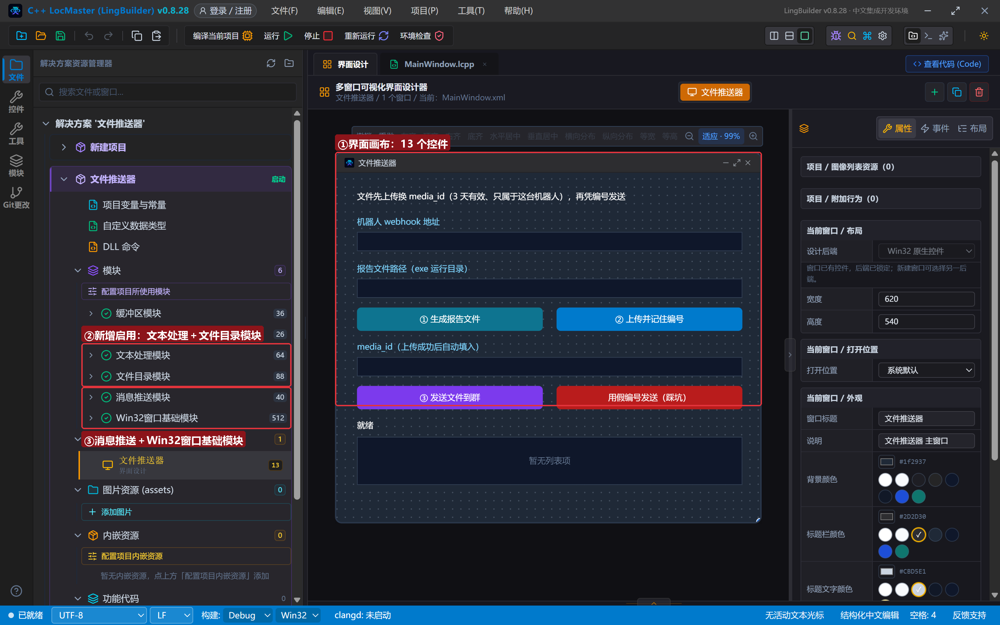

## 3. 项目全局变量：给 media_id 安个家

「上传」和「发送」是两个按钮、两次点击——media_id 要**跨事件保存**。局部变量做不到（只在单个子程序内有效），这正是**项目全局变量**的舞台。打开解决方案树「项目变量与常量」（项目全局变量.lcpp），加一行：

```lcpp
全局 文本型 media编号 = ""
```

声明语法是「`全局` + 类型 + 名称 + `= 初值`」——少了「全局」关键字的行会被当普通语句忽略，一定要带上。此后**项目里所有源码**都能读写 `media编号`。

## 4. 设计界面

| 控件 | 名称 | 显示内容 | 左距 | 顶距 | 宽度 | 高度 |
| --- | --- | --- | --- | --- | --- | --- |
| 标签 | 说明标签 | 文件先上传换 media_id（3 天有效、只属于这台机器人），再凭编号发送 | 30 | 22 | 560 | 24 |
| 标签 | 地址标签 | 机器人 webhook 地址 | 30 | 60 | 220 | 22 |
| 编辑框 | 地址框 | （空） | 30 | 86 | 560 | 28 |
| 标签 | 路径标签 | 报告文件路径（exe 运行目录） | 30 | 128 | 220 | 22 |
| 编辑框 | 文件框 | （空） | 30 | 154 | 560 | 28 |
| 按钮 | 生成按钮 | ① 生成报告文件 | 30 | 196 | 270 | 34 |
| 按钮 | 上传按钮 | ② 上传并记住编号 | 320 | 196 | 270 | 34 |
| 标签 | 编号标签 | media_id（上传成功后自动填入） | 30 | 242 | 220 | 22 |
| 编辑框 | 编号框 | （空） | 30 | 268 | 560 | 28 |
| 按钮 | 发送按钮 | ③ 发送文件到群 | 30 | 310 | 270 | 34 |
| 按钮 | 踩坑按钮 | 用假编号发送（踩坑） | 320 | 310 | 270 | 34 |
| 标签 | 状态标签 | 就绪 | 30 | 356 | 560 | 22 |
| 列表框 | 结果列表 | — | 30 | 384 | 560 | 70 |

窗口宽 620、高 540。绑 4 个按钮事件 + 窗口「创建完毕」（预填文件框为 `月度报告.txt`）。

## 5. 写代码

### 5.1 ① 生成报告文件

真实场景里这是「任务产出物」；演示里用 `文件_写入文本` 现写一份：

```lcpp
事件 _生成按钮_被单击()
    局部 文本型 内容
    内容 = "LingBuilder 月度报告" + #换行符 + "生成方式：演示程序自动生成" + #换行符
    内容 = 内容 + "————" + #换行符 + "这是一份用于演示文件推送的报告文件。"
    局部 逻辑型 成功
    成功 = 文件_写入文本(控件_取文本(文件框), 内容)
    控件_清空项目(结果列表)
    如果 (成功)
        控件_添加项目(结果列表, "报告已生成：" + 控件_取文本(文件框))
        控件_设置文本(状态标签, "文件就绪，接着点「② 上传并记住编号」")
    否则
        控件_添加项目(结果列表, "生成失败：" + 文件_取错误())
        控件_设置文本(状态标签, "生成失败，见结果列表")
    如果结束
结束
```

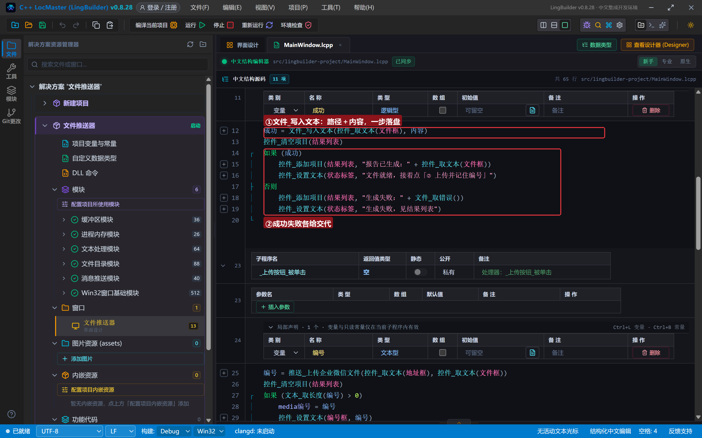

`文件_写入文本(路径, 内容)` 按 UTF-8 覆盖写入；相对路径落在 exe 运行目录。失败原因读 `文件_取错误()`（文件目录模块的错误命令）。

### 5.2 ② 上传并记住编号

```lcpp
事件 _上传按钮_被单击()
    局部 文本型 编号
    编号 = 推送_上传企业微信文件(控件_取文本(地址框), 控件_取文本(文件框))
    控件_清空项目(结果列表)
    如果 (文本_取长度(编号) > 0)
        media编号 = 编号
        控件_设置文本(编号框, 编号)
        控件_添加项目(结果列表, "上传成功，编号已记住（3 天内有效）")
        控件_设置文本(状态标签, "编号就绪，接着点「③ 发送文件到群」")
    否则
        控件_添加项目(结果列表, "上传失败：" + 推送_取错误())
        控件_设置文本(状态标签, "上传失败，先读错误信息")
    如果结束
结束
```

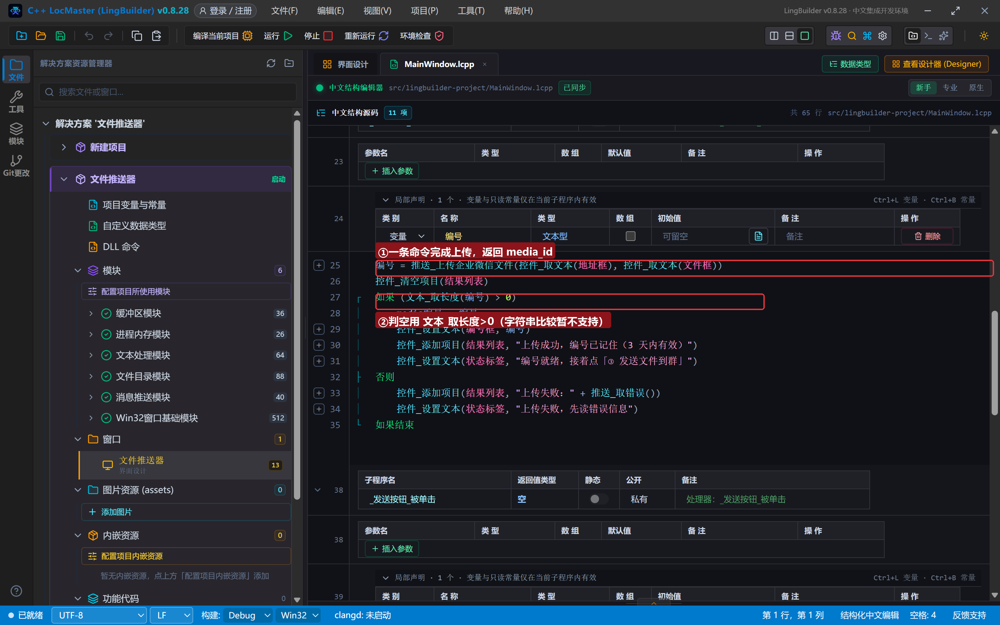

两个细节：

- **判空写法**：上传失败返回空文本，判断「拿到了编号」用 `文本_取长度(编号) > 0`。字符串的 `≠` 比较表达式当前无法翻译成 C++（生成器会明确报错提示），判空一律走长度。
- `media编号 = 编号` 把局部变量存进**项目全局变量**，下一个按钮事件里直接可用。

### 5.3 ③ 凭编号发送

```lcpp
事件 _发送按钮_被单击()
    局部 逻辑型 成功
    成功 = 推送_发企业微信文件(控件_取文本(地址框), media编号)
    控件_清空项目(结果列表)
    如果 (成功)
        控件_添加项目(结果列表, "文件发送成功：" + 推送_取响应文本())
        控件_设置文本(状态标签, "文件已进群（编号可复用，3 天内有效）")
    否则
        控件_添加项目(结果列表, "发送失败：" + 推送_取错误())
        控件_设置文本(状态标签, "发送失败，见结果列表")
    如果结束
结束
```

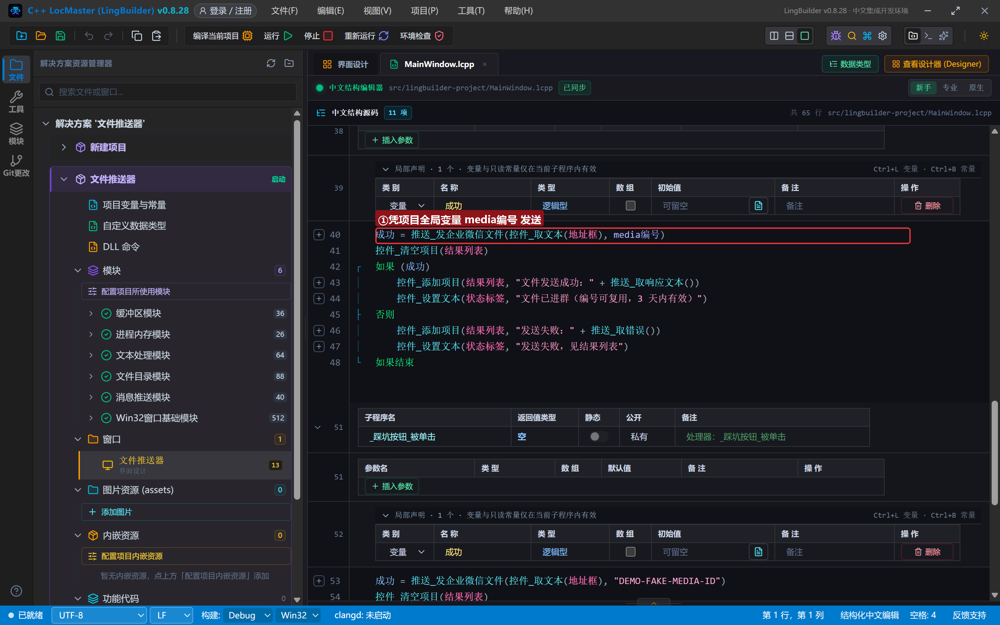

### 5.4 踩坑按钮：假编号会怎样

```lcpp
事件 _踩坑按钮_被单击()
    局部 逻辑型 成功
    成功 = 推送_发企业微信文件(控件_取文本(地址框), "DEMO-FAKE-MEDIA-ID")
    控件_清空项目(结果列表)
    如果 (成功)
        控件_添加项目(结果列表, "居然成功了？不应该")
    否则
        控件_添加项目(结果列表, "发送失败：" + 推送_取错误())
        控件_添加项目(结果列表, "平台响应：" + 推送_取响应文本())
        控件_设置文本(状态标签, "假编号被平台打回")
    如果结束
结束
```

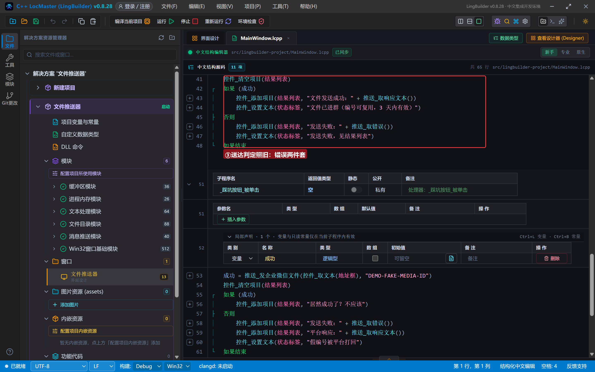

## 6. 编译与运行

点「编译当前项目」，错误列表 (0)、输出窗口「编译成功」：

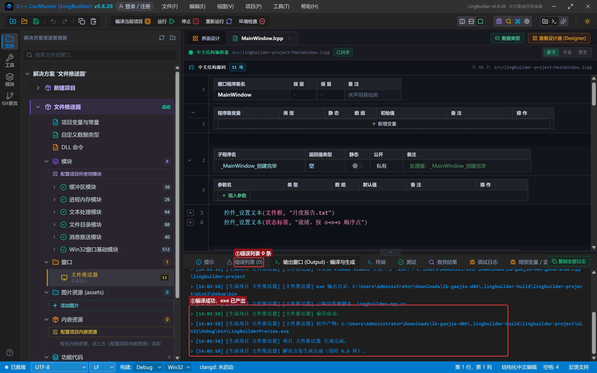

### 6.1 ① 生成报告文件

粘入真实 webhook 地址，点「① 生成报告文件」：

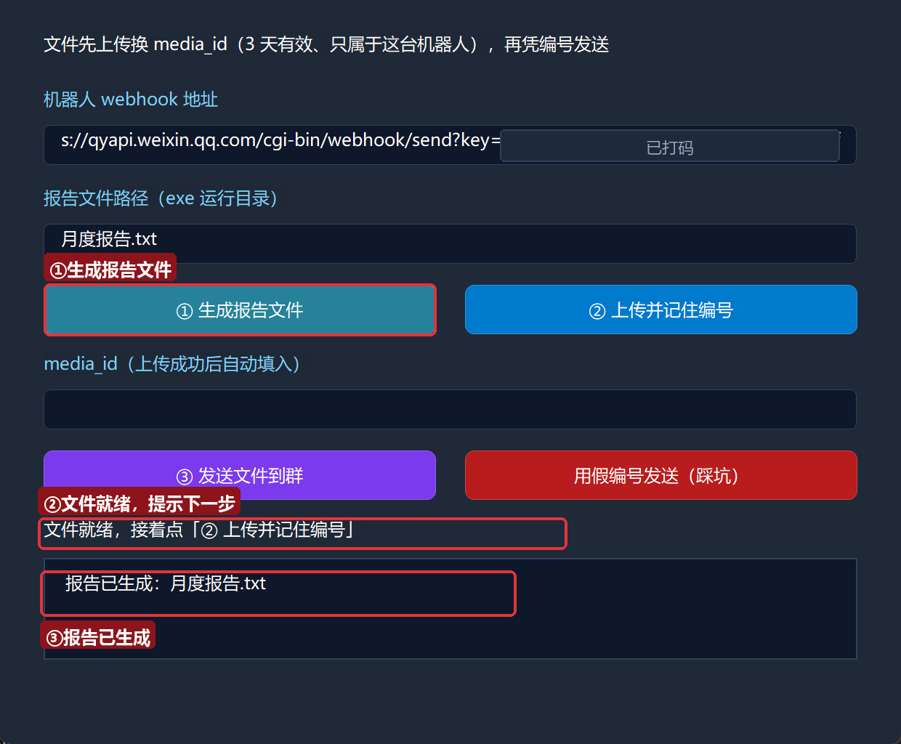

「报告已生成：月度报告.txt」，文件落在 exe 旁边的运行目录里。

### 6.2 ② 上传：拿到 media_id

点「② 上传并记住编号」：

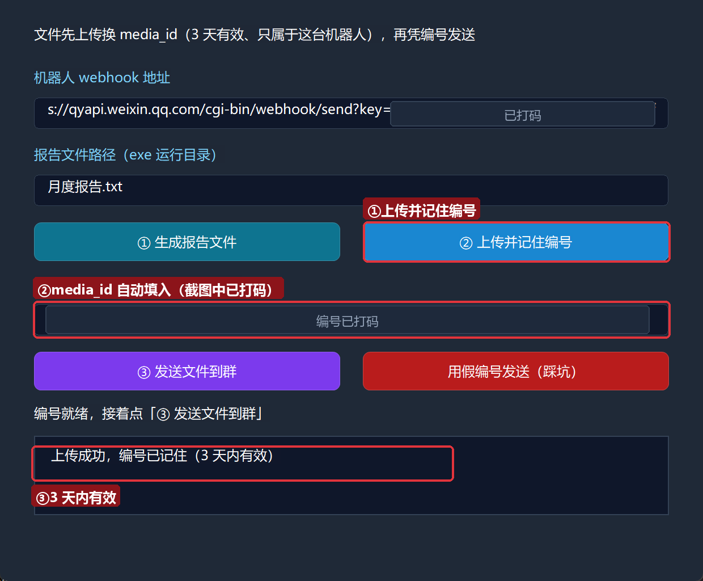

编号框自动填入一长串 `media_id`（截图已打码）——这就是那张「提货单」，3 天内有效。

### 6.3 ③ 发送：文件进群

点「③ 发送文件到群」：

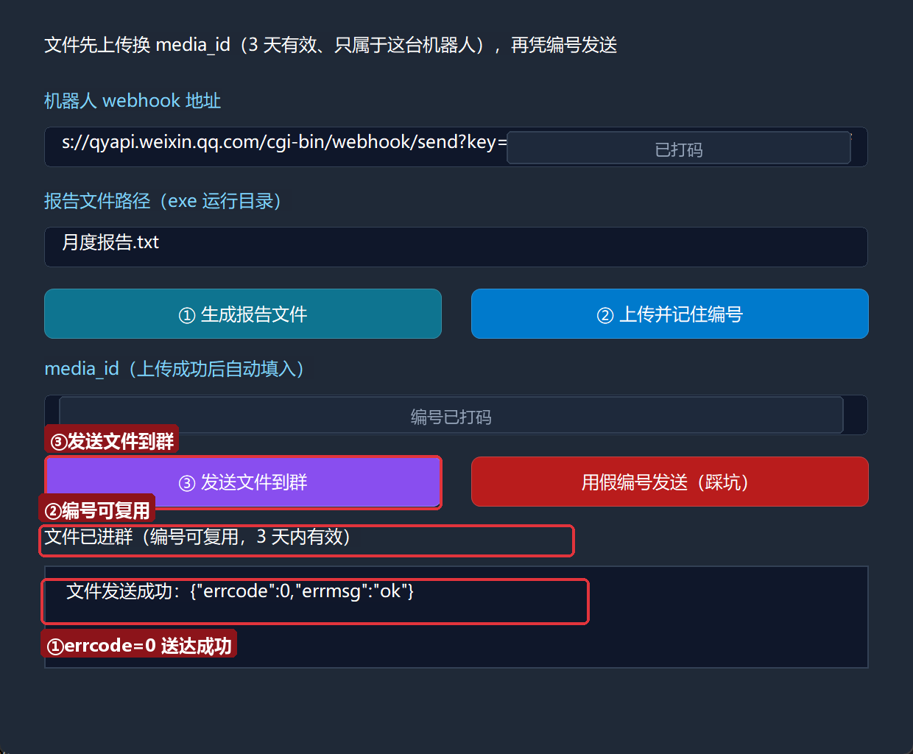

`errcode=0`。**再点一次③也成功**——同一个 media_id 可以反复用来发送，这就是「复用」；3 天后过期会收到平台错误，重新点②即可。打开手机：

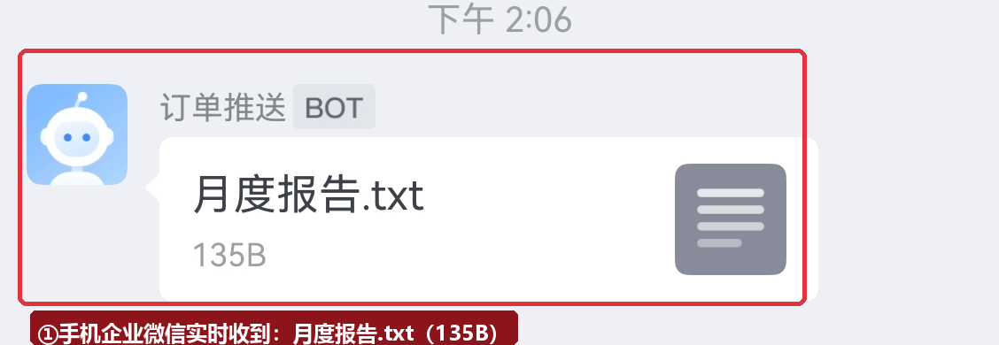

点开「月度报告.txt」，内容一字不差：

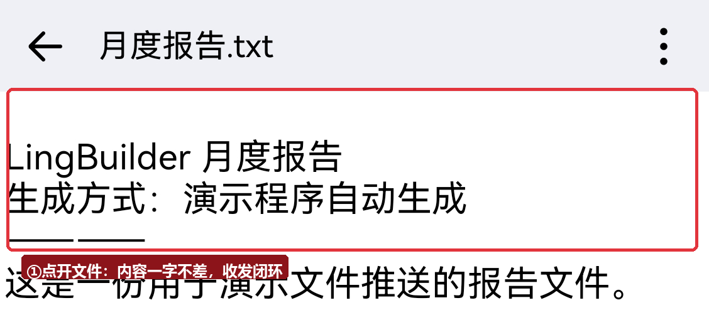

### 6.4 踩坑：假编号被平台打回

点「用假编号发送（踩坑）」：

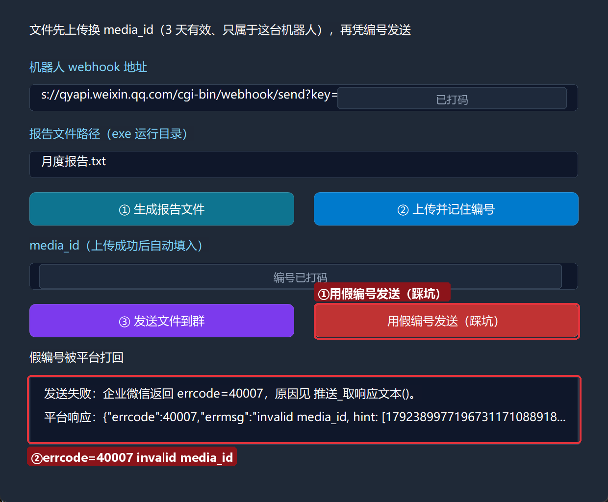

`企业微信返回 errcode=40007` + 平台响应 `"invalid media_id"`——编号不对、过期、或换了机器人，都会是这一类错误。

## 7. 红线与提示

- **文件 ≤20MB**：超出在本地预检被拒（「文件大小必须在 1 字节到 20MB 之间」）。
- **media_id 三天有效、绑定机器人**：过期/换 key 都会 errcode 40007。长期定时推送请在任务里「每次先上传再发送」，别把 media_id 存进配置文件。
- **media_id 不是秘密但要少晒**：它 3 天过期且绑 key，泄露风险有限；本集截图仍打了码，保持习惯。
- **判空用 `文本_取长度(编号) > 0`**：字符串 `≠` 比较暂不支持，生成器会明确报错。
- **全局变量声明带「全局」关键字**：`全局 文本型 media编号 = ""`，漏了关键字那行会被静默忽略。

## 8. 常见问题急救表

| 症状 | 原因 | 解法 |
| --- | --- | --- |
| 「文件大小必须在 1 字节到 20MB 之间」 | 文件为空或超限 | 检查生成步骤是否真的写出了内容 |
| `errcode=40007 invalid media_id` | 编号错/过期/换机器人 | 重新上传拿新编号；确认用的是同一台机器人 |
| 上传失败：读取文件失败 | 路径不存在或无权限 | 相对路径以 exe 运行目录为准；先跑生成步骤 |
| 表达式「编号 ≠ ""」无法翻译 | 字符串比较暂不支持 | 改 `文本_取长度(编号) > 0` |
| 全局变量报「尚未声明」 | 声明少了「全局」关键字 | 在项目全局变量.lcpp 用 `全局 类型 名称 = 初值` |

## 本集小结

- 文件推送两段式：`推送_上传企业微信文件` 拿 media_id → `推送_发企业微信文件` 凭编号发送。
- media_id **3 天有效、绑定机器人、可复用**；假编号 errcode 40007。
- 跨事件保存用项目全局变量 `全局 文本型 media编号 = ""`；判空用 `文本_取长度(编号) > 0`。
- 至此**企业微信篇五种消息全部打通**：文本（可@）、Markdown（可排版）、图片（可截图报警）、图文（可跳转）、文件（可交付）。

**系列预告**：企微篇收官后，接下来是**钉钉篇**（第 6~10 集）：关键词过滤、HMAC-SHA256 加签、@ 指定人与卡片消息——和企微的差异会在每一集对照着讲。

## 本集源码包

- 本集源码包已上架官网「[示例源码](https://lingbuilder.com/demos)」区，按名称「高阶实战05-×××」即可下载（每集一个 `.lcpppkg`，配套预览图与图文教程直链）。
- 导入：LingBuilder 欢迎页 →「**导入源码包**」，选中 `.lcpppkg` 一键还原整个项目（含界面设计与源码）。
- 源码包不含任何密钥：导入后粘贴自己的机器人 webhook 地址即可运行。

[回系列总览](/guide/tutorials/gaojie)
