# 高阶实战 06 · 钉钉入门：文本、Markdown 与关键词过滤模式

> 《LingBuilder 高阶实战系列》第 6 集，**消息推送专题·钉钉篇**开篇。企业微信篇（01~05 集）我们学会了往企微群发消息；本集换到**钉钉**。钉钉的自定义机器人有一个独特设定：**三种安全模式**（关键词 / 加签 / IP 白名单），其中「自定义关键词」是新手最容易踩坑的一个——机器人只肯转发**包含关键词**的消息。本集把文本、Markdown 两种消息发出去，亲眼看看钉钉服务器的**真实响应**，再理解关键词过滤的判定规则。全程约 35 分钟。
>
> 前置要求：学过[第 01 集](/guide/tutorials/gaojie-01-wecom-text)（消息推送模块的启用与 `推送_取错误()` 排障思路）。本集源码包见文末，钉钉/飞书的**真实 webhook 需要你用自己的机器人实测**——教程里的演示地址用的是占位 token，钉钉服务器照样会返回真实响应，正好用来学排障。

## 这一集你将学会

- `推送_发钉钉文本(地址, 内容, 手机号列表, 是否所有人, 加签密钥)`：发文本消息
- `推送_发钉钉Markdown(地址, 内容, 手机号列表, 是否所有人, 加签密钥)`：发 Markdown 消息
- **钉钉机器人三种安全模式**：关键词（内容必须带关键词）、加签（传 SEC 密钥，第 7 集专讲）、IP 白名单
- **钉钉与企微的两个相反点**：钉钉 Markdown **能 @ 人**（企微不能）；钉钉 Markdown **title 必填**（运行时自动取正文首个非空行截 20 字，你不用手填）
- 排障双子星：`推送_取错误()`（失败原因）＋ `推送_取响应文本()`（钉钉返回的 JSON 原文）

## 1. 三十秒理解：钉钉机器人怎么加

在钉钉群里点「群设置 → 机器人 → 添加机器人 → 自定义」，安全设置三选一：

1. **自定义关键词**（本集主角）：最多设 10 个关键词，消息内容**必须至少包含其中一个**，否则钉钉拒绝转发；
2. **加签**：机器人给你一个 `SEC` 开头的密钥，每次请求要带 HMAC-SHA256 签名（第 7 集完整实操）；
3. **IP 白名单**：只接受指定服务器 IP 的请求（本机开发一般不选）。

加完后钉钉会给你一个 webhook 地址，长这样：

```text
https://oapi.dingtalk.com/robot/send?access_token=xxxxxxxxxxxxxxxx
```

消息推送模块把「组 JSON、拼地址、转义引号」全部代劳，你只要给**地址 + 内容**：

```lcpp
推送_发钉钉文本(地址, "构建失败", "", 假, "")
```

第 3 个参数是要 @ 的手机号列表（空文本 = 不 @ 指定人），第 4 个参数是否 @ 所有人，第 5 个参数是加签密钥（没开加签就传空文本）。

## 2. 新建项目与启用模块

打开 LingBuilder，欢迎页点「**新建项目**」，在「选择项目类型」里选 **Windows 界面设计**：

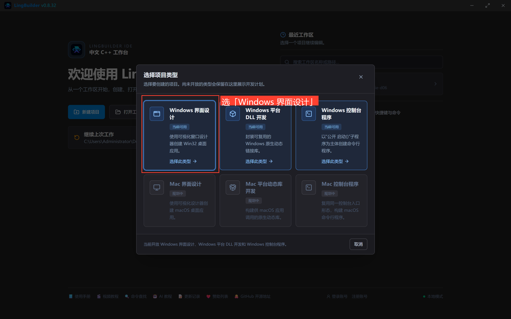

项目名称填 **钉钉通知器**，解决方案名称会自动跟随，创建位置留空（默认落在当前工作区），点「创建项目」：

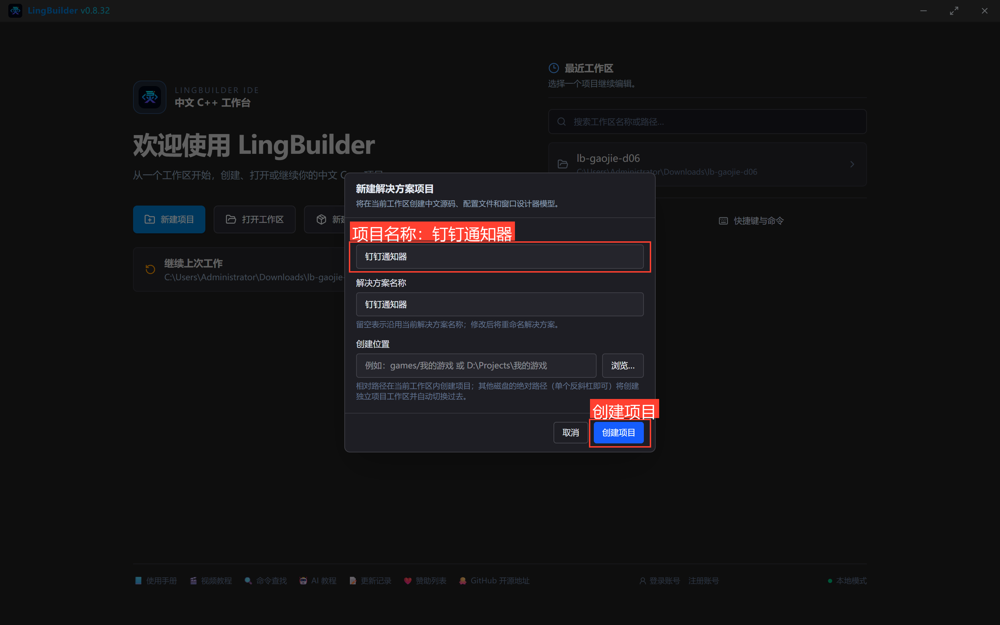

本集需要启用 **消息推送模块**（钉钉 6 条命令都在里面）。左侧活动栏点「模块」，搜索「消息推送」，在「已启用」分组确认它出现（新建窗口项目默认启用 Win32窗口基础模块，控件的 `控件_取文本`、`控件_设置文本` 等命令来自它，不用额外操作）：

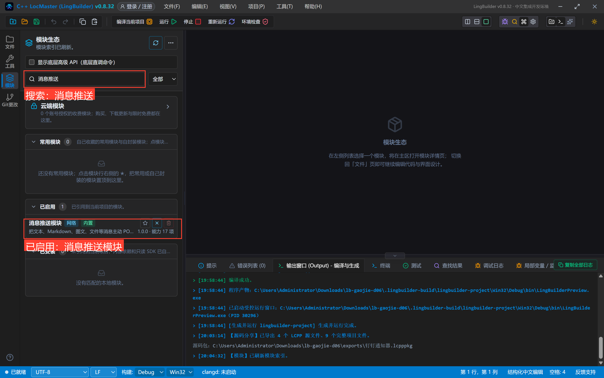

## 3. 设计界面

切换到「界面设计」页签，照下表摆 10 个控件（选中控件后在右侧属性面板改「中文名称」「左距/顶距/宽度/高度」和「显示内容」）：

| 控件 | 名称 | 显示内容 | 左距 | 顶距 | 宽度 | 高度 |
| --- | --- | --- | --- | --- | --- | --- |
| 标签 | 说明标签 | 钉钉群机器人入门：文本、Markdown 与关键词过滤 | 30 | 20 | 560 | 22 |
| 标签 | 地址标签 | 机器人 webhook 地址（把 REPLACE_WITH_YOUR_TOKEN 换成你自己的 token 即可真实送达） | 30 | 54 | 560 | 22 |
| 编辑框 | 地址框 | https://oapi.dingtalk.com/robot/send?access_token=REPLACE_WITH_YOUR_TOKEN | 30 | 80 | 560 | 28 |
| 标签 | 内容标签 | 消息内容（机器人开了自定义关键词时，内容必须包含关键词） | 30 | 120 | 560 | 22 |
| 编辑框 | 内容框 | 【LingBuilder】钉钉机器人第一条文本消息 | 30 | 146 | 560 | 28 |
| 按钮 | 发文本按钮 | ① 发文本消息 | 30 | 186 | 270 | 34 |
| 按钮 | 发MD按钮 | ② 发 Markdown 消息 | 320 | 186 | 270 | 34 |
| 标签 | 响应标签 | 钉钉服务器响应原文（errcode=0 表示送达成功） | 30 | 232 | 560 | 22 |
| 列表框 | 响应列表 | — | 30 | 258 | 560 | 224 |
| 标签 | 状态标签 | 就绪。 | 30 | 494 | 560 | 22 |

窗口宽 620、高 560。给两个按钮绑定「被单击」事件（选中按钮 → 右侧「事件」页 → 单击），窗口本身绑定「创建完毕」。

设计完的全景：

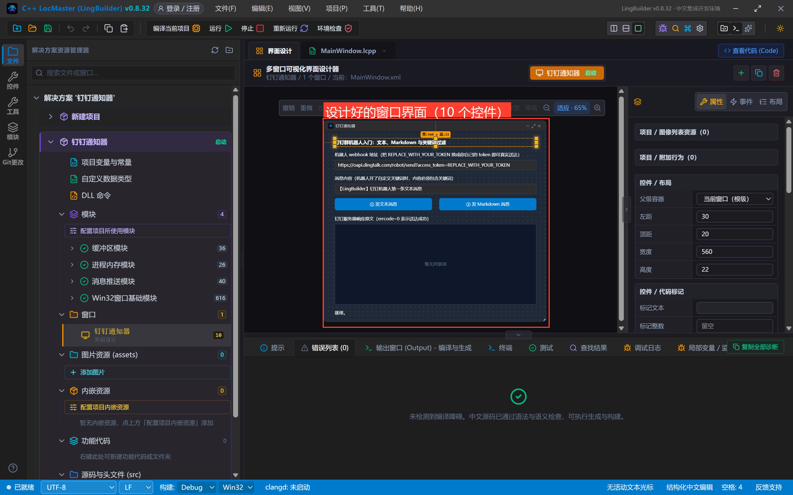

## 4. 写代码

切到 `MainWindow.lcpp` 页签，逐个事件填写。

### 4.1 窗口创建完毕：放两行提示

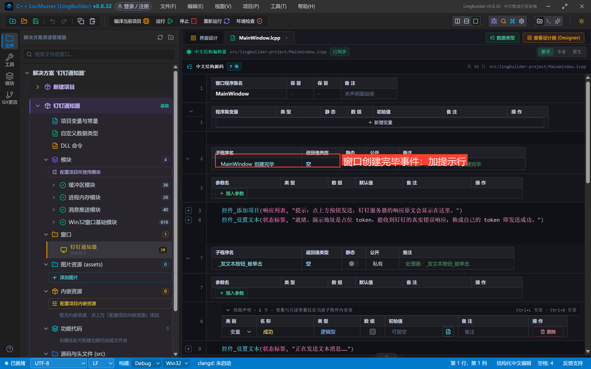

```lcpp
事件 _MainWindow_创建完毕()
    控件_添加项目(响应列表, "提示：点上方按钮发送，钉钉服务器的响应原文会显示在这里。")
    控件_设置文本(状态标签, "就绪。演示地址是占位 token，能收到钉钉的真实错误响应；换成自己的 token 即发送成功。")
结束
```

`控件_添加项目` 给列表框追加一行；`控件_设置文本` 改标签文字。这两个命令都来自 Win32窗口基础模块。

### 4.2 ① 发文本消息

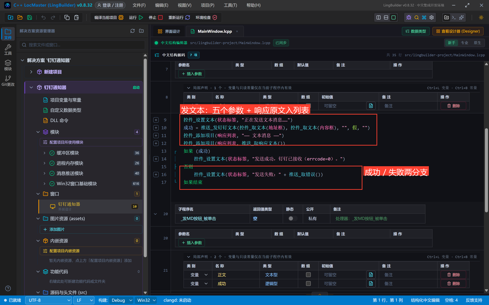

```lcpp
事件 _发文本按钮_被单击()
    局部 逻辑型 成功
    控件_设置文本(状态标签, "正在发送文本消息……")
    成功 = 推送_发钉钉文本(控件_取文本(地址框), 控件_取文本(内容框), "", 假, "")
    控件_添加项目(响应列表, "—— 文本消息 ——")
    控件_添加项目(响应列表, 推送_取响应文本())
    如果 (成功)
        控件_设置文本(状态标签, "发送成功，钉钉已接收（errcode=0）。")
    否则
        控件_设置文本(状态标签, "发送失败：" + 推送_取错误())
    如果结束
结束
```

四个要点：

1. **五个参数一次看全**：地址、内容、@手机号列表（空文本）、是否 @ 所有人（假）、加签密钥（空文本 = 未开加签）；
2. 返回值是**逻辑型**：真 = 钉钉已接收（HTTP 200 且 errcode=0），假 = 失败；
3. 不管成败，`推送_取响应文本()` 都留着**钉钉返回的 JSON 原文**——排障第一现场；
4. 声明用「先 `局部 逻辑型 成功`、再赋值」的顺序。如果写成 `局部 逻辑型 成功 = 推送_发钉钉文本(...)`，初始化会被提升到子程序最前面执行，依赖控件取值的写法容易踩坑（进阶实战系列反复强调过的坑）。

### 4.3 ② 发 Markdown 消息

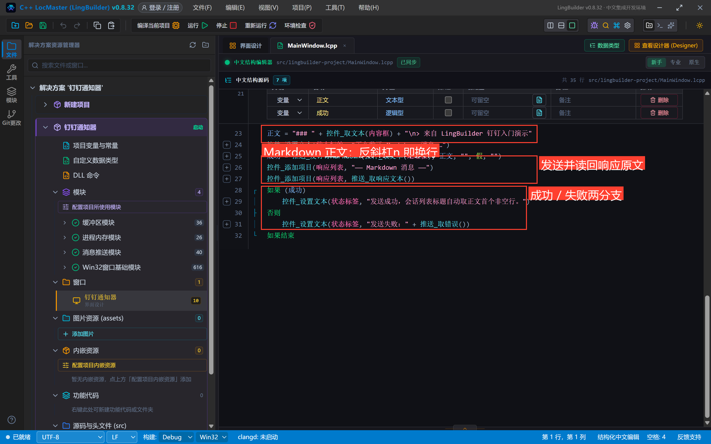

```lcpp
事件 _发MD按钮_被单击()
    局部 文本型 正文
    局部 逻辑型 成功
    正文 = "### " + 控件_取文本(内容框) + "\n> 来自 LingBuilder 钉钉入门演示"
    控件_设置文本(状态标签, "正在发送 Markdown 消息……")
    成功 = 推送_发钉钉Markdown(控件_取文本(地址框), 正文, "", 假, "")
    控件_添加项目(响应列表, "—— Markdown 消息 ——")
    控件_添加项目(响应列表, 推送_取响应文本())
    如果 (成功)
        控件_设置文本(状态标签, "发送成功，会话列表标题自动取正文首个非空行。")
    否则
        控件_设置文本(状态标签, "发送失败：" + 推送_取错误())
    如果结束
结束
```

两个钉钉特有规则在这里生效：

- **title 必填，但不用你填**：钉钉 Markdown 消息要求请求里带 `title`，缺失时报 400402。运行时自动取正文**首个非空行**（去掉行首 `#`，截 20 字）当 title，所以第一行写什么，会话列表就预览什么；
- **Markdown 能 @ 人**：第 3、4 个参数与文本版一致；钉钉要求 @ 的手机号**同时出现在正文里**才显示 @，运行时会自动把缺失的 `@手机号` 补到正文末尾（第 8 集专门演练）。

字符串里的 `\n` 会转成真正的换行（`> ` 开头的行在钉钉里渲染成引用块）。

## 5. 编译：先看错误列表

点工具栏「**编译当前项目**」，编译完先看底部**错误列表**——`错误列表 (0)` 加绿色对勾才是干净状态：

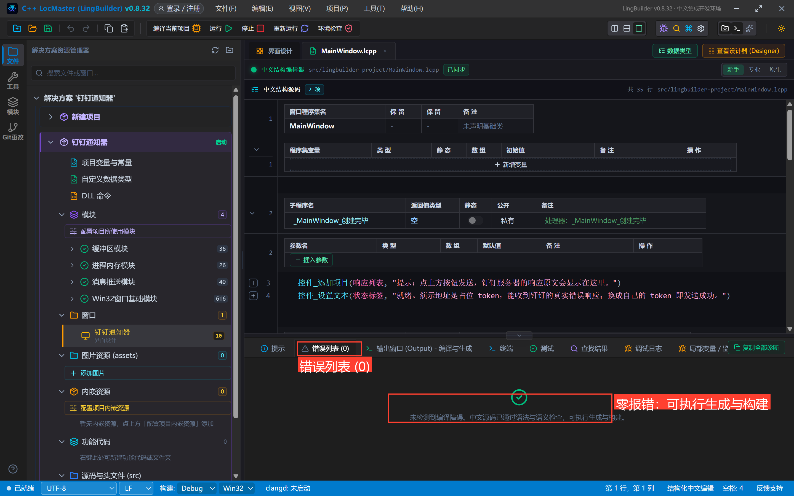

有报错先按提示改（常见：没启用消息推送模块 → 命令名下划线报红；漏写 `如果结束` → 结构错误），归零再继续。

## 6. 运行与观察真实响应

点「**运行**」，程序窗口弹出来：

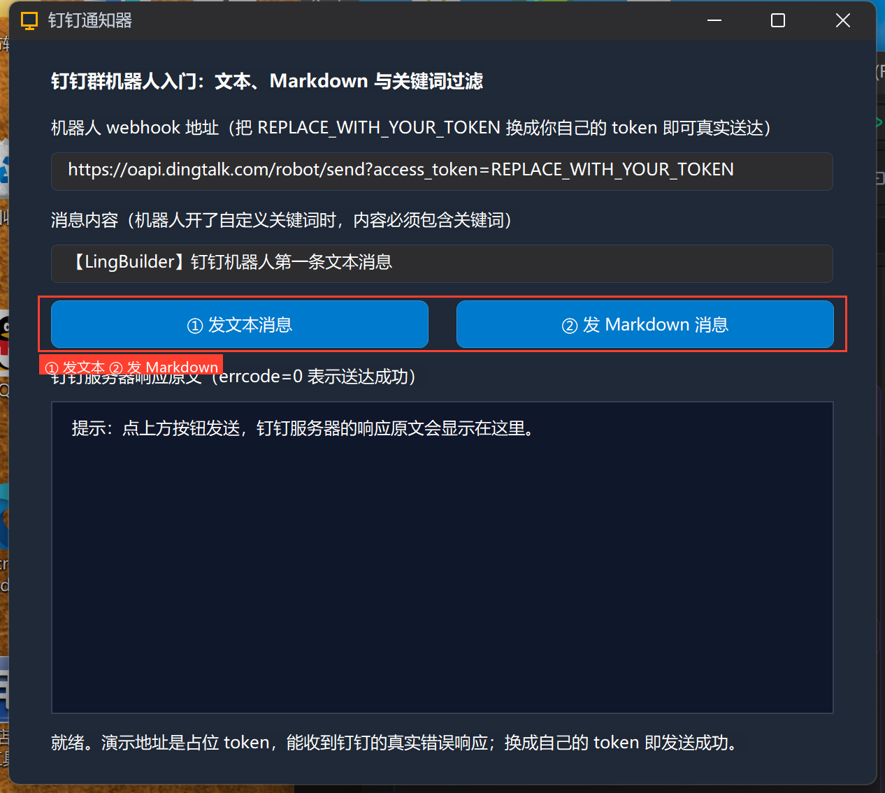

地址框预填的是**占位 token**（`REPLACE_WITH_YOUR_TOKEN`），这不是坏事儿——正好能看到钉钉服务器的**真实响应**。点「① 发文本消息」：

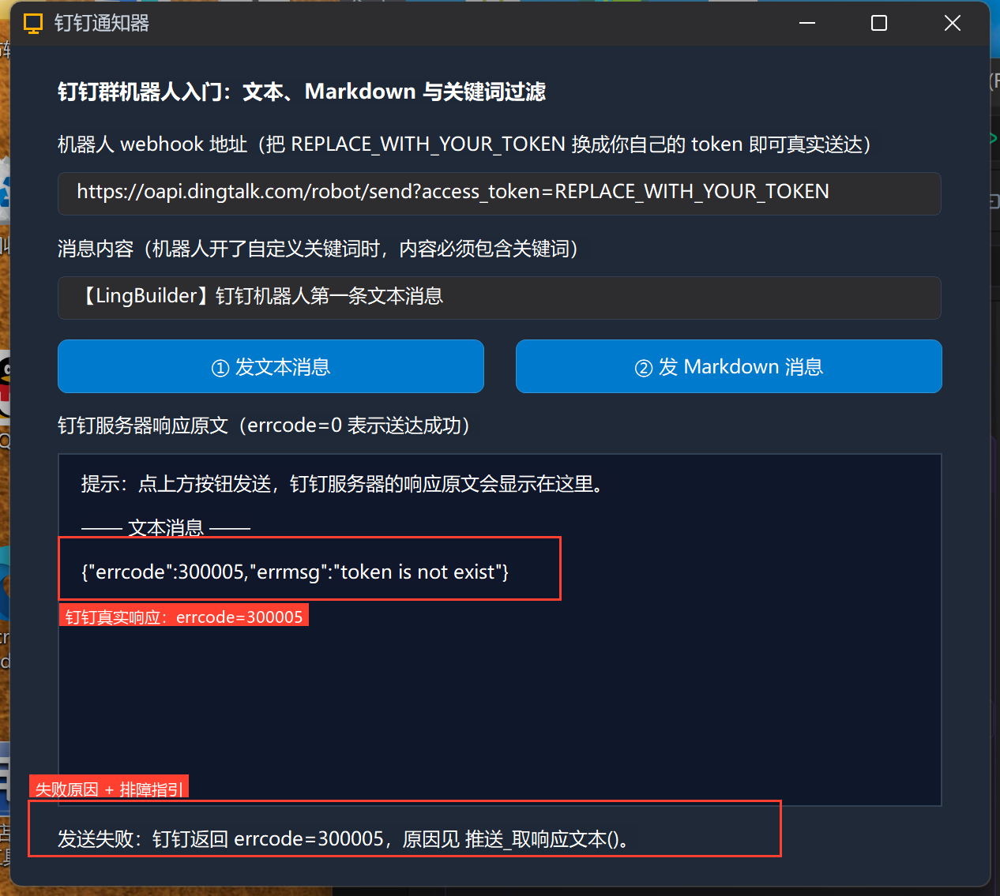

响应列表出现了钉钉的原文：

```json
{"errcode":300005,"errmsg":"token is not exist"}
```

状态行显示「发送失败：钉钉返回 errcode=300005」。这一行 JSON 就是排障的全部线索：**请求已经抵达钉钉服务器**，它明确告诉你「token 不存在」——把地址里的 token 换成你自己机器人的，就能真正送达。

再点「② 发 Markdown 消息」，同样能看到响应原文：

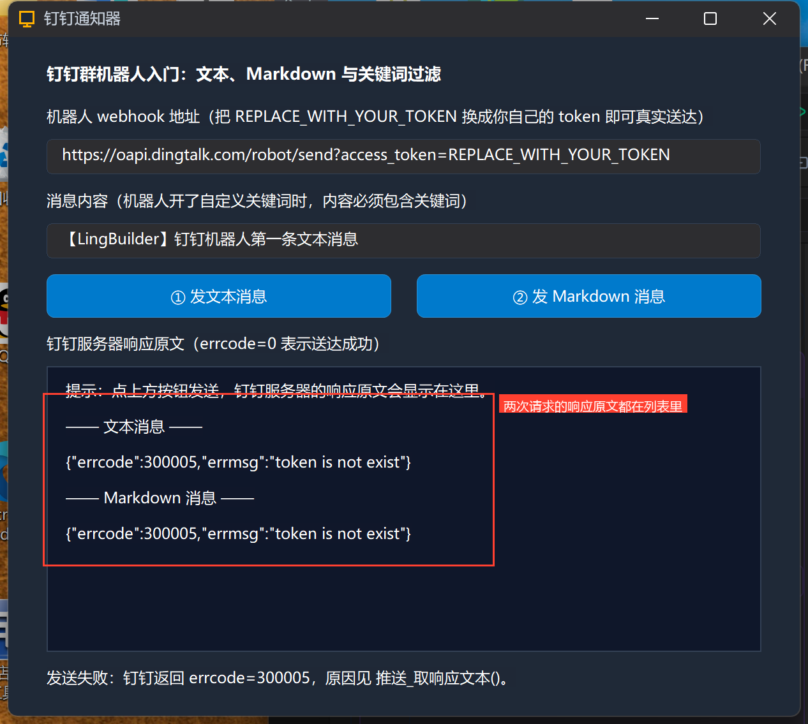

## 7. 关键词过滤模式：规则与预期结果

你的机器人如果开了「自定义关键词」（比如关键词设为 `LingBuilder`），钉钉按下面的规则判定：

| 你发的内容 | 钉钉的判定 | 响应 |
| --- | --- | --- |
| `【LingBuilder】钉钉机器人第一条文本消息` | 包含关键词 → 放行 | `{"errcode":0,"errmsg":"ok"}`，群里收到消息 |
| `今天构建失败了` | 不含关键词 → 拒绝转发 | `{"errcode":310000,"errmsg":"keywords not in content"}` |

自己动手验证：把「内容框」里的 `【LingBuilder】` 前缀删掉，再点「① 发文本消息」——换了真实 token 的机器人会返回 310000；占位 token 则依旧返回 300005（token 校验在关键词校验之前）。

三个关键词模式的红线：

1. **关键词与加签可以叠加**：机器人可以同时开「关键词 + 加签」，两条都要满足；
2. 关键词对**文本和 Markdown 一视同仁**：判定的是正文文字，Markdown 语法符号不算关键词载体（关键词 `构建` 能匹配 `## 构建失败`，因为正文文字里有「构建」）；
3. 频率限制约 **20 条/分钟**，超了会被限流，脚本批量发送时要自己控制节奏（第 15 集会做定时报告器）。

## 8. 常见坑速查

- **地址必须是完整的 webhook**（`https://oapi.dingtalk.com/robot/send?access_token=...`），少 `?access_token=` 会报 300005；
- **占位 token 别带中文**：URL 里的非 ASCII 字符会导致请求都发不出去（HTTP 400）——教程特意用 ASCII 占位符 `REPLACE_WITH_YOUR_TOKEN`；
- `推送_取错误()` 给人看，`推送_取响应文本()` 给排障用：失败时两个都要看；
- 钉钉机器人**不能直接发图片消息**（那是企业内部机器人接口的权限）；带图推送用第 10 集的 FeedCard 图文（图片走 URL）；
- 判断成功别自己解析 JSON：返回值 + `推送_取错误()` 已经把「HTTP 200 且 errcode=0」的判定做好了。

## 小结与源码包

这一集你打通了钉钉机器人的最小闭环：新建项目 → 启用消息推送模块 → 两个发送命令 → 读懂钉钉真实响应。下一集把安全级别拉满：**加签模式**，亲手看 HMAC-SHA256 签名怎么算。

- 本集源码包：[钉钉入门.lcpppkg](https://lingbuilder.com/demos)（LingBuilder 欢迎页 → 打开工作区 → 导入源码包即可一键还原）
- 官方示例源码区同款：`06-钉钉入门.lcpppkg`
