# 高阶实战 08 · @指定人与@所有人：at 字段与内容同现规则

> 《LingBuilder 高阶实战系列》第 8 集，**消息推送专题·钉钉篇**。群机器人最常用的高频动作就是 @ 人：值班告警 @ 值班同学、发布通知 @ 全群。钉钉的 @ 机制有一套独特的「双重要求」——**at 字段要带手机号，正文里也要出现 @手机号 文本**，缺一样显示就不对。本集用四个按钮把规则逐一实测：@ 指定人、@ 所有人、Markdown 版自动补齐，以及「正文不带 @」的对照组——并用本地回显器把运行时组装出的 at 字段看得一清二楚。全程约 35 分钟。
>
> 前置要求：学过[第 06 集](/guide/tutorials/gaojie-06-dingtalk)。真实机器人请把占位 token 换成自己的；@ 所有人会打扰全群，实测时建议先在小群试。

## 这一集你将学会

- `推送_发钉钉文本` / `推送_发钉钉Markdown` 的第 3、4 参数：**手机号列表**（逗号/换行分隔）与**是否所有人**
- at 字段由运行时组装（`atMobiles` / `isAtAll`），你不用手写 JSON
- **内容同现规则**：钉钉要求正文里出现 `@手机号` 才显示 @——**Markdown 版运行时会自动把缺失的 @手机号 补进正文；文本版不补**（本集真机实证）
- @ 所有人 = `isAtAll:true`，同样占一条限流额度

## 1. 三十秒理解：钉钉 @ 的两条规则

钉钉自定义机器人 @ 人时，请求体里会多一个 `at` 字段：

```json
{
  "msgtype": "text",
  "text": { "content": "会议提醒：请准时参加 @13800000001" },
  "at": { "atMobiles": ["13800000001","13800000002"], "isAtAll": false }
}
```

两条规则同时生效：

1. **at 字段决定「谁被通知」**：`atMobiles` 里的手机号必须**是群成员**（不在群里 = 不报错也没显示）；
2. **正文 @ 文本决定「显示成什么样」**：钉钉客户端按正文里的 `@手机号` 文本渲染蓝色 @ 标记。**Markdown 消息**如果正文漏了，LingBuilder 运行时会自动把缺失的 @手机号 补到正文末尾；**文本消息不自动补**，需要你自己把 @手机号 写进正文。

`是否所有人 = 真` 时走 `isAtAll:true`，@ 全群（手机号列表被忽略）。

## 2. 新建项目与启用模块

新建窗口项目「**钉钉艾特演示**」（类型 Windows 界面设计、创建位置留空），启用 **消息推送模块**：

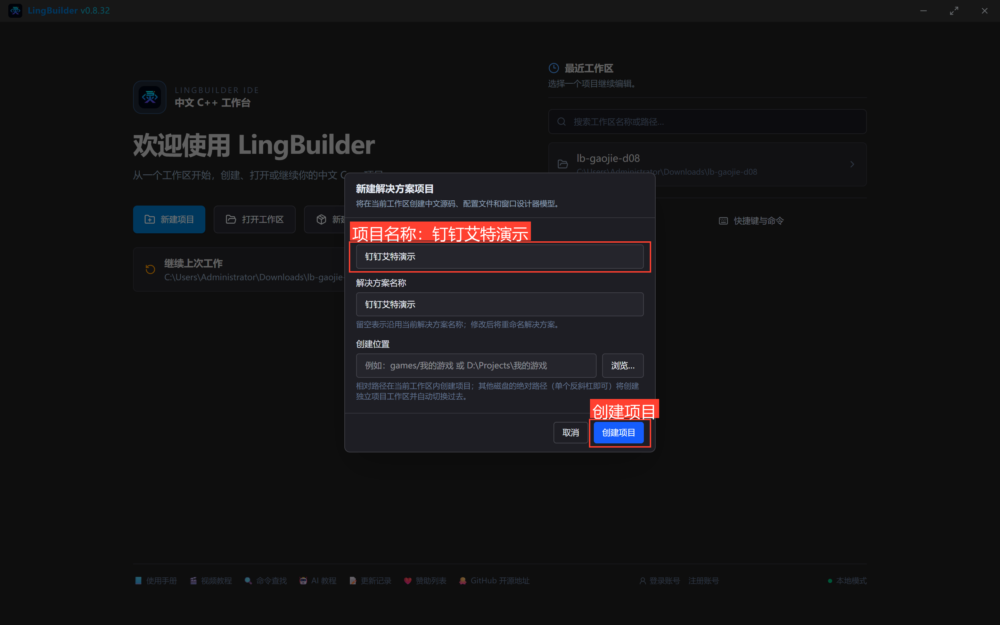

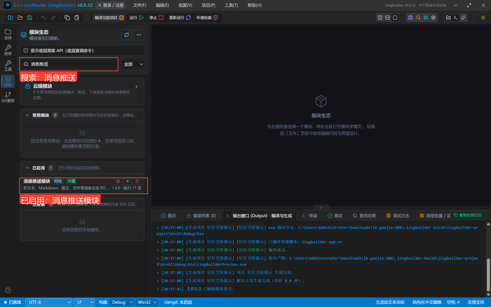

## 3. 设计界面

| 控件 | 名称 | 显示内容 | 左距 | 顶距 | 宽度 | 高度 |
| --- | --- | --- | --- | --- | --- | --- |
| 标签 | 说明标签 | @ 指定人与 @ 所有人：at 字段由运行时组装，正文 @ 文本自动补齐 | 30 | 20 | 560 | 22 |
| 标签 | 地址标签 | 机器人 webhook 地址（换成自己的 token 即可真实送达） | 30 | 54 | 560 | 22 |
| 编辑框 | 地址框 | https://oapi.dingtalk.com/robot/send?access_token=REPLACE_WITH_YOUR_TOKEN | 30 | 80 | 560 | 28 |
| 标签 | 手机号标签 | 要 @ 的手机号列表（逗号或换行分隔；须是群成员手机号） | 30 | 120 | 560 | 22 |
| 编辑框 | 手机号框 | 13800000001,13800000002 | 30 | 146 | 560 | 28 |
| 标签 | 内容标签 | 消息内容（Markdown 版会自动把缺失的 @手机号 补进正文） | 30 | 186 | 560 | 22 |
| 编辑框 | 内容框 | 会议提醒：请相关同学准时参加 @13800000001 | 30 | 212 | 560 | 28 |
| 按钮 | 文本指定按钮 | ① 文本 @指定人 | 30 | 254 | 270 | 34 |
| 按钮 | 文本所有人按钮 | ② 文本 @所有人 | 320 | 254 | 270 | 34 |
| 按钮 | MD指定按钮 | ③ Markdown @指定人 | 30 | 300 | 270 | 34 |
| 按钮 | 对照按钮 | ④ 对照：正文不带 @（发本地回显器） | 320 | 300 | 270 | 34 |
| 标签 | 响应标签 | 钉钉响应原文 / 回显器判定（atMobiles、isAtAll、正文 @ 处数） | 30 | 346 | 560 | 22 |
| 列表框 | 响应列表 | — | 30 | 372 | 560 | 116 |
| 标签 | 状态标签 | 就绪。 | 30 | 500 | 560 | 22 |

窗口宽 620、高 560；四个按钮绑「被单击」，窗口绑「创建完毕」。

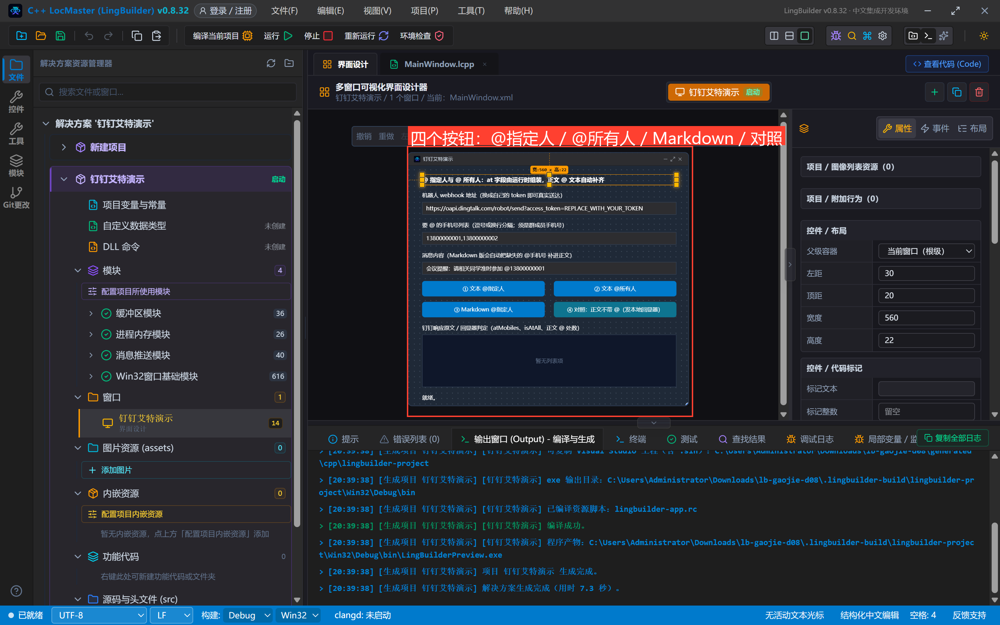

## 4. 写代码

### 4.1 创建完毕

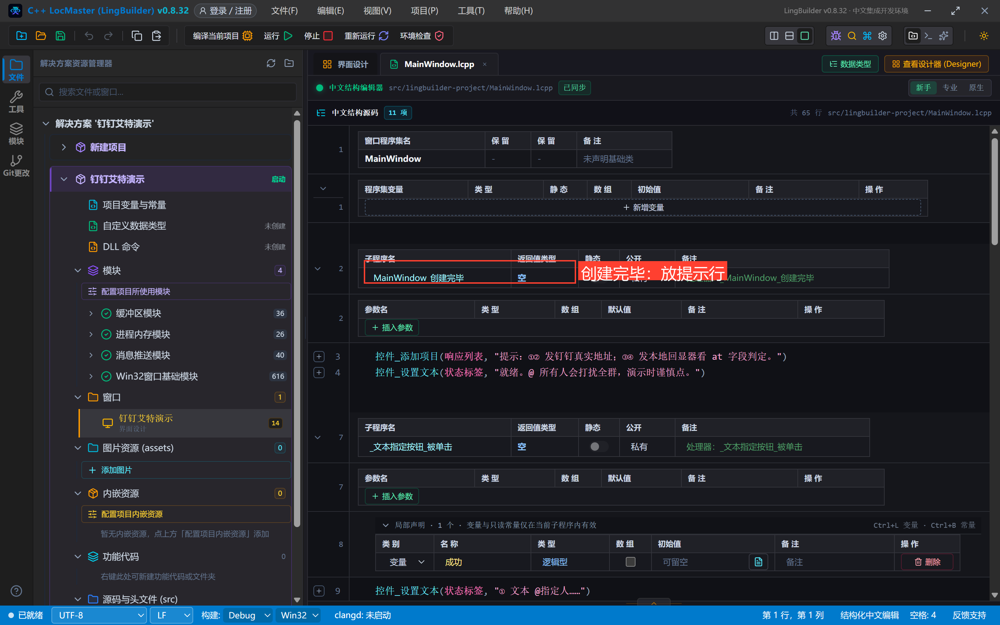

```lcpp
事件 _MainWindow_创建完毕()
    控件_添加项目(响应列表, "提示：①② 发钉钉真实地址；③④ 发本地回显器看 at 字段判定。")
    控件_设置文本(状态标签, "就绪。@ 所有人会打扰全群，演示时谨慎点。")
结束
```

### 4.2 ①②③：三个发送事件

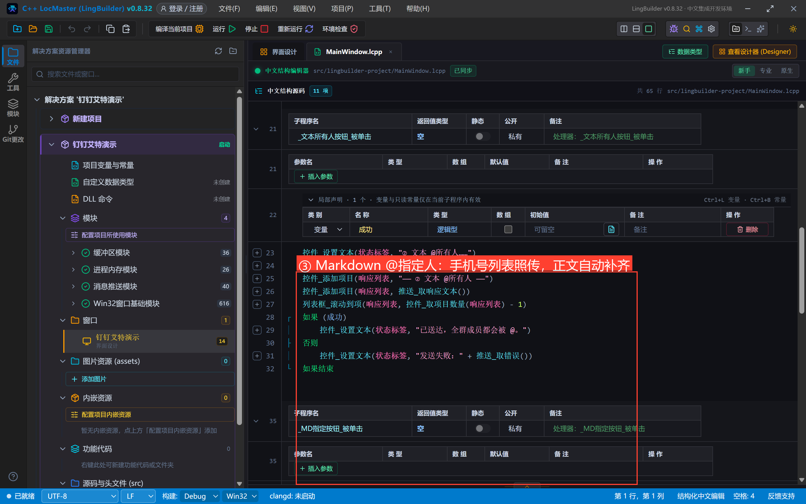

```lcpp
事件 _文本指定按钮_被单击()
    局部 逻辑型 成功
    控件_设置文本(状态标签, "① 文本 @指定人……")
    成功 = 推送_发钉钉文本(控件_取文本(地址框), 控件_取文本(内容框), 控件_取文本(手机号框), 假, "")
    控件_添加项目(响应列表, "—— ① 文本 @指定人 ——")
    控件_添加项目(响应列表, 推送_取响应文本())
    列表框_滚动到项(响应列表, 控件_取项目数量(响应列表) - 1)
    如果 (成功)
        控件_设置文本(状态标签, "已送达，被 @ 的群成员会收到强提醒。")
    否则
        控件_设置文本(状态标签, "发送失败：" + 推送_取错误())
    如果结束
结束
```

② 只改两个参数：手机号列表传**空文本**、是否所有人传**真**：

```lcpp
成功 = 推送_发钉钉文本(控件_取文本(地址框), 控件_取文本(内容框), "", 真, "")
```

③ 换 Markdown 命令，正文用 `### 标题` + 内容拼接（发往本地回显器 127.0.0.1:18778，方便看 at 字段判定）：

```lcpp
正文 = "### 会议提醒\n" + 控件_取文本(内容框)
成功 = 推送_发钉钉Markdown("http://127.0.0.1:18778/robot/send?access_token=demo", 正文, 控件_取文本(手机号框), 假, "")
```

### 4.3 ④ 对照组：正文硬编码不带任何 @

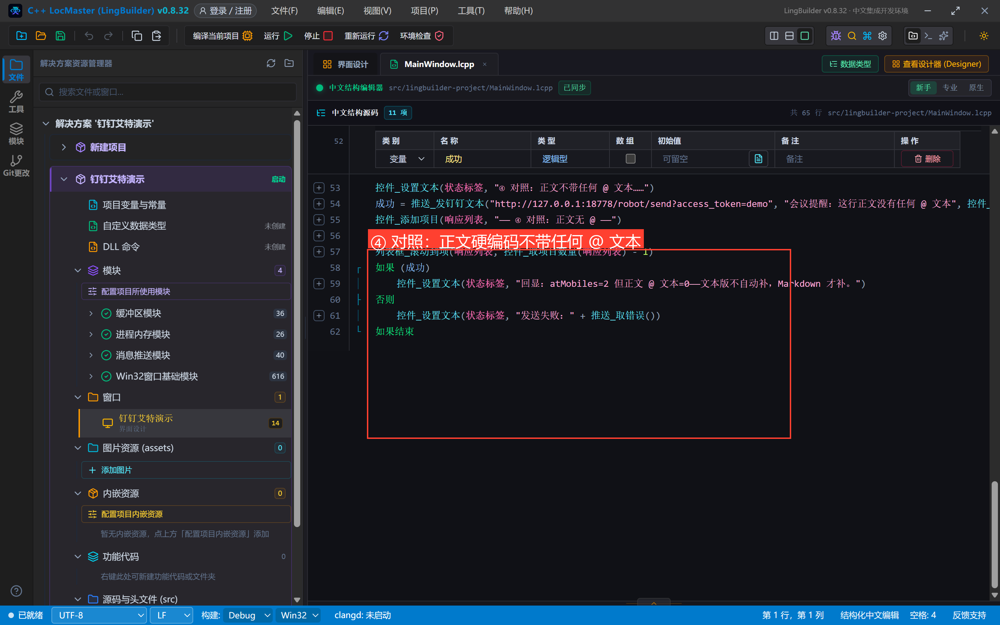

```lcpp
事件 _对照按钮_被单击()
    局部 逻辑型 成功
    控件_设置文本(状态标签, "④ 对照：正文不带任何 @ 文本……")
    成功 = 推送_发钉钉文本("http://127.0.0.1:18778/robot/send?access_token=demo", "会议提醒：这行正文没有任何 @ 文本", 控件_取文本(手机号框), 假, "")
    控件_添加项目(响应列表, "—— ④ 对照：正文无 @ ——")
    控件_添加项目(响应列表, 推送_取响应文本())
    列表框_滚动到项(响应列表, 控件_取项目数量(响应列表) - 1)
    如果 (成功)
        控件_设置文本(状态标签, "回显：atMobiles=2 但正文 @ 文本=0——文本版不自动补，Markdown 才补。")
    否则
        控件_设置文本(状态标签, "发送失败：" + 推送_取错误())
    如果结束
结束
```

正文是写死的「没有任何 @ 文本」——发出去之后回显器会告诉我们：at 字段带没带手机号、正文里有没有 @ 文本。这一条对照就是本集的实验核心。

## 5. 编译与运行

编译后**先看错误列表**（零报错再继续），点运行：

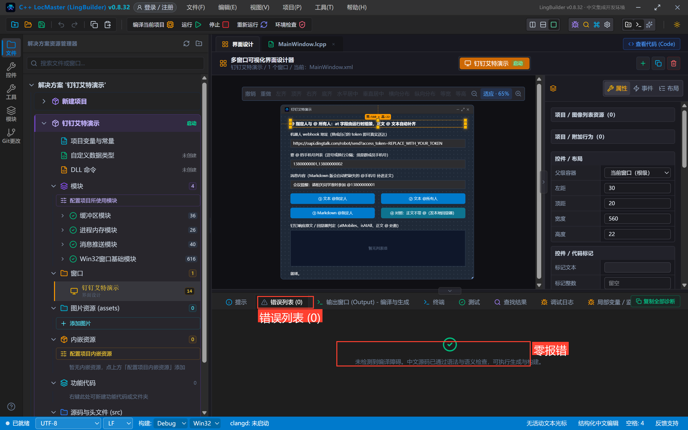

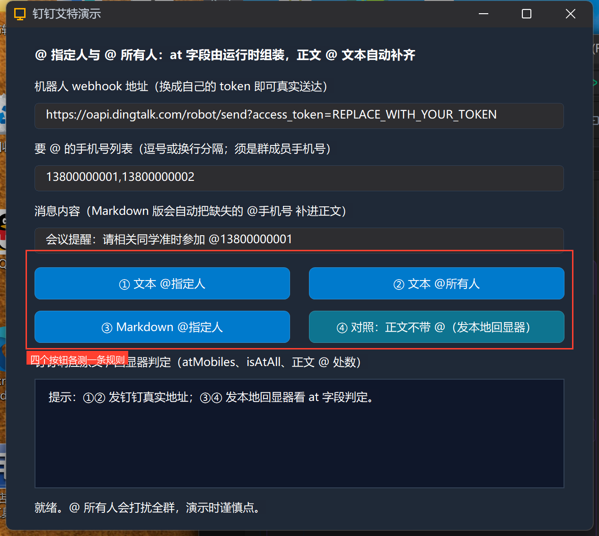

## 6. 真机观察四条规则

**①② 打真实钉钉地址**（占位 token）：返回 `errcode 300005`，说明请求已到达钉钉；换成你的 token 后，① 会 @ 两个群成员、② 会 @ 全群：

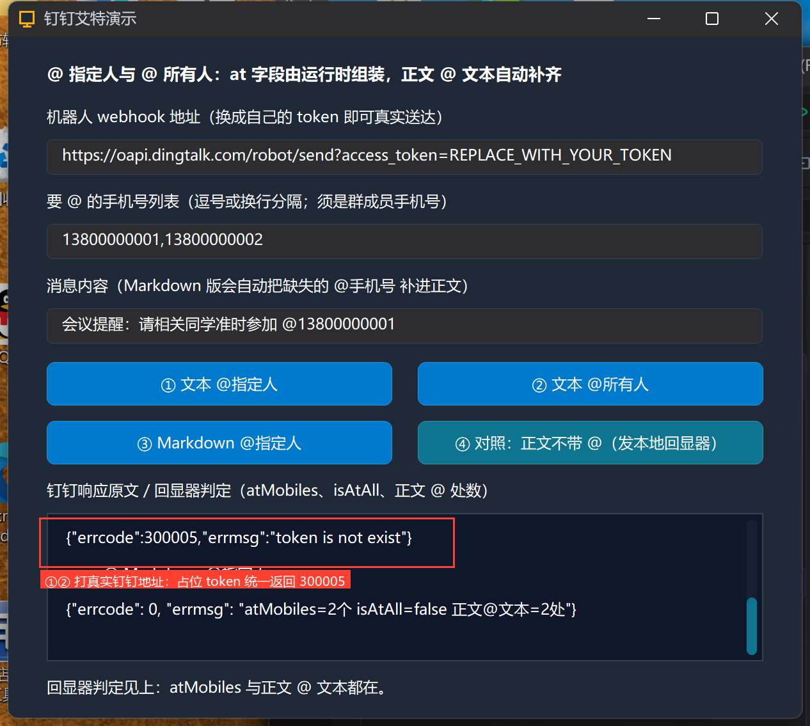

**③ Markdown @指定人 → 回显器判定**：`atMobiles=2个 isAtAll=false 正文@文本=2处`——正文原本只写了 @13800000001，**缺失的 @13800000002 被运行时自动补进了正文**（服务端日志里的请求体原文可证）：

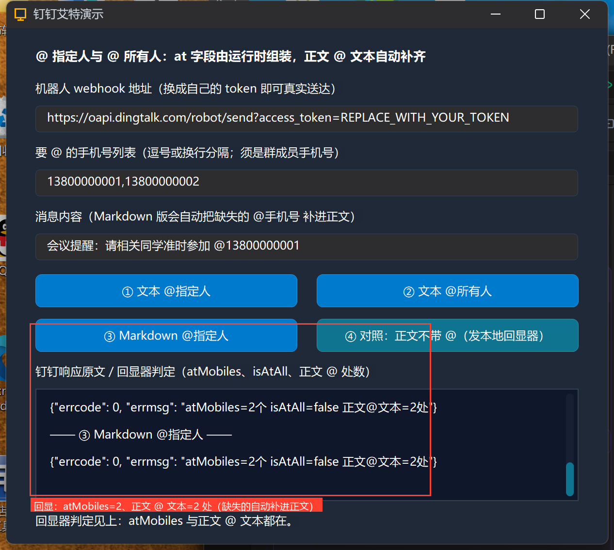

**④ 文本版对照**：at 字段照带（atMobiles=2），但**正文 @ 文本=0 处**——文本消息不做自动补齐：

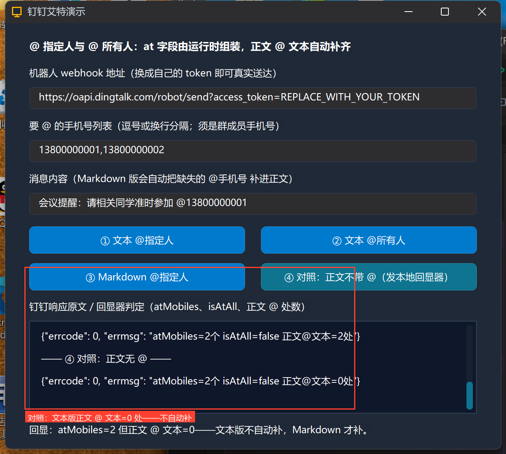

结论一句话：**想省心就发 Markdown（缺的 @ 自动补）；坚持发文本就把 @手机号 自己写进正文**。

## 7. @ 机制红线速查

- 手机号必须是**群成员**，不在群里不报错、也没人被 @；
- 多个手机号用**逗号或换行**分隔都行，运行时统一拆；
- @ 所有人（真）时手机号列表被忽略；@ 所有人同样占用限流额度（约 20 条/分钟）；
- **文本版不自动补 @ 文本、Markdown 版自动补**（本集真机实证，正文漏写时优先选 Markdown）；
- @ 别人属于打扰性动作，告警类消息才用，营销群发别用；
- 企微对照：企微文本命令才支持 @ 手机号，且只对**企业成员**生效（不在企业的手机号无显示不报错）。

## 小结与源码包

这一集把钉钉 @ 的两条规则（at 字段 + 内容同现）做成了四个可动手的实验。下一集换消息形态：**链接消息与整体跳转卡片**，让通知变成可点击的卡片。

- 本集源码包：[钉钉艾特.lcpppkg](https://lingbuilder.com/demos)（回显器脚本 `dingtalk_at_echo.py` 与源码包同目录，`python dingtalk_at_echo.py` 即可启动）
- 官方示例源码区同款：`08-钉钉艾特.lcpppkg`
