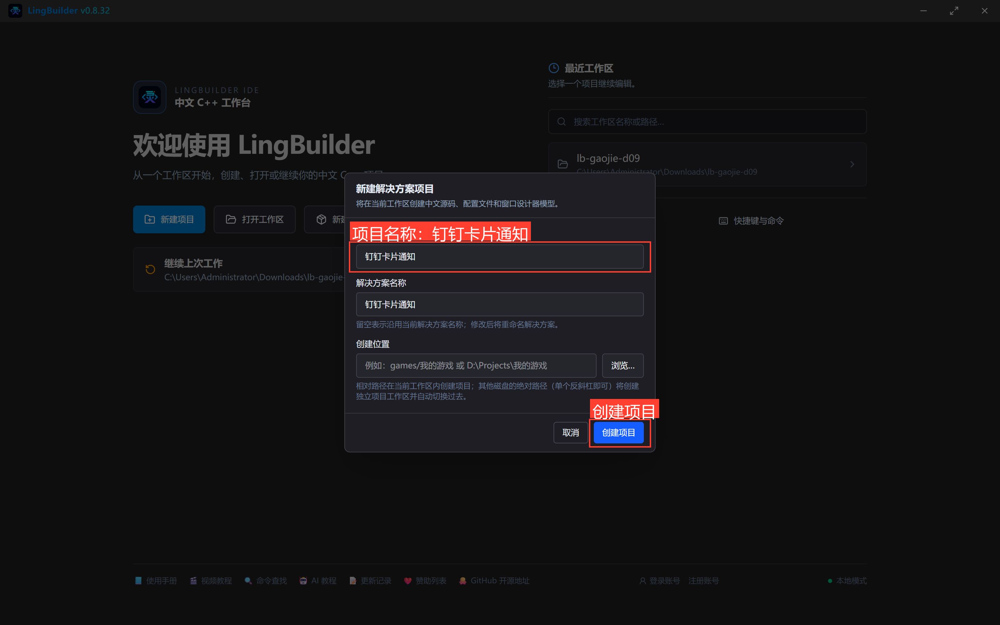
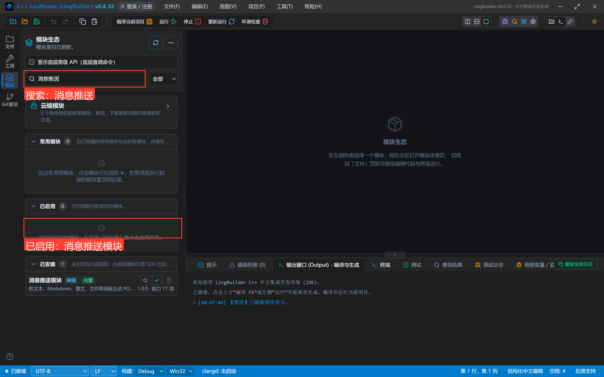
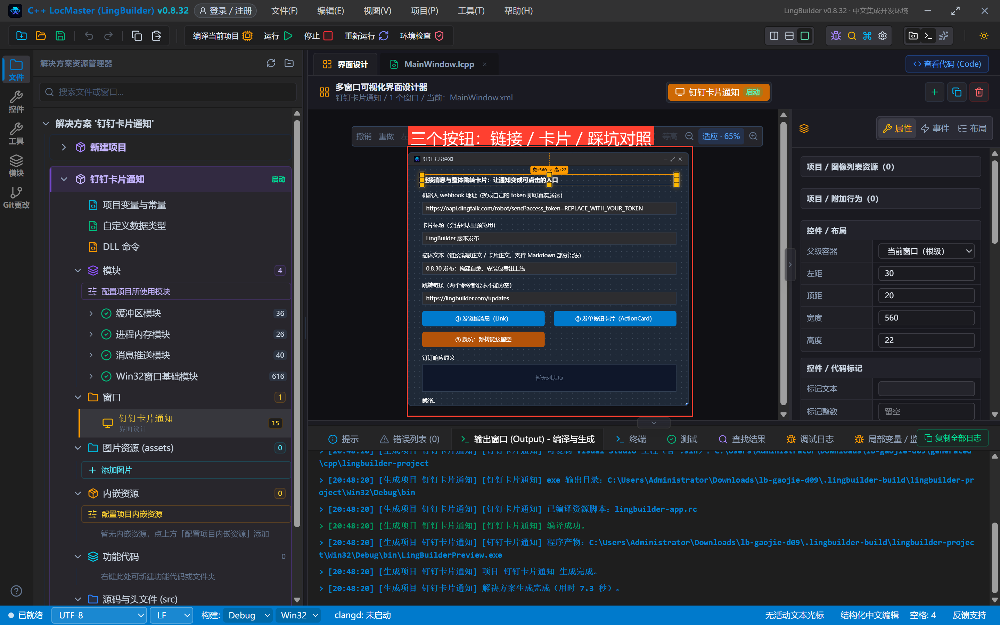
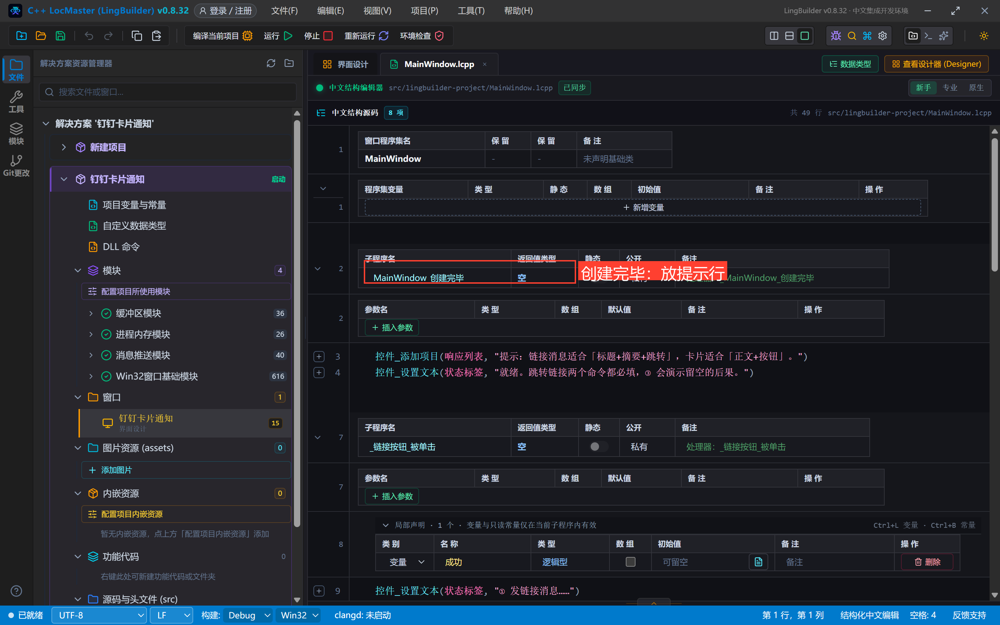
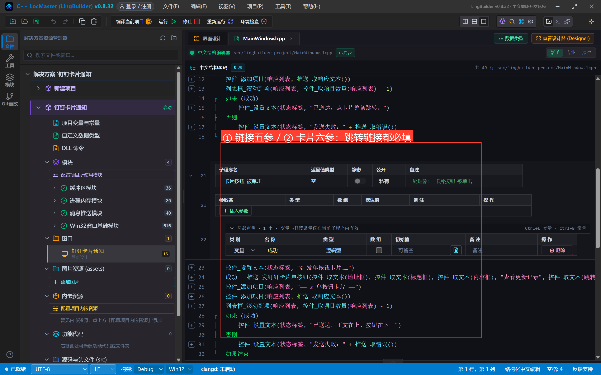
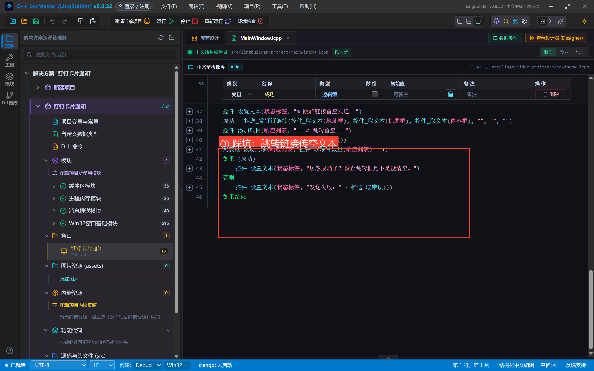
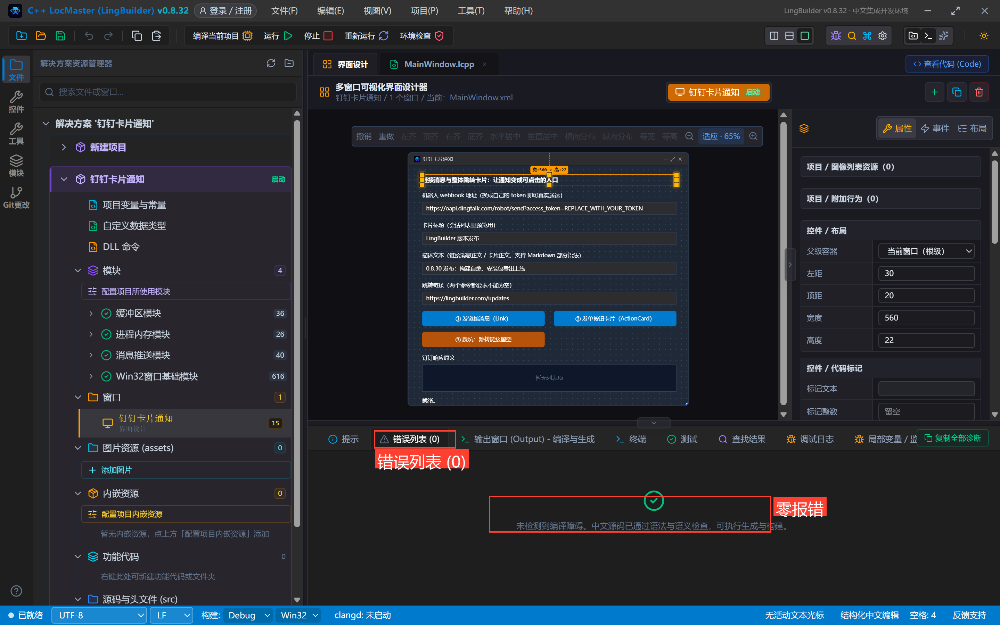
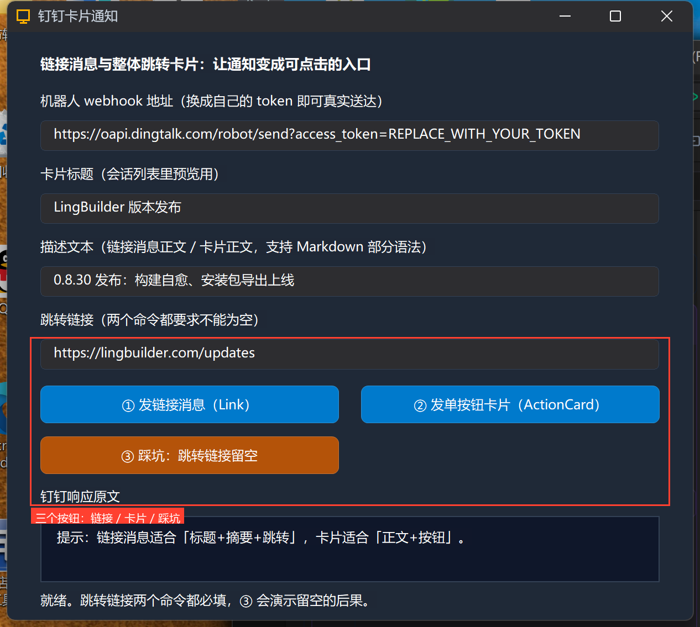
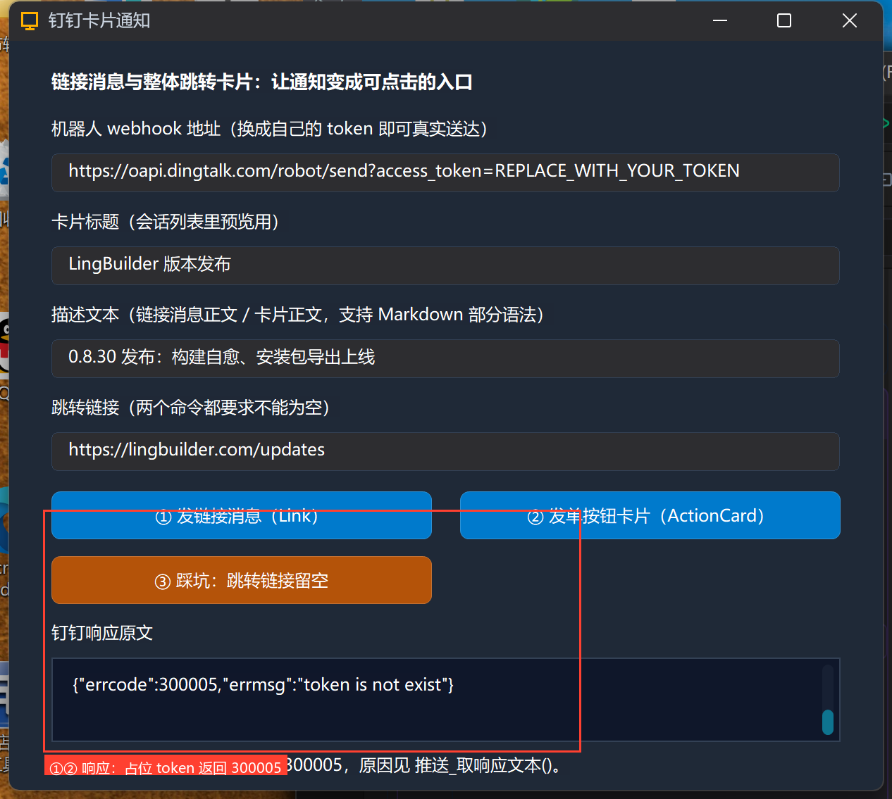
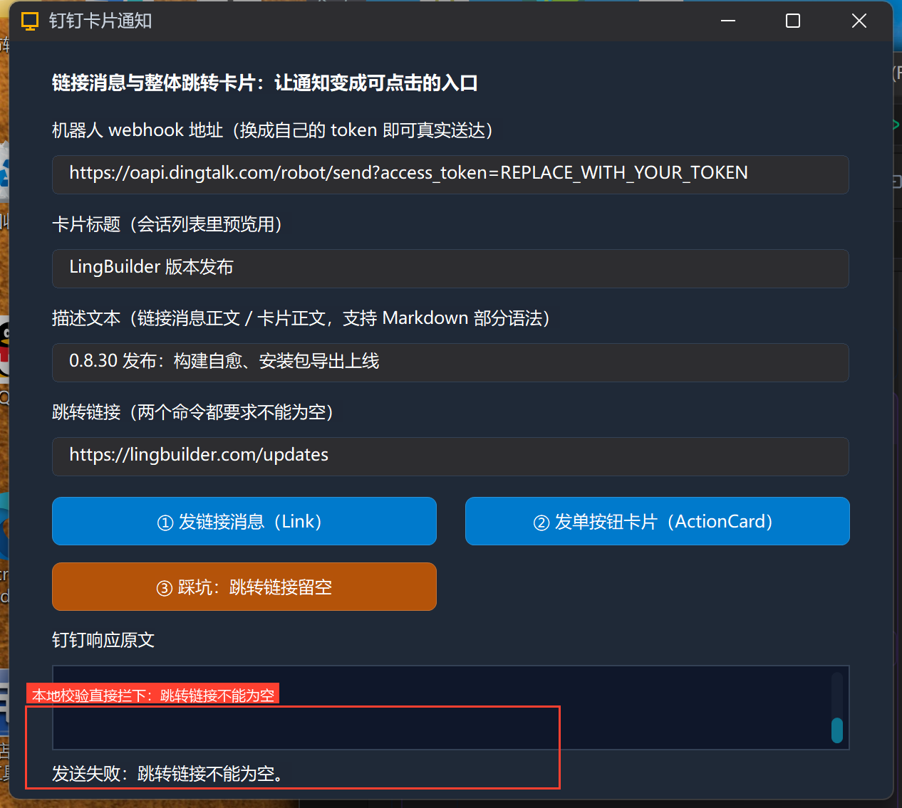

# 高阶实战 09 · 链接与单按钮卡片：整体跳转 ActionCard

> 《LingBuilder 高阶实战系列》第 9 集，**消息推送专题·钉钉篇**。文本消息适合「说一句话」，但要发「一个可以点的东西」——版本发布、日报入口、告警详情页——就得换消息形态。钉钉给了两种带跳转的形态：**Link 链接消息**（标题 + 摘要 + 点击整条跳转）和 **ActionCard 卡片**（正文在上、按钮在下）。本集把两种都发一遍，再故意把必填的跳转链接留空，看看参数校验怎么拦下你。全程约 30 分钟。
>
> 前置要求：学过[第 06 集](/guide/tutorials/gaojie-06-dingtalk)。真实机器人请把占位 token 换成自己的。

## 这一集你将学会

- `推送_发钉钉链接(地址, 标题, 内容, 跳转链接, 图片链接, 加签密钥)`：六参发 Link 消息
- `推送_发钉钉卡片单按钮(地址, 标题, 内容, 按钮标题, 跳转链接, 加签密钥)`：整体跳转 ActionCard
- **跳转链接两个命令都必填**——留空会被本地校验直接拦下（不用等钉钉响应）
- 图片链接参数：Link 消息可选配图（传公网图片 URL，空文本 = 不带图）

## 1. 三十秒理解：Link 与 ActionCard 怎么选

| | Link 链接消息 | ActionCard 单按钮 |
| --- | --- | --- |
| 样子 | 标题 + 一行摘要（+ 可选配图），点**整条卡片**跳转 | 正文（支持 Markdown 部分语法）+ **「查看详情」按钮** |
| 适合 | 版本发布、文章分享、日报入口 | 构建报告、告警详情（正文写摘要，按钮跳日志） |
| 必填 | 标题、跳转链接 | 标题、按钮标题、跳转链接 |

两者的跳转链接都必须是合法 URL——这是本集踩坑按钮要验证的规则。

## 2. 新建项目与启用模块

新建窗口项目「**钉钉卡片通知**」（Windows 界面设计、创建位置留空），启用 **消息推送模块**：





## 3. 设计界面

| 控件 | 名称 | 显示内容 | 左距 | 顶距 | 宽度 | 高度 |
| --- | --- | --- | --- | --- | --- | --- |
| 标签 | 说明标签 | 链接消息与整体跳转卡片：让通知变成可点击的入口 | 30 | 20 | 560 | 22 |
| 标签 | 地址标签 | 机器人 webhook 地址（换成自己的 token 即可真实送达） | 30 | 54 | 560 | 22 |
| 编辑框 | 地址框 | https://oapi.dingtalk.com/robot/send?access_token=REPLACE_WITH_YOUR_TOKEN | 30 | 80 | 560 | 28 |
| 标签 | 标题标签 | 卡片标题（会话列表里预览用） | 30 | 120 | 560 | 22 |
| 编辑框 | 标题框 | LingBuilder 版本发布 | 30 | 146 | 560 | 28 |
| 标签 | 内容标签 | 描述文本（链接消息正文 / 卡片正文，支持 Markdown 部分语法） | 30 | 186 | 560 | 22 |
| 编辑框 | 内容框 | 0.8.30 发布：构建自愈、安装包导出上线 | 30 | 212 | 560 | 28 |
| 标签 | 跳转标签 | 跳转链接（两个命令都要求不能为空） | 30 | 252 | 560 | 22 |
| 编辑框 | 跳转框 | https://lingbuilder.com/updates | 30 | 278 | 560 | 28 |
| 按钮 | 链接按钮 | ① 发链接消息（Link） | 30 | 320 | 270 | 34 |
| 按钮 | 卡片按钮 | ② 发单按钮卡片（ActionCard） | 320 | 320 | 270 | 34 |
| 按钮 | 踩坑按钮 | ③ 踩坑：跳转链接留空 | 30 | 366 | 270 | 34 |
| 标签 | 响应标签 | 钉钉响应原文 | 30 | 412 | 560 | 22 |
| 列表框 | 响应列表 | — | 30 | 438 | 560 | 60 |
| 标签 | 状态标签 | 就绪。 | 30 | 506 | 560 | 22 |

窗口宽 620、高 560；三个按钮绑「被单击」，窗口绑「创建完毕」。



## 4. 写代码

### 4.1 创建完毕



```lcpp
事件 _MainWindow_创建完毕()
    控件_添加项目(响应列表, "提示：链接消息适合「标题+摘要+跳转」，卡片适合「正文+按钮」。")
    控件_设置文本(状态标签, "就绪。跳转链接两个命令都必填，③ 会演示留空的后果。")
结束
```

### 4.2 ①②：两种卡片形态



```lcpp
事件 _链接按钮_被单击()
    局部 逻辑型 成功
    控件_设置文本(状态标签, "① 发链接消息……")
    成功 = 推送_发钉钉链接(控件_取文本(地址框), 控件_取文本(标题框), 控件_取文本(内容框), 控件_取文本(跳转框), "", "")
    控件_添加项目(响应列表, "—— ① 链接消息 ——")
    控件_添加项目(响应列表, 推送_取响应文本())
    列表框_滚动到项(响应列表, 控件_取项目数量(响应列表) - 1)
    如果 (成功)
        控件_设置文本(状态标签, "已送达，点卡片整条跳转。")
    否则
        控件_设置文本(状态标签, "发送失败：" + 推送_取错误())
    如果结束
结束
```

```lcpp
事件 _卡片按钮_被单击()
    局部 逻辑型 成功
    控件_设置文本(状态标签, "② 发单按钮卡片……")
    成功 = 推送_发钉钉卡片单按钮(控件_取文本(地址框), 控件_取文本(标题框), 控件_取文本(内容框), "查看更新记录", 控件_取文本(跳转框), "")
    控件_添加项目(响应列表, "—— ② 单按钮卡片 ——")
    控件_添加项目(响应列表, 推送_取响应文本())
    列表框_滚动到项(响应列表, 控件_取项目数量(响应列表) - 1)
    如果 (成功)
        控件_设置文本(状态标签, "已送达，正文在上、按钮在下。")
    否则
        控件_设置文本(状态标签, "发送失败：" + 推送_取错误())
    如果结束
结束
```

对照着记参数：链接消息是「标题、内容、**跳转**、图片、密钥」；单按钮卡片是「标题、内容、**按钮标题**、跳转、密钥」——按钮标题就是钉钉里那个蓝色按钮的文字（本例「查看更新记录」）。图片链接传空 = 不配图；要配图就传公网 `https://` 图片直链。

### 4.3 ③ 踩坑：跳转链接留空



```lcpp
事件 _踩坑按钮_被单击()
    局部 逻辑型 成功
    控件_设置文本(状态标签, "③ 跳转链接留空发送……")
    成功 = 推送_发钉钉链接(控件_取文本(地址框), 控件_取文本(标题框), 控件_取文本(内容框), "", "", "")
    控件_添加项目(响应列表, "—— ③ 跳转留空 ——")
    控件_添加项目(响应列表, 推送_取响应文本())
    列表框_滚动到项(响应列表, 控件_取项目数量(响应列表) - 1)
    如果 (成功)
        控件_设置文本(状态标签, "居然成功了？检查跳转框是不是没清空。")
    否则
        控件_设置文本(状态标签, "发送失败：" + 推送_取错误())
    如果结束
结束
```

第 4 个参数（跳转链接）硬编码成空文本——这条消息**根本不会发出去**：运行时的参数校验会先拦下它。

## 5. 编译与运行

编译后先看错误列表（零报错再继续），点运行：





## 6. 真机观察

**①② 正常路径**：占位 token 下两条都返回 `errcode 300005`（token 校验在最前）；换成你的 token，群里会出现一张可点击的 Link 卡片和一张带「查看更新记录」按钮的 ActionCard：



**③ 踩坑路径**：状态行直接显示「发送失败：跳转链接不能为空。」——注意响应列表里**没有新的钉钉响应**：参数校验发生在本地，请求根本没出网。这类「先本地校验、再发请求」的设计能省下大量来回排查时间：



## 7. 卡片消息红线速查

- **跳转链接必填**（Link 与 ActionCard 都是），留空本地直接报错；
- 跳转链接必须是合法 URL（`https://` 优先）；按钮标题建议 4~8 个字；
- Link 的图片链接是**公网可访问**的图片 URL（钉钉服务器去拉图，本机路径无效）；ActionCard 单按钮版不带图参数；
- 卡片正文支持 Markdown 部分语法（加粗、链接、引用），但**关键词过滤认正文文字**——开了关键词的机器人别忘了把关键词写进卡片标题或正文；
- 卡片与加签、@ 完全兼容：第 6 参数传 SEC 密钥即加签（第 7 集）。

## 小结与源码包

这一集让通知从「一句话」升级成「一个入口」。下一集把卡片玩全：**多按钮独立跳转 + FeedCard 图文流**。

- 本集源码包：[钉钉卡片.lcpppkg](https://lingbuilder.com/demos)
- 官方示例源码区同款：`09-钉钉卡片.lcpppkg`
