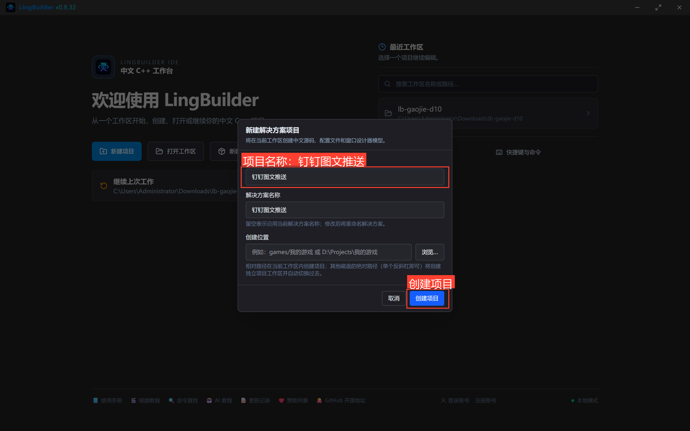
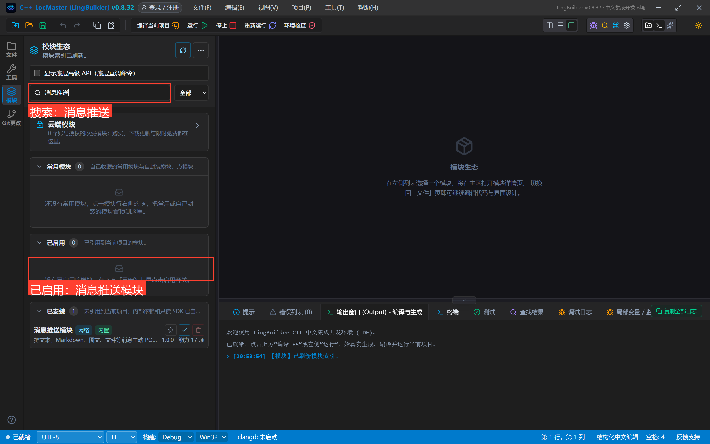
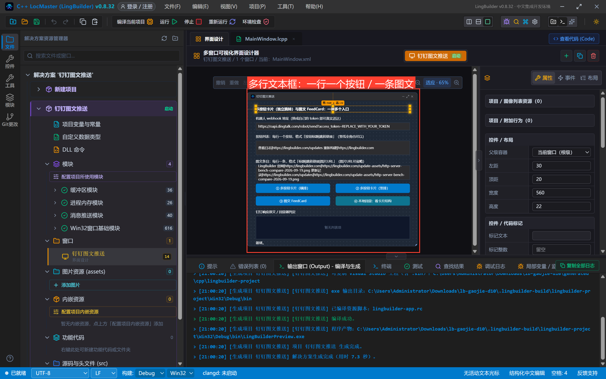
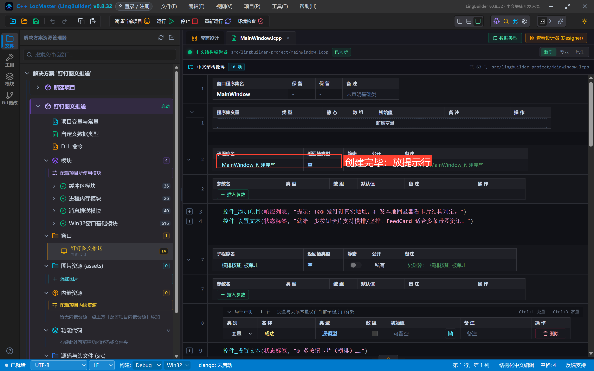
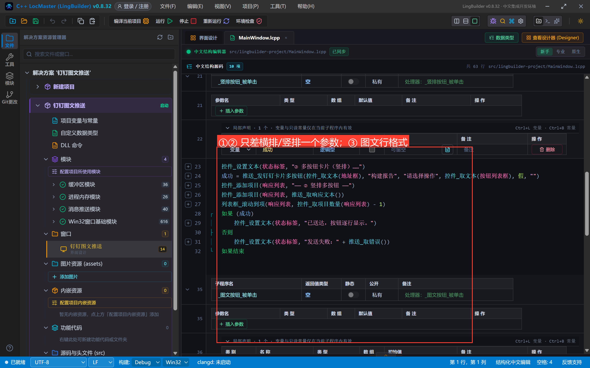
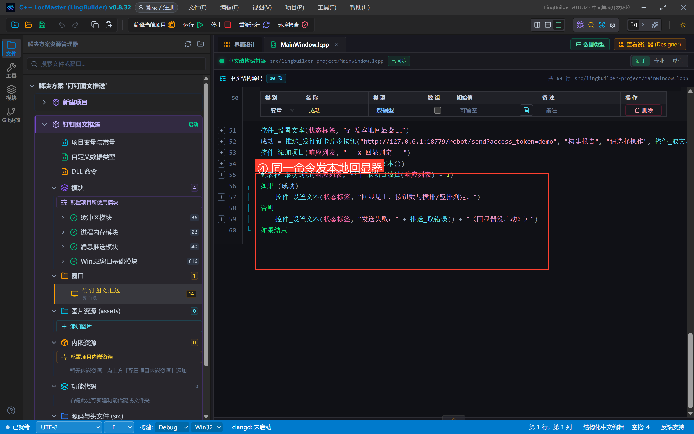
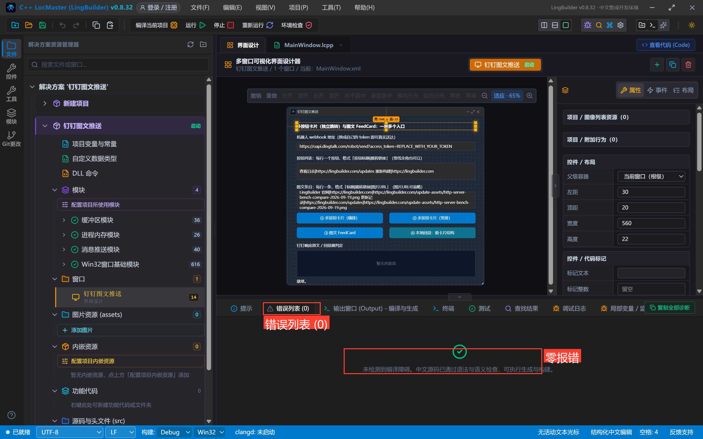
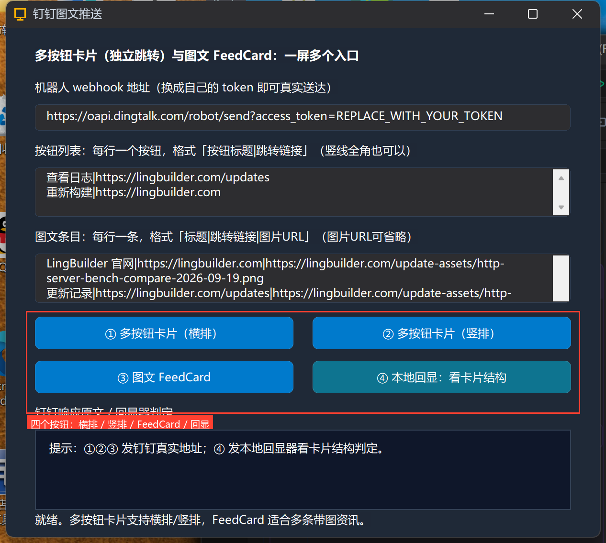
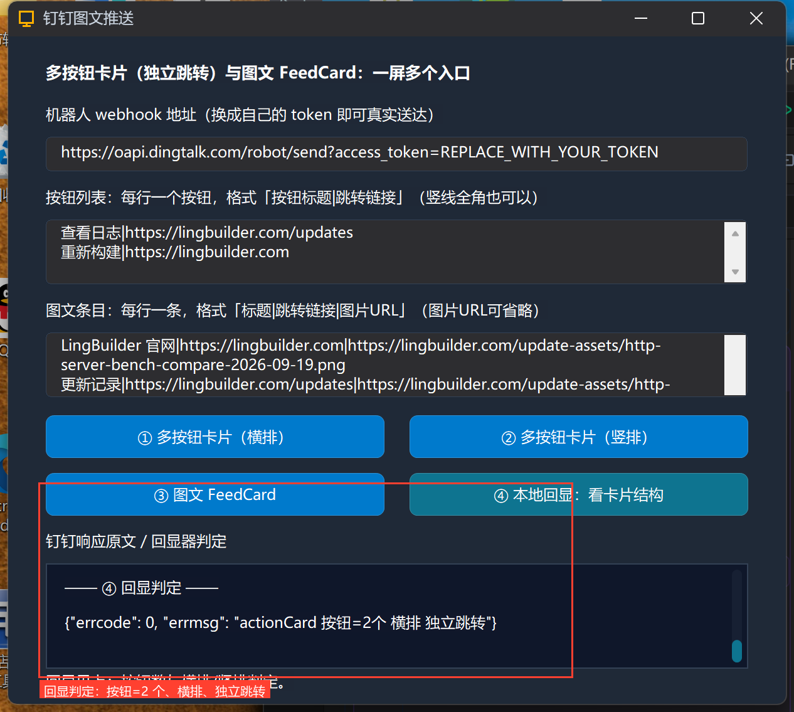

# 高阶实战 10 · 多按钮卡片与图文 FeedCard：一屏多个入口

> 《LingBuilder 高阶实战系列》第 10 集，**消息推送专题·钉钉篇**收官。上一集的单按钮卡片只带一个动作；这一集把卡片玩全：**ActionCard 多按钮**（每个按钮独立跳转、横排竖排随意）和 **FeedCard 图文流**（多条带图资讯左右滑动）。两个命令的参数都是「每行一条」的行文本格式——这正好是**多行编辑框**的主场，本集还顺带修复并验证了设计器多行框的默认换行显示。全程约 35 分钟。
>
> 前置要求：学过[第 09 集](/guide/tutorials/gaojie-09-dingtalk-card)（单按钮卡片与跳转链接必填规则）。真实机器人请把占位 token 换成自己的。

## 这一集你将学会

- `推送_发钉钉卡片多按钮(地址, 标题, 内容, 按钮列表文本, 是否横排, 加签密钥)`：独立跳转 ActionCard
- `推送_发钉钉图文(地址, 图文条目文本, 加签密钥)`：FeedCard 多图文
- **行文本协议**：按钮每行「按钮标题|跳转链接」；图文每行「标题|跳转链接|图片URL」（竖线全角｜也可以，拆分转义由运行时完成）
- 多行编辑框：设计器勾「多行」放多行默认内容（本集修复了多行框默认内容挤成一行的问题）
- 本地回显器核对卡片结构（按钮数、横排/竖排、条目数）

## 1. 三十秒理解：多按钮与图文流的行格式

多按钮卡片把 N 个按钮塞进一张卡片，每个按钮各跳各的：

```text
查看日志|https://lingbuilder.com/updates
重新构建|https://lingbuilder.com
```

图文 FeedCard 则是 N 条「标题 + 跳转 + 配图」，在群里左右滑动浏览：

```text
LingBuilder 官网|https://lingbuilder.com|https://.../cover.png
更新记录|https://lingbuilder.com/updates|https://.../cover.png
```

两类红线先记住：**按钮标题与跳转链接必填**；钉钉 webhook **不能直接发图片消息**，带图只能走 FeedCard 的图片 URL 形式（钉钉服务器去拉图，本机路径无效）。

## 2. 新建项目与启用模块

新建窗口项目「**钉钉图文推送**」（Windows 界面设计、创建位置留空），启用 **消息推送模块**：





## 3. 设计界面（多行编辑框登场）

| 控件 | 名称 | 显示内容 | 左距 | 顶距 | 宽度 | 高度 |
| --- | --- | --- | --- | --- | --- | --- |
| 标签 | 说明标签 | 多按钮卡片（独立跳转）与图文 FeedCard：一屏多个入口 | 30 | 20 | 560 | 22 |
| 标签 | 地址标签 | 机器人 webhook 地址（换成自己的 token 即可真实送达） | 30 | 54 | 560 | 22 |
| 编辑框 | 地址框 | https://oapi.dingtalk.com/robot/send?access_token=REPLACE_WITH_YOUR_TOKEN | 30 | 80 | 560 | 28 |
| 标签 | 按钮列表标签 | 按钮列表：每行一个按钮，格式「按钮标题|跳转链接」（竖线全角也可以） | 30 | 120 | 560 | 22 |
| 编辑框 | 按钮列表框 | 两行按钮文本（见下） | 30 | 146 | 560 | 52 |
| 标签 | 图文条目标签 | 图文条目：每行一条，格式「标题|跳转链接|图片URL」（图片URL可省略） | 30 | 210 | 560 | 22 |
| 编辑框 | 图文条目框 | 两行图文文本（见下） | 30 | 236 | 560 | 52 |
| 按钮 | 横排按钮 | ① 多按钮卡片（横排） | 30 | 302 | 270 | 34 |
| 按钮 | 竖排按钮 | ② 多按钮卡片（竖排） | 320 | 302 | 270 | 34 |
| 按钮 | 图文按钮 | ③ 图文 FeedCard | 30 | 348 | 270 | 34 |
| 按钮 | 回显按钮 | ④ 本地回显：看卡片结构 | 320 | 348 | 270 | 34 |
| 标签 | 响应标签 | 钉钉响应原文 / 回显器判定 | 30 | 394 | 560 | 22 |
| 列表框 | 响应列表 | — | 30 | 420 | 560 | 84 |
| 标签 | 状态标签 | 就绪。 | 30 | 506 | 560 | 22 |

窗口宽 620、高 560；四个按钮绑「被单击」，窗口绑「创建完毕」。

两个**多行编辑框**的做法：选中编辑框 → 属性面板勾「**多行**」、滚动条选「垂直」，显示内容里直接敲两行：

```text
查看日志|https://lingbuilder.com/updates
重新构建|https://lingbuilder.com
```

```text
LingBuilder 官网|https://lingbuilder.com|https://lingbuilder.com/update-assets/http-server-bench-compare-2026-09-19.png
更新记录|https://lingbuilder.com/updates|https://lingbuilder.com/update-assets/http-server-bench-compare-2026-09-19.png
```

> 🛠 **本集修复**：制作时发现多行编辑框的**默认内容**会把换行挤没（多行 EDIT 只认 CRLF，创建期没归一）。已在生成器修复并随本集真机验证——如果你的版本较旧，遇到默认内容挤成一行，升级 IDE 或在「创建完毕」里用 `控件_设置文本` 重新赋值即可（运行期赋值的归一是好的）。



## 4. 写代码

### 4.1 创建完毕



```lcpp
事件 _MainWindow_创建完毕()
    控件_添加项目(响应列表, "提示：①②③ 发钉钉真实地址；④ 发本地回显器看卡片结构判定。")
    控件_设置文本(状态标签, "就绪。多按钮卡片支持横排/竖排，FeedCard 适合多条带图资讯。")
结束
```

### 4.2 ①②③：三个发送事件



```lcpp
事件 _横排按钮_被单击()
    局部 逻辑型 成功
    控件_设置文本(状态标签, "① 多按钮卡片（横排）……")
    成功 = 推送_发钉钉卡片多按钮(控件_取文本(地址框), "构建报告", "请选择操作", 控件_取文本(按钮列表框), 真, "")
    控件_添加项目(响应列表, "—— ① 横排多按钮 ——")
    控件_添加项目(响应列表, 推送_取响应文本())
    列表框_滚动到项(响应列表, 控件_取项目数量(响应列表) - 1)
    如果 (成功)
        控件_设置文本(状态标签, "已送达，按钮并排显示。")
    否则
        控件_设置文本(状态标签, "发送失败：" + 推送_取错误())
    如果结束
结束
```

② 与 ① **只差一个参数**：是否横排传「假」= 竖排（按钮逐行显示）。③ 图文更简单，三个参数就够：

```lcpp
成功 = 推送_发钉钉图文(控件_取文本(地址框), 控件_取文本(图文条目框), "")
```

### 4.3 ④ 本地回显：把卡片结构看真切



```lcpp
事件 _回显按钮_被单击()
    局部 逻辑型 成功
    控件_设置文本(状态标签, "④ 发本地回显器……")
    成功 = 推送_发钉钉卡片多按钮("http://127.0.0.1:18779/robot/send?access_token=demo", "构建报告", "请选择操作", 控件_取文本(按钮列表框), 真, "")
    控件_添加项目(响应列表, "—— ④ 回显判定 ——")
    控件_添加项目(响应列表, 推送_取响应文本())
    列表框_滚动到项(响应列表, 控件_取项目数量(响应列表) - 1)
    如果 (成功)
        控件_设置文本(状态标签, "回显见上：按钮数与横排/竖排判定。")
    否则
        控件_设置文本(状态标签, "发送失败：" + 推送_取错误() + "（回显器没启动？）")
    如果结束
结束
```

同一个命令、同一个按钮列表，只是地址换成本地回显器（`dingtalk_card_echo.py`，与源码包同目录）。

## 5. 编译与运行

编译后先看错误列表（零报错再继续），点运行：





## 6. 真机观察：结构判定

④ 的回显判定一眼确认三件事：

```json
{"errcode": 0, "errmsg": "actionCard 按钮=2个 横排 独立跳转"}
```

回显器日志里的请求体原文（`btns` 数组、`btnOrientation:"1"`）证明运行时把两行文本**正确拆成了两个带独立跳转的按钮**：



①②③ 打占位 token 地址会返回 `errcode 300005`（老朋友了）；换成你的 token 后：① 按钮并排、② 按钮逐行、③ 群里出现可左右滑动的带图资讯流。

## 7. 卡片与图文红线速查

- 按钮行格式「标题|跳转链接」、图文行格式「标题|跳转链接|图片URL」，竖线用半角 `|` 或全角 `｜` 都行；
- **钉钉 webhook 不能直接发图片消息**——带图只有 FeedCard 图片 URL 一条路（图片 URL 必须公网可访问）；
- 多按钮的跳转链接、图文的标题与跳转链接**必填**，缺了会被本地校验或钉钉响应拦下；
- 卡片正文（`请选择操作` 这类）支持 Markdown 部分语法，开了关键词的机器人记得把关键词写进标题或正文；
- 行文本里别再写竖线以外的半角 `|`（会被当分隔符拆开），URL 里的 `/` `:` 不受影响。

## 小结与源码包

钉钉篇五集（06~10）到此收官：文本/Markdown、关键词、加签、@ 人、链接与卡片、多按钮与图文——群机器人的常用形态全部打通。下一集换平台：**飞书**，并顺带认识万能兜底 `推送_发JSON`。

- 本集源码包：[钉钉图文.lcpppkg](https://lingbuilder.com/demos)（回显器脚本 `dingtalk_card_echo.py` 同目录附带）
- 官方示例源码区同款：`10-钉钉图文.lcpppkg`
