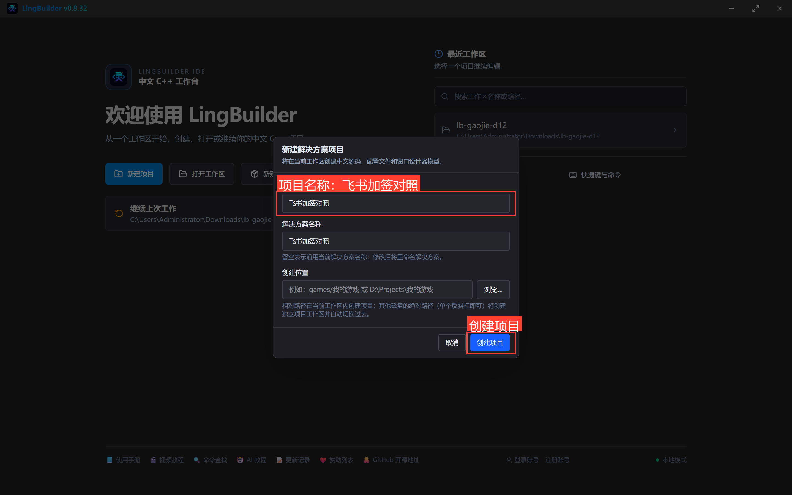
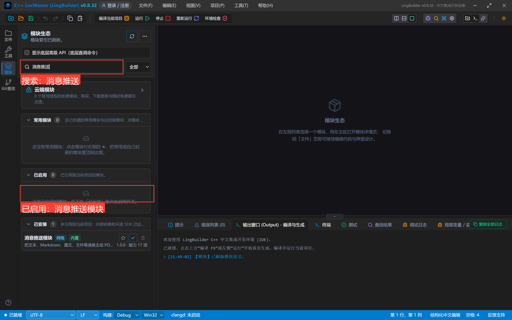
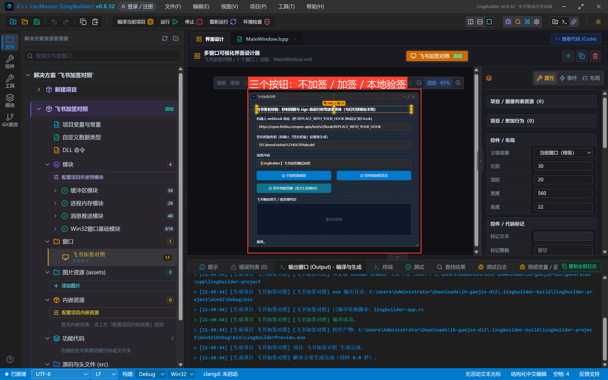
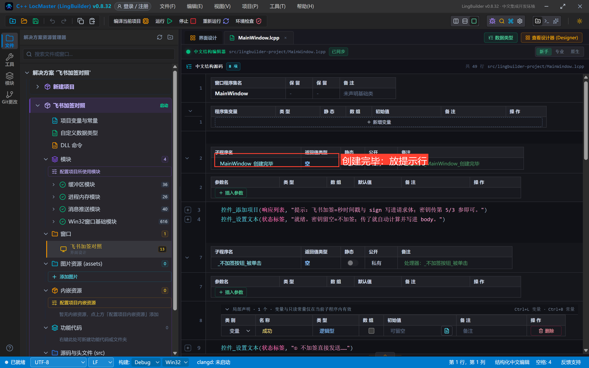
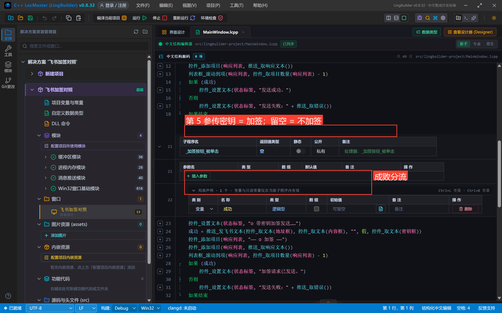
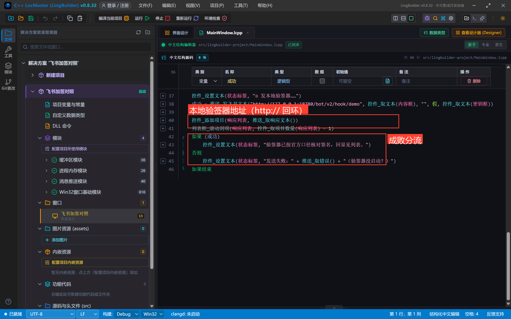
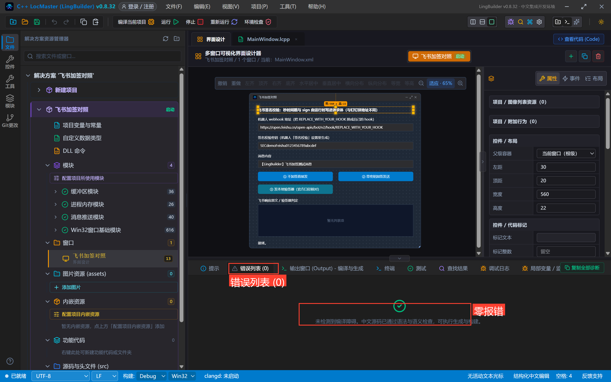
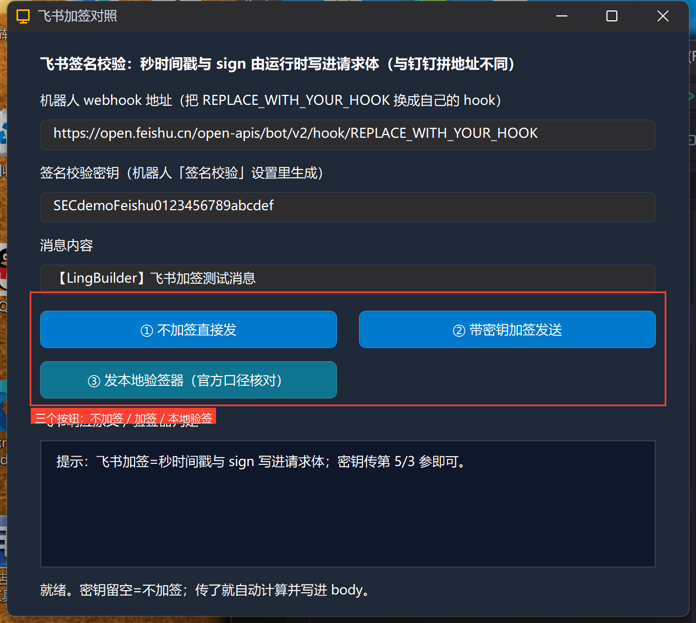
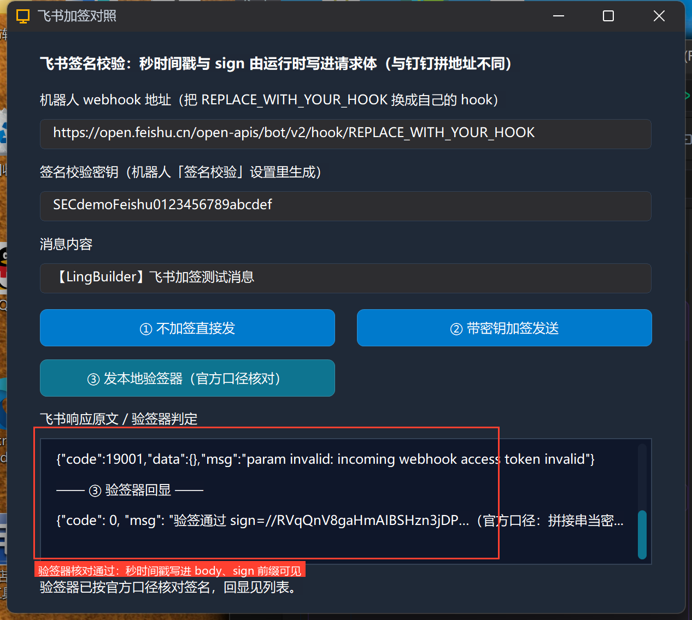

# 高阶实战 12 · 飞书加签：秒时间戳写 body（与钉钉对照）

> 《LingBuilder 高阶实战系列》第 12 集，**消息推送专题·飞书篇**收官。钉钉的签名拼在**地址**上、时间戳是**毫秒**；飞书完全相反——**秒级时间戳和 sign 写进请求体**，而且签名算法本身也不一样（飞书官方口径：把「秒时间戳+换行+密钥」**整串当 HMAC 密钥**，消息为空）。本集把两种加签放在一起对照，再用本地验签器按**官方口径**逐字节核对运行时算出的签名。全程约 30 分钟。
>
> 前置要求：学过[第 07 集](/guide/tutorials/gaojie-07-dingtalk-sign)（钉钉加签）。本集制作中发现并修复了运行时飞书签名与官方口径不一致的问题（详见第 6 节），已随本集真机验证。

## 这一集你将学会

- `推送_发飞书文本` / `推送_发飞书富文本` 的加签参数：密钥传最后一位，留空 = 不加签
- **飞书签名算法**：`sign = Base64(HMAC-SHA256(密钥 = "秒时间戳\n密钥整串", 消息 = 空))`，与秒时间戳一起写进请求体 `timestamp`/`sign` 字段
- **钉钉 vs 飞书签名差异总表**（算法、时间戳单位、放置位置三处都不同）
- 本地验签器按官方口径核对签名（`feishu_sign_echo.py` 随源码包附带）

## 1. 三十秒理解：两家签名差在哪

| | 钉钉加签 | 飞书签名校验 |
| --- | --- | --- |
| 时间戳 | **毫秒**（13 位） | **秒**（10 位） |
| HMAC 密钥 | `SEC` 密钥 | **`秒时间戳\n密钥` 整串** |
| HMAC 消息 | `毫秒时间戳\n密钥` | **空** |
| 结果放置 | URL 参数 `&timestamp=…&sign=…`（URL 编码） | 请求体字段 `"timestamp":"…","sign":"…"`（原样 Base64） |
| 失败响应 | `errcode 310000 sign not match` | `code 9499`（签名不匹配类错误） |

这些差异 LingBuilder 全部封装掉了：**你只管把密钥传给命令最后一位**，算法、时间戳、放置位置由运行时按平台各自动作。

## 2. 新建项目与启用模块

新建窗口项目「**飞书加签对照**」（Windows 界面设计、创建位置留空），启用 **消息推送模块**：





## 3. 设计界面

| 控件 | 名称 | 显示内容 | 左距 | 顶距 | 宽度 | 高度 |
| --- | --- | --- | --- | --- | --- | --- |
| 标签 | 说明标签 | 飞书签名校验：秒时间戳与 sign 由运行时写进请求体（与钉钉拼地址不同） | 30 | 20 | 560 | 22 |
| 标签 | 地址标签 | 机器人 webhook 地址（把 REPLACE_WITH_YOUR_HOOK 换成自己的 hook） | 30 | 54 | 560 | 22 |
| 编辑框 | 地址框 | https://open.feishu.cn/open-apis/bot/v2/hook/REPLACE_WITH_YOUR_HOOK | 30 | 80 | 560 | 28 |
| 标签 | 密钥标签 | 签名校验密钥（机器人「签名校验」设置里生成） | 30 | 120 | 560 | 22 |
| 编辑框 | 密钥框 | SECdemoFeishu0123456789abcdef | 30 | 146 | 560 | 28 |
| 标签 | 内容标签 | 消息内容 | 30 | 186 | 560 | 22 |
| 编辑框 | 内容框 | 【LingBuilder】飞书加签测试消息 | 30 | 212 | 560 | 28 |
| 按钮 | 不加签按钮 | ① 不加签直接发 | 30 | 254 | 270 | 34 |
| 按钮 | 加签按钮 | ② 带密钥加签发送 | 320 | 254 | 270 | 34 |
| 按钮 | 验签按钮 | ③ 发本地验签器（官方口径核对） | 30 | 300 | 270 | 34 |
| 标签 | 响应标签 | 飞书响应原文 / 验签器判定 | 30 | 346 | 560 | 22 |
| 列表框 | 响应列表 | — | 30 | 372 | 560 | 116 |
| 标签 | 状态标签 | 就绪。 | 30 | 500 | 560 | 22 |

窗口宽 620、高 560；三个按钮绑「被单击」，窗口绑「创建完毕」。



## 4. 写代码

### 4.1 创建完毕



```lcpp
事件 _MainWindow_创建完毕()
    控件_添加项目(响应列表, "提示：飞书加签=秒时间戳与 sign 写进请求体；密钥传第 5/3 参即可。")
    控件_设置文本(状态标签, "就绪。密钥留空=不加签；传了就自动计算并写进 body。")
结束
```

### 4.2 ①②：不加签与加签只差一位参数



```lcpp
事件 _加签按钮_被单击()
    局部 逻辑型 成功
    控件_设置文本(状态标签, "② 带密钥加签发送……")
    成功 = 推送_发飞书文本(控件_取文本(地址框), 控件_取文本(内容框), "", 假, 控件_取文本(密钥框))
    控件_添加项目(响应列表, "—— ② 加签 ——")
    控件_添加项目(响应列表, 推送_取响应文本())
    列表框_滚动到项(响应列表, 控件_取项目数量(响应列表) - 1)
    如果 (成功)
        控件_设置文本(状态标签, "加签请求已发送。")
    否则
        控件_设置文本(状态标签, "发送失败：" + 推送_取错误())
    如果结束
结束
```

与第 7 集的钉钉加签结构完全同构：唯一区别是这里最后一参传给的是**飞书签名校验密钥**，运行时按飞书口径算签名并写进 body。富文本命令同理（`推送_发飞书富文本(地址, 多行文本, 密钥)`）。

### 4.3 ③ 本地验签器：按官方口径逐字节核对



```lcpp
事件 _验签按钮_被单击()
    局部 逻辑型 成功
    控件_设置文本(状态标签, "③ 发本地验签器……")
    成功 = 推送_发飞书文本("http://127.0.0.1:18780/bot/v2/hook/demo", 控件_取文本(内容框), "", 假, 控件_取文本(密钥框))
    控件_添加项目(响应列表, "—— ③ 验签器回显 ——")
    控件_添加项目(响应列表, 推送_取响应文本())
    列表框_滚动到项(响应列表, 控件_取项目数量(响应列表) - 1)
    如果 (成功)
        控件_设置文本(状态标签, "验签器已按官方口径核对签名，回显见列表。")
    否则
        控件_设置文本(状态标签, "发送失败：" + 推送_取错误() + "（验签器没启动？）")
    如果结束
结束
```

验签器 `feishu_sign_echo.py`（约 35 行，随源码包附带）用 Python 标准库按**官方 gen_sign 口径**独立重算：`hmac.new(key="秒时间戳\n密钥".encode(), digestmod=sha256)`（消息为空）→ Base64 → 与 body 里的 `sign` 对比。

## 5. 编译与运行

编译后先看错误列表（零报错再继续），点运行：





## 6. 真机观察：签名核对通过

**①② 打占位 hook**：飞书返回 `{"code":19001,...,"msg":"param invalid: incoming webhook access token invalid"}`（token 校验在前——与钉钉 300005 同理）。

**③ 验签器**：请求体里看到了 `"timestamp":"1792849832"`（**10 位秒级时间戳**，对比钉钉的 13 位毫秒），验签器按官方口径重算的签名与运行时算出的**逐字节一致**：

```json
{"code": 0, "msg": "验签通过 sign=//RVqQnV8gaHmAIBSHzn3jDP…（官方口径：拼接串当密钥、消息为空）"}
```



> 🛠 **本集修复**：制作中发现运行时此前给飞书用的是钉钉签名算法（密钥当 HMAC key），与飞书官方「拼接串当 key、消息为空」不一致——真实开启签名校验的飞书机器人会拒绝。已按官方口径修复并经本集验签器真机核对通过；如果你的版本较旧，升级 IDE 后再跑加签。

## 7. 飞书加签红线速查

- 密钥原样粘贴；**换密钥后所有请求立刻换签名**，不用改代码；
- 时间戳是**秒**且写在 **body**——别把钉钉的「毫秒拼地址」习惯带过来（两家的参数名恰好都是 timestamp/sign，更容易混）；
- 签名与消息内容无关；**时间戳偏差过大会被拒**，本机时钟要准；
- 签名校验与关键词过滤（飞书叫「关键词过滤」或「IP 白名单」）可叠加，各自独立判定；
- `推送_取响应文本()` 在飞书返回的是带 `code`/`msg` 的 JSON——排障先看它，别拿 errcode 的眼光找字段。

## 小结与源码包

三家平台的加签机制全部打通。下一集是消息推送专题的万能后手：**`推送_发JSON`**——任何结构化消息（企微模板卡片、Server酱、Bark、自建接口）都能直发。

- 本集源码包：[飞书加签.lcpppkg](https://lingbuilder.com/demos)（验签器脚本 `feishu_sign_echo.py` 同目录附带）
- 官方示例源码区同款：`12-飞书加签.lcpppkg`
