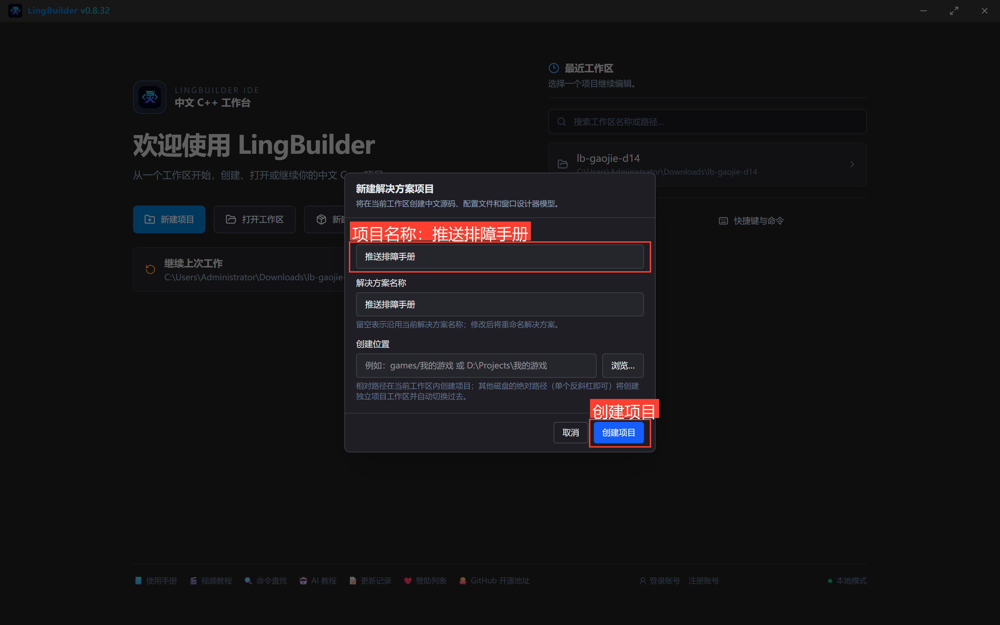
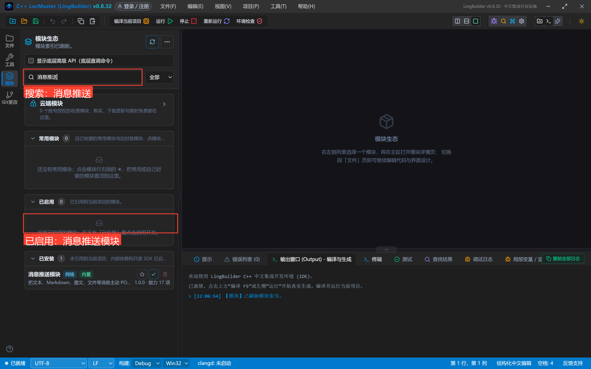
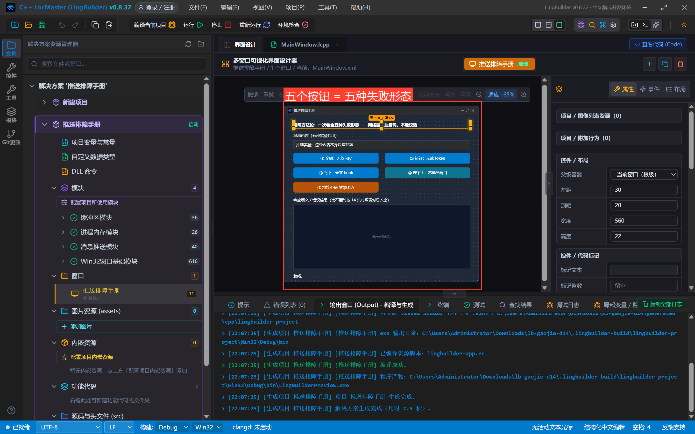
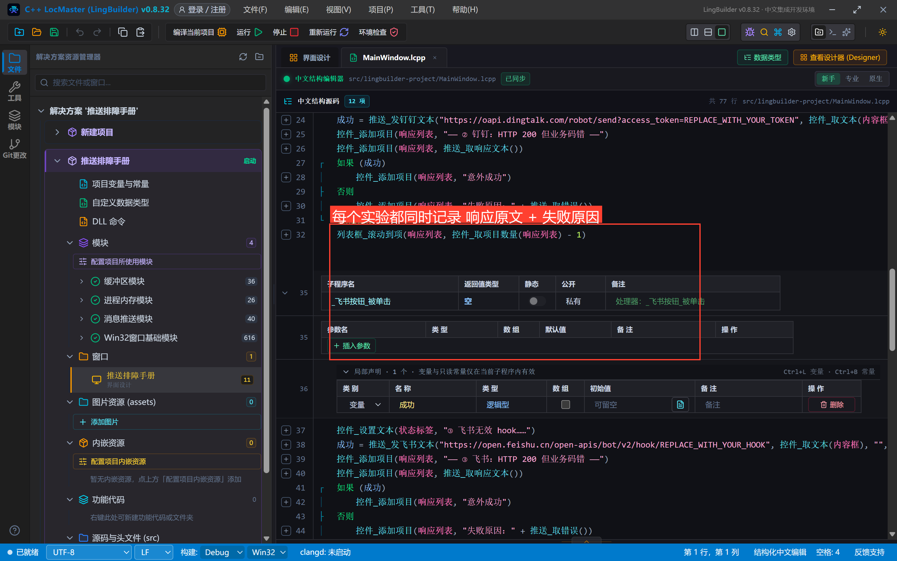
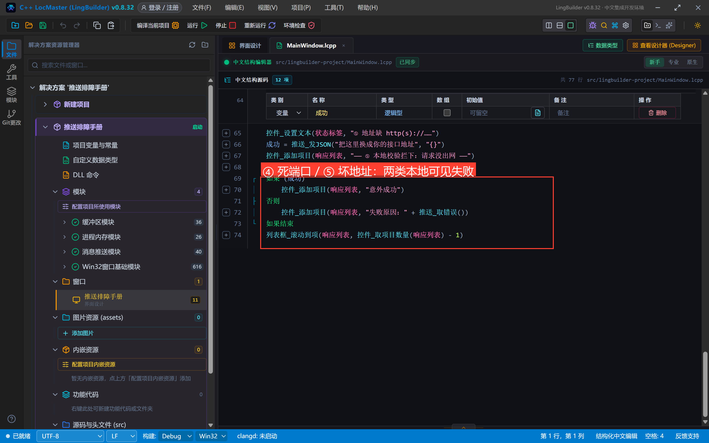
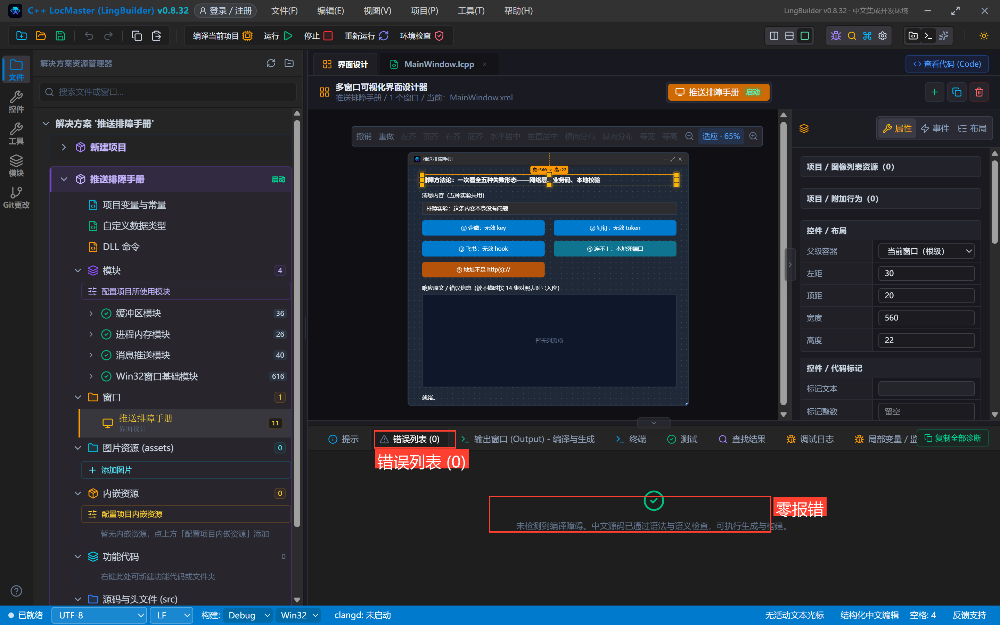
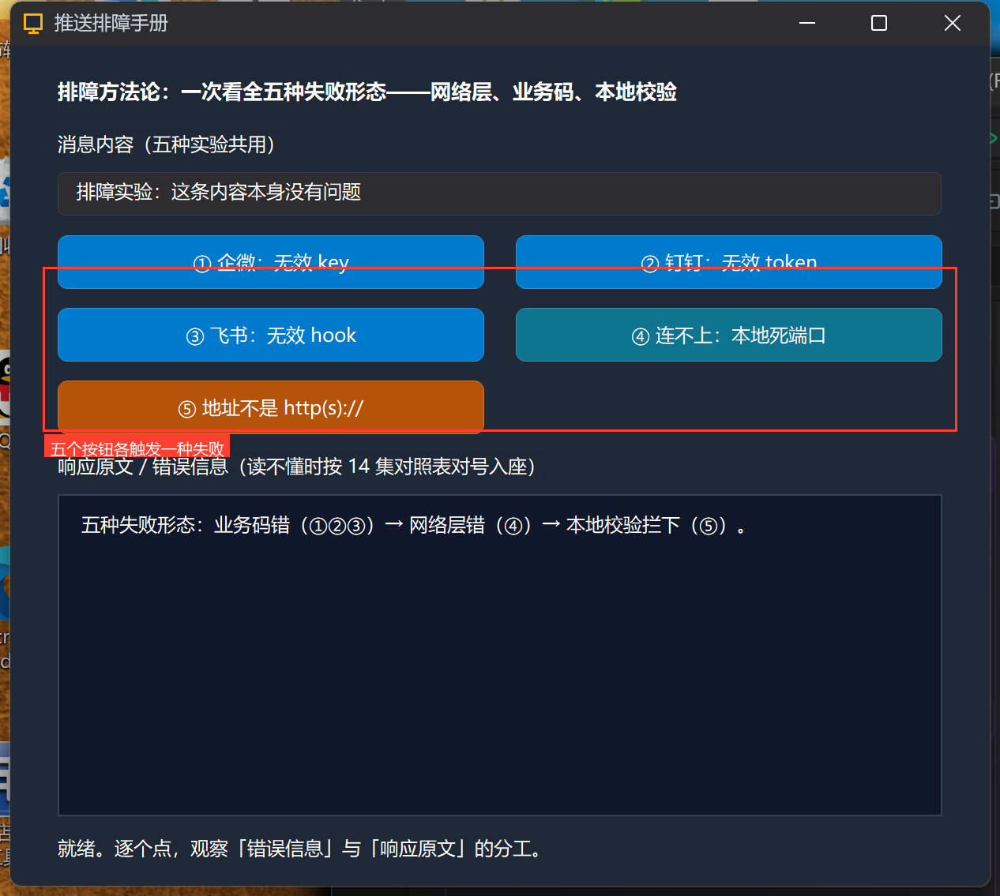
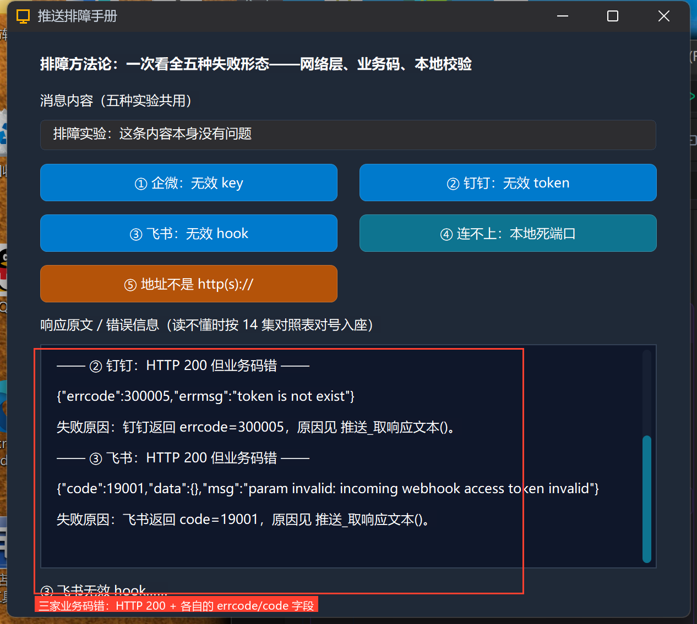
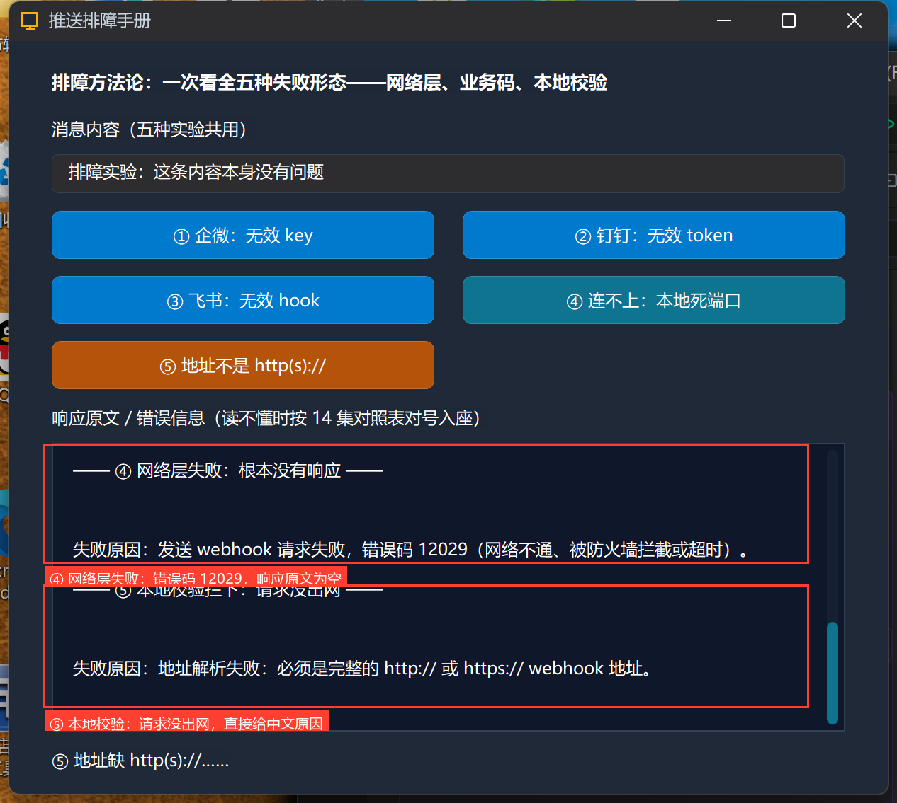

# 高阶实战 14 · 排障方法论：取错误、取响应文本、三家格式对照与限流

> 《LingBuilder 高阶实战系列》第 14 集，**消息推送专题·通用篇**。前 13 集里「失败」出现过很多次：无效 key、无效 token、连不上、关键词被拒……这一集把它们**收进一张实验台**：五个按钮各触发一种失败形态，你在同一个列表里对比「错误信息」与「响应原文」的分工，学会按形态对号入座。最后附**三家响应字段对照表**与 **20 条/分钟限流**的应对写法。全程约 30 分钟。
>
> 前置要求：学过第 06~13 集（每集的真实响应都是本集对照表的素材）。

## 这一集你将学会

- 排障双子星的分工：`推送_取错误()`（中文结论）vs `推送_取响应文本()`（服务器原文，第一现场）
- **五种失败形态**：业务码错（①②③）/ 网络层错（④）/ 本地校验拦下（⑤），各自的证据长什么样
- 三家响应字段对照：`errcode`（企微/钉钉）vs `code`/`StatusCode`（飞书）
- 限流（约 20 条/分钟）的两种应对：时钟节流与失败重试

## 1. 排障总纲：先分形态，再找证据

所有推送失败只落进三种形态，证据链完全不同：

```text
①②③ 业务码错：请求到了平台，平台拒绝
      证据 = HTTP 200 + 响应原文里的 errcode/code
④    网络层错：请求根本没到达（或没等到响应）
      证据 = 错误信息里的 Windows 错误码（如 12029），响应原文为空
⑤    本地校验拦下：请求没出网
      证据 = 错误信息直接给中文原因（地址解析失败/内容为空/跳转链接不能为空）
```

排障口诀：**先看返回值分真假，假的再看取错误定形态，拿不准就取响应文本看原文**。

## 2. 实验台：五个按钮，五种失败

新建窗口项目「**推送排障手册**」（Windows 界面设计、创建位置留空），启用 **消息推送模块**：





界面布局（窗口 620×560）：

| 控件 | 名称 | 显示内容 | 左距 | 顶距 | 宽度 | 高度 |
| --- | --- | --- | --- | --- | --- | --- |
| 标签 | 说明标签 | 排障方法论：一次看全五种失败形态——网络层、业务码、本地校验 | 30 | 20 | 560 | 22 |
| 标签 | 内容标签 | 消息内容（五种实验共用） | 30 | 54 | 560 | 22 |
| 编辑框 | 内容框 | 排障实验：这条内容本身没有问题 | 30 | 80 | 560 | 28 |
| 按钮 | 企微按钮 | ① 企微：无效 key | 30 | 120 | 270 | 34 |
| 按钮 | 钉钉按钮 | ② 钉钉：无效 token | 320 | 120 | 270 | 34 |
| 按钮 | 飞书按钮 | ③ 飞书：无效 hook | 30 | 166 | 270 | 34 |
| 按钮 | 死端口按钮 | ④ 连不上：本地死端口 | 320 | 166 | 270 | 34 |
| 按钮 | 坏地址按钮 | ⑤ 地址不是 http(s):// | 30 | 212 | 270 | 34 |
| 标签 | 响应标签 | 响应原文 / 错误信息 | 30 | 258 | 560 | 22 |
| 列表框 | 响应列表 | — | 30 | 284 | 560 | 204 |
| 标签 | 状态标签 | 就绪。 | 30 | 500 | 560 | 22 |



## 3. 写代码：每个实验同时记两样证据

每个按钮事件都是同一个骨架——发送、记录响应原文、记录失败原因：



```lcpp
事件 _钉钉按钮_被单击()
    局部 逻辑型 成功
    控件_设置文本(状态标签, "② 钉钉无效 token……")
    成功 = 推送_发钉钉文本("https://oapi.dingtalk.com/robot/send?access_token=REPLACE_WITH_YOUR_TOKEN", 控件_取文本(内容框), "", 假, "")
    控件_添加项目(响应列表, "—— ② 钉钉：HTTP 200 但业务码错 ——")
    控件_添加项目(响应列表, 推送_取响应文本())
    如果 (成功)
        控件_添加项目(响应列表, "意外成功")
    否则
        控件_添加项目(响应列表, "失败原因：" + 推送_取错误())
    如果结束
    列表框_滚动到项(响应列表, 控件_取项目数量(响应列表) - 1)
结束
```

① 企微、③ 飞书同构（换命令与地址）。④ 死端口用 `推送_发JSON` 打一个不存在的本地端口：



```lcpp
成功 = 推送_发JSON("http://127.0.0.1:9/push", "{}")     ' ④ 网络层失败
成功 = 推送_发JSON("把这里换成你的接口地址", "{}")        ' ⑤ 本地校验拦下
```

## 4. 编译与运行

编译后先看错误列表（零报错再继续），点运行：





## 5. 真机对照：三种业务码错

①②③ 点下去，三家平台都返回 HTTP 200 + 各自的业务码字段（占位凭据）：



```text
企微  → {"errcode":93000,"errmsg":"invalid webhook url, hint:..."}
钉钉  → {"errcode":300005,"errmsg":"token is not exist"}
飞书  → {"code":19001,"data":[],"msg":"param invalid: incoming webhook access token invalid"}
```

注意两点：**字段名不同**（企微/钉钉用 `errcode`，飞书新格式用 `code`、老格式用 `StatusCode`）；失败原因行是 `推送_取错误()` 给的中文结论——它已经替你兼容了三键判定。

## 6. 真机对照：网络层错与本地校验

④ 死端口：错误码 **12029**（无法连接），响应原文**为空**——没有服务器，自然没有原文；⑤ 坏地址：请求根本没出网，错误信息直接给中文：



```text
④ 失败原因：发送 webhook 请求失败，错误码 12029（网络不通、被防火墙拦截或超时）。
⑤ 失败原因：地址解析失败：必须是完整的 http:// 或 https:// webhook 地址。
```

**实战判读**：错误信息带「错误码 12xxx」→ 查网络（代理/防火墙/VPN）；带「解析失败/不能为空/不能为空」类中文 → 查你自己传的参数；有响应原文 → 按下面对照表读业务码。

## 7. 三家响应字段对照表（速查）

| | 企微 | 钉钉 | 飞书 |
| --- | --- | --- | --- |
| 成功判定 | `errcode=0` | `errcode=0` | `code=0`（旧格式 `StatusCode=0`） |
| 凭据错 | `errcode:93000` invalid webhook url | `errcode:300005` token is not exist | `code:19001` access token invalid |
| 关键词拒 | `errcode:40039`（news 图文 url 必填等参数类） | `errcode:310000` keywords not in content | 按机器人安全设置返回 |
| @ 机制 | 手机号（企业成员） | 手机号 + 正文同现 | open_id 内联标签 |
| 加签 | —（IP 白名单） | 毫秒时间戳拼地址 | 秒时间戳写 body |
| 图片 | 文本消息可发（≤2MB base64） | webhook 不能直接发图 | 富文本图片元素/FeedCard 类 |

## 8. 限流：约 20 条/分钟的应对

三家群机器人都有限流（钉钉明确约 20 条/分钟，企微/飞书同类量级）。两种写法：

1. **时钟节流**：用 `时钟_启动` 挂 3 秒周期，每周期最多发 1 条，把突发摊开（进阶实战第 7 集的时钟用法直接套用）；
2. **失败退避**：发送失败且错误信息含「限流」类字样时，延迟重试而不是立即连发。

脚本批量场景（压测、巡检）务必先估量：20 条/分钟 = 每 3 秒 1 条，一分钟以上的批量任务先算好时长。

## 小结与源码包

排障方法论收官：**形态 → 证据 → 对照表**。下一集是消息推送专题的整合收官：cron 定时 + 数据汇总 + 多通道推送的**定时报告器**。

- 本集源码包：[推送排障手册.lcpppkg](https://lingbuilder.com/demos)
- 官方示例源码区同款：`14-推送排障手册.lcpppkg`
