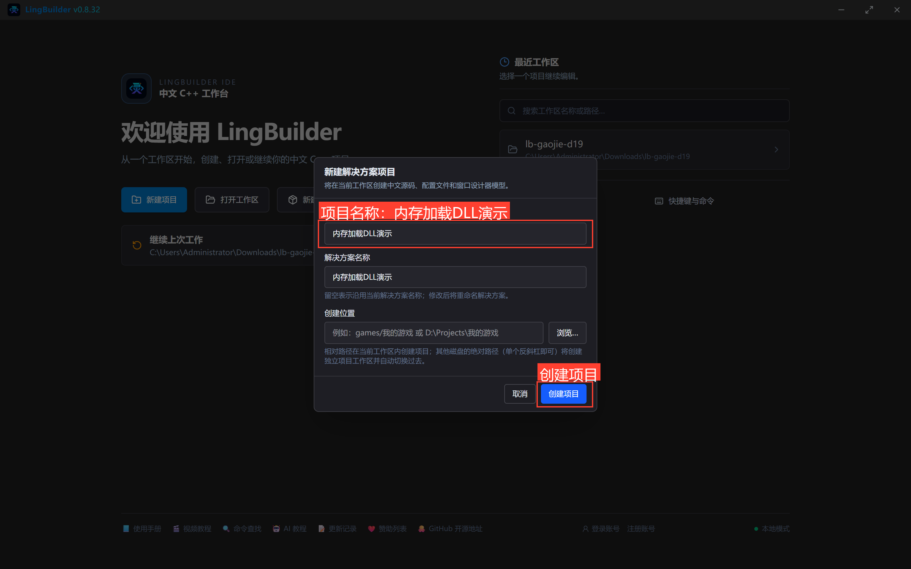
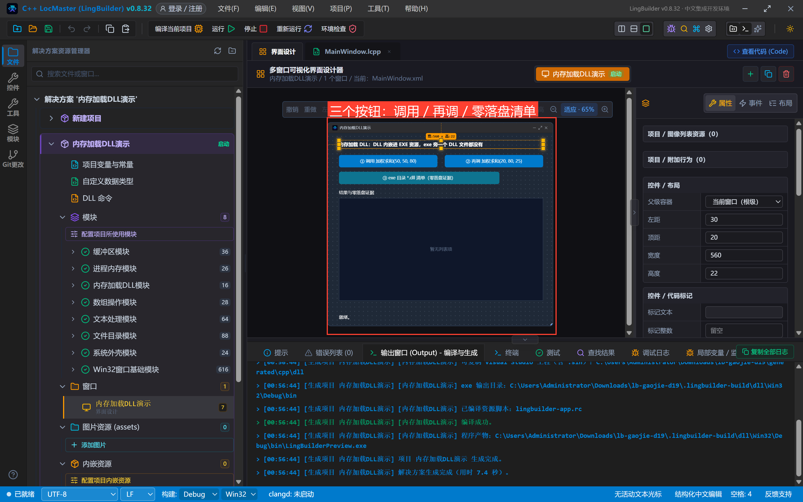
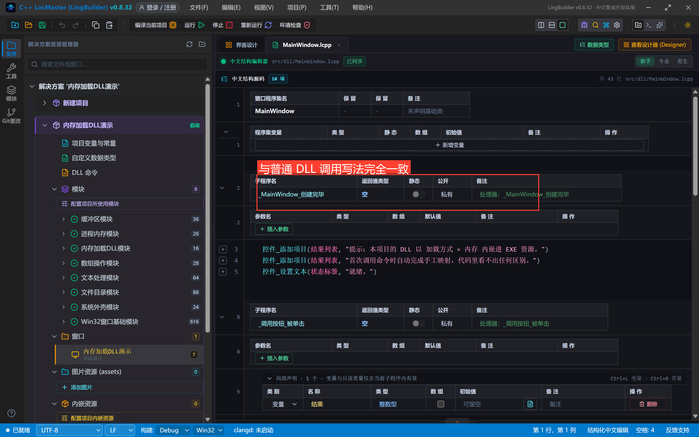
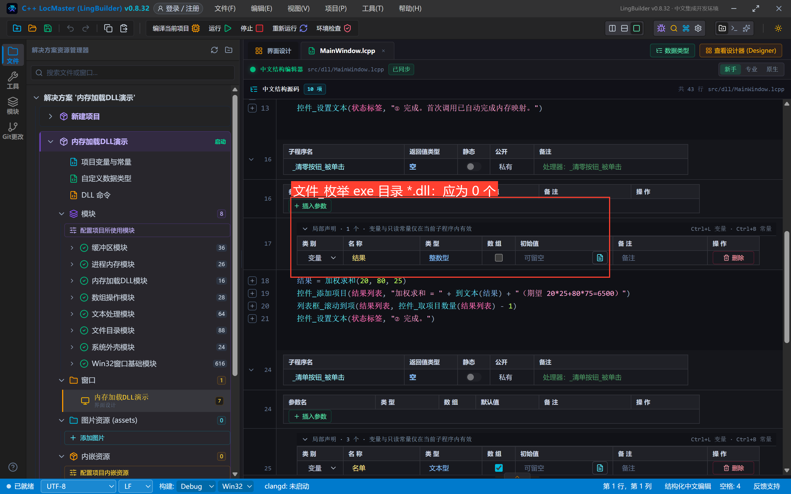
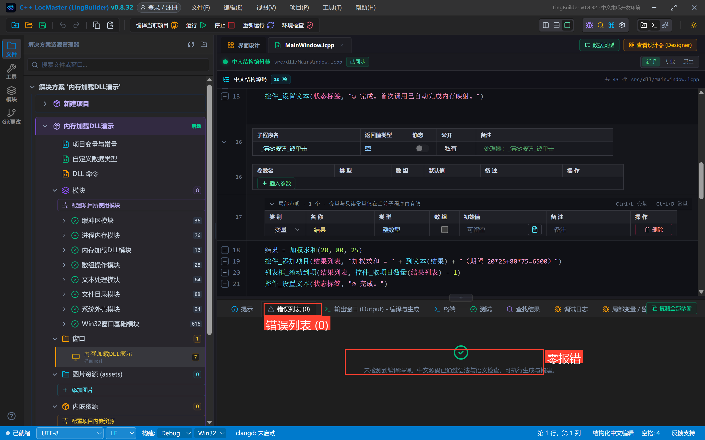
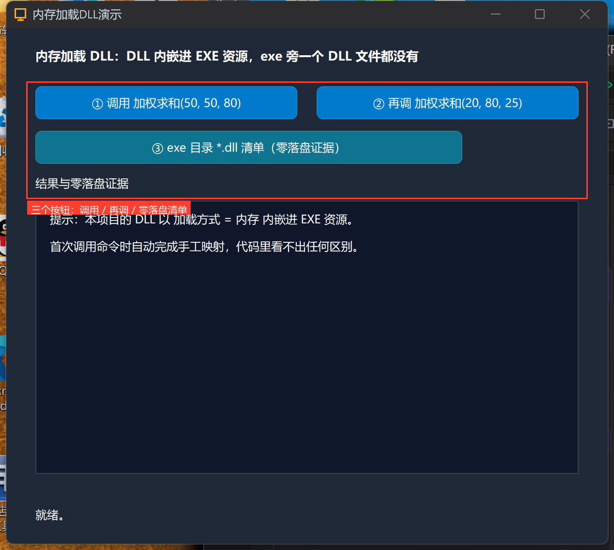
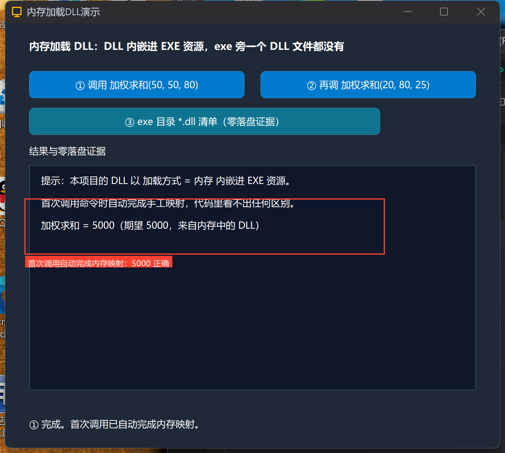
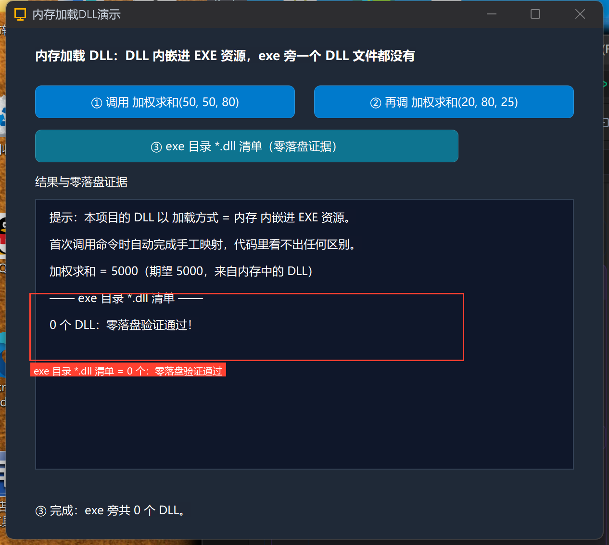

# 高阶实战 19 · 内存加载 DLL：零落盘的内嵌插件

> 《LingBuilder 高阶实战系列》第 19 集，**DLL 专题**收官。前两集的 DLL 都要在 exe 旁边放一个 .dll 文件；这一集加一行 **`加载方式 = 内存`**——DLL 被内嵌进 EXE 的资源段，首次调用时运行时自动完成**手工映射**，exe 旁边一个 DLL 文件都没有（零落盘）。本集用第 18 集同款函数真机验证：调用结果正确 + `文件_枚举` 证明 exe 目录 **0 个 DLL**。全程约 35 分钟。
>
> 前置要求：学过[第 16~18 集](/guide/tutorials/gaojie-16-system-dll)。本集素材：`MyDll源码/`（静态 CRT 的 cdecl 测试 DLL，随源码包附带）。

## 这一集你将学会

- 项目DLL命令声明里的一行 **`加载方式 = 内存`**：DLL 以 RCDATA 资源内嵌进 EXE
- **调用写法与普通 DLL 完全一致**——首次调用命令时自动完成手工映射，代码零改动
- **零落盘验证**：`文件_枚举(系统_取运行目录(), "*.dll", …)` 证明 exe 旁 0 个 DLL
- ⚠️ **/MD DLL 不能内存加载**（真机崩溃实证）：内存加载要求被加载 DLL 与主程序**同 CRT 且已初始化就绪**——LingBuilder 生成的 DLL 项目默认 /MD，做内存插件请用 **/MT 静态 CRT** 的 DLL（本集 MyDll 即 /MT + cdecl）

## 1. 三十秒理解：内存加载改了什么

```text
普通 DLL（16~18 集）                 内存加载 DLL（本集）
  exe + 我的第一个DLL.dll              exe（DLL 已内嵌为资源）
  加载器按导入表自动加载               首次调用命令 → 运行时读资源 →
  （exe 旁必须有 .dll 文件）            手工映射节区 → 处理重定位 → 调用
```

写法上只有一处区别——声明库里的那一行 `加载方式 = 内存`。其余（中文名、别名、参数）与普通声明完全一样；调用代码更是**一字不改**。构建期会做安全检查：未启用「内存加载DLL模块」、DLL 超大（>32MB）、位数不符、识别为加壳 DLL 都会被中文阻断。

## 2. 准备测试 DLL（/MT 静态 CRT）

用第 16 集的 cl 命令行编一个最小 DLL（`MyDll.c` + `MyDll.def`，**关键参数 `/MT`**）：

```c
__declspec(dllexport) int __cdecl WeightedSum(int leftValue, int rightValue, int weight) {
    return leftValue * weight + rightValue * (100 - weight);
}
```

```text
cl /nologo /LD /MT /O2 MyDll.c MyDll.def /Fe:MyDll.dll
```

> ⚠️ **/MD DLL 内存加载会崩溃（本集真机实证）**：`/MD` DLL 依赖加载器为它初始化动态 CRT；手工映射路径没有这个环节，首次调用直接 0xC0000005。LingBuilder 自己的「DLL 项目」模板默认 /MD——所以做内存插件时，请用 **/MT 静态 CRT** 编译的 DLL（第三方 SDK 类 DLL 通常也是 /MT，天然适配）。

## 3. 新建项目与声明

新建窗口项目「**内存加载DLL演示**」（Windows 界面设计），启用模块：**内存加载DLL模块**（`加载方式 = 内存` 的前置要求）+ 文件目录 / 数组 / 文本处理（清单验证用）：



把 `MyDll.dll` 放进项目 `dll/Win32/`，在「项目DLL命令.lcpp」声明——注意第二行 **`加载方式 = 内存`**：

```lcpp
DLL命令库 我的第一个DLL
  加载方式 = 内存
  Win32 = "dll/Win32/我的第一个DLL.dll"
  整数型 加权求和(整数型 左值, 整数型 右值, 整数型 权重) = WeightedSum
结束DLL命令库
```

## 4. 设计界面与代码

| 控件 | 名称 | 显示内容 | 左距 | 顶距 | 宽度 | 高度 |
| --- | --- | --- | --- | --- | --- | --- |
| 标签 | 说明标签 | 内存加载 DLL：DLL 内嵌进 EXE 资源，exe 旁一个 DLL 文件都没有 | 30 | 20 | 560 | 22 |
| 按钮 | 调用按钮 | ① 调用 加权求和(50, 50, 80) | 30 | 60 | 270 | 34 |
| 按钮 | 清零按钮 | ② 再调 加权求和(20, 80, 25) | 320 | 60 | 270 | 34 |
| 按钮 | 清单按钮 | ③ exe 目录 *.dll 清单（零落盘证据） | 30 | 106 | 440 | 34 |
| 标签 | 结果标签 | 结果与零落盘证据 | 30 | 152 | 560 | 22 |
| 列表框 | 结果列表 | — | 30 | 178 | 560 | 282 |
| 标签 | 状态标签 | 就绪。 | 30 | 494 | 560 | 22 |

窗口宽 620、高 560；三个按钮绑「被单击」，窗口绑「创建完毕」。



调用代码与第 18 集一字不差：



```lcpp
事件 _调用按钮_被单击()
    局部 整数型 结果
    结果 = 加权求和(50, 50, 80)
    控件_添加项目(结果列表, "加权求和 = " + 到文本(结果) + "（期望 5000，来自内存中的 DLL）")
    列表框_滚动到项(结果列表, 控件_取项目数量(结果列表) - 1)
    控件_设置文本(状态标签, "① 完成。首次调用已自动完成内存映射。")
结束
```

零落盘证据按钮用 `文件_枚举` 数 exe 目录下的 `*.dll`：



```lcpp
事件 _清单按钮_被单击()
    局部 文本型 名单[]
    局部 整数型 数量
    局部 整数型 索引
    数量 = 文件_枚举(系统_取运行目录(), "*.dll", 假, 名单)
    控件_添加项目(结果列表, "—— exe 目录 *.dll 清单 ——")
    如果 (数量 = 0)
        控件_添加项目(结果列表, "0 个 DLL：零落盘验证通过！")
    否则
        索引 = 0
        判断循环首 (索引 < 数量)
            控件_添加项目(结果列表, 数组_取成员(名单, 索引))
            索引 = 索引 + 1
        判断循环尾
    如果结束
    列表框_滚动到项(结果列表, 控件_取项目数量(结果列表) - 1)
    控件_设置文本(状态标签, "③ 完成：exe 旁共 " + 到文本(数量) + " 个 DLL。")
结束
```

## 5. 编译与运行

编译后先看错误列表（零报错），点运行：





## 6. 真机观察：调用正确 + 零落盘

**① 调用**：结果 5000，与普通加载完全一致——首次调用时运行时自动读资源、手工映射、处理重定位：



**③ 零落盘证据**：`文件_枚举` 数出的 exe 目录 `*.dll` 数量为 **0**：



```text
—— exe 目录 *.dll 清单 ——
0 个 DLL：零落盘验证通过！
```

## 7. 内存加载红线速查

- **/MD DLL 不能内存加载**（0xC0000005 崩溃，本集真机实证）——用 **/MT 静态 CRT** 的 DLL；LingBuilder「DLL 项目」模板默认 /MD，别直接拿它当内存插件；
- 内嵌上限：单 DLL ≤32MB、最多 8 个；位数必须与主程序一致，加壳 DLL（过文件校验）会被构建期中文阻断；
- 「公开」子程序导出/调用写法与普通加载完全一致，`加载方式 = 内存` 只改变载体，不改变声明语法；
- 内存加载的 DLL **没有加载器服务**：依赖系统 DLL（user32 等）仍由 Windows 加载器从系统目录解析（不算落盘），但**依赖其他第三方 DLL** 需一并提供（同样内嵌或静态链接）；
- `GetModuleHandleW` 查不到手工映射的模块——要用「内存加载DLL模块」的 `内存DLL_已加载/取模块大小/卸载` 命令族（按 `内存DLL_加载` 返回的模块地址管理）；
- C++ 异常（throw/catch）在手工映射模块内不派发；需要异常语义的逻辑请放主程序侧。

## 小结与源码包

DLL 专题（16~19）收官：系统 API 调用、第三方结构体对接、自己封装导出、零落盘内存加载——四条路全部真机验证。下一个专题是**模块封装**：把能力封装成可分发的 .lbmod 模块。

- 本集源码包：[内存加载DLL演示.lcpppkg](https://lingbuilder.com/demos)（`MyDll源码/` 附 /MT 测试 DLL 的 C 源码与编译产物）
- 官方示例源码区同款：`19-内存加载DLL演示.lcpppkg`
