# 高阶实战 22 · 功能库与代码组织：`库名.功能()` 把项目代码拆干净

> 《LingBuilder 高阶实战系列》第 22 集，**模块封装专题**第三集。模块（20~21 集）是把代码分享给别人；**功能库**是把**自己项目里**的可复用代码拆出去：一个 `.lcpp` 文件一个库，函数用 `库名.功能名(参数)` 限定调用，还能用子目录分类归拢。这一集做一个「客服话术生成器」：两个功能库、五段话术函数、跨库调用，最后真机跑起来。全程约 30 分钟。
>
> 前置要求：会用 LingBuilder 建窗口项目（零基础系列水平即可），不需要模块知识。

## 这一集你将学会

- 在解决方案树「功能代码」区**新建功能代码 / 新建文件夹**
- 功能库语法：`功能库 库名 … 公开: … 结束功能库`，函数声明带返回类型和参数
- **限定调用**：`话术库.生成问候(姓名)`、`格式库.装饰(标题, 内容)`
- **跨库调用**：话术库的函数内部调用格式库的工具函数
- **分类子目录**：`功能库/工具/格式库.lcpp` 归拢工具函数，调用方式完全不变
- 项目里怎么消费：窗口事件里直接 `库名.功能()`，与调用模块命令的写法一致

## 1. 功能库 vs 模块，一张表分清

| | 功能库（本集） | 模块（20~21 集） |
| --- | --- | --- |
| 归属 | 只属于当前项目 | 可安装到任何工作区任何项目 |
| 载体 | 项目里的普通 `.lcpp` 文件 | `.lingbuilder/module-build/<id>/`（可打包 .lbmod） |
| 语言 | 纯中文 `.lcpp`，无清单 | 清单 + C++ 桥接 |
| 调用 | `库名.功能名(参数)` | 直接调中文命令名 |
| 适合 | 自己项目的复用 | 发给别人用 |

## 2. 建项目，找到「功能代码」区

新建窗口项目「话术生成器」（Windows 界面设计）：

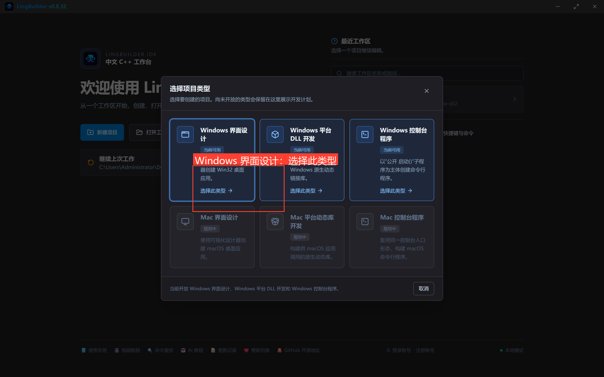

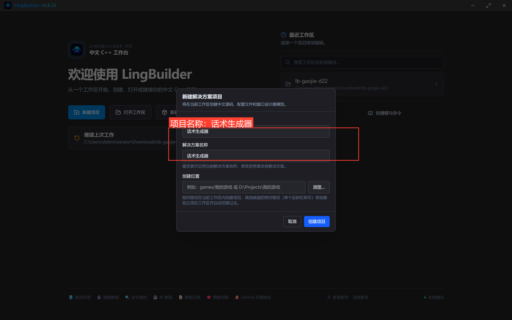

在解决方案树展开项目节点，找到**「功能代码」**分组，**右键**它——菜单里有**「新建功能代码…」「新建文件夹…」「粘贴功能库…」**三项：

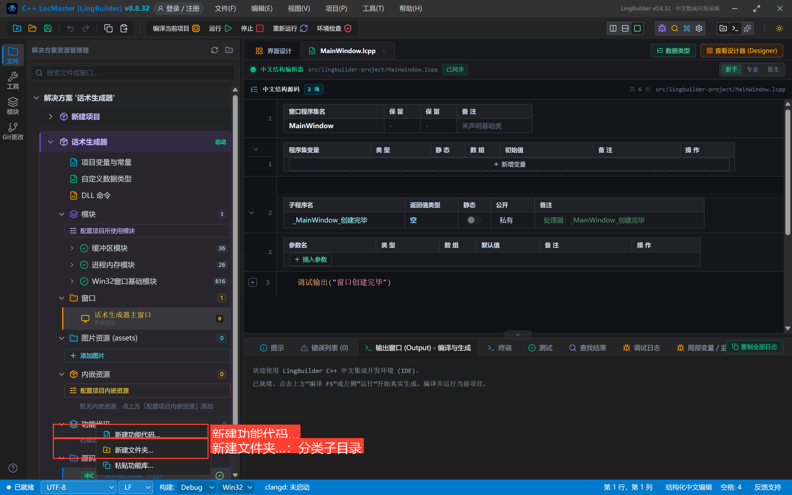

本集我们直接用磁盘文件的方式准备两个库（效果与菜单新建完全一致——IDE 直接消费磁盘上的项目源码）：

```text
src/话术生成器（项目源码根）/
├── MainWindow.lcpp
└── 功能库/
    ├── 话术库.lcpp          ← 业务话术（根目录）
    └── 工具/
        └── 格式库.lcpp      ← 通用小工具（分类子目录）
```

## 3. 写两个功能库

### 3.1 话术库（`功能库/话术库.lcpp`）

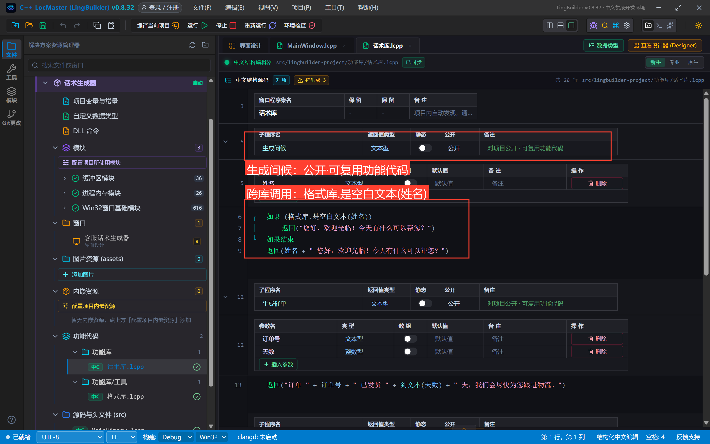

```lcpp
// 话术库：客服三类话术（问候 / 催单 / 致谢）。
功能库 话术库
公开:
  文本型 生成问候(文本型 姓名)
      如果 (格式库.是空白文本(姓名))
          返回("您好，欢迎光临！今天有什么可以帮您？")
      如果结束
      返回(姓名 + " 您好，欢迎光临！今天有什么可以帮您？")
  结束

  文本型 生成催单(文本型 订单号, 整数型 天数)
      返回("订单 " + 订单号 + " 已发货 " + 到文本(天数) + " 天，我们会尽快为您跟进物流。")
  结束

  文本型 生成致谢(文本型 订单号)
      返回(格式库.装饰("已签收", "订单 " + 订单号 + " 已完成，感谢您的信任，期待再次光临！"))
  结束
结束功能库
```

四个要点：

- 文件开头 `功能库 话术库`、文件末尾 `结束功能库`，**库名 = 文件名**（保持一致最好记）；
- `公开:` 段下面的函数对项目公开；不带公开段的功能只供库内部使用；
- 函数声明一行写完：`返回类型 函数名(类型 参数, 类型 参数)`，函数体以 `结束` 收尾；
- **跨库调用**：`格式库.是空白文本(姓名)`、`格式库.装饰(...)` ——直接写对方库名。

### 3.2 格式库（`功能库/工具/格式库.lcpp`，子目录）

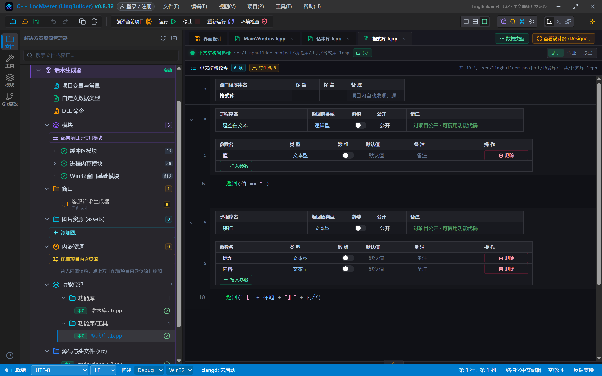

```lcpp
// 格式库：通用小工具（空白判断、统一装饰框）。
// 放在 功能库/工具/ 子目录里做分类归拢，调用方式与根目录功能库完全一致。
功能库 格式库
公开:
  逻辑型 是空白文本(文本型 值)
      返回(值 == "")
  结束

  文本型 装饰(文本型 标题, 文本型 内容)
      返回("【" + 标题 + "】" + 内容)
  结束
结束功能库
```

**子目录归拢**后，解决方案树里按文件夹分组显示，调用端一个字都不用改：

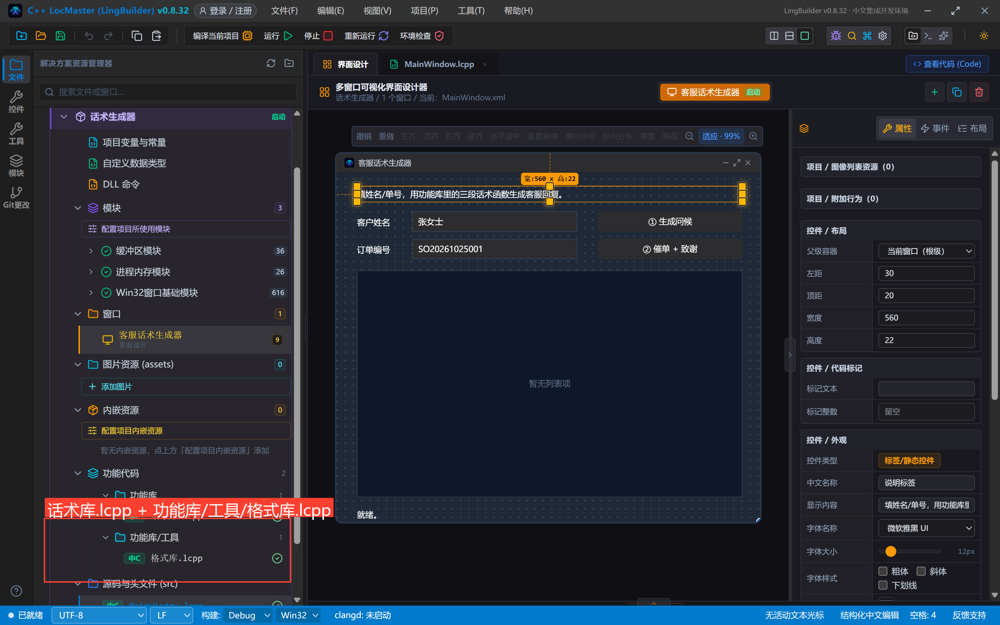

## 4. 窗口里消费：`库名.功能()`

窗口画 8 个控件：说明标签、客户姓名标签+输入框（默认 `张女士`）、订单编号标签+输入框（默认 `SO20261025001`）、两个按钮、结果列表、状态标签：

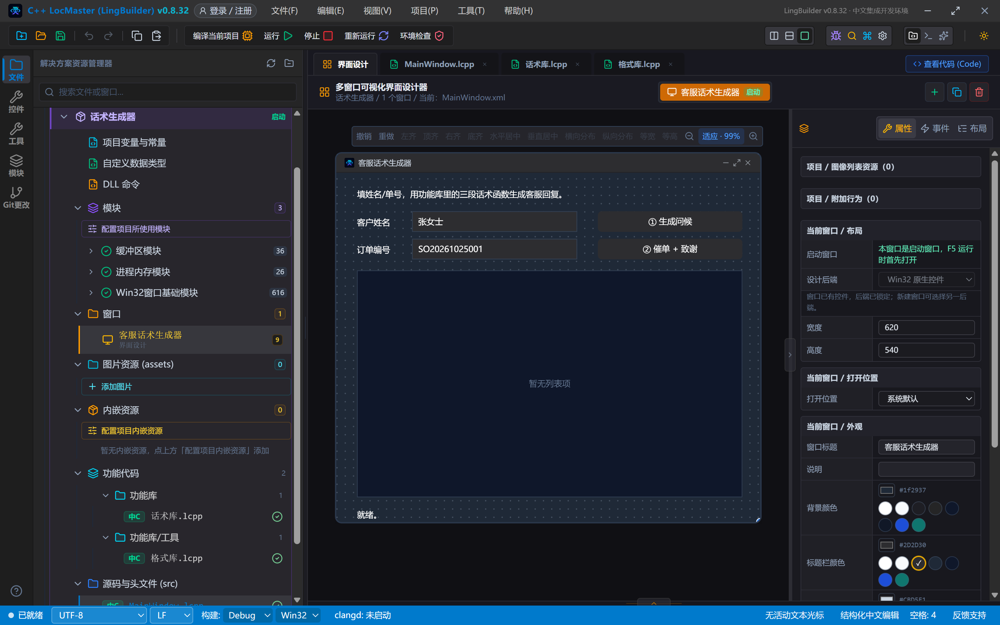

MainWindow.lcpp 里三个事件块，全部通过 `库名.功能()` 调用：

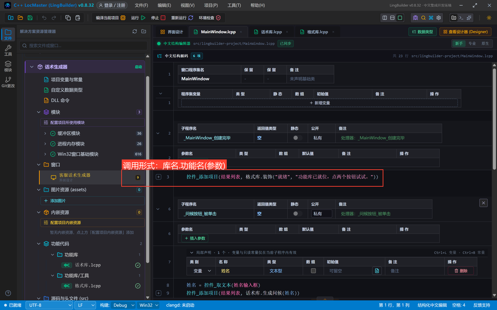

```lcpp
类 MainWindow
    事件 _MainWindow_创建完毕()
        控件_添加项目(结果列表, 格式库.装饰("就绪", "功能库已就位，点两个按钮试试。"))
    结束

    事件 _问候按钮_被单击()
        局部 文本型 姓名
        姓名 = 控件_取文本(姓名输入框)
        控件_添加项目(结果列表, 话术库.生成问候(姓名))
        列表框_滚动到项(结果列表, 控件_取项目数量(结果列表) - 1)
        控件_设置文本(状态标签, "问候已生成。")
    结束

    事件 _催单按钮_被单击()
        局部 文本型 单号
        单号 = 控件_取文本(单号输入框)
        控件_添加项目(结果列表, 话术库.生成催单(单号, 3))
        控件_添加项目(结果列表, 话术库.生成致谢(单号))
        列表框_滚动到项(结果列表, 控件_取项目数量(结果列表) - 1)
        控件_设置文本(状态标签, "催单与致谢已生成。")
    结束
结束类
```

## 5. 编译运行：真机验证

编译后错误列表零报错（功能库由项目**自动发现**，无需登记）：

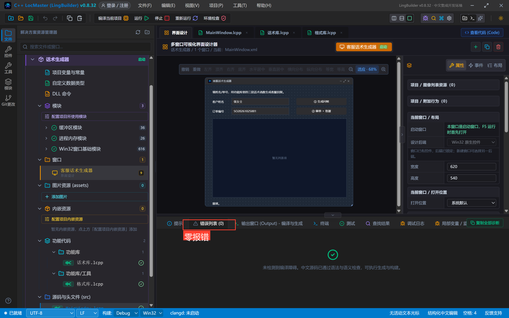

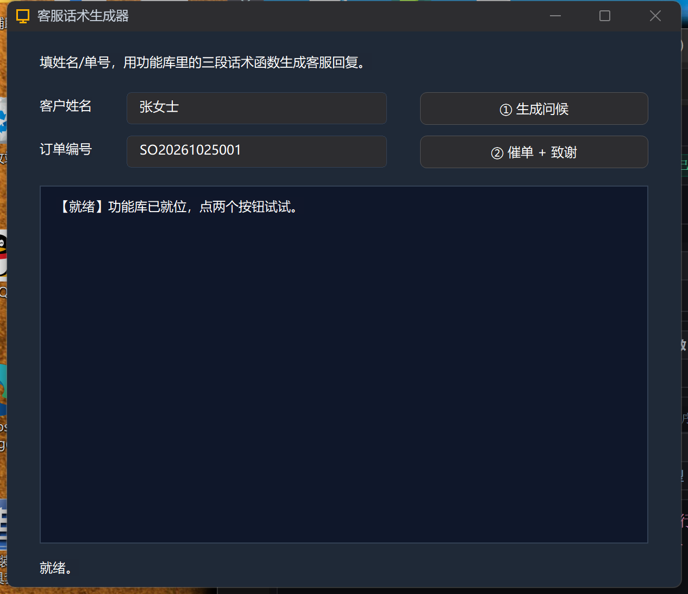

点「① 生成问候」：`张女士 您好，欢迎光临！今天有什么可以帮您？`——姓名从输入框读入、传入功能库函数、拼好返回：

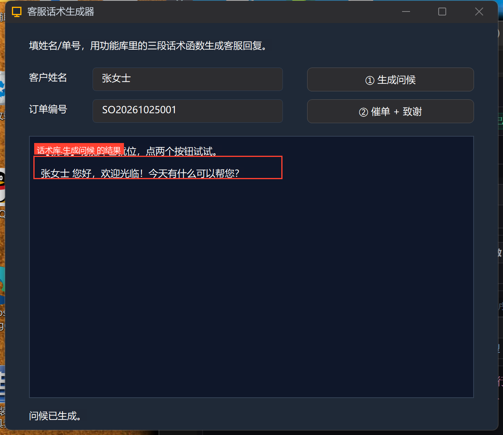

点「② 催单 + 致谢」：催单话术带单号和天数；致谢话术**外面套了一层【已签收】装饰框——那是话术库内部调用格式库.装饰() 的结果**，跨库调用真机闭环：

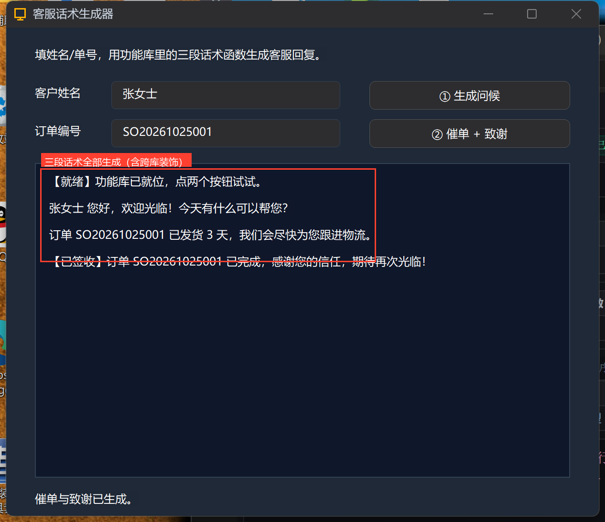

## 6. 什么时候拆功能库？

- 同一段逻辑要**在两个以上事件里用**（校验、格式化、拼报文）；
- 一个 `MainWindow.lcpp` **超过百行**、事件块之间开始复制粘贴；
- 想按业务**分文件**（话术归话术、工具归工具）——就用子目录归拢。

反过来说：只在一个地方用、就几行——不必拆，直接写在事件里最直观。

## 常见坑

- **库名与文件名不一致**：能跑，但树里对不上号，建议保持一致；
- **跨文件调私有功能**：不带 `公开:` 的功能只允许库内部调用，跨库调用会在诊断里被阻断；
- **功能库文件里写 `类` 声明**：功能库是 `功能库 … 结束功能库` 结构，不要把窗口类的代码粘进来；
- **忘了 `结束功能库`**：解析器会明确报「功能库声明缺少结束语句」，按提示补上即可。

## 下一集预告

23 集讲**模块的 C++ 运行时与第三方库**：pragma 链接、runtimeFiles 随包、双架构 Win32+x64 红线。

## 源码包

本集完整项目已打包：[话术生成器.lcpppkg](https://lingbuilder.com/demos)——在 LingBuilder 里「文件 → 打开 LCPP 源码包」一键导入（功能库文件会一起导入）。
