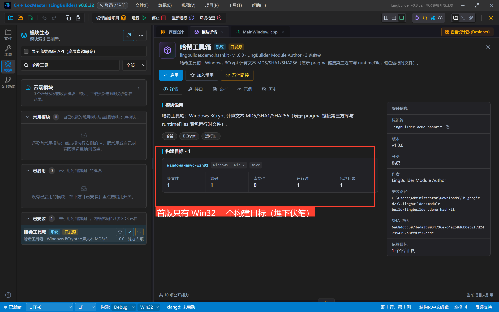
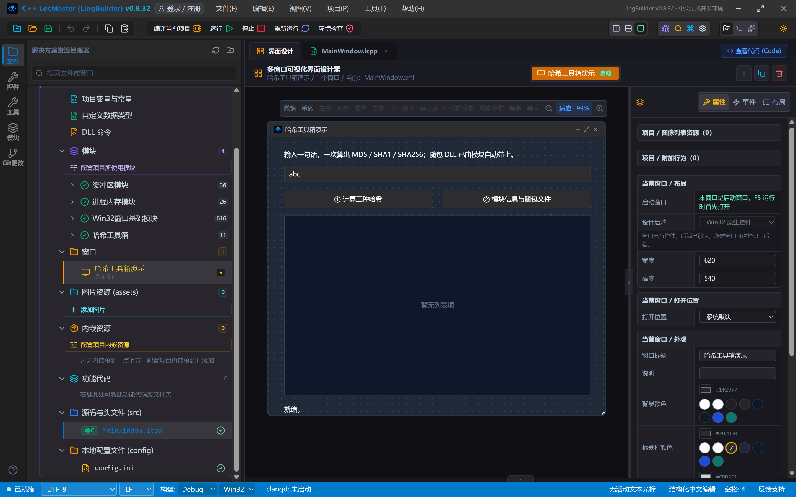
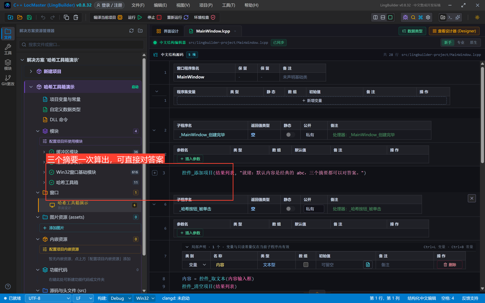
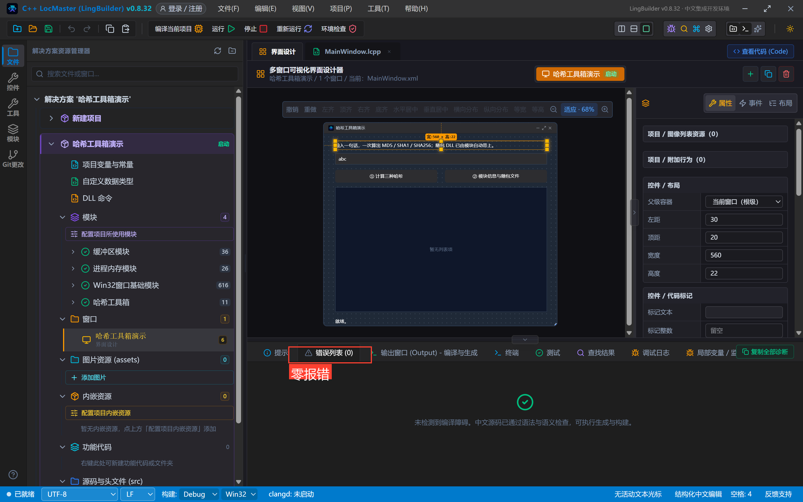
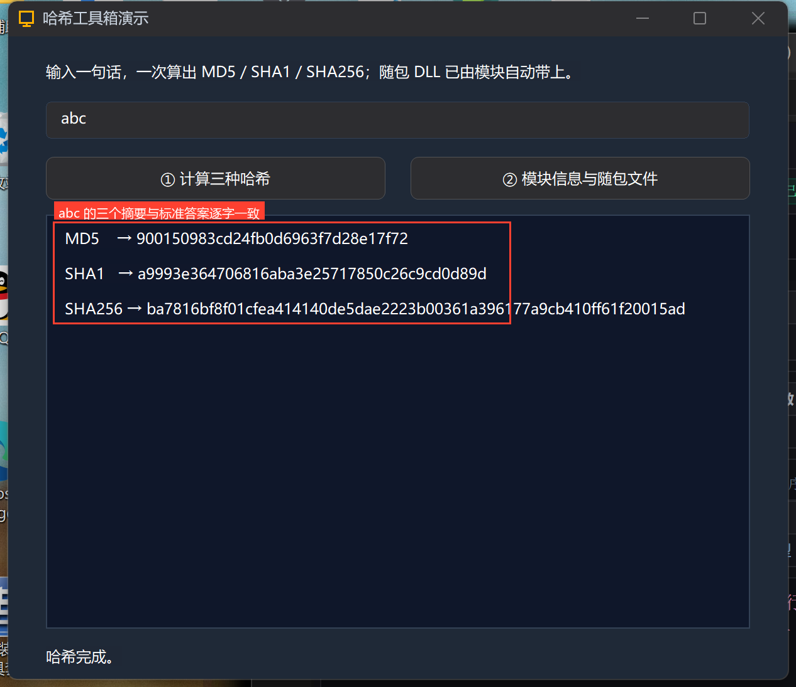
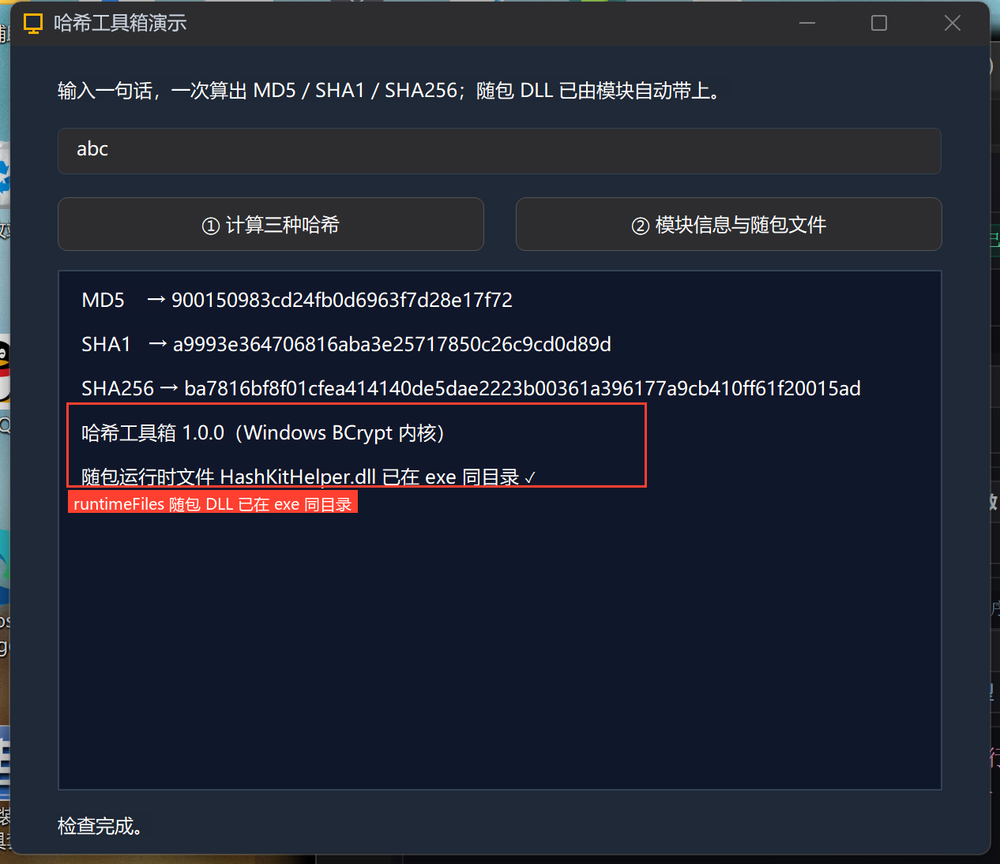
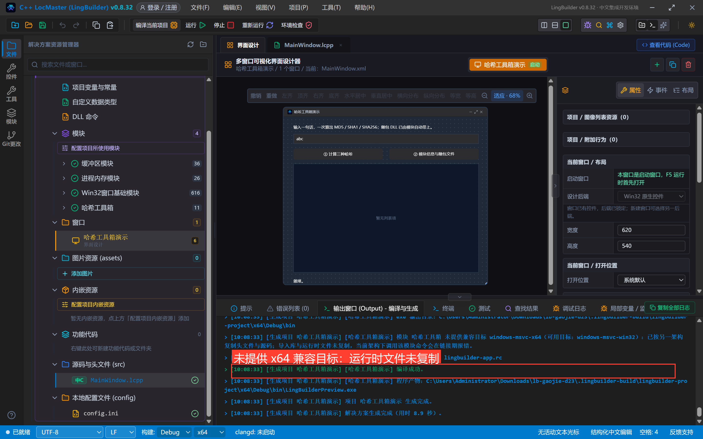
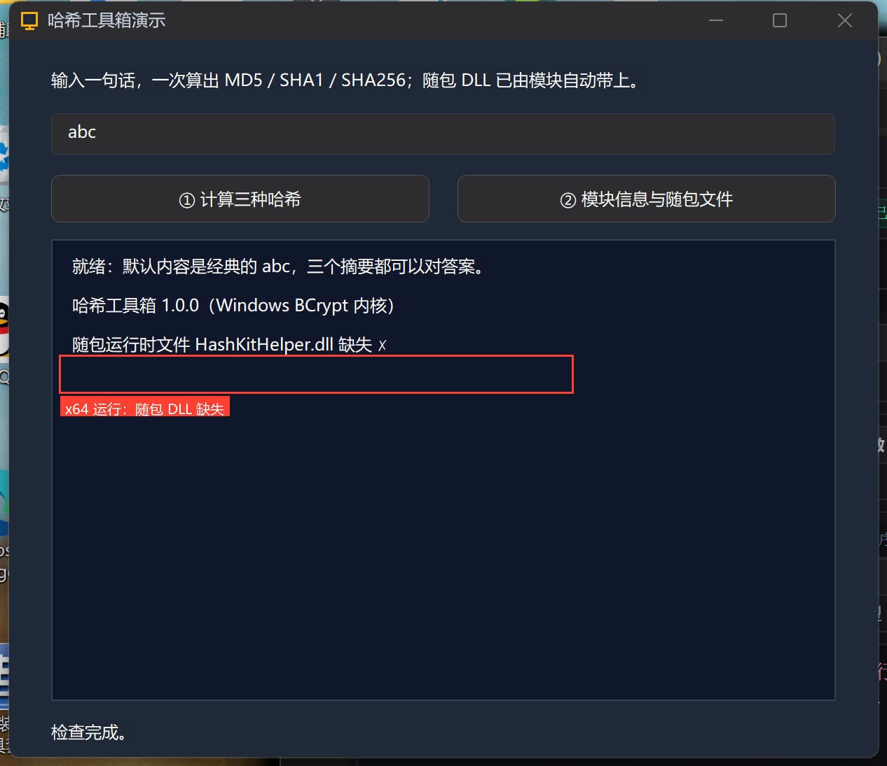
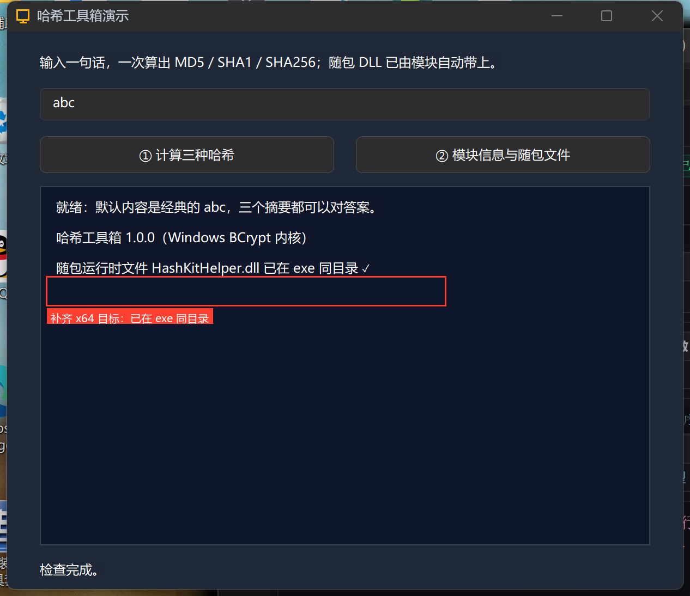

# 高阶实战 23 · 模块的 C++ 运行时：pragma 链接、随包文件与双架构红线

> 《LingBuilder 高阶实战系列》第 23 集，**模块封装专题**第四集。前两集的模块都是「纯 C++ 源码」；这一集补齐运行时的三件事：① **`#pragma comment(lib, ...)` 链接第三方库**（我们用 Windows 自带的 BCrypt 做真哈希）；② **`runtimeFiles` 随包文件**——模块自带的 DLL 由构建链自动复制到 exe 同目录；③ **双架构红线**——只给 Win32 目标的模块切到 x64 构建会发生什么（本集真机踩给你看）。全程约 40 分钟。
>
> 前置要求：学过[第 20 集](/guide/tutorials/gaojie-20-module-overview)（会建模块、改清单）。

## 这一集你将学会

- 在模块 C++ 里 `#pragma comment(lib, "bcrypt.lib")` 链接 Windows 系统库
- 用 BCrypt 算出与网页工具**逐字一致**的 MD5/SHA1/SHA256（UTF-8 口径）
- `targets[].runtimeFiles`：随包 DLL 按架构（`x86/`、`x64/` 目录）自动物化到 exe 旁
- 单架构模块在另一架构构建时的**真实表现**：构建告警 + 运行期随包文件缺失，以及怎么补齐

## 1. 本集模块：哈希工具箱

新建模块 `lingbuilder.demo.hashkit`（名称「哈希工具箱」，分类「系统」），命令面三条：

| 命令 | 签名 | 返回 | 看点 |
| --- | --- | --- | --- |
| `哈希_计算` | (算法, 内容) | 文本型 | BCrypt 真哈希，算法 MD5/SHA1/SHA256 |
| `哈希_取版本` | () | 文本型 | 版本说明 |
| `哈希_随包文件就位` | () | 逻辑型 | 检查随包 DLL 是否已被复制到 exe 同目录 |

新建与启用的流程和第 20 集完全一致（欢迎页「新建模块」→ 模块页搜索「哈希工具」→ 详情 → 启用），不再重复截图。注意下面这张**模块详情**：首版清单我们**故意只登记了 Win32 一个构建目标**——为第 5 节的红线实验埋下伏笔：



## 2. pragma 链接第三方库：BCrypt 真哈希

`src/module_bridge.cpp` 的核心三段（完整源码见源码包）：

**① 链接**——一行 pragma 把 BCrypt 的实现库挂进链接器（bcrypt.lib 随 Windows SDK 分发，x86/x64 都有，无需下载任何第三方文件）：

```cpp
#include <windows.h>
#include <bcrypt.h>

// pragma 链接第三方（系统）库：BCrypt 的实现位于 bcrypt.lib。
#pragma comment(lib, "bcrypt.lib")
```

**② 编码口径**——BCrypt 吃字节序列；文本命令传进来的是宽字符，先转 UTF-8 再算，哈希结果才和常见网页工具一致：

```cpp
static std::string HashKit_ToUtf8(const std::wstring& text) {
    if (text.empty()) return std::string();
    int size = WideCharToMultiByte(CP_UTF8, 0, text.c_str(), (int)text.size(), nullptr, 0, nullptr, nullptr);
    if (size <= 0) return std::string();
    std::string out(size, (char)0);
    WideCharToMultiByte(CP_UTF8, 0, text.c_str(), (int)text.size(), &out[0], size, nullptr, nullptr);
    return out;
}
```

**③ 计算**——标准 BCrypt 四步：打开算法 → 建哈希对象 → 喂数据 → 取摘要；摘要长度用 `BCryptGetProperty` 向算法查询（MD5=16、SHA1=20、SHA256=32 字节），最后转小写十六进制返回。

## 3. runtimeFiles：模块自带文件怎么到 exe 旁边

清单 `targets` 上除了头文件和源码，还有 **`runtimeFiles`**——按架构登记的随包运行时文件：

```json
"targets": [
  { "id": "windows-msvc-win32", "platform": "windows", "arch": "win32", "toolchain": "msvc",
    "includeDirs": ["include"], "headers": ["include/module_bridge.h"], "sources": ["src/module_bridge.cpp"],
    "runtimeFiles": ["x86/HashKitHelper.dll"] },
  { "id": "windows-msvc-x64", "platform": "windows", "arch": "x64", "toolchain": "msvc",
    "includeDirs": ["include"], "headers": ["include/module_bridge.h"], "sources": ["src/module_bridge.cpp"],
    "runtimeFiles": ["x64/HashKitHelper.dll"] }
]
```

本集的 `HashKitHelper.dll` 是我们用一个 C 文件现场编的（`cl /LD /MT`，x86/x64 各一份），只导出一个版本号——它的意义是**证明物化链路**。F5 构建时输出面板会明确记录：

```text
已复制模块运行时文件：HashKitHelper.dll
```

模块命令用 `GetModuleFileNameW` 定位 exe 目录再检查文件是否在——这就是「哈希_随包文件就位」的实现。

## 4. 调用方项目与真机结果

建窗口项目「哈希工具箱演示」，启用模块，画 6 个控件（输入框默认内容就是经典的 `abc`，方便对答案）：



调用代码：



```lcpp
    事件 _哈希按钮_被单击()
        局部 文本型 内容
        内容 = 控件_取文本(内容输入框)
        控件_清空项目(结果列表)
        控件_添加项目(结果列表, "MD5    → " + 哈希_计算("MD5", 内容))
        控件_添加项目(结果列表, "SHA1   → " + 哈希_计算("SHA1", 内容))
        控件_添加项目(结果列表, "SHA256 → " + 哈希_计算("SHA256", 内容))
        列表框_滚动到项(结果列表, 控件_取项目数量(结果列表) - 1)
        控件_设置文本(状态标签, "哈希完成。")
    结束
```

编译后错误列表零报错：



点「① 计算三种哈希」——三个摘要与标准答案**逐字一致**（可拿任意在线工具对答案）：



```text
MD5("abc")    = 900150983cd24fb0d6963f7d28e17f72
SHA1("abc")   = a9993e364706816aba3e25717850c26c9cd0d89d
SHA256("abc") = ba7816bf8f01cfea414140de5dae2223b00361a396177a9cb410ff61f20015ad
```

点「② 模块信息与随包文件」：版本文本 + 「随包运行时文件 HashKitHelper.dll 已在 exe 同目录 ✓」——runtimeFiles 物化链路真机验证：



## 5. 双架构红线：单架构模块切 x64 会怎样

到上面为止，模块清单只有 Win32 一个目标（第 1 节那张详情图）。现在把 IDE 底部状态栏的架构从 **Win32 切成 x64** 再编译——构建**不会失败**，但输出面板多了一行**黄色告警**：



```text
模块 哈希工具箱 未提供兼容目标 windows-msvc-x64（可用目标：windows-msvc-win32）：
已按另一架构复制头文件与源码；导入库与运行时文件未复制，
当前架构下调用该模块命令会在链接期报错。
```

读一遍这句话，三件事：源码能编（跨架构兜底复制）、**运行时文件不会复制**、带 .lib 的模块会直接链接报错。我们运行 x64 的 exe 点「②」验证第一件：



```text
随包运行时文件 HashKitHelper.dll 缺失 ✗
```

**修复**：给清单补上 x64 目标（第 3 节清单里的第二个 target），重新编译——告警消失，`HashKitHelper.dll` 出现在 `x64\Debug\bin`，再运行就是「已在 exe 同目录 ✓」：



> **红线备忘**：发布模块请始终双 target（Win32 + x64）。纯源码模块少一个架构是「静默降级 + 告警」，带 .lib/带 DLL 的模块少一个架构就是**在另一种架构下直接不可用**。写清单时字段名也要小心：`includeDirs / headers / sources / libs / runtimeFiles` 都是复数，拼错（如 `include`、`lib`）会被校验点名——拼错的字段会被构建静默忽略，典型症状就是 C1083 找不到头文件。

## 常见坑

- **pragma 放错文件**：`#pragma comment(lib, ...)` 要放在**使用它的源文件**顶部（模块的 module_bridge.cpp 里），不是头文件随意一处；
- **哈希对不上**：99% 是编码口径——先转 UTF-8 再算，别直接把宽字符按字节算；
- **runtimeFiles 路径按架构分目录**：`x86/文件` 登记在 win32 目标、`x64/文件` 登记在 x64 目标，别把两个架构的 DLL 登记到同一目标；
- **C 字符串里的反斜杠**：`L"\\HashKitHelper.dll"` 两个反斜杠才是一个真实反斜杠，写错会编译报「字符串字面量中的换行符」。

## 下一集预告

24 集讲**模块文档与例程**：随包文档门禁与生成器、模块信息弹窗分组、contributes.examples 例程「在新 IDE 窗口打开」。

## 源码包

本集完整项目（模块源码含 BCrypt 实现 + 调用方源码）已打包：[哈希工具箱演示.lcpppkg](https://lingbuilder.com/demos)——在 LingBuilder 里「文件 → 打开 LCPP 源码包」一键导入运行。
