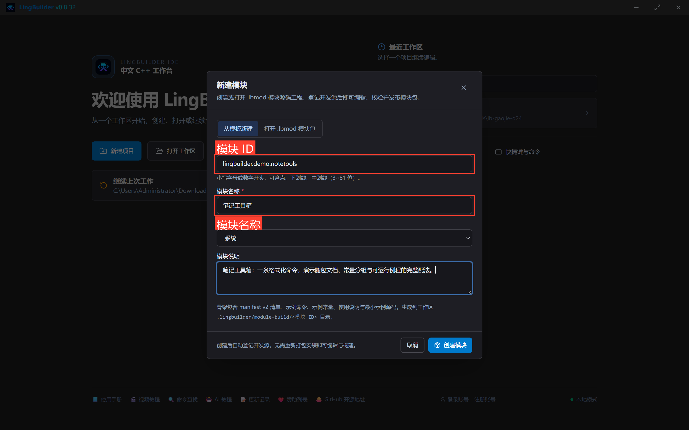
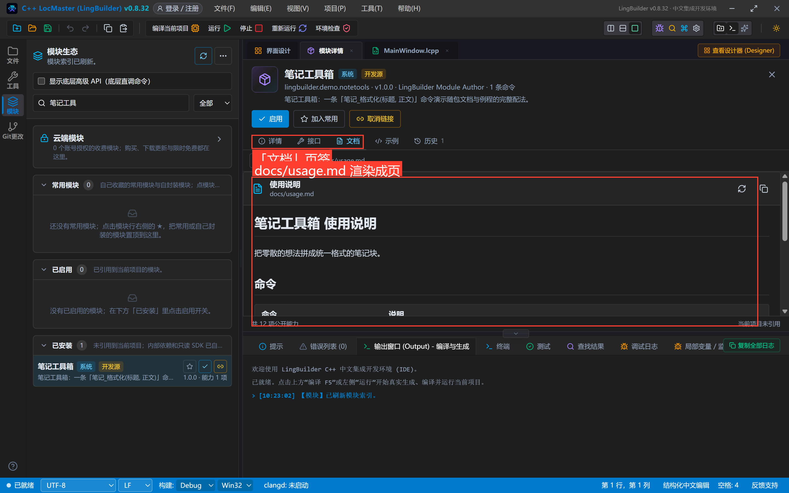
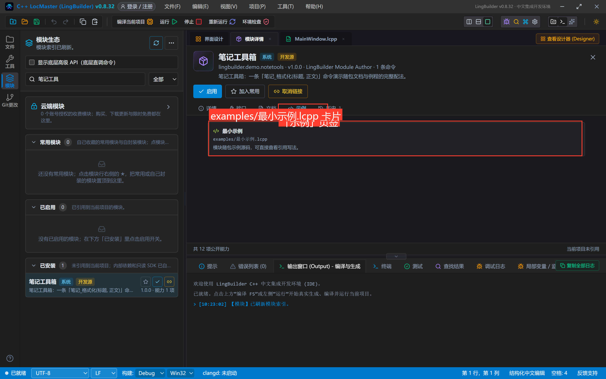
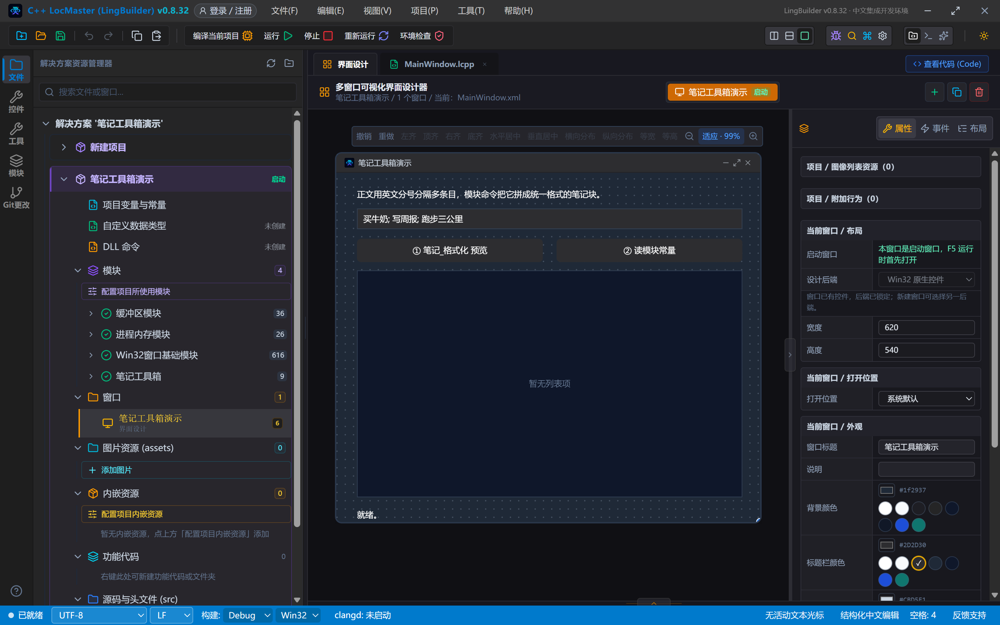
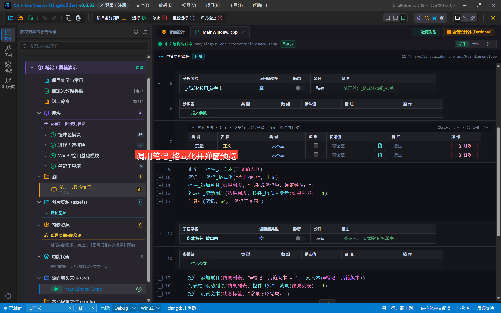
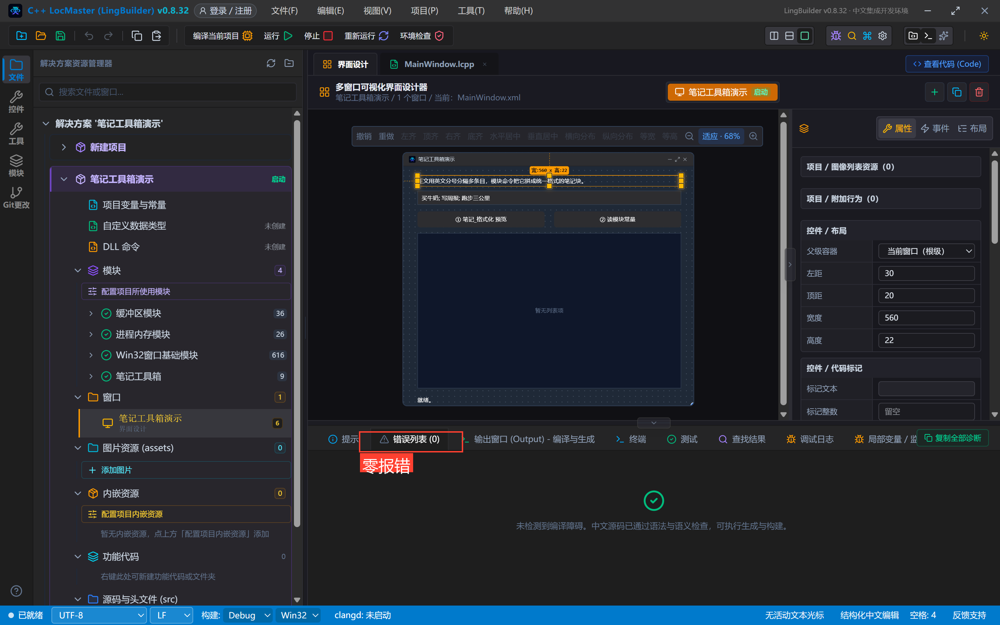
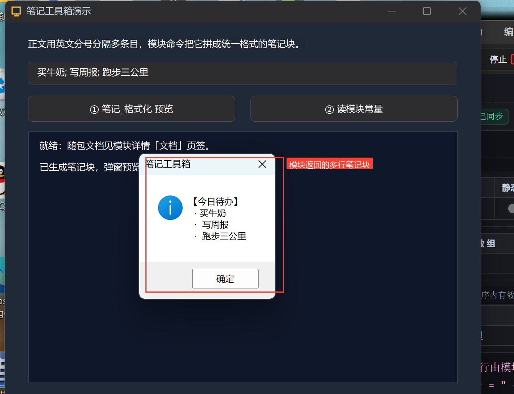
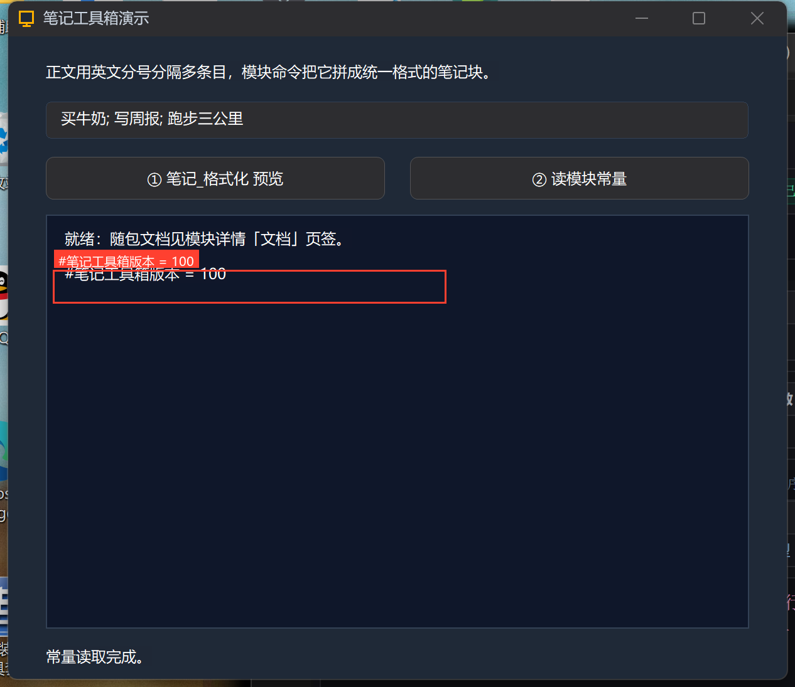

# 高阶实战 24 · 模块文档与例程：让模块「自带说明书」

> 《LingBuilder 高阶实战系列》第 24 集，**模块封装专题**第五集。一个模块光能跑还不行——装它的人要**看懂怎么用**。这一集把模块的「说明书系统」配齐：随包文档（`contributes.docs`，模块详情里直接渲染成页）、**常量分组**、**示例**（`contributes.examples`，例程源码随包走），最后真机跑通例程同款调用。全程约 30 分钟。
>
> 前置要求：学过[第 20 集](/guide/tutorials/gaojie-20-module-overview)（会建模块）。

## 这一集你将学会

- 清单里 `contributes.docs` / `contributes.examples` 的标准写法
- 模块详情页的「文档」「示例」页签长什么样、内容从哪来
- 常量在模块详情/接口里的分组展示（`#常量名` 在源码中直接引用）
- 随包文档的**内容怎么写才算合格**（命令表 + 常量 + 示例指引）
- 真机验证：调用模块命令弹出多行笔记块、读取模块常量

## 1. 本集模块：笔记工具箱

新建模块 `lingbuilder.demo.notetools`（名称「笔记工具箱」，分类「系统」）——一条命令、一个常量、一篇文档、一个例程，麻雀虽小五脏俱全：

| 配置项 | 值 |
| --- | --- |
| 命令 | `笔记_格式化(标题, 正文)` → 文本型：正文用英文分号分隔多条目，返回「【标题】+ 每行一个 `· 条目`」的多行文本 |
| 常量 | `笔记工具箱版本` = 100（源码中写 `#笔记工具箱版本`） |
| 文档 | `docs/usage.md`（随包使用说明） |
| 例程 | `examples/最小示例.lcpp`（控制台程序，可直接看用法） |

新建模块的流程与第 20 集完全一致（欢迎页「新建模块」→ 填 ID/名称/说明 → 创建）：



## 2. 清单怎么配：docs 与 examples

清单 `contributes` 里加两个数组，路径都是**模块目录内的相对路径**：

```json
"contributes": {
  "commands": [ { "name": "笔记_格式化", "...": "..." } ],
  "constants": [
    { "name": "笔记工具箱版本", "type": "整数型", "value": 100,
      "description": "模块版本常量（1.00）；源码中用 #笔记工具箱版本 引用。" }
  ],
  "docs": [
    { "title": "使用说明", "path": "docs/usage.md" }
  ],
  "examples": [
    { "title": "最小示例", "path": "examples/最小示例.lcpp" }
  ]
}
```

C++ 实现就一个函数——分号分段、逐条拼「· 条目」：

```cpp
std::wstring NoteKit_Format(const std::wstring& title, const std::wstring& body) {
    std::wstring out = L"【" + title + L"】";
    size_t start = 0;
    while (start <= body.size()) {
        size_t end = body.find(L';', start);
        if (end == std::wstring::npos) end = body.size();
        if (end > start) {
            out += (wchar_t)10;
            out += L"  · " + body.substr(start, end - start);
        }
        if (end == body.size()) break;
        start = end + 1;
    }
    return out;
}
```

## 3. 随包文档怎么写才算合格

`docs/usage.md` 用 Markdown 写，模块详情的「文档」页签会**直接渲染成页**。合格的随包文档至少包含三块：

```markdown
# 笔记工具箱 使用说明

把零散的想法拼成统一格式的笔记块。

## 命令
| 命令 | 说明 |
| --- | --- |
| `笔记_格式化(标题, 正文)` | 正文用英文分号 `;` 分隔多条目，…… |

## 常量
- `#笔记工具箱版本`（整数型，100 = 1.00）。

## 示例
见「示例」页签的《最小示例》：……
```

**写作口径**：每条命令说清「参数含义 + 返回什么 + 一个调用例子」；常量给出取值含义；最后指到例程。模块详情「文档」页签的真机渲染效果：



「示例」页签则列出 `contributes.examples` 登记的例程卡片（标题 + 路径 + 说明），点击可查看源码用法：



> 补充：**内置模块**的随包文档由 IDE 的文档生成器从命令签名确定性产出（`npm run module:builtin-docs`，带 `--check` 门禁防漂移）；自己封装的模块（.lbmod）文档由你手写在 `docs/` 里，两条路线都汇到同一个「文档」页签展示。随包例程在**打包版 IDE** 的模块详情里还有「在新 IDE 窗口打开」按钮（复制例程到独立工作区直接跑）；开发源模块在开发阶段看源码用法即可。

## 4. 建一个演示项目真机验证

建窗口项目「笔记工具箱演示」，启用模块（流程同 20 集），画 6 个控件：说明标签、正文输入框（默认 `买牛奶; 写周报; 跑步三公里`）、两个按钮、结果列表、状态标签：



调用代码（22 行）：



```lcpp
    事件 _格式化按钮_被单击()
        局部 文本型 正文
        局部 文本型 笔记
        正文 = 控件_取文本(正文输入框)
        笔记 = 笔记_格式化("今日待办", 正文)
        控件_添加项目(结果列表, "已生成笔记块，弹窗预览：")
        列表框_滚动到项(结果列表, 控件_取项目数量(结果列表) - 1)
        信息框(笔记, 64, "笔记工具箱")
    结束

    事件 _版本按钮_被单击()
        控件_添加项目(结果列表, "#笔记工具箱版本 = " + 到文本(#笔记工具箱版本))
        列表框_滚动到项(结果列表, 控件_取项目数量(结果列表) - 1)
        控件_设置文本(状态标签, "常量读取完成。")
    结束
```

编译后错误列表零报错：



点「① 笔记_格式化 预览」：信息框弹出**多行笔记块**——标题行 + 三个「· 条目」，正是文档里承诺的格式：



点「② 读模块常量」：`#笔记工具箱版本 = 100`：



## 5. 文档门禁：为什么每个模块至少一篇

LingBuilder 对**内置模块**有硬门禁：每个模块至少登记一篇随包文档，且登记表、生成文档与命令清单逐字同步（`--check` 不一致直接拒绝构建）。对模块作者的意义是一样的——**没有文档的命令，用户不会用**。发布 .lbmod 前，请对着这条清单自查：

- [ ] 每条命令在 `docs/usage.md` 有参数与返回说明；
- [ ] 常量有含义解释；
- [ ] 至少一个 `contributes.examples` 例程，且例程能编译运行；
- [ ] 文档里的示例代码与真实签名一致（复制粘贴能跑）。

## 下一集预告

25 集讲**模块生态与分发**：安装/卸载/启用禁用/修复重装/升级自愈、开发者中心/市场/历史、AI 生成模块与外部 AI 六步链。

## 源码包

本集完整项目（模块源码含文档与例程 + 调用方源码）已打包：[笔记工具箱演示.lcpppkg](https://lingbuilder.com/demos)——在 LingBuilder 里「文件 → 打开 LCPP 源码包」一键导入运行。
