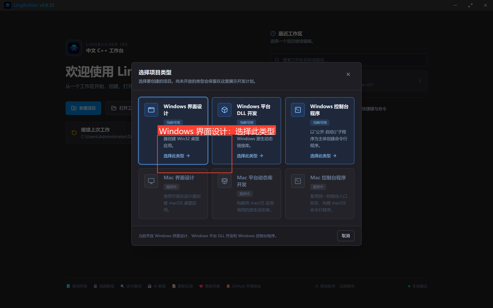
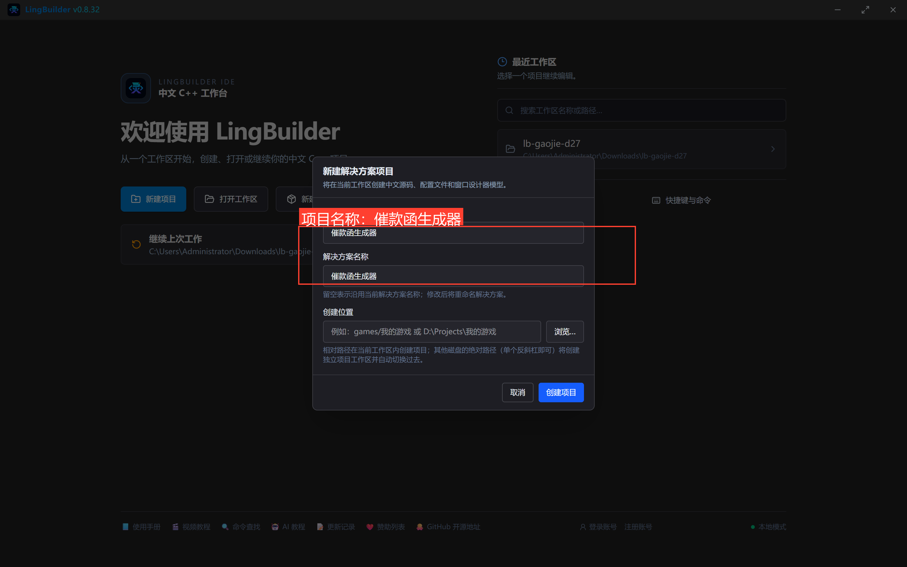
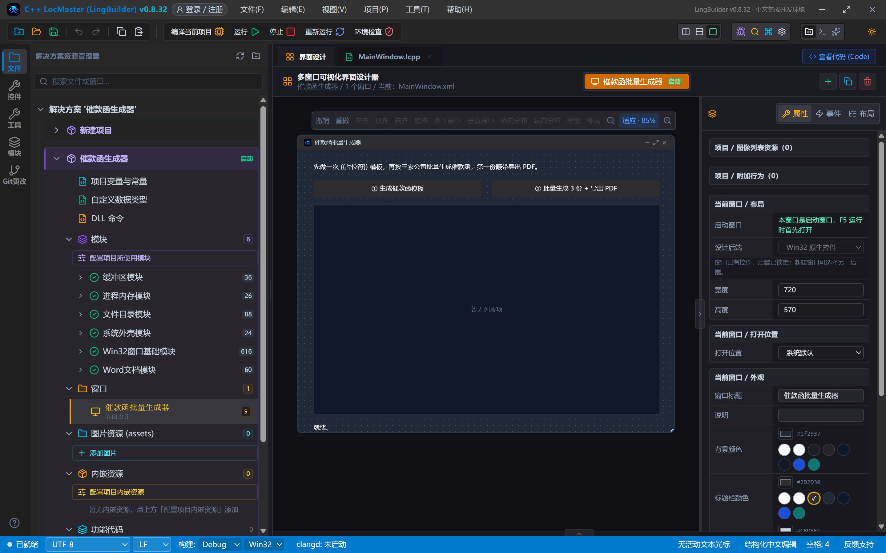
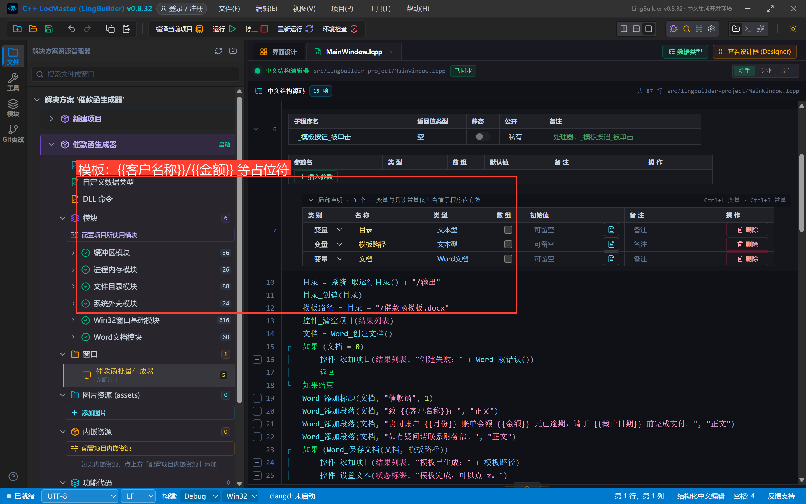
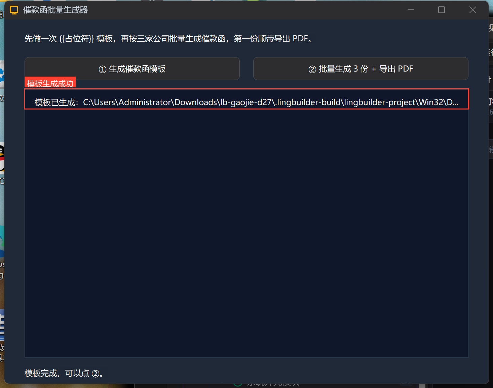
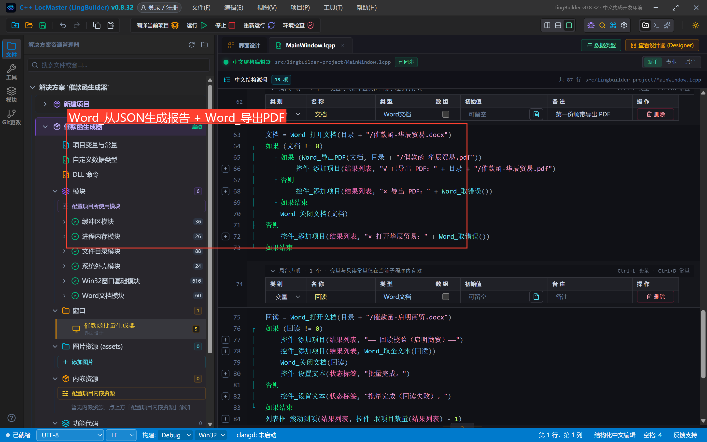
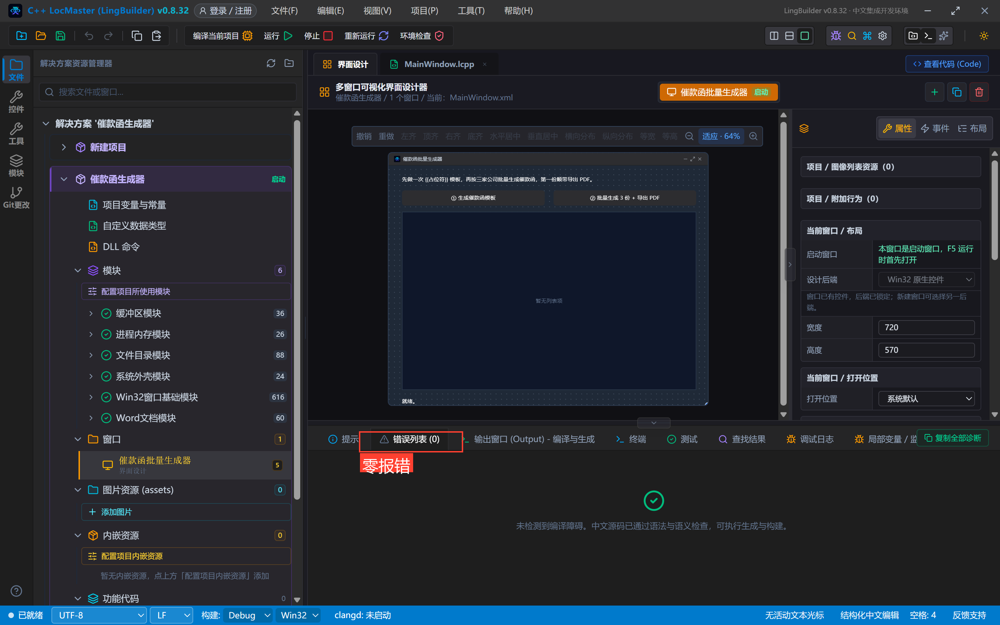
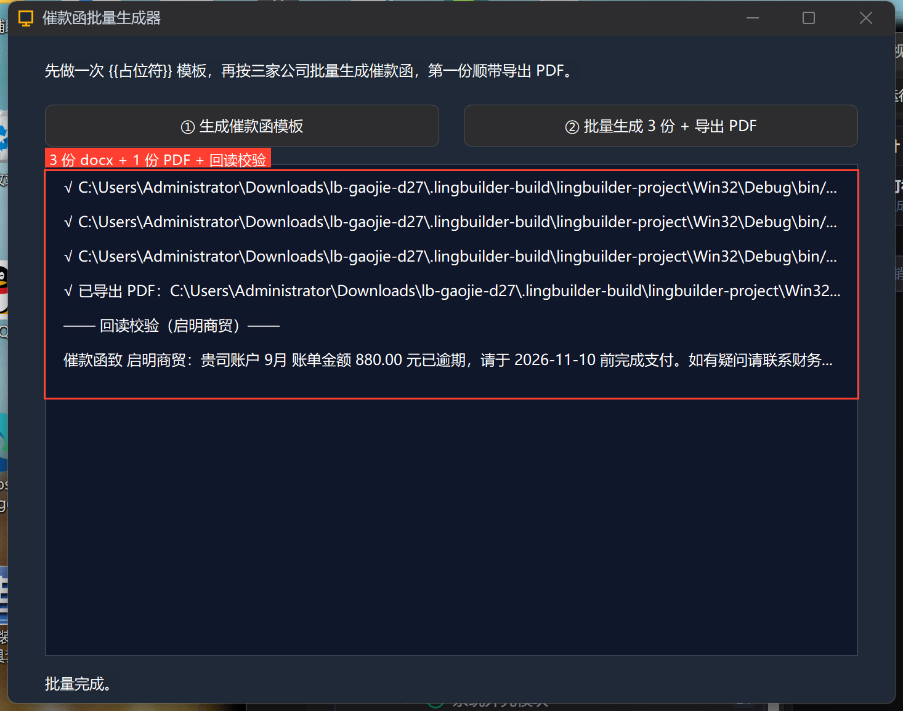

# 高阶实战 27 · Word 批量与导出：模板占位符 + 一行导出 PDF

> 《LingBuilder 高阶实战系列》第 27 集。第 26 集是「从零写一篇文档」；这一集是办公自动化最常见的姿势——**模板批量填充**：先做一份带 <code v-pre>{{占位符}}</code> 的催款函模板，再按三家公司各生成一份，第一份顺带 **`Word_导出PDF`**，最后回读一份校验占位符真的被替换。约 35 分钟。
>
> 前置要求：学过[第 26 集](/guide/tutorials/gaojie-26-word-intro)（会启用 Word 模块、知道句柄五步）。

## 这一集你将学会

- <code v-pre>{{占位名}}</code> 模板写法与 `Word_从JSON生成报告` 一步法（打开→替换→保存）
- `Word_导出PDF`：程序生成的文档直接转 PDF 分发
- 批量任务的日志式界面写法（列表框当流水账）
- 模块跨用：`目录_创建`（文件目录模块）+ `系统_取运行目录`（系统外壳模块）

## 1. 模板里写占位符

新建窗口项目「催款函生成器」，启用 **Word文档模块**（这一批会顺带用到 文件目录模块 和 系统外壳模块，一起启用）：





界面很朴素：两个按钮 + 一个结果列表（当流水账用）：



「① 生成催款函模板」——用第 26 集学过的五步写一份模板，**正文里嵌 <code v-pre>{{占位符}}</code>**：



```lcpp
    事件 _模板按钮_被单击()
        局部 文本型 目录
        局部 文本型 模板路径
        局部 Word文档 文档
        目录 = 系统_取运行目录() + "/输出"
        目录_创建(目录)
        模板路径 = 目录 + "/催款函模板.docx"
        控件_清空项目(结果列表)
        文档 = Word_创建文档()
        如果 (文档 = 0)
            控件_添加项目(结果列表, "创建失败：" + Word_取错误())
            返回
        如果结束
        Word_添加标题(文档, "催款函", 1)
        Word_添加段落(文档, "致 {{客户名称}}：", "正文")
        Word_添加段落(文档, "贵司账户 {{月份}} 账单金额 {{金额}} 元已逾期，请于 {{截止日期}} 前完成支付。", "正文")
        Word_添加段落(文档, "如有疑问请联系财务部。", "正文")
        如果 (Word_保存文档(文档, 模板路径))
            控件_添加项目(结果列表, "模板已生成：" + 模板路径)
        否则
            控件_添加项目(结果列表, "保存失败：" + Word_取错误())
        如果结束
        Word_关闭文档(文档)
    结束
```

点一下，模板落盘（目录_创建 负责 `输出/` 目录，已存在也返回真）：



## 2. 批量生成 + 导出 PDF

「② 批量生成 3 份 + 导出 PDF」——核心就一条命令：**`Word_从JSON生成报告(模板路径, 数据JSON, 输出路径)`**，一步完成「打开模板 → 替换全部占位符 → 另存」。占位符跨文本片段分裂（IME/拼写检查把 <code v-pre>{{名称}}</code> 拆开）也能正确替换：



```lcpp
        数据 = "{\"客户名称\":\"华辰贸易\",\"月份\":\"9月\",\"金额\":\"12800.00\",\"截止日期\":\"2026-11-05\"}"
        输出 = 目录 + "/催款函-华辰贸易.docx"
        如果 (Word_从JSON生成报告(模板路径, 数据, 输出))
            控件_添加项目(结果列表, "√ " + 输出)
        否则
            控件_添加项目(结果列表, "× 华辰贸易：" + Word_取错误())
        如果结束
```

> 注意 JSON 里的引号：`.lcpp` 字符串用 `\"` 转义。数据换成三家公司的，同一条命令调三次就是批量。

第一份生成后**导出 PDF**——打开它，一条命令转出：

```lcpp
        局部 Word文档 文档
        文档 = Word_打开文档(目录 + "/催款函-华辰贸易.docx")
        如果 (文档 != 0)
            如果 (Word_导出PDF(文档, 目录 + "/催款函-华辰贸易.pdf"))
                控件_添加项目(结果列表, "√ 已导出 PDF")
            否则
                控件_添加项目(结果列表, "× 导出 PDF：" + Word_取错误())
            如果结束
            Word_关闭文档(文档)
        如果结束
```

最后回读「启明商贸」那份做校验（第 26 集学的 `Word_打开文档` + `Word_取全文本`）。

## 3. 真机结果

编译后错误列表零报错：



先点 ① 再点 ②——四行 √（三份 docx + 一份 PDF）加上回读校验，占位符逐字替换正确：



```text
—— 回读校验（启明商贸）——
催款函致 启明商贸：贵司账户 9月 账单金额 880.00 元已逾期，请于 2026-11-10 前完成支付。如有疑问请联系财务…
```

磁盘上落了 5 个文件：`催款函模板.docx`、三份催款函 .docx、`催款函-华辰贸易.pdf`（PDF 可直接发客户）。

## 4. 边界备忘

- `Word_导出PDF` 对**本模块生成的文档子集**（段落/标题/表格/图片）承诺保真；外部复杂 docx 的高保真转换走 PDF 模块的 `PDF_外部文档转PDF`（28 集会见到）；
- 模板里没有的占位符不报错——`Word_替换占位符` 返回替换次数 0，`从JSON生成报告` 直接跳过，可用这个特性做「可选字段」；
- 模板建议程序自己生成（像本集），也可让业务同事在 Word 里维护——只要 <code v-pre>{{占位名}}</code> 写对，程序照常填充。

## 下一集预告

28 集进入 **PDF**：用 PDF 模块做「拆分 + 合并」小工具（注意：PDF 模块仅 x64）。

## 源码包

本集完整项目已打包：[催款函生成器.lcpppkg](https://lingbuilder.com/demos)——「文件 → 打开 LCPP 源码包」一键导入。
