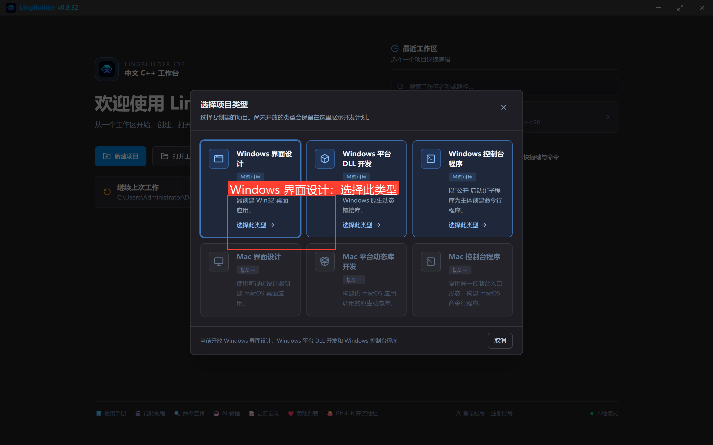
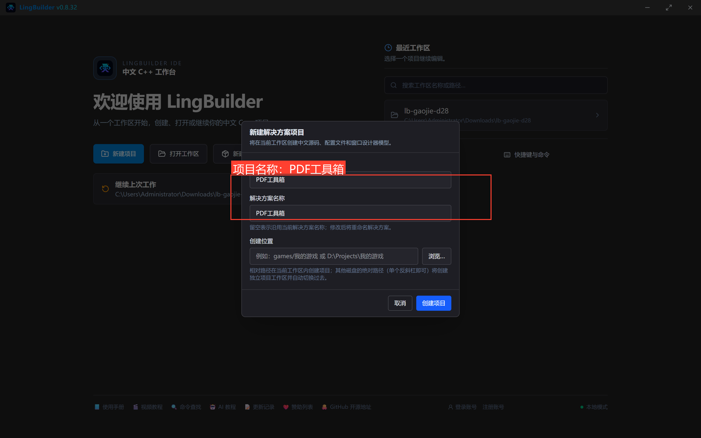
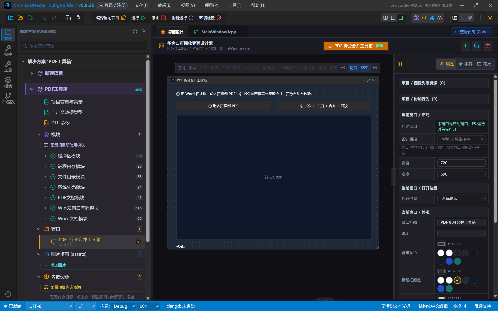
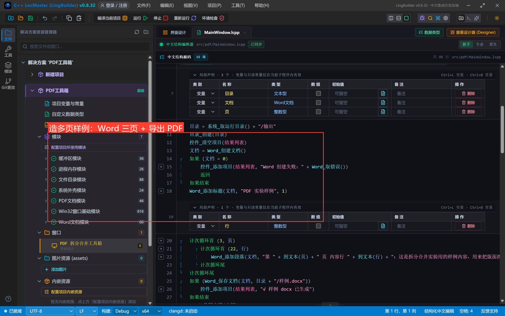
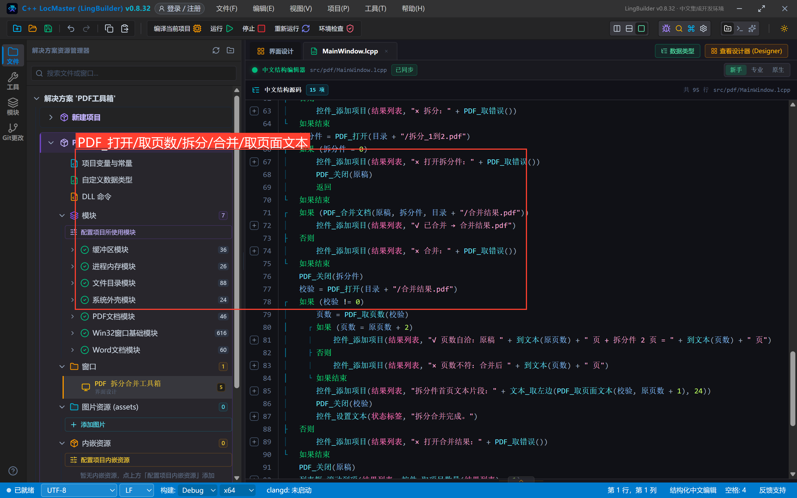
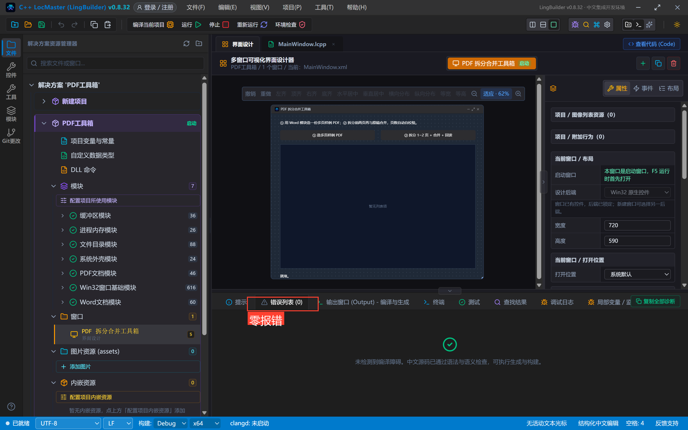
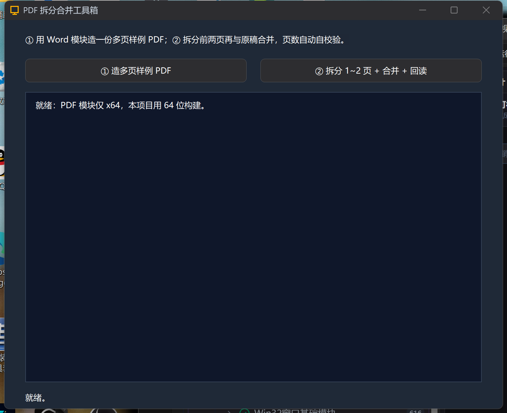
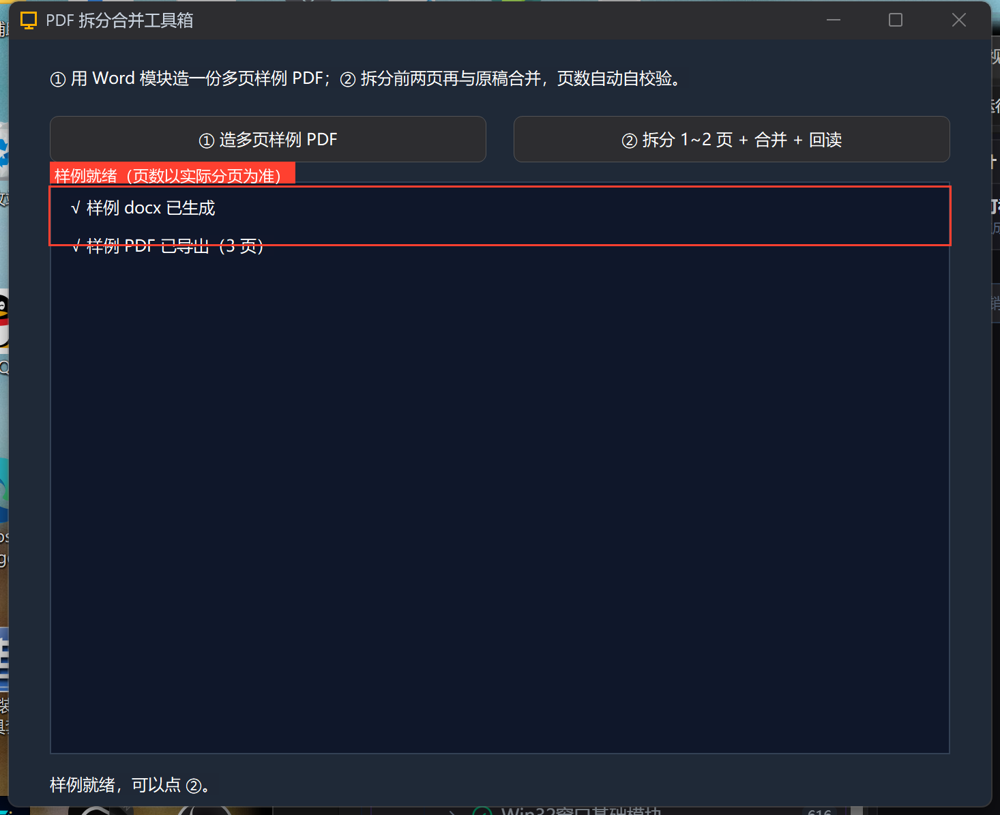
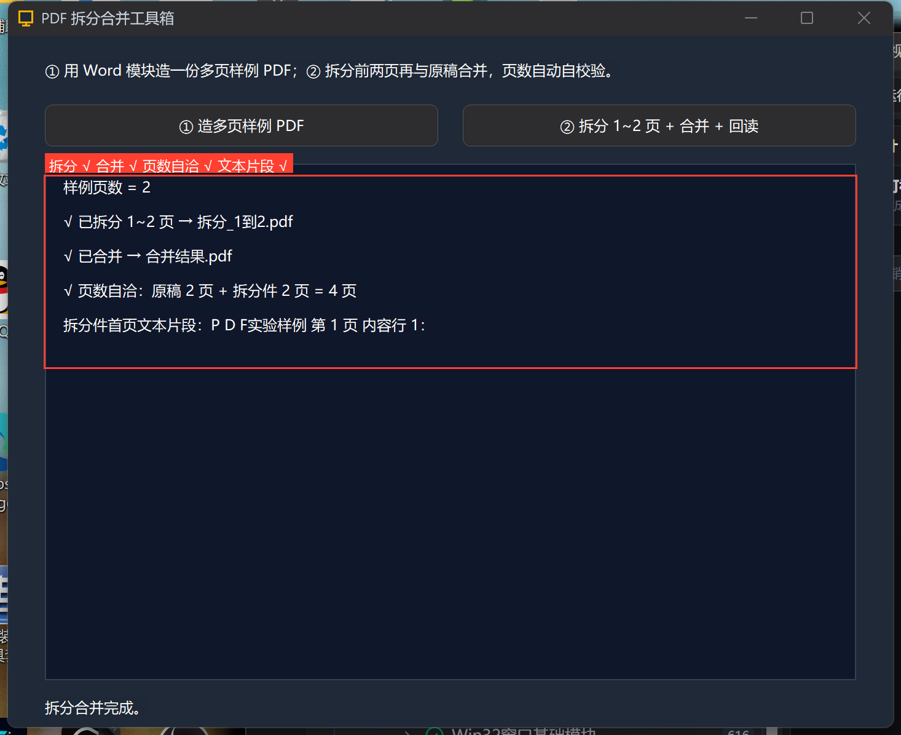

# 高阶实战 28 · PDF 读取与拆分合并：程序自己剪贴 PDF

> 《LingBuilder 高阶实战系列》第 28 集。这一集用 **PDF 文档模块**（`lingbuilder.data.pdf`，Chrome 同款 PDFium 内核）做一个「PDF 拆分合并工具箱」：先用 Word 模块造一份多页样例 PDF，再把它**拆分出前两页**、与原稿**合并**，最后程序自己核对「合并页数 = 原稿页数 + 拆分件页数」并抽取文本片段证明页序正确。约 35 分钟。
>
> ⚠️ **PDF 模块仅支持 64 位（x64）构建**——本项目会演示怎么把构建架构切到 x64。

## 这一集你将学会

- 把构建架构从 Win32 **切换到 x64**（状态栏下拉，PDF/OpenCV 等 x64 模块的前置）
- `PDF_打开 / PDF_取页数 / PDF_拆分页面 / PDF_合并文档 / PDF_取页面文本 / PDF_关闭` 全套页面操作
- 用 Word 模块**造测试素材**（多模块协同）
- **运行时自校验**：页数对不上就报错，不靠人眼

## 1. 建项目，切到 x64

新建窗口项目「PDF工具箱」，启用 **PDF文档模块**（顺带启用 Word文档/文件目录/系统外壳/文本处理，造样例要用）：





> ⚠️ 关键一步：IDE 底部状态栏有**架构下拉**（默认 Win32）。PDF 模块只提供 x64 目标，**点开下拉选择 `x64`** 再编译，否则该模块的运行时资产不会复制、命令不可用。

## 2. 界面与「造样料」按钮

5 个控件：说明标签、两个按钮、结果列表、状态标签：



「① 造多页样例 PDF」——多模块协同：Word 模块写 3 大段×22 行的真实分页内容，保存 docx 后 `Word_导出PDF` 转成 PDF：



```lcpp
    事件 _准备按钮_被单击()
        局部 文本型 目录
        局部 Word文档 文档
        局部 整数型 页
        局部 整数型 行
        目录 = 系统_取运行目录() + "/输出"
        目录_创建(目录)
        控件_清空项目(结果列表)
        文档 = Word_创建文档()
        如果 (文档 = 0)
            控件_添加项目(结果列表, "Word 创建失败：" + Word_取错误())
            返回
        如果结束
        Word_添加标题(文档, "PDF 实验样例", 1)
        计次循环首 (3, 页)
            计次循环首 (22, 行)
                Word_添加段落(文档, "第 " + 到文本(页) + " 页 内容行 " + 到文本(行) + "：这是拆分合并实验用的样例内容，用来把版面撑到真实分页。", "正文")
            计次循环尾
        计次循环尾
        如果 (Word_保存文档(文档, 目录 + "/样例.docx"))
            控件_添加项目(结果列表, "√ 样例 docx 已生成")
        如果结束
        Word_关闭文档(文档)
        文档 = Word_打开文档(目录 + "/样例.docx")
        如果 (文档 != 0)
            如果 (Word_导出PDF(文档, 目录 + "/样例.pdf"))
                控件_添加项目(结果列表, "√ 样例 PDF 已导出")
            否则
                控件_添加项目(结果列表, "× 导出 PDF：" + Word_取错误())
            如果结束
            Word_关闭文档(文档)
        如果结束
    结束
```

> 页数以**实际分页**为准——别在文案里写死「3 页」，版式一变就穿帮（本集真机就撞上了：3 大段只排出一页，拆分直接「页范围越界」）。

## 3. 拆分 + 合并 + 自校验

「② 拆分 1~2 页 + 合并 + 回读」——PDF 命令全是受管句柄 `PDF文档`：



```lcpp
    事件 _拆合按钮_被单击()
        局部 文本型 目录
        局部 PDF文档 原稿
        局部 PDF文档 拆分件
        局部 PDF文档 校验
        局部 整数型 页数
        局部 整数型 原页数
        目录 = 系统_取运行目录() + "/输出"
        控件_清空项目(结果列表)
        原稿 = PDF_打开(目录 + "/样例.pdf")
        如果 (原稿 = 0)
            控件_添加项目(结果列表, "× 打开样例：" + PDF_取错误())
            返回
        如果结束
        原页数 = PDF_取页数(原稿)
        控件_添加项目(结果列表, "样例页数 = " + 到文本(原页数))
        如果 (PDF_拆分页面(原稿, 1, 2, 目录 + "/拆分_1到2.pdf"))
            控件_添加项目(结果列表, "√ 已拆分 1~2 页 → 拆分_1到2.pdf")
        否则
            控件_添加项目(结果列表, "× 拆分：" + PDF_取错误())
        如果结束
        拆分件 = PDF_打开(目录 + "/拆分_1到2.pdf")
        如果 (拆分件 = 0)
            控件_添加项目(结果列表, "× 打开拆分件：" + PDF_取错误())
            PDF_关闭(原稿)
            返回
        如果结束
        如果 (PDF_合并文档(原稿, 拆分件, 目录 + "/合并结果.pdf"))
            控件_添加项目(结果列表, "√ 已合并 → 合并结果.pdf")
        否则
            控件_添加项目(结果列表, "× 合并：" + PDF_取错误())
        如果结束
        PDF_关闭(拆分件)
        校验 = PDF_打开(目录 + "/合并结果.pdf")
        如果 (校验 != 0)
            页数 = PDF_取页数(校验)
            如果 (页数 = 原页数 + 2)
                控件_添加项目(结果列表, "√ 页数自洽：原稿 " + 到文本(原页数) + " 页 + 拆分件 2 页 = " + 到文本(页数) + " 页")
            否则
                控件_添加项目(结果列表, "× 页数不符：合并后 " + 到文本(页数) + " 页")
            如果结束
            控件_添加项目(结果列表, "拆分件首页文本片段：" + 文本_取左边(PDF_取页面文本(校验, 原页数 + 1), 24))
            PDF_关闭(校验)
            控件_设置文本(状态标签, "拆分合并完成。")
        否则
            控件_添加项目(结果列表, "× 打开合并结果：" + PDF_取错误())
        如果结束
        PDF_关闭(原稿)
        列表框_滚动到项(结果列表, 控件_取项目数量(结果列表) - 1)
    结束
```

## 4. 真机结果

编译后错误列表零报错：



点 ①：样例就绪；点 ②：拆分、合并、自校验、文本片段四行全 √：







```text
样例页数 = 2
√ 已拆分 1~2 页 → 拆分_1到2.pdf
√ 已合并 → 合并结果.pdf
√ 页数自洽：原稿 2 页 + 拆分件 2 页 = 4 页
拆分件首页文本片段：PDF实验样例 第 1 页 内容行 1：
```

页数自洽 + 文本片段对得上（合并结果的第 3 页正是拆分件的第 1 页）——整条链路程序自己证明了正确性。

## 5. 边界备忘

- **仅 x64**：PDF 模块与 OpenCV 模块同策略，32 位项目不可用；运行时资产（pdfium.dll + LingBuilderPdf.dll）由构建链自动复制到 exe 旁；
- 加密 PDF（需要密码）与损坏文件会被**明确拒绝**，错误读 `PDF_取错误()`；
- 扫描件（无文本层）`PDF_取页面文本` 得到空——正确姿势是 `PDF_是否有文本层` 分流后走 OCR（`PDF_渲染页面PNG` + 图像识别）；
- 拆分页码从 1 起、含结束页；页范围越界会明确报「页范围越界」（本集真机演示过）。

## 下一集预告

29 集：一维条码生成与识别——五码制纯本地实现，生成的条码当场扫回来验证。

## 源码包

本集完整项目已打包：[PDF工具箱.lcpppkg](https://lingbuilder.com/demos)——「文件 → 打开 LCPP 源码包」一键导入（记得把构建架构切到 x64）。
