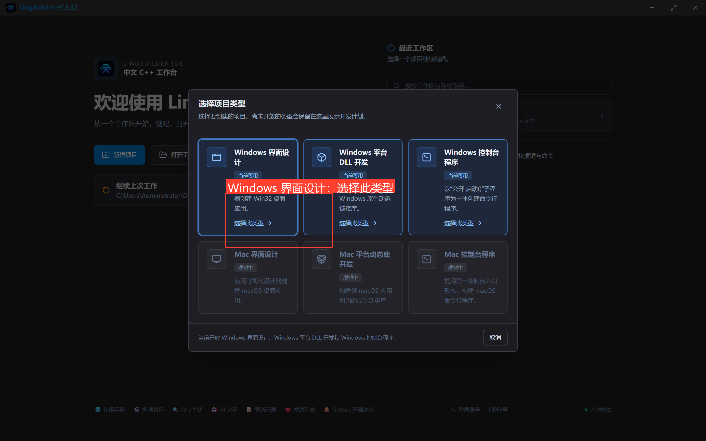
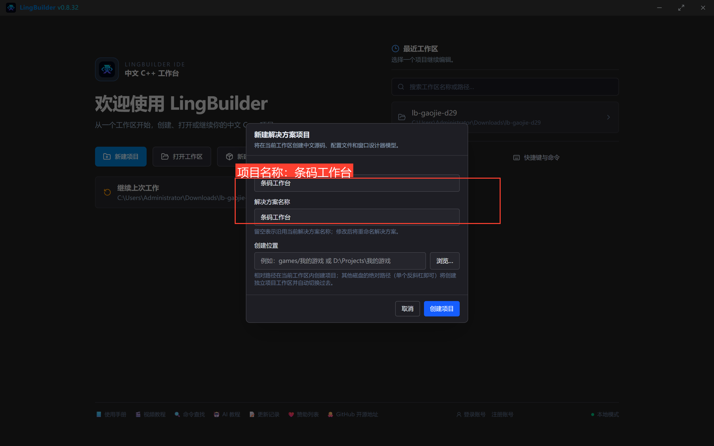
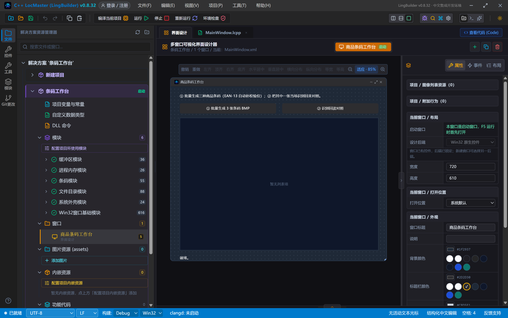
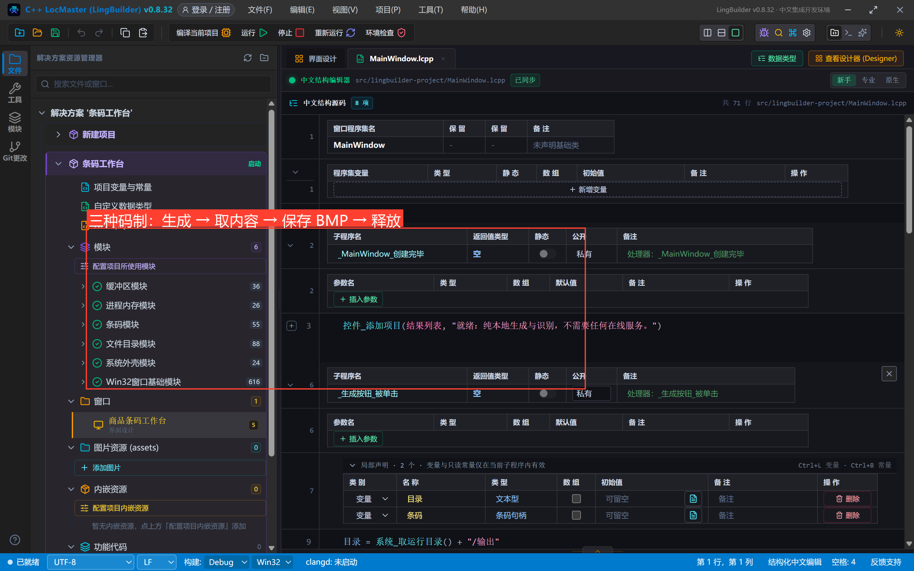
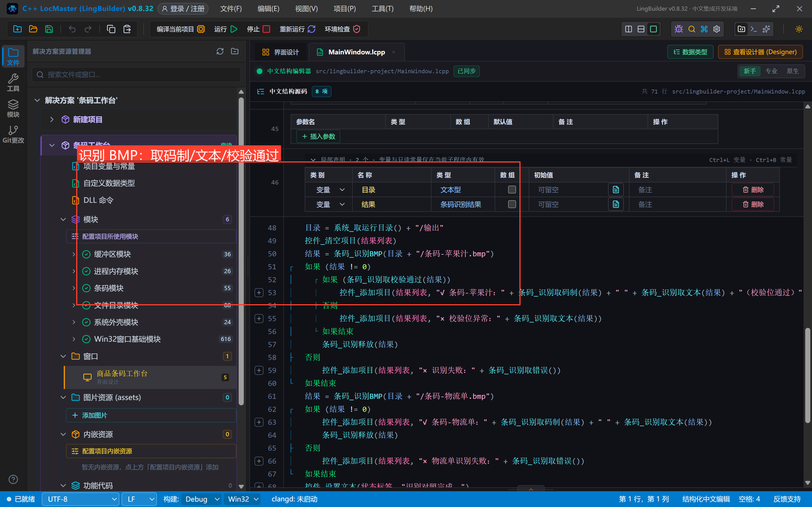
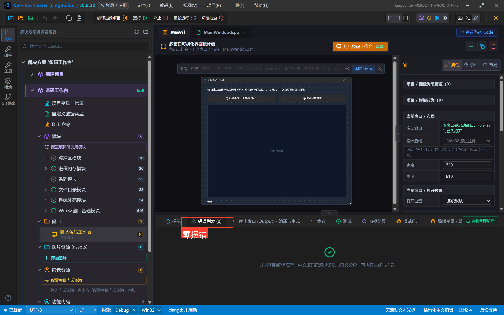
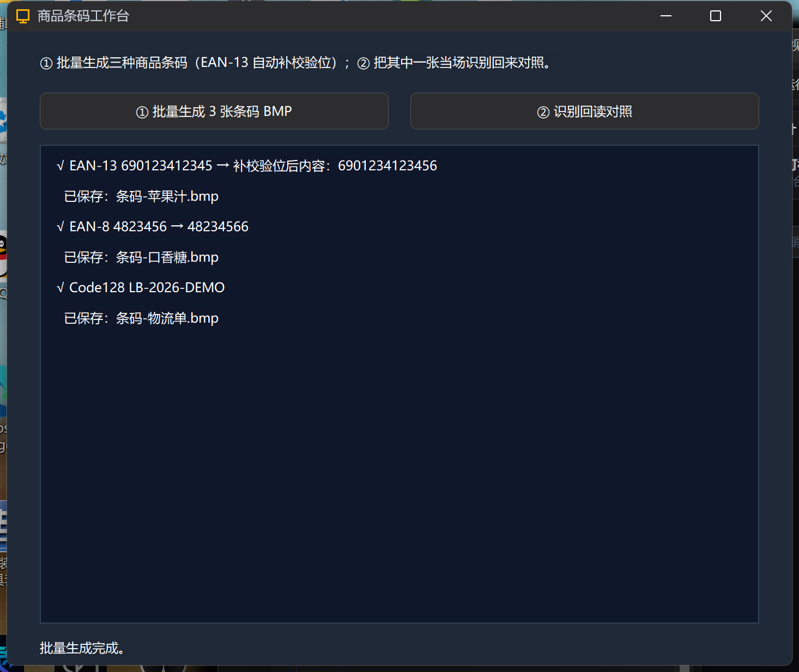
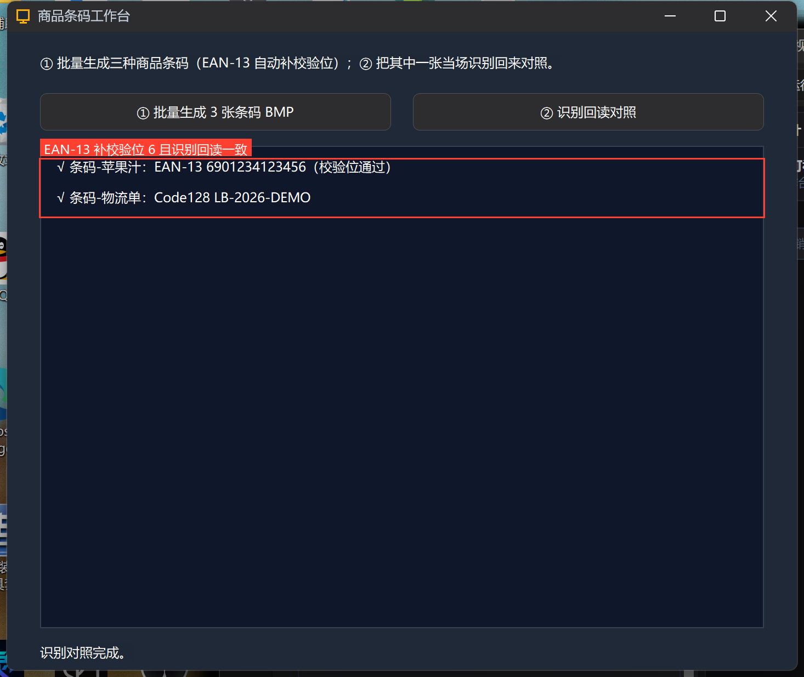

# 高阶实战 29 · 一维条码生成与识别：生成后当场扫回来

> 《LingBuilder 高阶实战系列》第 29 集。用 **条码模块**（`lingbuilder.barcode`，纯本地零依赖）做一个「商品条码工作台」：批量生成 EAN-13 / EAN-8 / Code128 三张条码 BMP，然后把其中一张**当场识别回来**——EAN-13 自动补的校验位、识别侧的校验验证，全部真机对账。约 30 分钟。

## 这一集你将学会

- 三种常用码制生成：`条码_生成EAN13 / 条码_生成EAN8 / 条码_生成Code128`
- EAN-13 **自动补校验位**：12 位进 13 位出，识别侧「校验位通过」
- `条码_保存BMP` 落盘、`条码_识别BMP` 从图片文件识别
- 生成→释放、识别→释放的句柄纪律

## 1. 项目与界面

新建窗口项目「条码工作台」，启用 **条码模块**（顺带 文件目录 + 系统外壳）：





5 个控件：说明标签、两个按钮、结果列表、状态标签：



## 2. 批量生成三张条码

「① 批量生成 3 张条码 BMP」——三种码制各来一张，注意**句柄纪律**：用完 `条码_释放`：



```lcpp
    事件 _生成按钮_被单击()
        局部 文本型 目录
        局部 条码句柄 条码
        目录 = 系统_取运行目录() + "/输出"
        目录_创建(目录)
        控件_清空项目(结果列表)
        条码 = 条码_生成EAN13("690123412345")
        如果 (条码 != 0)
            控件_添加项目(结果列表, "√ EAN-13 690123412345 → 补校验位后内容：" + 条码_取内容(条码))
            如果 (条码_保存BMP(条码, 目录 + "/条码-苹果汁.bmp", 3))
                控件_添加项目(结果列表, "  已保存：条码-苹果汁.bmp")
            如果结束
            条码_释放(条码)
        否则
            控件_添加项目(结果列表, "× EAN-13：" + 条码_取错误())
        如果结束
        // EAN-8：条码_生成EAN8("4823456")；Code128：条码_生成Code128("LB-2026-DEMO")，写法同上
    结束
```

EAN-13 传 **12 位**数字（缺的校验位自动算）；带校验位传 13 位也行，但**算错会明确报错**，不会静默纠正。每模块像素 3 是打印质量的建议值。

## 3. 识别回读对照

「② 识别回读对照」——从 BMP 文件直接识别，`条码_识别取码制` 报码制、`条码_识别取文本` 给内容、`条码_识别取校验通过` 验校验位：



```lcpp
    事件 _识别按钮_被单击()
        局部 文本型 目录
        局部 条码识别结果 结果
        目录 = 系统_取运行目录() + "/输出"
        控件_清空项目(结果列表)
        结果 = 条码_识别BMP(目录 + "/条码-苹果汁.bmp")
        如果 (结果 != 0)
            如果 (条码_识别取校验通过(结果))
                控件_添加项目(结果列表, "√ 条码-苹果汁：" + 条码_识别取码制(结果) + " " + 条码_识别取文本(结果) + "（校验位通过）")
            否则
                控件_添加项目(结果列表, "× 校验位异常：" + 条码_识别取文本(结果))
            如果结束
            条码_识别释放(结果)
        否则
            控件_添加项目(结果列表, "× 识别失败：" + 条码_识别取错误())
        如果结束
        // 条码-物流单.bmp（Code128）同理
    结束
```

## 4. 真机对照

编译后错误列表零报错：



点 ①：三张条码全部生成，**EAN-13 的校验位自动算出 6**（690123412345 → 690123412345**6**）：



点 ②：两张 BMP 当场识别回来——码制、内容、校验位全部对上：



```text
√ 条码-苹果汁：EAN-13 6901234123456（校验位通过）
√ 条码-物流单：Code128 LB-2026-DEMO
```

生成侧补的校验位 = 识别侧验证的校验位 = 手算的 6，闭环成立。识别特性备忘：**横纵双向扫描**（覆盖旋转 90° 的条码）；EAN/UPC/Code128 校验位不符的条码不会被识别成功；UPC-A 与首位 0 的 EAN-13 图形同构。

## 常见坑

- **内容放行字符**：Code39 只收 0-9、A-Z、空格与 `- . $ / + %`（小写自动转大写）；Code128 收全部 ASCII 可见字符，纯数字自动选 C 子集更紧凑；
- **识别输入格式**：`条码_识别BMP` 只吃 24/32 位未压缩 BMP（本模块 `条码_保存BMP` 的输出正合适）；PNG 请先用图像模块转 BMP 或走 `条码_识别像素` 字节集入口；
- **句柄必须释放**：`条码_释放` / `条码_识别释放` 逐个还，或者退出前 `条码_释放全部` / `条码_识别释放全部`。

## 下一集预告

30 集：Excel 报表归档——写表头与数据、套格式，最后 `Excel_导出PDF` 一键归档。

## 源码包

本集完整项目已打包：[条码工作台.lcpppkg](https://lingbuilder.com/demos)——「文件 → 打开 LCPP 源码包」一键导入。
