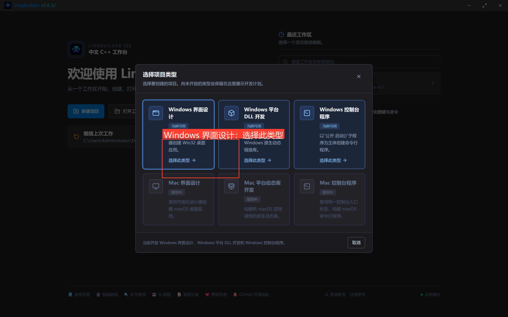
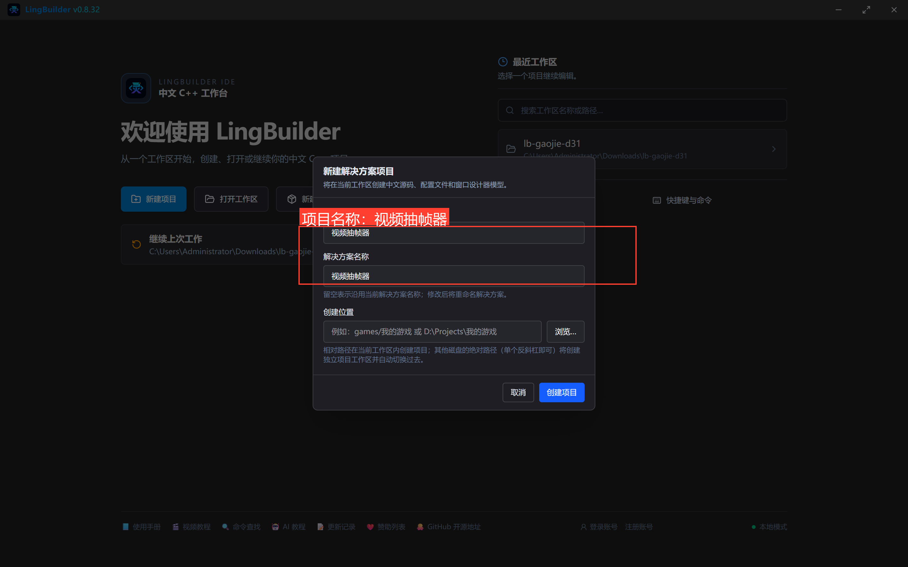
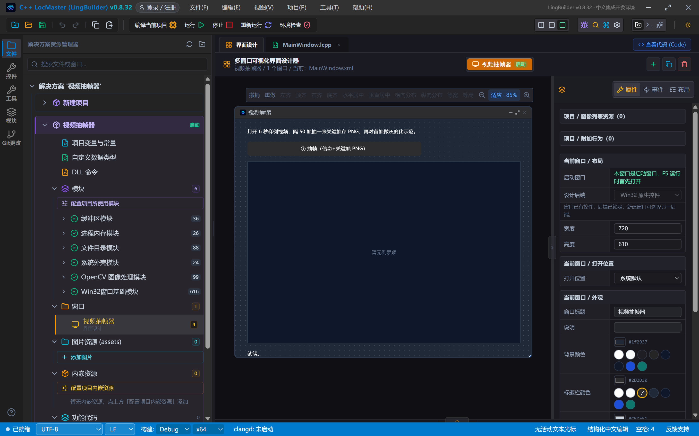
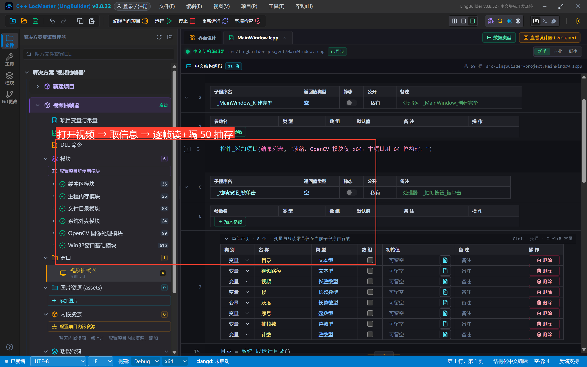
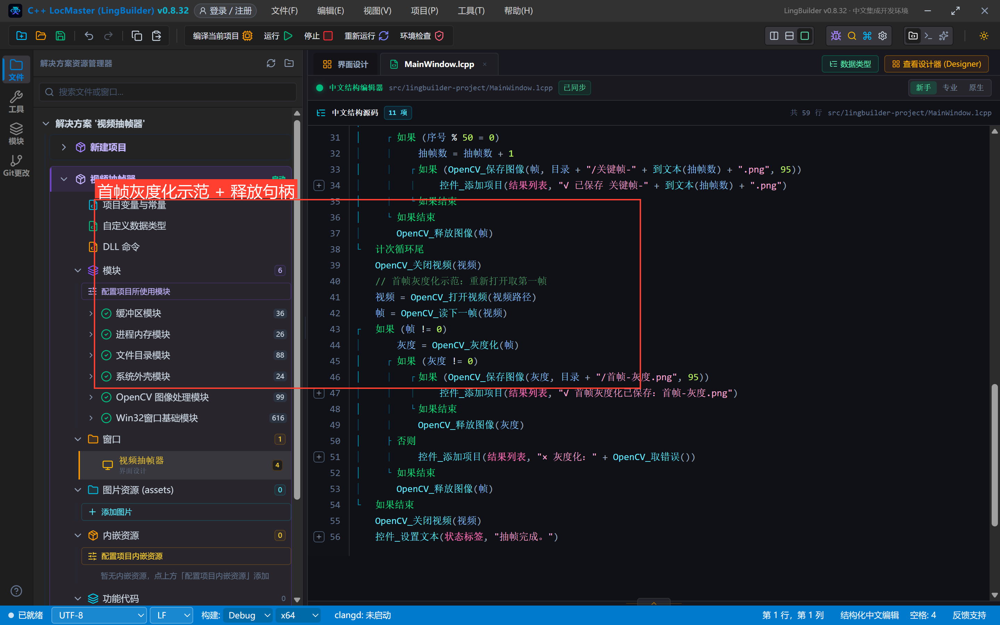
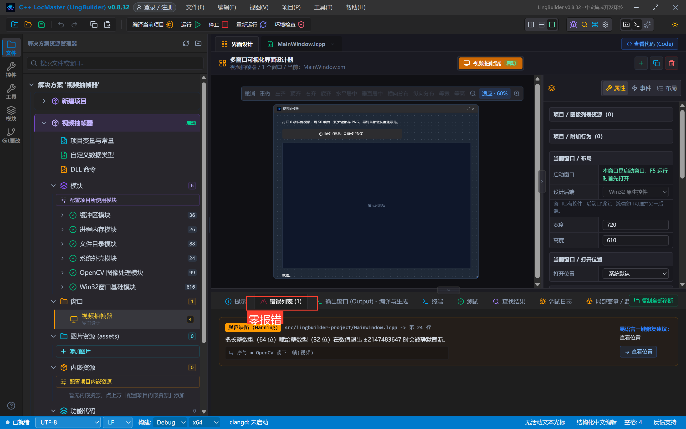
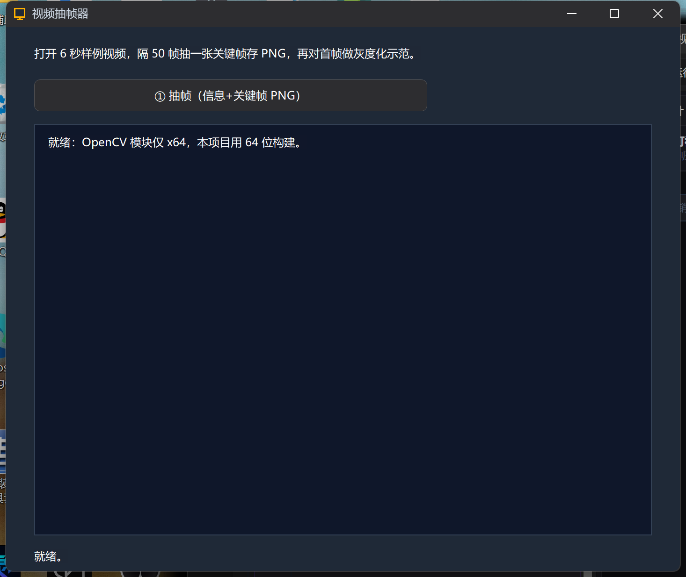
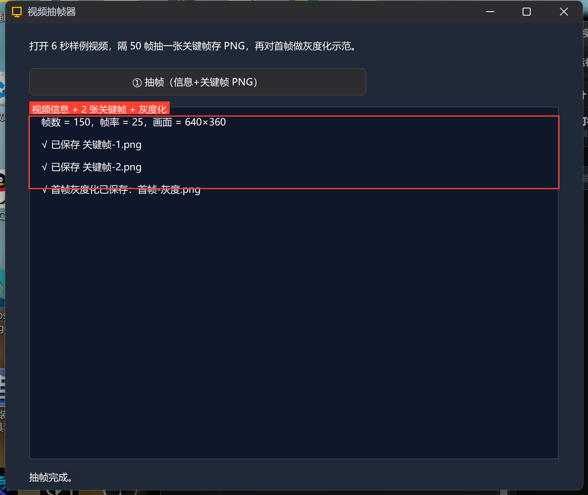
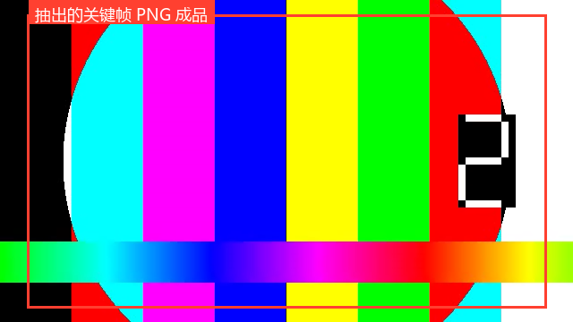

# 高阶实战 31 · 视频帧处理：OpenCV 打开视频、隔帧抽图、灰度化

> 《LingBuilder 高阶实战系列》第 31 集，**专题收官**。用 **OpenCV 模块**（`lingbuilder.opencv` 1.2，x64）的视频族命令做一个「视频抽帧器」：打开 6 秒样例视频 → 读出帧数/帧率/分辨率 → **隔 50 帧抽一张关键帧存 PNG** → 再对首帧做**灰度化**示范。学会后接上识图/OCR 就是完整的视频自动化管线。约 35 分钟。
>
> ⚠️ 与 28 集相同：OpenCV 模块**仅 x64**，先把状态栏架构切到 `x64`。

## 这一集你将学会

- `OpenCV_打开视频 → OpenCV_取视频帧数/帧率/宽度/高度 → OpenCV_读下一帧 → OpenCV_关闭视频` 视频族全流程
- 隔 N 帧抽样 + `%` 取余判断 + 到末尾跳出
- `OpenCV_保存图像` 存 PNG（第三个参数是质量/压缩级别，**不能省**）
- `OpenCV_灰度化` 图像处理入门；句柄 `OpenCV_释放图像` 纪律
- 用 ffmpeg 造测试视频、MF 后端的编码兼容性

## 1. 造样例视频（ffmpeg）

OpenCV 视频后端是 **Windows Media Foundation**。用 ffmpeg 造 6 秒 150 帧的测试视频，编码选 **mpeg4**（MF 原生支持；libx264 High Profile 在部分机器上打不开，本集真机踩过）：

```text
ffmpeg -y -f lavfi -i "testsrc=duration=6:size=640x360:rate=25" -c:v mpeg4 -q:v 5 样例视频.mp4
```

把 `样例视频.mp4` 复制到 exe 运行目录（F5 一次后就是 `.lingbuilder-build\<项目>\x64\Debug\bin\`）。

## 2. 建项目与界面

新建窗口项目「视频抽帧器」，启用 **OpenCV图像处理模块**（x64）+ 文件目录 + 系统外壳，架构切 `x64`：





4 个控件：说明标签、抽帧按钮、结果列表、状态标签：



## 3. 抽帧代码



```lcpp
    事件 _抽帧按钮_被单击()
        局部 文本型 目录
        局部 文本型 视频路径
        局部 长整数型 视频
        局部 长整数型 帧
        局部 长整数型 灰度
        局部 整数型 序号
        局部 整数型 抽帧数
        目录 = 系统_取运行目录()
        视频路径 = 目录 + "/样例视频.mp4"
        控件_清空项目(结果列表)
        视频 = OpenCV_打开视频(视频路径)
        如果 (视频 = 0)
            控件_添加项目(结果列表, "× 打开视频：" + OpenCV_取错误())
            返回
        如果结束
        控件_添加项目(结果列表, "帧数 = " + 到文本(OpenCV_取视频帧数(视频)) + "，帧率 = " + 到文本(OpenCV_取视频帧率(视频)) + "，画面 = " + 到文本(OpenCV_取视频宽度(视频)) + "×" + 到文本(OpenCV_取视频高度(视频)))
        序号 = OpenCV_读下一帧(视频)
        抽帧数 = 0
        计次循环首 (150, 序号)
            帧 = OpenCV_读下一帧(视频)
            如果 (帧 = 0)
                跳出循环
            如果结束
            如果 (序号 % 50 = 0)
                抽帧数 = 抽帧数 + 1
                如果 (OpenCV_保存图像(帧, 目录 + "/关键帧-" + 到文本(抽帧数) + ".png", 95))
                    控件_添加项目(结果列表, "√ 已保存 关键帧-" + 到文本(抽帧数) + ".png")
                如果结束
            如果结束
            OpenCV_释放图像(帧)
        计次循环尾
        OpenCV_关闭视频(视频)
```

三个要点：

- **每帧都是新句柄**：`OpenCV_读下一帧` 每次返回新的图像句柄（内部缓冲的深拷贝），用完必须 `OpenCV_释放图像`，否则很快涨到 256 个上限；
- **到末尾返回 0** 是正常结束信号（配合 `跳出循环`），真正的错误读 `OpenCV_取错误()`；
- `OpenCV_保存图像(帧, 路径, 质量)` **三个参数都要给**（PNG 用质量参数映射压缩级别），少传一个直接编译错。

首帧灰度化示范（灰度化返回新句柄，同样要释放）：



```lcpp
        // 首帧灰度化示范：重新打开取第一帧
        视频 = OpenCV_打开视频(视频路径)
        帧 = OpenCV_读下一帧(视频)
        如果 (帧 != 0)
            灰度 = OpenCV_灰度化(帧)
            如果 (灰度 != 0)
                如果 (OpenCV_保存图像(灰度, 目录 + "/首帧-灰度.png", 95))
                    控件_添加项目(结果列表, "√ 首帧灰度化已保存：首帧-灰度.png")
                如果结束
                OpenCV_释放图像(灰度)
            如果结束
            OpenCV_释放图像(帧)
        如果结束
        OpenCV_关闭视频(视频)
        控件_设置文本(状态标签, "抽帧完成。")
    结束
```

## 4. 真机结果

编译后错误列表零报错：



点「① 抽帧」：





```text
帧数 = 150，帧率 = 25，画面 = 640×360
√ 已保存 关键帧-1.png
√ 已保存 关键帧-2.png
√ 首帧灰度化已保存：首帧-灰度.png
```

150 帧 ÷ 每 50 帧一张 = 第 0、100 帧各存一张（序号从 1 的首次读取后计），加上灰度首帧，exe 旁共 3 张 PNG。抽出的关键帧成品：



## 5. 接上自动化管线

抽帧的价值在于衔接：`OpenCV_读下一帧` 返回的帧句柄直接流入 `OpenCV_模板匹配 / 查找轮廓 / 分析缺口`，也可以 `OpenCV_保存图像` 落盘后交给 **识图模块 / 微信OCR** 做「视频里有没有出现某个画面 / 某段文字」的轮询监控。配合 30 集的 Excel 与 20 集的定时能力，就是一个完整的「录屏监控→识别→记账→告警」流水线——这正是本专题从推送一路讲到视觉的收束点。

## 合集收官

31 集全部完成：**推送（01~15）→ DLL（16~19）→ 模块封装（20~25）→ 文档与识别（26~31）**。所有源码包都能「一键导入」复现，所有结论都有真机截图背书。

## 源码包

本集完整项目已打包：[视频抽帧器.lcpppkg](https://lingbuilder.com/demos)——「文件 → 打开 LCPP 源码包」一键导入（x64 + 把样例视频放进运行目录）。
