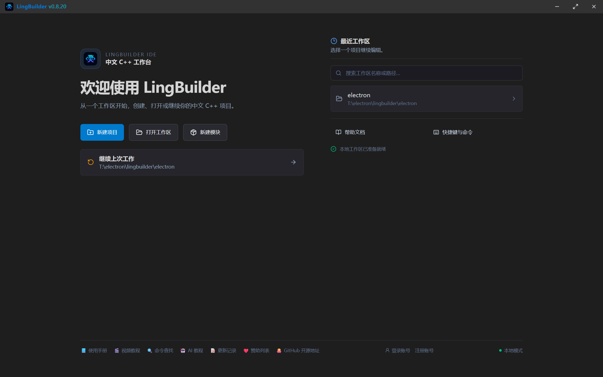
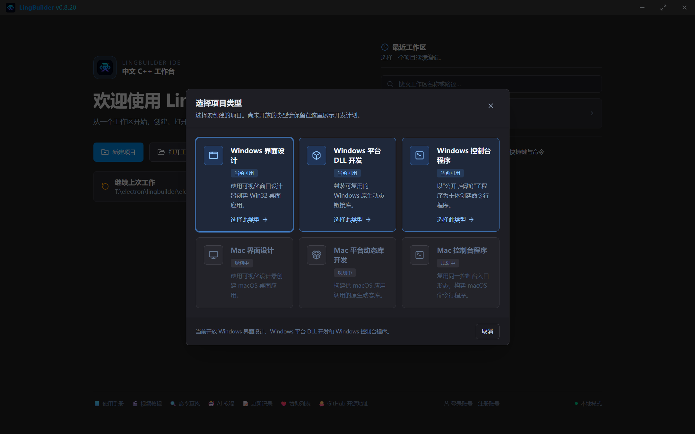
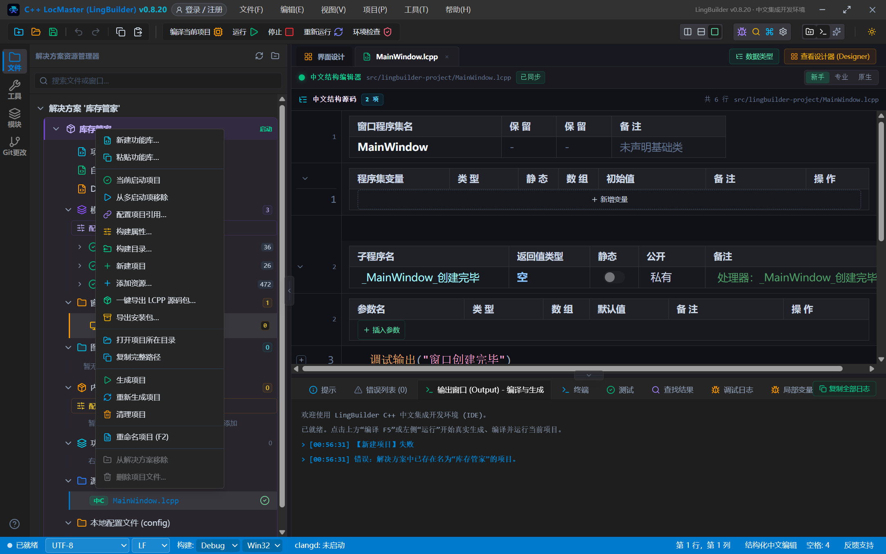
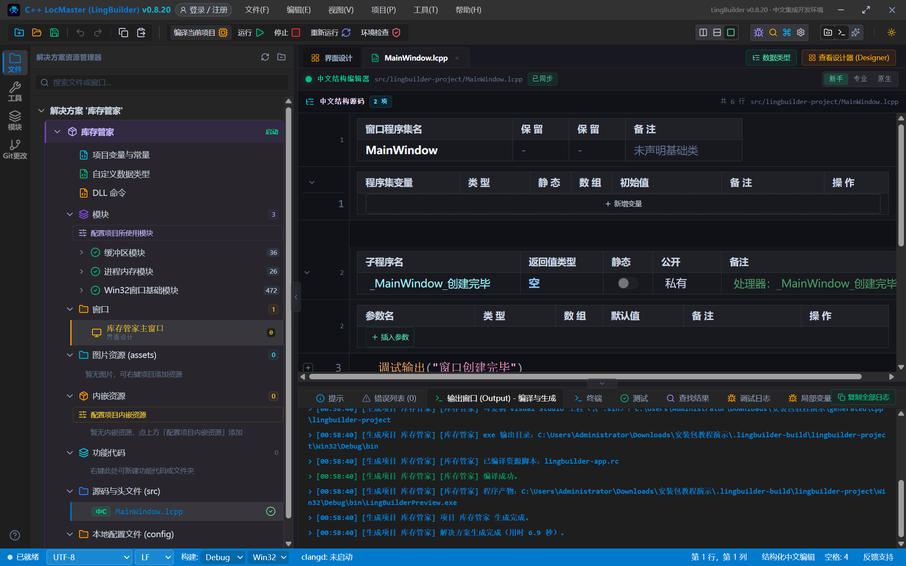
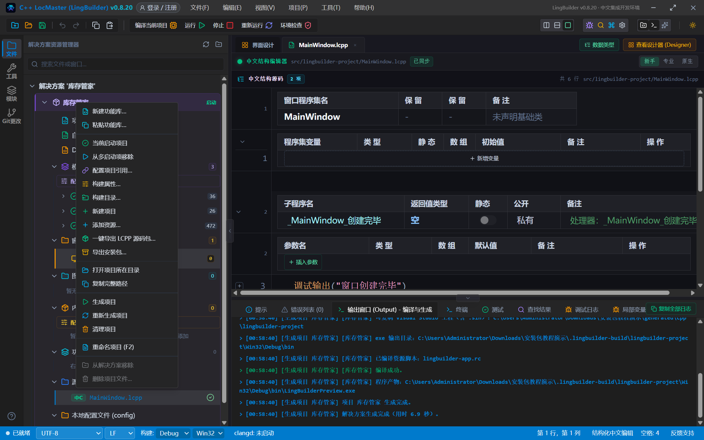
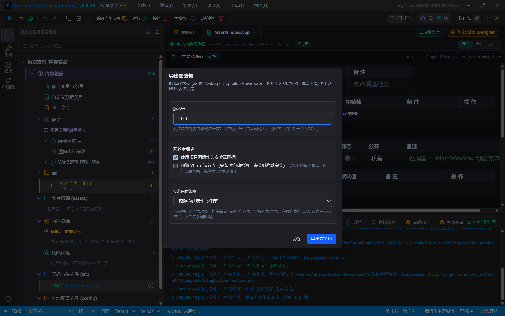
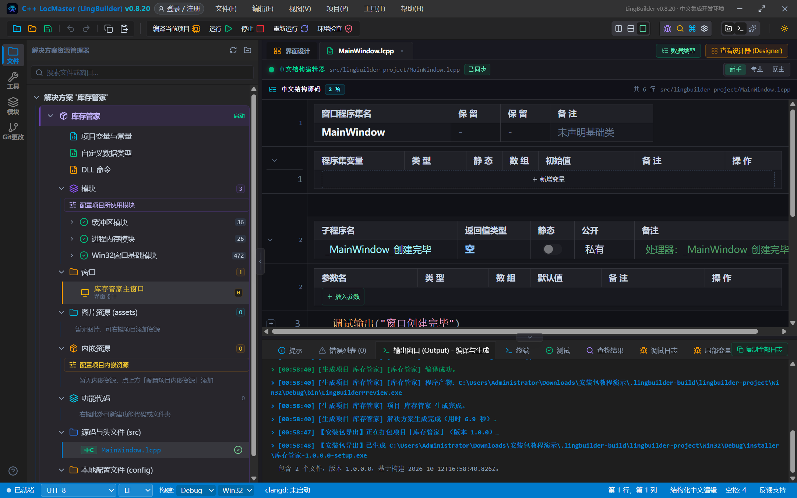

# LingBuilder「安装包导出」图文教程

> 适用版本：LingBuilder 0.8.20 及以上（含 2026-10-12 安装包导出一期 + 二期）
> 你将做出：把你写好的程序一键打包成单个 `setup.exe` 安装程序——对方双击安装、开始菜单打开、控制面板可卸载。全程不写一行脚本。

**安装包导出是什么？** 它把项目**最近一次构建**出来的产物（主程序 exe + 它需要的全部 DLL）装进一个 NSIS 安装程序：简体中文安装向导、可选安装位置、自动创建开始菜单快捷方式、自带卸载入口。对方拿到的是一个正规的 `setup.exe`，而不是一个需要「解压到某处再找 exe」的文件夹。它和「LCPP 源码包分享」是一对：源码包给**会用的开发者**，安装包给**最终用户**。

---

## 第 1 章 前置知识：先构建，后导出

安装包的内容来自**最近一次成功构建**的产物。所以流程永远是：

1. 构建（F5「生成并运行」、工具栏「运行」或「编译当前项目」、菜单「生成」都行）；
2. 右键项目 →「导出安装包…」。

如果还没构建过就点导出，IDE 会在输出面板提示「请先构建项目」，不会打包出空安装包。

**两个项目形态不支持导出安装包**：动态库（DLL）项目没有可安装的主程序；导出入口会对 DLL 项目给出中文提示。

---

## 第 2 章 从新建项目开始（可跳过）

如果你还没有项目：启动 LingBuilder，在欢迎页点 **新建项目**。



在类型选择里选 **Windows 界面设计**（当前可用），填写项目名称（例如本教程的「库存管家」），创建位置留空即创建在当前工作区内，点 **创建项目**。



创建完成后进入工作台，解决方案树里就是你的项目，模板代码已经可以直接编译：



> 想改窗口内容？双击「窗口」下的主窗口进入界面设计器；想加行为？点 `MainWindow.lcpp` 在中文结构编辑器里写事件代码。安装包导出只关心**构建产物**，界面长什么样都不影响打包。

---

## 第 3 章 构建一次

点工具栏 **编译当前项目**（或 F5「生成并运行」）。构建完成后，输出面板会播报关键路径：



重点看这一行：

```
[生成项目 库存管家] 程序产物：C:\...\安装包教程演示\.lingbuilder-build\lingbuilder-project\Win32\Debug\bin\LingBuilderPreview.exe
```

这就是安装包将要打包的主程序。此时 IDE 也悄悄记下了一份「构建清单」（项目名、主程序名、架构、是否需要管理员、是否动态 CRT、构建时间），后面导出安装包时全部自动带上——你不需要填任何东西。

---

## 第 4 章 一键导出安装包

在解决方案树里 **右键项目**，菜单里选「**导出安装包…**」：



> 也可以用命令面板（Ctrl+Shift+P 或工具栏的命令入口）搜「导出安装包」，同一个功能。

弹出导出选项对话框：



四项设置，全部有合理默认值：

| 选项 | 说明 | 怎么选 |
| --- | --- | --- |
| **版本号** | 进安装包文件名与卸载注册表项（`1.0` 自动规范为 `1.0.0.0`） | 第一次发 `1.0.0`，以后每版递增；对话框会记住你上次用的版本 |
| **使用项目图标作为安装器图标** | 安装器与卸载器复用主程序同一枚 `.ico`（在窗口设计的「窗口属性 → 图标」里配置） | 保持勾选；本次构建没配图标时自动禁用、用默认图标 |
| **捆绑 VC++ 运行库** | 把微软官方运行库安装器打进包，安装时检测目标机器**未装才静默安装**，装完自动删包 | 项目用了 CEF3/protobuf 等模块（/MD 构建，对话框会注明「推荐勾选」）就勾；纯 Win32 项目（/MT）不用勾。首次勾选若本机无缓存，会自动从微软官网下载约 25MB |
| **安装目录策略** | 「跟随构建属性（推荐）」/「安装到所有用户（Program Files，需管理员）」/「仅当前用户（免管理员）」 | 普通桌面软件用默认即可；发到公司/机房等需要装给所有用户的场景选 perMachine |

点 **导出安装包**，输出面板开始播报打包进度：



完成后重点两行：

```
【安装包导出】已生成 C:\...\Win32\Debug\installer\库存管家-1.0.0.0-setup.exe
包含 2 个文件，版本 1.0.0.0，基于构建 2026-10-12T16:58:40Z。
```

**安装包永远生成在构建输出目录的 `installer` 子目录下**（`.lingbuilder-build\<项目>\Win32\Debug\installer\`），文件名是「项目名-版本-setup.exe」。

> 小知识：安装包里的主程序文件名是**构建输出名**（默认 `LingBuilderPreview.exe`，可在「构建属性 → 可执行文件名」里改成你自己的名字，比如 `库存管家.exe`——改完重新构建再导出即可）。

---

## 第 5 章 别人怎么安装

把 `setup.exe` 发给对方（微信/网盘/官网都行），双击运行：


安装向导是**简体中文**的：欢迎页 → 选择安装目录 → 安装 → 完成。安装器会自动：

- 按你选的策略写入安装目录（默认免管理员，装到当前用户目录）；
- 创建**开始菜单快捷方式**（程序 + 卸载入口）；
- 写入**卸载注册表项**——对方可在 Windows「设置 → 应用」或控制面板里卸载；
- 若勾选了捆绑运行库且目标机器没装，安装最后一步会自动静默装好；
- 若对方机器上还开着旧版本程序，安装器会弹出「请先退出程序后重试」，不会静默装出损坏文件。

卸载同样干净：删除全部已装文件、快捷方式与注册表项。

> ⚠️ **杀毒软件误报**：未签名的安装程序（和裸 exe 一样）可能被杀软提示风险，这在国内分发环境是普遍现象，不是 LingBuilder 或你程序的问题。不要为此建议对方关闭杀软；商用分发建议申请代码签名证书。

---

## 第 6 章 让外部 AI 帮你导出

如果你连接了 AI Bridge（外部 AI 客户端经 MCP 接入，见[外部 AI 连接 MCP](/guide/tutorials/ai-bridge-mcp)），可以直接让 AI 干这件事：

> 「帮我把库存管家项目打包成安装包，版本 2.0，要捆绑 VC++ 运行库」

AI 会调用 `lingbuilder.installer.export` 工具，对应参数：

| 参数 | 含义 | 默认 |
| --- | --- | --- |
| `projectId` | 项目 ID（`workspace.list` 首项 `projects[]` 可查） | 必填 |
| `version` | 版本号 | 沿用上次导出，首次 1.0.0 |
| `useProjectIcon` | 安装器用项目图标 | true |
| `bundleVcRedist` | 捆绑 VC++ 运行库 | false |
| `installMode` | `auto` / `perMachine` / `perUser` | auto |

外部 AI 触发的导出会**先自动执行一次「只构建不运行」**再打包——保证安装包反映的是当前源码，而不是上次的旧产物。响应里 `installerPath` 就是安装包绝对路径。

---

## 第 7 章 常见问题

**Q：导出时提示「请先构建」？**
安装包来自最近一次构建产物。先 F5 或「编译当前项目」，成功后再导出。

**Q：改了代码但安装包里还是旧的？**
导出不会重新编译。改完代码先重新构建，再导出；或者让外部 AI 经 MCP 导出（它会自动先构建）。

**Q：DLL 项目能导出安装包吗？**
不能。动态库没有「安装」概念，入口会中文提示。给别人 DLL 用「一键导出 LCPP 源码包」或直接拷 `bin` 下的 `.dll + .lib`。

**Q：目标机器双击 exe 提示缺少 VCRUNTIME140.dll？**
你的项目用了 /MD 动态运行库。让用户安装 [VC++ 运行库](https://aka.ms/vs/17/release/vc_redist.x64.exe)，或导出时勾选「捆绑 VC++ 运行库」一劳永逸。

**Q：安装包太大 / 想减体积？**
包体积 ≈ 构建产物 + 是否捆绑运行库（约 +25MB）。Debug 构建比 Release 大不少——正式分发前把构建配置切到 **Release** 再构建导出。

**Q：一次构建能导出多次吗？**
可以。导出只读产物，不改动它；改版本号重复导出会生成多个 `setup.exe` 共存于 `installer` 目录。
