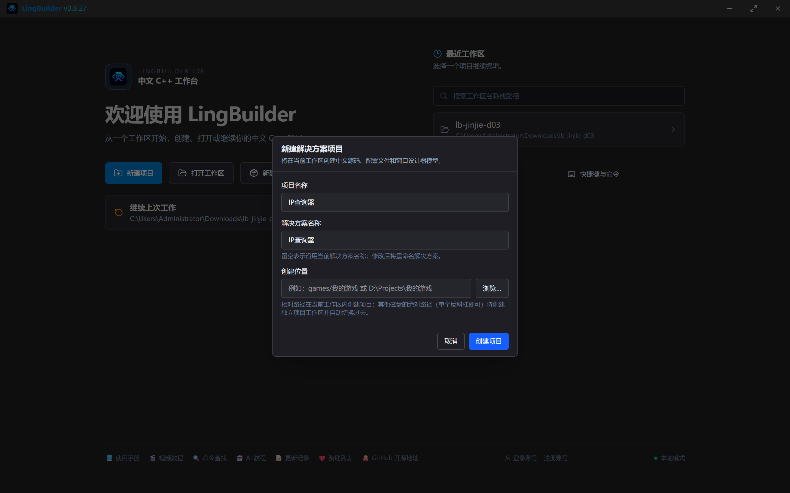
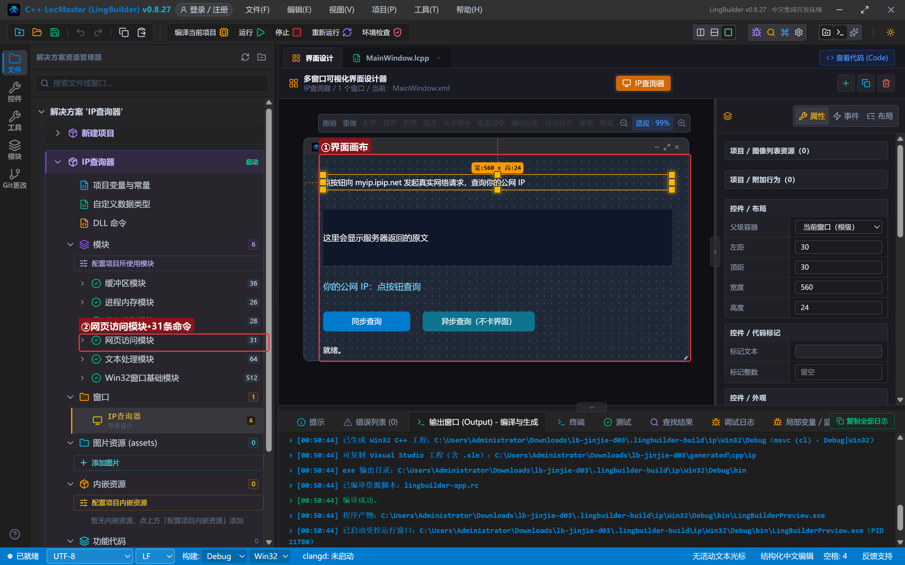
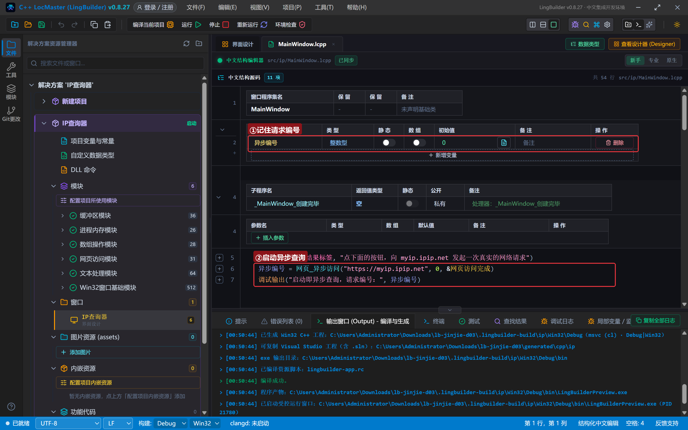
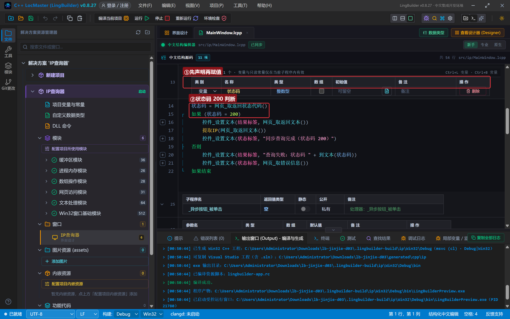
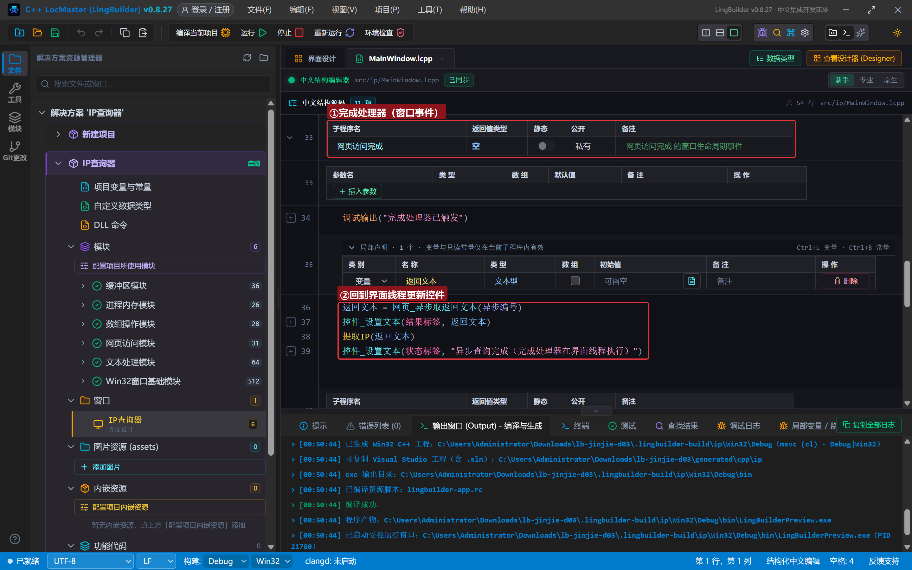
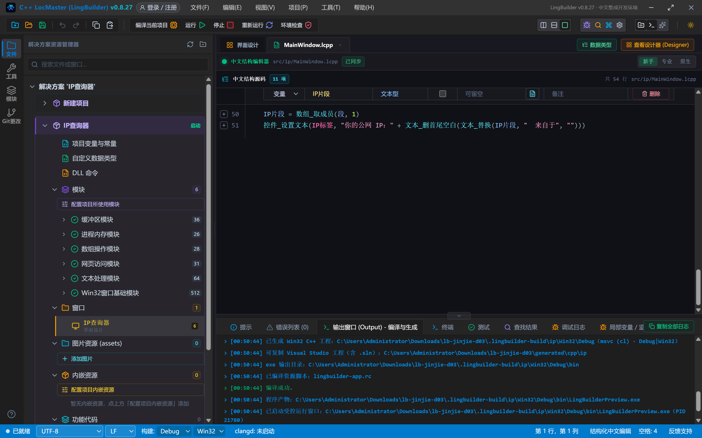
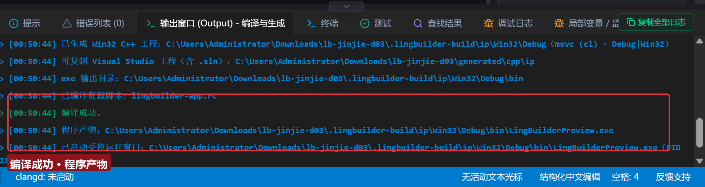
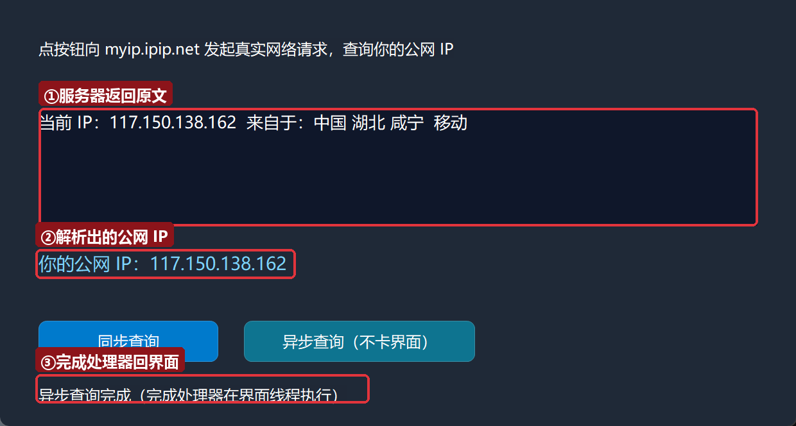
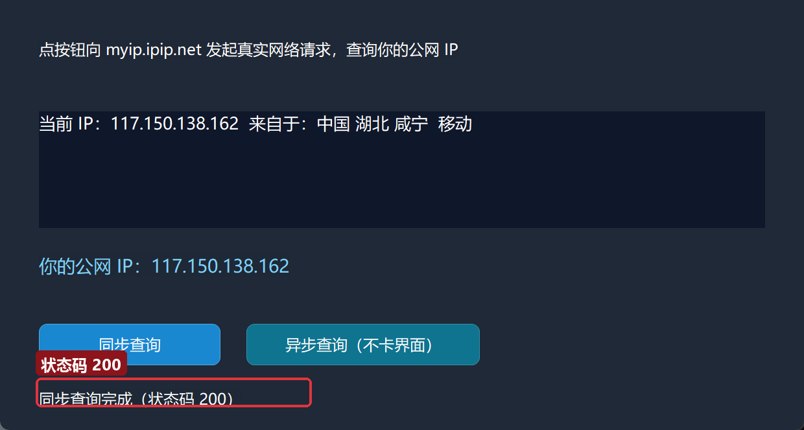

# 进阶实战 03 · 网络请求 web.http：做一个 IP 查询小工具

> 《LingBuilder 进阶实战系列》第 3 集。程序连上互联网，才算真正「活」了。本集用**网页访问模块（web.http）**做一个 **IP 查询小工具**：点一下按钮，向公网服务发一次真实的 HTTP 请求，把自己的公网 IP 和归属地显示在窗口里。你还会学到两种发起方式——**同步**（简单直接，但请求期间界面会卡住）和**异步**（后台线程发请求，界面永不卡）——以及完成后如何**回到界面线程**更新控件。全程约 35 分钟。
>
> 前置要求：学完[零基础入门系列](/guide/tutorials/beginner)与[进阶第 1 集](/guide/tutorials/jinjie-01-sqlite)、[第 2 集](/guide/tutorials/jinjie-02-inline-cpp)。本集源码包见文末。

## 这一集你将学会

- 启用「网页访问模块」，用 `网页_访问_对象` 发一次同步 GET 请求
- 读响应三件套：`网页_取返回文本`、`网页_取返回状态代码`、`网页_取错误信息`
- 用 `网页_异步访问` + `&完成处理器` 发异步请求——**完成处理器必须在窗口类里声明**，它在界面线程执行，可以直接更新控件
- 用 `文本_分割` + `数组_取成员` 解析服务器返回的文本
- 理解「先声明、再赋值」为什么在网络代码里尤其重要

## 1. 三十秒理解：同步与异步

想象你打电话问朋友一个问题：

- **同步** = 你拿着话筒干等，他说完你才挂——等待期间你什么都干不了。程序里就是**界面卡住**，请求一两秒还好，网络差时十几秒都下不来。
- **异步** = 你开了免提去干别的，他说完再喊你。程序里就是**后台线程发请求**，界面照常响应，请求完成后系统自动调用你指定的一个子程序（**完成处理器**）把结果交给你。

两种方式本集都教：先同步（容易理解），再异步（正确姿势）。

## 2. 新建项目与启用模块

新建窗口项目：名称 **IP查询器**，模板「Windows 界面设计」，创建位置留空：



然后点「**配置项目所使用模块**」，启用「**网页访问模块**」（搜索「网页」即可找到）。本集还会用到文本处理（`文本_分割`/`文本_替换`）和数组操作（`数组_取成员`/`数组_取成员数`），这两个模块如果你的项目还没启用，一并启用。

## 3. 设计界面

| 控件 | 名称 | 显示内容 | 左距 | 顶距 | 宽度 | 高度 |
| --- | --- | --- | --- | --- | --- | --- |
| 标签 | 说明标签 | 点按钮向 myip.ipip.net 发起真实网络请求，查询你的公网 IP | 30 | 30 | 560 | 24 |
| 标签 | 结果标签 | 这里会显示服务器返回的原文（字体大小 13） | 30 | 86 | 560 | 90 |
| 标签 | IP标签 | 你的公网 IP：点按钮查询（字体大小 14） | 30 | 196 | 560 | 28 |
| 按钮 | 同步按钮 | 同步查询 | 30 | 250 | 140 | 32 |
| 按钮 | 异步按钮 | 异步查询（不卡界面） | 190 | 250 | 180 | 32 |
| 标签 | 状态标签 | 就绪。 | 30 | 300 | 560 | 24 |

窗口宽 620、高 360。绑 5 个事件：窗口「创建完毕」、同步按钮「被单击」、异步按钮「被单击」，以及一个**手动新建的窗口事件**「网页访问完成」——右键窗口类空白处「新建子程序」，命名为 `网页访问完成`、返回值类型「空」。它就是异步请求的完成处理器，名字必须和 `&` 后面写的完全一致。



## 4. 认识本集命令

| 命令 | 作用 | 什么时候用 |
| --- | --- | --- |
| `网页_访问_对象(网址, 访问方式)` | 同步访问，返回响应字节集 | 请求快、不在乎卡顿时 |
| `网页_取返回文本()` | 读最近一次同步响应的 UTF-8 文本 | 紧跟同步访问之后 |
| `网页_取返回状态代码()` | 读状态码（200=成功） | 判断请求是否成功 |
| `网页_取错误信息()` | 读失败的中文原因 | 失败分支里给用户看 |
| `网页_异步访问(网址, 方式, &完成处理器)` | 后台线程发请求，立即返回请求编号 | 正式软件的首选 |
| `网页_异步取返回文本(请求编号)` | 在完成处理器里读结果 | 完成处理器第一行 |

## 5. 写代码 ①：程序集变量 + 启动即查询

程序集变量表加一个「异步编号」（整数型，初始值 0）——它记住异步请求的编号，完成处理器靠它取结果。

`_MainWindow_创建完毕` 里先发一次异步查询（程序一启动就自动查，这是真实软件的常见做法）：

```lcpp
事件 _MainWindow_创建完毕()
    控件_设置文本(结果标签, "点下面的按钮，向 myip.ipip.net 发起一次真实的网络请求")
    异步编号 = 网页_异步访问("https://myip.ipip.net", 0, &网页访问完成)
    调试输出("启动即异步查询，请求编号：", 异步编号)
结束
```



`网页_异步访问` 前三个参数就够了：网址（必须带 `https://`）、访问方式（0=GET）、完成处理器（**`&网页访问完成`，`&` 不能少**）。返回的请求编号存进程序集变量；**返回 0 表示启动失败**（网址非法或处理器名不存在）。

## 6. 写代码 ②：同步查询

`_同步按钮_被单击`：

```lcpp
事件 _同步按钮_被单击()
    控件_设置文本(状态标签, "同步查询中…（此时界面暂时无响应）")
    网页_访问_对象("https://myip.ipip.net", 0)
    局部 整数型 状态码
    状态码 = 网页_取返回状态代码()
    如果 (状态码 = 200)
        控件_设置文本(结果标签, 网页_取返回文本())
        提取IP(网页_取返回文本())
        控件_设置文本(状态标签, "同步查询完成（状态码 200）")
    否则
        控件_设置文本(结果标签, "查询失败：状态码 " + 到文本(状态码))
        控件_设置文本(状态标签, 网页_取错误信息())
    如果结束
结束
```



两个要点：

- **`状态码` 必须先声明再赋值**。`网页_访问_对象` 这行执行完才有状态码，而「声明带初始化」会被提升到子程序最前——提升后读到的是上一次请求的旧值（第一次甚至是 0）。老坑第三次出现，说明它值得你背下来。
- 失败分支不要沉默：状态码写进结果区，`网页_取错误信息()` 的中文原因写进状态栏。

## 7. 写代码 ③：完成处理器（异步的正确姿势）

`_异步按钮_被单击` 发起请求，`网页访问完成` 在请求结束时被自动调用：

```lcpp
事件 _异步按钮_被单击()
    控件_设置文本(状态标签, "异步查询中…（界面不卡，随便拖动窗口试试）")
    异步编号 = 网页_异步访问("https://myip.ipip.net", 0, &网页访问完成)
    如果 (异步编号 = 0)
        控件_设置文本(状态标签, "异步请求启动失败")
    如果结束
结束

事件 网页访问完成()
    调试输出("完成处理器已触发")
    局部 文本型 返回文本
    返回文本 = 网页_异步取返回文本(异步编号)
    控件_设置文本(结果标签, 返回文本)
    提取IP(返回文本)
    控件_设置文本(状态标签, "异步查询完成（完成处理器在界面线程执行）")
结束
```

三个关键规则：

1. **完成处理器必须声明在窗口类里**（功能库不行），名字必须与 `&` 后面完全一致。
2. 它由系统在**界面线程**自动调用——所以里面可以直接 `控件_设置文本` 更新界面，不需要任何线程切换代码。
3. 结果用 `网页_异步取返回文本(请求编号)` 读取，请求编号就是发起时存下的那个。



## 8. 写代码 ④：解析出干净的 IP

服务器返回的是一整句：「当前 IP：117.150.138.162  来自于：中国 湖北 咸宁  移动」。子程序 `提取IP` 负责把 IP 抠出来（带一个文本型参数，方法见零基础第 15 集）：

```lcpp
空 提取IP(文本型 原始文本)
    局部 文本型 段[]
    文本_分割(原始文本, "：", 段, 真)
    如果 (数组_取成员数(段) < 2)
        控件_设置文本(IP标签, "没有解析到 IP")
        返回()
    如果结束
    局部 文本型 IP片段
    IP片段 = 数组_取成员(段, 1)
    控件_设置文本(IP标签, "你的公网 IP：" + 文本_删首尾空白(文本_替换(IP片段, "  来自于", "")))
结束
```

思路：按中文冒号把整句切成三段，第 2 段是「IP＋尾巴」，替换掉尾巴、删掉首尾空白，就是干净的 IP。下一集的正则表达式还有更优雅的解法。



## 9. 编译：先看错误列表

点「**编译当前项目**」，先看「错误列表」为 (0)、输出窗口出现「编译成功。」「程序产物：…exe」再运行：



## 10. 运行：启动即查询

点「运行」。程序一启动就自动发起了异步查询，几秒后结果自动填满窗口——你没点任何按钮：



再点「同步查询」试一次，状态栏显示「同步查询完成（状态码 200）」：



点「异步查询」时注意观察：按钮按下去的瞬间状态栏变成「异步查询中…」，但**窗口可以随便拖动**——这就是异步的价值。切回 IDE 的「调试日志」，能看到两条调试输出：请求编号和「完成处理器已触发」。

## 11. 常见问题急救表

| 症状 | 原因 | 解法 |
| --- | --- | --- |
| 完成处理器永远不触发 | `&` 后面的名字与窗口类里的子程序名不一致 | 名字必须一字不差（本集制作时真踩过：`&网页访问完成` 对不上 `_网页访问完成`） |
| 状态码读出来是 0 或旧值 | `局部 整数型 状态码 = 网页_取返回状态代码()` 提升到了请求之前 | 拆成「先声明、再赋值」 |
| 返回文本中文乱码 | 目标站点返回 GBK | `网页_取返回文本` 按 UTF-8 解码；换 UTF-8 站点或用编码模块转 |
| 同步请求时界面白屏几秒 | 同步的本质就是等 | 改用 `网页_异步访问` |
| 编译报「未知命令 网页_…」 | 网页访问模块未启用 | 第 2 节启用模块 |
| 需要自定义 User-Agent | 默认 UA 被网关拒绝时 | `网页_异步访问` 第 6 参传「User-Agent: …」（一行一个协议头） |

## 本集小结

- 同步 = `网页_访问_对象` + 三件套读取，简单但卡界面；异步 = `网页_异步访问` + `&完成处理器`，正式软件首选。
- 完成处理器：窗口类里声明、名字与 `&` 一致、系统保证在界面线程调用。
- 「先声明、再赋值」防提升坑——网络代码里全是「先执行才有值」的场景，务必形成肌肉记忆。
- 文本解析三板斧：分割 → 取成员 → 删空白。

**下一集预告**：《多线程 threading》——把耗时任务真正搬进后台线程，做一个批量文件统计器，进度条实时走、界面永不卡。

[回系列总览](/guide/tutorials/jinjie)
