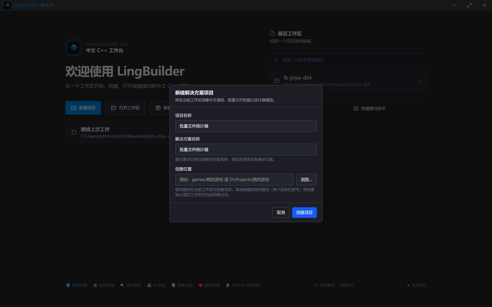
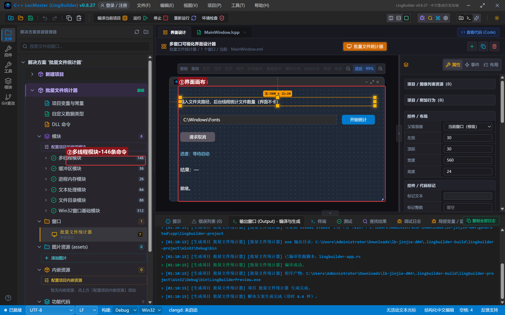
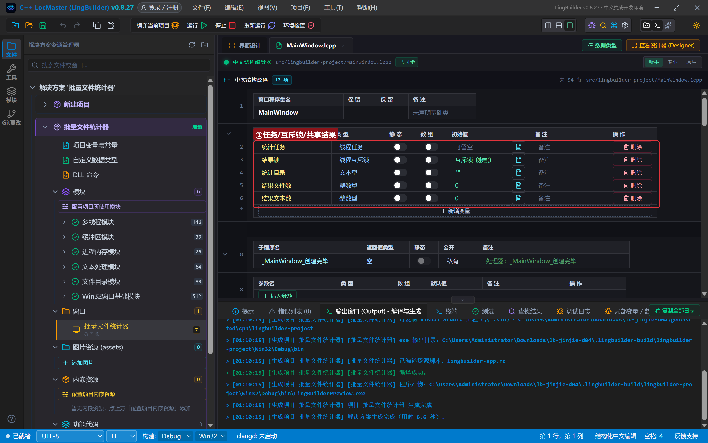
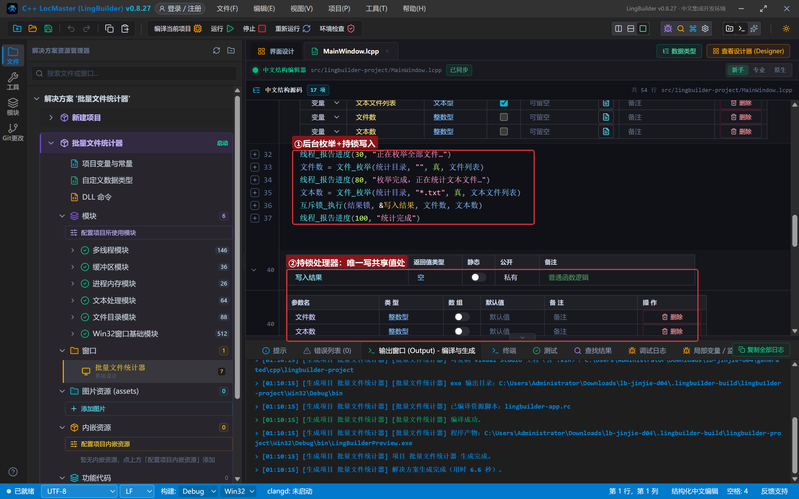
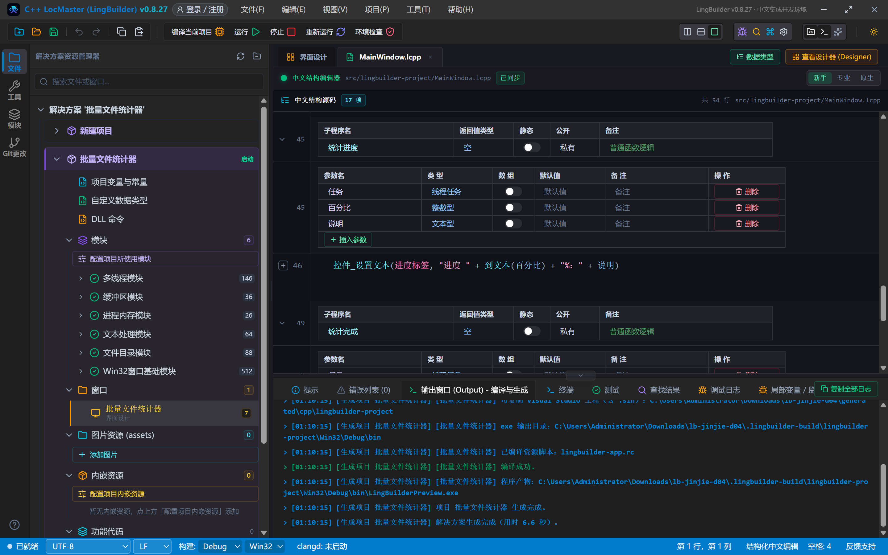
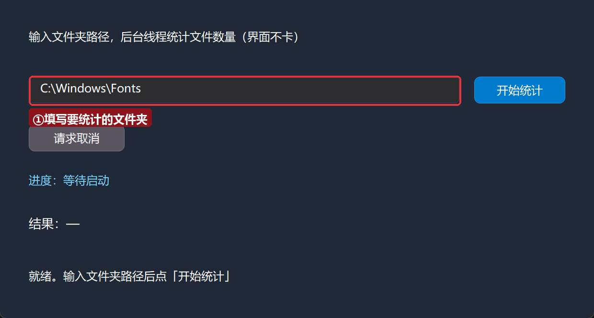
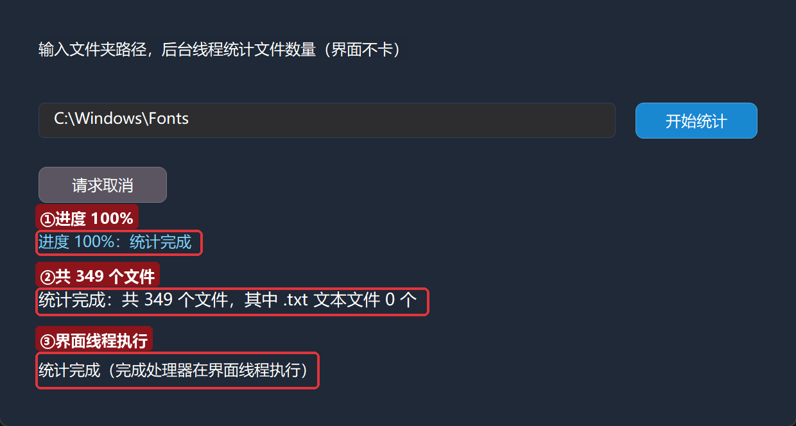

# 进阶实战 04 · 多线程 threading：批量文件统计器

> 《LingBuilder 进阶实战系列》第 4 集。第 3 集的异步查询让网络请求不再卡界面，这一集把同样的思想用到**本地重活**上：统计一个文件夹里有多少文件。你将学会**多线程模块**的核心三件套——`线程_提交进度`（后台干活）、**进度回调**（实时汇报）、**完成回调**（带回结果），以及多线程编程的第一条铁律：**工作线程禁止直接碰控件，共享数据必须加锁**。全程约 35 分钟。
>
> 前置要求：学完[零基础入门系列](/guide/tutorials/beginner)与进阶前 3 集。本集源码包见文末。

## 这一集你将学会

- `线程_提交进度`：把耗时任务提交到后台线程池
- 工作处理器、进度处理器、完成处理器三者各司其职
- **互斥锁**：`互斥锁_创建` + `互斥锁_执行`，安全地把结果写回共享变量
- `文件_枚举`：一条命令枚举文件夹（可含子目录）
- 编译器的**线程安全警告**怎么看、怎么修（本集真机复现并修复）

## 1. 三十秒理解：为什么需要多线程

第 3 集的异步网络请求开了免提，这一集的「统计文件夹」是本地重活：递归枚举几千个文件同样耗时，如果放在按钮事件里直接干，窗口一样会卡死。多线程模块提供的方案和第 3 集如出一辙，只是角色更多：

| 角色 | 谁来干 | 在哪个线程 | 能不能碰控件 |
| --- | --- | --- | --- |
| 工作处理器 | `&统计工作` | **后台线程** | ❌ 绝对禁止 |
| 进度处理器 | `&统计进度` | 界面线程 | ✅ 直接更新 |
| 完成处理器 | `&统计完成` | 界面线程 | ✅ 直接更新 |

**红线记住一句：只有工作处理器在后台，它永远不碰控件；要更新界面，走进度或完成处理器。**

## 2. 新建项目与启用模块

新建窗口项目：名称 **批量文件统计器**，模板「Windows 界面设计」，创建位置留空：



启用两个模块：「**多线程模块**」（146 条命令，本集主角）和「**文件目录模块**」（88 条命令，提供 `文件_枚举`）。

## 3. 设计界面

| 控件 | 名称 | 显示内容/占位 | 左距 | 顶距 | 宽度 | 高度 |
| --- | --- | --- | --- | --- | --- | --- |
| 标签 | 说明标签 | 输入文件夹路径，后台线程统计文件数量（界面不卡） | 30 | 30 | 560 | 24 |
| 编辑框 | 路径框 | （显示内容 C:\Windows\Fonts） | 30 | 80 | 450 | 28 |
| 按钮 | 统计按钮 | 开始统计 | 495 | 80 | 95 | 28 |
| 按钮 | 取消按钮 | 请求取消 | 30 | 130 | 100 | 28 |
| 标签 | 进度标签 | 进度：等待启动 | 30 | 180 | 560 | 24 |
| 标签 | 结果标签 | 结果：—（字体大小 13） | 30 | 224 | 560 | 28 |
| 标签 | 状态标签 | 就绪。 | 30 | 280 | 560 | 24 |

窗口宽 620、高 360。绑 3 个事件：统计按钮「被单击」、取消按钮「被单击」、窗口「创建完毕」。



## 4. 认识本集命令

| 命令 | 作用 | 什么时候用 |
| --- | --- | --- |
| `线程_提交进度(&工作, &进度, &完成, 参数)` | 提交带进度汇报的后台任务 | 耗时且想显示进度 |
| `线程_请求取消(任务)` | 请求取消（协作式） | 用户点「取消」 |
| `线程_报告进度(百分比, 说明)` | 工作处理器里汇报进度 | 后台干活时 |
| `文件_枚举(目录, 通配符, 含子目录, 结果数组)` | 枚举文件到文本数组，返回数量 | 统计、批量处理 |
| `互斥锁_创建()` / `互斥锁_执行(锁, &处理器, 参数...)` | 创建锁 / **持锁执行**处理器（自动解锁） | 后台线程写共享变量 |

## 5. 写代码 ①：五个程序集成员

程序集变量表加 5 个成员（第 3 集的成员表画法）：

| 名称 | 类型 | 初始值 |
| --- | --- | --- |
| 统计任务 | 线程任务 | （空） |
| 结果锁 | 线程互斥锁 | 互斥锁_创建() |
| 统计目录 | 文本型 | "" |
| 结果文件数 | 整数型 | 0 |
| 结果文本数 | 整数型 | 0 |



两个新面孔：

- **线程任务**：`线程_提交*` 返回的任务句柄类型，后续取消、查状态都用它。
- **线程互斥锁**：初始值直接写 `互斥锁_创建()`——窗口创建时这把锁就建好了，全程复用。

## 6. 写代码 ②：三个处理器

```lcpp
事件 _统计按钮_被单击()
    统计目录 = 文本_删首尾空白(控件_取文本(路径框))
    如果 (统计目录 = "")
        信息框("请先填写要统计的文件夹路径", 48, "提示")
        返回()
    如果结束
    控件_设置文本(状态标签, "已在后台线程开始统计，界面不卡…")
    统计任务 = 线程_提交进度(&统计工作, &统计进度, &统计完成, 0)
结束

事件 _取消按钮_被单击()
    线程_请求取消(统计任务)
    控件_设置文本(状态标签, "已发出取消请求，等待工作处理器协作停下")
结束
```

按钮先把路径存进成员变量 `统计目录`（工作处理器在后台线程读它），再一句 `线程_提交进度` 提交任务——**提交立即返回**，按钮事件瞬间结束，这就是「不卡界面」的全部秘密。

核心的工作处理器：

```lcpp
空 统计工作(整数型 保留参数)
    局部 文本型 文件列表[]
    局部 文本型 文本文件列表[]
    局部 整数型 文件数
    局部 整数型 文本数
    线程_报告进度(30, "正在枚举全部文件…")
    文件数 = 文件_枚举(统计目录, "", 真, 文件列表)
    线程_报告进度(80, "枚举完成，正在统计文本文件…")
    文本数 = 文件_枚举(统计目录, "*.txt", 真, 文本文件列表)
    互斥锁_执行(结果锁, &写入结果, 文件数, 文本数)
    线程_报告进度(100, "统计完成")
结束
```



- 工作处理器在**后台线程**执行——这里从头到尾没有碰任何控件。
- `文件_枚举(目录, "", 真, 文件列表)`：空通配符匹配全部文件，`真` 表示连子目录一起递归，命中的完整路径写进文本数组，返回数量。
- **`互斥锁_执行(结果锁, &写入结果, 文件数, 文本数)`**：本集的点睛之笔。工作线程要把结果写进两个共享变量（结果文件数/结果文本数），多线程同时读写共享数据是出错的根源。这行代码「持着锁调用写入结果处理器」，处理器干完活锁自动释放（RAII），从机制上保证写操作不会和界面线程的读操作撞车。
- 两个局部计数 `文件数`/`文本数` 也遵守「先声明、再赋值」——它们依赖 `文件_枚举` 的执行结果。

配一个**只在持锁时才执行**的小处理器，专职写共享值：

```lcpp
空 写入结果(整数型 文件数, 整数型 文本数)
    结果文件数 = 文件数
    结果文本数 = 文本数
结束
```

最后是进度和完成处理器——它们在界面线程，可以放心碰控件：

```lcpp
空 统计进度(线程任务 任务, 整数型 百分比, 文本型 说明)
    控件_设置文本(进度标签, "进度 " + 到文本(百分比) + "%：" + 说明)
结束

空 统计完成(线程任务 任务)
    控件_设置文本(结果标签, "统计完成：共 " + 到文本(结果文件数) + " 个文件，其中 .txt 文本文件 " + 到文本(结果文本数) + " 个")
    控件_设置文本(状态标签, "统计完成（完成处理器在界面线程执行）")
结束
```



## 7. 编译：先看错误列表，再认识线程安全警告

点「编译当前项目」。如果你偷懒没写互斥锁、直接在工作处理器里写 `结果文件数 = 文件数`，错误列表会出现两条**线程安全警告**：

> 工作处理器 统计工作 写入共享值 结果文件数，但未检测到互斥锁保护。

本集制作时就真机复现了这两条警告——它们不阻断编译，但 multi-thread 下不加锁的共享写入是真正的事故来源。按本集写法补上 `互斥锁_执行` 后警告消失，错误列表归零：

（警告与清除过程见上一节代码对比；本集最终编译错误列表 (0)、输出窗口「编译成功。」）

## 8. 运行：看着后台统计跑完

点「运行」。初始状态，路径已预填 `C:\Windows\Fonts`：



点「开始统计」，约一秒后统计完成——**全程窗口可以随便拖动**：



三个信息各就各位：进度 100%、共 349 个文件（.txt 文本文件 0 个——字体目录里确实没有 txt）、状态栏提示完成处理器在界面线程执行。

> **关于「请求取消」**：取消是**协作式**的——`线程_请求取消` 只是发出请求，真正停下来需要工作处理器主动调用 `线程_是否请求取消` 检查点。本例的 `文件_枚举` 是一条阻塞命令，枚举期间无法插入检查，所以取消只在两步枚举的间隙生效。需要强取消的长任务，把大任务拆成小步、每步之间检查取消标志即可（多线程模块完整演示项目里有范例）。

## 9. 常见问题急救表

| 症状 | 原因 | 解法 |
| --- | --- | --- |
| 错误列表出现「写入共享值…未检测到互斥锁保护」警告 | 工作处理器直接给共享成员赋值 | 用 `互斥锁_执行(锁, &处理器, 参数)` 持锁写入 |
| 在工作处理器里调 `控件_设置文本` 报错或界面异常 | 工作线程禁碰控件 | 改用 `线程_报告进度` 或把更新挪进完成处理器 |
| 线程_请求取消 没停 | 协作取消需要处理器主动检查 `线程_是否请求取消` | 拆小步、在循环里检查 |
| 局部变量值总是旧值/0 | 声明带初始化被提升到子程序最前 | 先声明、再赋值 |
| 文件_枚举 返回 0 | 目录不存在 | 检查路径；目录不存在时返回 0 |

## 本集小结

- `线程_提交进度(&工作, &进度, &完成, 参数)`：三处理器分工，工作在后台、进度/完成回界面。
- **工作线程禁碰控件**；共享数据用 `互斥锁_创建` + `互斥锁_执行` 持锁读写。
- `文件_枚举` 一条命令递归枚举文件；线程安全警告是编译器送的免费审查。
- 取消是协作式的：请求发出后，工作处理器在检查点才真正停下。

**下一集预告**：《正则表达式 std.regex》——让程序拥有一双「文本搜索鹰眼」，从一堆日志里批量提取邮箱、链接，学会「宽松解码+正则」的形态校验范式。

[回系列总览](/guide/tutorials/jinjie)
