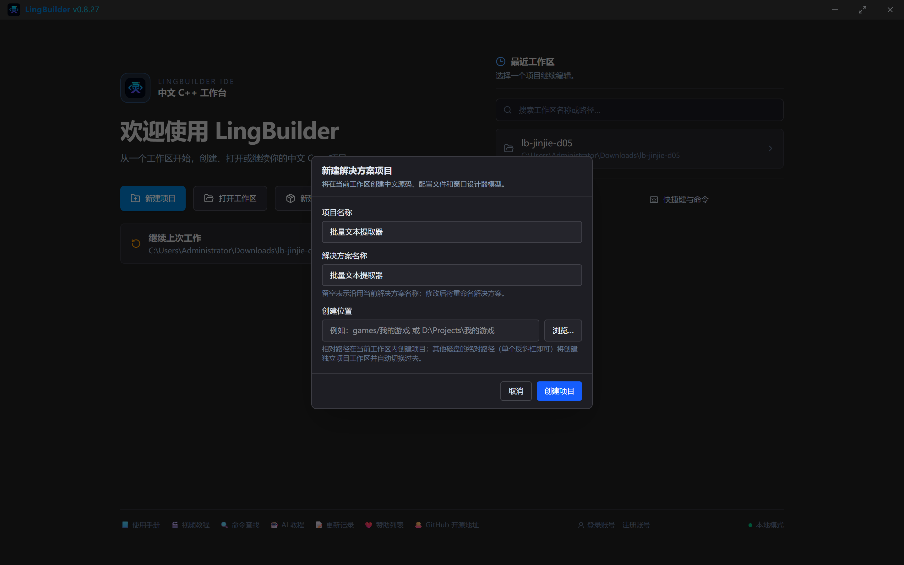
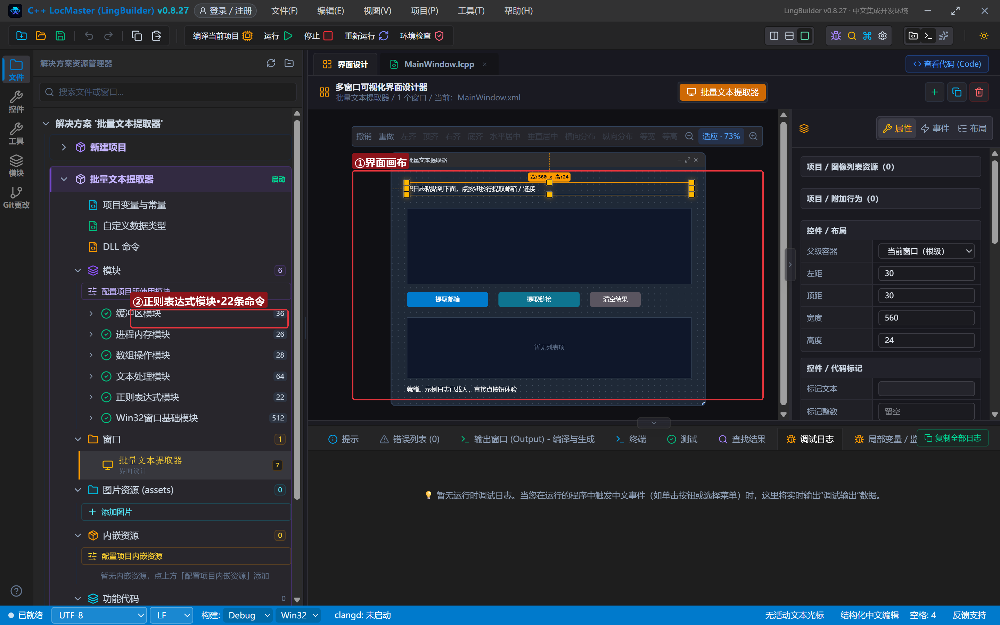
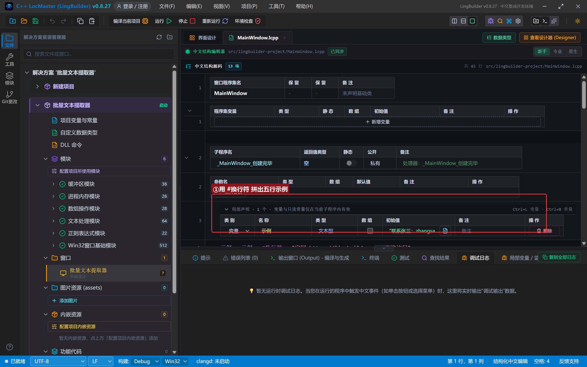
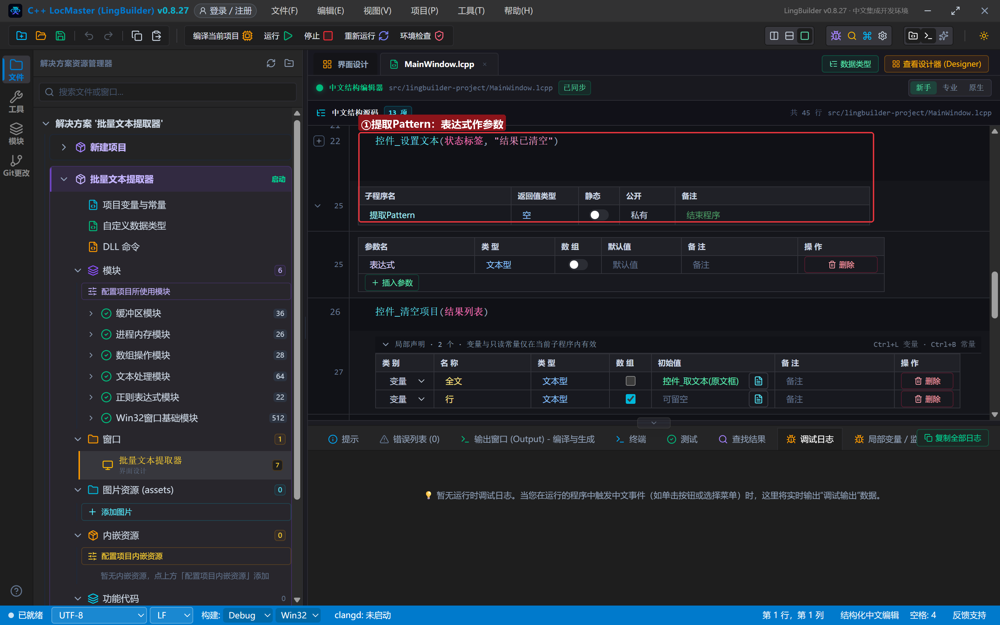
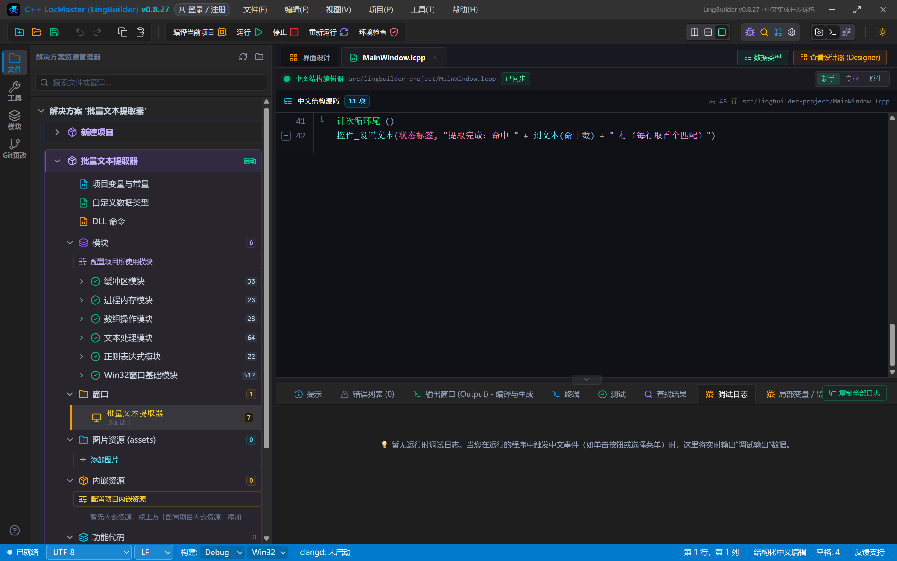
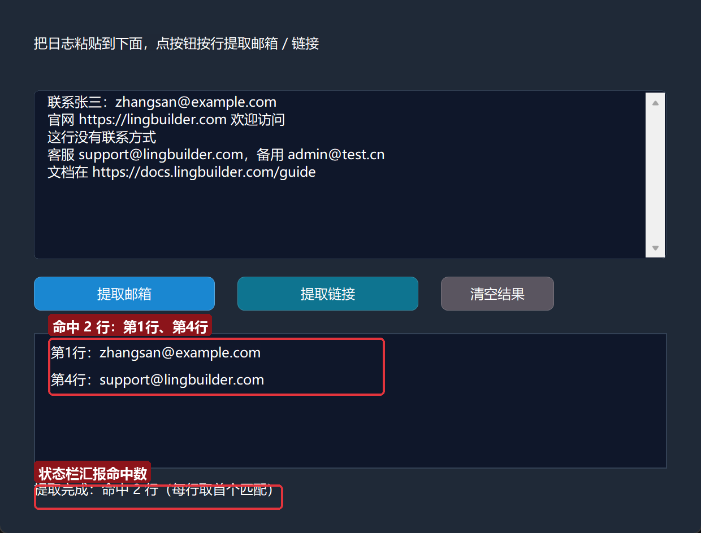
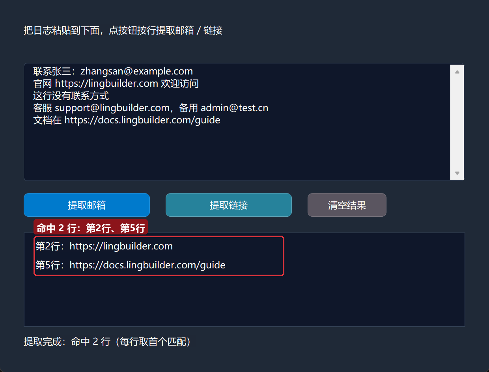

# 进阶实战 05 · 正则表达式 std.regex：批量文本提取器

> 《LingBuilder 进阶实战系列》第 5 集。日志、网页、聊天记录——文本处理的第一步是「把想要的东西抓出来」。本集用**正则表达式模块（std.regex）**做一个**批量文本提取器**：粘贴一段文本，点一下按钮，按行提取所有邮箱和链接。你还会学到程序员处理乱文本的标准姿势——**「宽松解码 + 正则」形态校验范式**。全程约 30 分钟。
>
> 前置要求：学完[零基础入门系列](/guide/tutorials/beginner)与进阶前 4 集（特别是第 1 集的数组和第 3 集的「先声明再赋值」）。本集源码包见文末。

## 这一集你将学会

- 正则表达式模块的五条命令：`正则_完全匹配`、`正则_是否包含`、`正则_取首个`、`正则_替换`、`正则_匹配数量`
- 用 `#换行符` 内置常量拼出多行文本
- 用 `文本_分割` + `计次循环首` 逐行扫描、批量提取
- 两种正则的写法：邮箱 `[a-zA-Z0-9._%+-]+@[a-zA-Z0-9.-]+`、链接 `https?://[a-zA-Z0-9./_-]+`
- 「宽松解码 + 正则」形态校验范式：判断一段字节「像不像某种内容」的标准姿势

## 1. 三十秒理解：正则是什么

正则表达式就是「文本的搜索公式」：用一串符号描述你要找的内容长什么样。比如：

- `[a-zA-Z0-9._%+-]+@[a-zA-Z0-9.-]+` —— 「一串字母数字点号，跟一个 @，再跟一串字母数字点号」= 邮箱的样子
- `https?://[a-zA-Z0-9./_-]+` —— 「http 或 https 开头，跟冒号斜杠，再跟一串地址字符」= 链接的样子

LingBuilder 的正则模块只有 5 条命令，本集用到其中两条：`正则_是否包含`（判断这行有没有）和 `正则_取首个`（取出第一个匹配）。

> **形态校验范式**：判断一段字节「像不像某种内容」（验证码、账号、特定协议包），标准姿势是先用宽松解码（GB18030）转成文本，再用正则匹配特征——不要写逐字节状态机硬怼。

## 2. 新建项目与启用模块

新建窗口项目：名称 **批量文本提取器**，模板「Windows 界面设计」，创建位置留空：



启用「**正则表达式模块**」（22 条命令）。`文本_分割`、`数组_取成员` 等命令分别属于文本处理和数组操作模块，未启用的话一并启用。

## 3. 设计界面

| 控件 | 名称 | 显示内容 | 左距 | 顶距 | 宽度 | 高度 |
| --- | --- | --- | --- | --- | --- | --- |
| 标签 | 说明标签 | 把日志粘贴到下面，点按钮按行提取邮箱 / 链接 | 30 | 30 | 560 | 24 |
| 编辑框 | 原文框 | （空，勾选**多行**） | 30 | 80 | 560 | 150 |
| 按钮 | 邮箱按钮 | 提取邮箱 | 30 | 245 | 160 | 30 |
| 按钮 | 链接按钮 | 提取链接 | 210 | 245 | 160 | 30 |
| 按钮 | 清空按钮 | 清空结果 | 390 | 245 | 100 | 30 |
| 列表框 | 结果列表 | — | 30 | 295 | 560 | 120 |
| 标签 | 状态标签 | 就绪。示例日志已载入，直接点按钮体验 | 30 | 425 | 560 | 24 |

窗口宽 620、高 500。**原文框记得勾选「多行」**，否则只能粘贴一行。绑 4 个按钮事件（被单击）+ 窗口「创建完毕」。



## 4. 写代码 ①：载入五行示例日志

```lcpp
事件 _MainWindow_创建完毕()
    局部 文本型 示例 = "联系张三：zhangsan@example.com"
    示例 = 示例 + #换行符 + "官网 https://lingbuilder.com 欢迎访问"
    示例 = 示例 + #换行符 + "这行没有联系方式"
    示例 = 示例 + #换行符 + "客服 support@lingbuilder.com，备用 admin@test.cn"
    示例 = 示例 + #换行符 + "文档在 https://docs.lingbuilder.com/guide"
    控件_设置文本(原文框, 示例)
    控件_设置文本(状态标签, "示例日志已载入，直接点按钮体验")
结束
```



`#换行符` 是语言内置常量（文本型，回车+换行两个字符），开箱可用不需要声明。五行示例覆盖三种情况：有邮箱的行、有链接的行、什么都没有的行——正好检验提取器是否准确。

## 5. 写代码 ②：核心提取子程序

两个按钮共用一个子程序，只是表达式不同：

```lcpp
事件 _邮箱按钮_被单击()
    提取Pattern("[a-zA-Z0-9._%+-]+@[a-zA-Z0-9.-]+")
结束

事件 _链接按钮_被单击()
    提取Pattern("https?://[a-zA-Z0-9./_-]+")
结束

事件 _清空按钮_被单击()
    控件_清空项目(结果列表)
    控件_设置文本(状态标签, "结果已清空")
结束

空 提取Pattern(文本型 表达式)
    控件_清空项目(结果列表)
    局部 文本型 全文 = 控件_取文本(原文框)
    局部 文本型 行[]
    文本_分割(全文, "\r\n", 行, 真)
    局部 整数型 命中数 = 0
    局部 整数型 序号 = 0
    局部 文本型 本行 = ""
    局部 文本型 命中 = ""
    计次循环首 (数组_取成员数(行), 序号)
        本行 = 数组_取成员(行, 序号 - 1)
        如果 (正则_是否包含(本行, 表达式))
            命中 = 正则_取首个(本行, 表达式)
            命中数 = 命中数 + 1
            控件_添加项目(结果列表, "第" + 到文本(序号) + "行：" + 命中)
        如果结束
    计次循环尾 ()
    控件_设置文本(状态标签, "提取完成：命中 " + 到文本(命中数) + " 行（每行取首个匹配）")
结束
```



拆解：

- `文本_分割(全文, "\r\n", 行, 真)`：按回车换行把全文切成行数组。**分隔符这里要写 `"\r\n"` 字面量，不要写 `#换行符`**——`#换行符` 是 wstring 常量，拼接没问题，但传给「分隔符」这类指针参数位置会报 C2664 类型错（本集真机踩过并修好）。
- `计次循环首 (数组_取成员数(行), 序号)`：有几行就循环几次；`序号 - 1` 是因为循环序号从 1 起，而数组下标从 0 起。
- `正则_是否包含` 先判断这行有没有匹配，有才 `正则_取首个` 取出来——避免对无匹配的行取到空文本。
- 命中行以「第N行：内容」格式进结果列表，一眼能对应回原文。

循环体涉及的两个提取命令细节：`正则_是否包含(文本, 表达式)` 返回逻辑型，`正则_取首个(文本, 表达式)` 返回首个匹配文本（无匹配返回空）——两者都要求表达式合法，非法时取首个返回空文本、是否包含返回假，不会崩溃。



## 6. 编译与运行

点「编译当前项目」，先看错误列表为 (0)、输出窗口「编译成功。」，然后点「运行」。程序启动时示例日志已载入原文框。点「提取邮箱」：



第 1 行和第 4 行命中（每行取首个匹配，第 4 行有两个邮箱只报第一个——这正是 `取首个` 的语义）。点「提取链接」：



第 2 行、第 5 行的链接被抓出来。试试删掉某行再提取，命中数会跟着变——提取逻辑完全由数据驱动。

## 7. 常见问题急救表

| 症状 | 原因 | 解法 |
| --- | --- | --- |
| 编译报 C2664 无法将 wstring 转换为 wchar_t* | 把 `#换行符` 常量传给了指针参数位置 | 分隔符等参数位置改用 `"\r\n"` 字面量 |
| 永远只提取到第一个匹配 | `正则_取首个` 的语义就是首个 | 按行分割后逐行提取（本集做法），或每行多次截取 |
| 提取邮箱把句尾句号带上 | 表达式结尾字符类没排除句号 | 用 `[a-zA-Z0-9._%+-]+@[a-zA-Z0-9.-]+\.[a-zA-Z]{2,}` 更严谨 |
| 正则合法但匹配不到 | 目标文本是 GBK 乱码 | 宽松解码（GB18030）转文本再匹配 |
| 表达式非法返回空文本 | 括号/方括号不配对 | 先用 `正则_是否包含` 验证表达式可用性 |

## 本集小结

- 正则模块五条命令，本集用 `正则_是否包含` + `正则_取首个` 完成按行批量提取。
- `#换行符` 拼接多行文本；作为分隔符参数时改用 `"\r\n"` 字面量。
- 「宽松解码 + 正则」是处理来历不明文本的标准姿势。
- 「先声明、再赋值」在循环体里同样适用（`本行`、`命中` 都是这么写的）。

**下一集预告**：《压缩与打包 archive》——把一堆文件一键打成 zip，学会 ZIP 命令族与内存压缩族，做一个文件夹一键压缩/解压工具。

[回系列总览](/guide/tutorials/jinjie)
