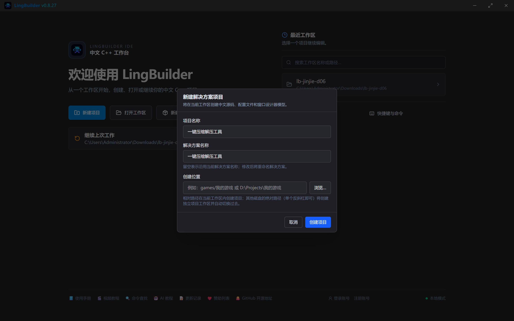
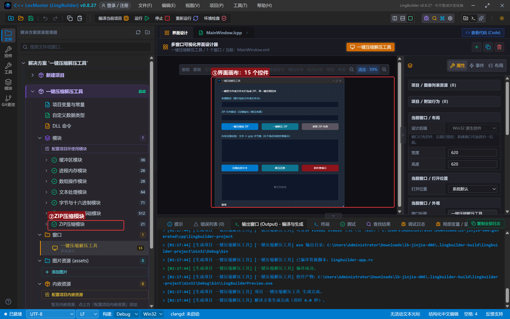
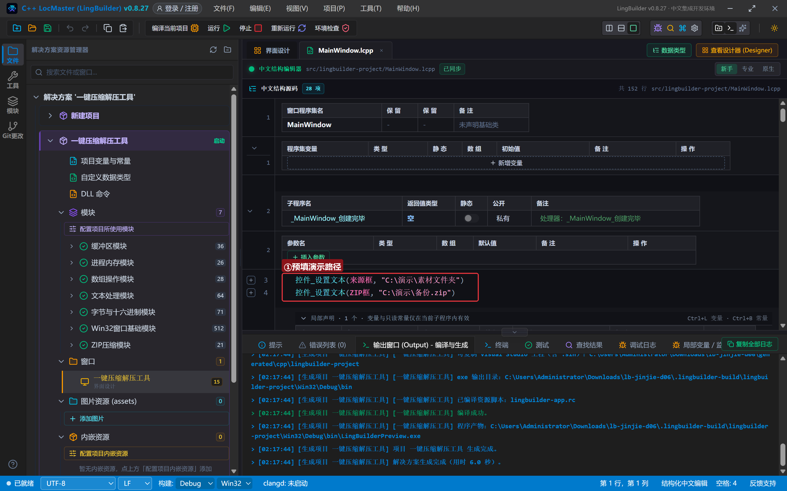
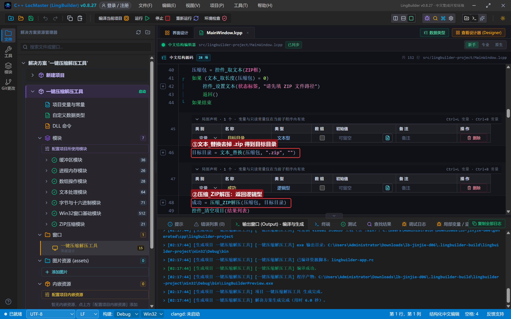
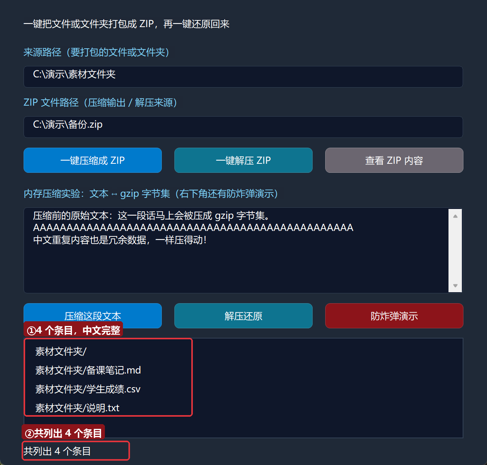
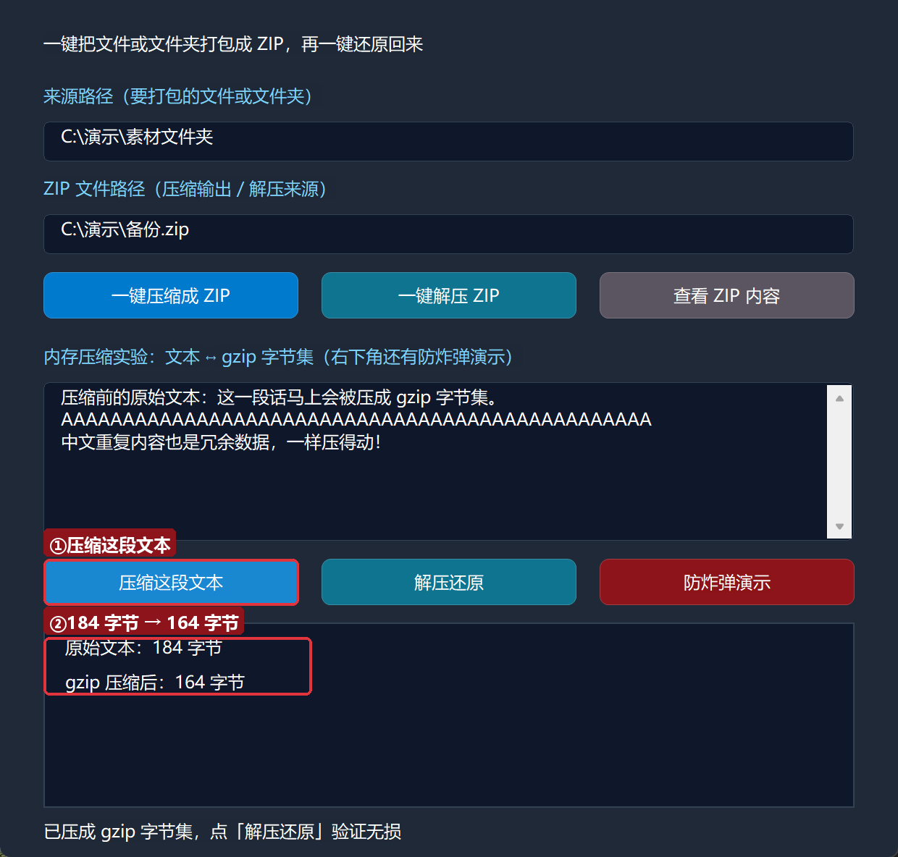
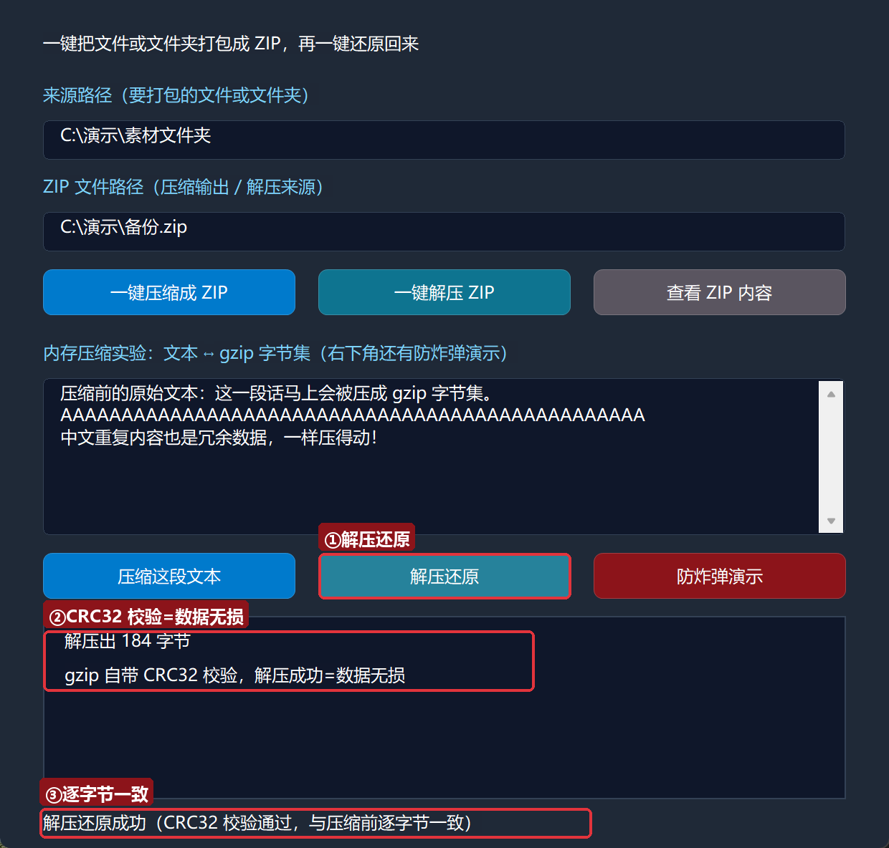

# 进阶实战 06 · 压缩与打包 archive：一键压缩 / 解压工具

> 《LingBuilder 进阶实战系列》第 6 集。备份聊天记录、打包项目文件夹、下载一个 .zip 还原回来——压缩是电脑上最常用的文件操作之一。本集用**ZIP 压缩模块（lingbuilder.archive）**做一个**一键压缩 / 解压工具**：填个路径点一下，文件夹变成 .zip；再点一下，.zip 完整还原。你还会学到「内存压缩」：把一段文字压成 gzip 字节集再无损还原，并亲眼看到**防炸弹上限**拦截恶意压缩包。全程约 35 分钟。
>
> 前置要求：学完[零基础入门系列](/guide/tutorials/beginner)与进阶前 5 集（特别是第 5 集的文本分割和「先声明再赋值」）。本集源码包见文末。

## 这一集你将学会

- ZIP 命令族三条主力：`压缩_ZIP创建`、`压缩_ZIP解压`、`压缩_ZIP列出`
- 内存压缩族：`压缩_GZIP压缩` / `压缩_GZIP解压`（还有 DEFLATE / ZLIB 两种形态）
- 出错就问 `压缩_取错误()`：每条失败都带中文原因
- 防炸弹上限 `#压缩_解压上限字节`：解压输出超过 64MB 自动中止
- 字节集三件套：`字节集_从文本`、`字节集_长度`、`字节集_重复`
- 路径里的反斜杠红线：哪些写法安全、哪些会踩雷

## 1. 三十秒理解：两种压缩

**文件打包（ZIP 族）**：把一个文件夹变成一个 .zip 文件。底层调用 Windows 自带的 tar.exe，不装任何东西、生成的 .zip 谁都能解。

**内存压缩（字节集族）**：把一段「字节集」压小，不落盘。三种形态：

| 命令族 | 格式 | 说明 |
| --- | --- | --- |
| `压缩_GZIP压缩` / `压缩_GZIP解压` | gzip（RFC1952） | 带 CRC32 校验，解压时自动验完整性，最常用 |
| `压缩_DEFLATE压缩` / `压缩_DEFLATE解压` | raw deflate（RFC1951） | 裸压缩流，网络协议里常见 |
| `压缩_ZLIB解压` | zlib（RFC1950） | 解压 zlib 容器（Adler32 校验）；本模块只提供解压方向 |

三条铁律先记住：**失败一律返回空**（字节集命令返回空字节集，ZIP 命令返回假），**原因一律问 `压缩_取错误()`**，**解压输出不许超过 64MB**（`#压缩_解压上限字节`，防 zip 炸弹）。

## 2. 新建项目与启用模块

新建窗口项目：名称 **一键压缩解压工具**，模板「Windows 界面设计」，创建位置留空：



启用「**ZIP压缩模块**」（9 条命令）。`文本_替换`、`文本_分割` 来自文本处理模块，`数组_取成员数` 等来自数组操作模块，`字节集_从文本` 等来自字节与十六进制模块——未启用的话一并启用。

> **这一集最重要的编译错误预演**：如果忘了启用 ZIP压缩模块就点「编译当前项目」，生成会被直接拦下，错误列表每条都点名来源模块：
>
> 
>
> 处理办法就一句：解决方案树 → 模块 → 双击勾上 ZIP压缩模块，再编译。后面所有 `压缩_*` 命令都要靠它。

## 3. 设计界面

窗口分上下两段：上段是「文件夹 ↔ ZIP」，下段是「文本 ↔ gzip 字节集」实验区。

| 控件 | 名称 | 显示内容 | 左距 | 顶距 | 宽度 | 高度 |
| --- | --- | --- | --- | --- | --- | --- |
| 标签 | 说明标签 | 一键把文件或文件夹打包成 ZIP，再一键还原回来 | 30 | 22 | 560 | 24 |
| 标签 | 来源标签 | 来源路径（要打包的文件或文件夹） | 30 | 58 | 420 | 22 |
| 编辑框 | 来源框 | （空） | 30 | 84 | 560 | 28 |
| 标签 | ZIP标签 | ZIP 文件路径（压缩输出 / 解压来源） | 30 | 122 | 420 | 22 |
| 编辑框 | ZIP框 | （空） | 30 | 148 | 560 | 28 |
| 按钮 | 压缩按钮 | 一键压缩成 ZIP | 30 | 188 | 176 | 32 |
| 按钮 | 解压按钮 | 一键解压 ZIP | 222 | 188 | 176 | 32 |
| 按钮 | 列出按钮 | 查看 ZIP 内容 | 414 | 188 | 176 | 32 |
| 标签 | 内存标签 | 内存压缩实验：文本 ↔ gzip 字节集（右下角还有防炸弹演示） | 30 | 238 | 560 | 22 |
| 编辑框 | 实验框 | （空，勾选**多行**） | 30 | 264 | 560 | 110 |
| 按钮 | 压缩实验按钮 | 压缩这段文本 | 30 | 386 | 176 | 32 |
| 按钮 | 还原实验按钮 | 解压还原 | 222 | 386 | 176 | 32 |
| 按钮 | 炸弹按钮 | 防炸弹演示 | 414 | 386 | 176 | 32 |
| 列表框 | 结果列表 | — | 30 | 430 | 560 | 128 |
| 标签 | 状态标签 | 就绪 | 30 | 566 | 560 | 22 |

窗口宽 620、高 620。绑 6 个按钮的「被单击」事件 + 窗口「创建完毕」。



## 4. 写代码 ①：创建完毕——预填演示路径

```lcpp
事件 _MainWindow_创建完毕()
    控件_设置文本(来源框, "C:\演示\素材文件夹")
    控件_设置文本(ZIP框, "C:\演示\备份.zip")
    局部 文本型 演示文
    演示文 = "压缩前的原始文本：这一段话马上会被压成 gzip 字节集。"
    演示文 = 演示文 + #换行符 + "AAAAAAAAAAAAAAAAAAAAAAAAAAAAAAAAAAAAAAAAAAAAAAAA"
    演示文 = 演示文 + #换行符 + "中文重复内容也是冗余数据，一样压得动！"
    控件_设置文本(实验框, 演示文)
    控件_设置文本(状态标签, "就绪。路径已填好，直接点「一键压缩成 ZIP」体验")
结束
```



窗口一打开就把两个路径填好、把实验文本塞进实验框，演示时一键直达。自己玩的时候把路径换成你的任意文件夹即可。

> **反斜杠红线**：`.lcpp` 的字符串和 C++ 一样认识 `\t`、`\n`、`\r` 这三个转义。写 `"C:\test"` 时 `\t` 会被当成**制表符**，路径就变成了「C: + 制表符 + est」。反斜杠后面跟中文（如 `"C:\演示\素材文件夹"`）或跟其他字母都没事，唯独 `\t`、`\n`、`\r` 要躲开——拿不准就用 `/`（`"C:/演示/素材文件夹"` 在 Windows 上同样合法）。

## 5. 写代码 ②：一键解压（顺带看懂 ZIP 三连的套路）

三个按钮套路一致：取路径 → 空值拦截 → 调命令 → 用返回值汇报。以解压为例：

```lcpp
事件 _解压按钮_被单击()
    局部 文本型 压缩包
    压缩包 = 控件_取文本(ZIP框)
    如果 (文本_取长度(压缩包) = 0)
        控件_设置文本(状态标签, "请先填 ZIP 文件路径")
        返回()
    如果结束
    局部 文本型 目标目录
    目标目录 = 文本_替换(压缩包, ".zip", "")
    局部 逻辑型 成功
    成功 = 压缩_ZIP解压(压缩包, 目标目录)
    控件_清空项目(结果列表)
    如果 (成功)
        控件_添加项目(结果列表, "已解压到：" + 目标目录)
        控件_设置文本(状态标签, "解压完成！去目标目录看看，文件都回来了")
    否则
        控件_添加项目(结果列表, "解压失败：" + 压缩_取错误())
        控件_设置文本(状态标签, "解压失败，原因见结果列表")
    如果结束
结束
```



拆解：

- `文本_替换(压缩包, ".zip", "")` 把 `C:\演示\备份.zip` 变成 `C:\演示\备份`——解压目标目录**不用手动填**，自动落在压缩包旁边，目录不存在时命令会递归创建。
- `压缩_ZIP解压(ZIP路径, 目标目录)` 返回逻辑型：真 = 成功，假 = 失败。失败原因**必问** `压缩_取错误()`。
- 「先声明、再赋值」再次登场：`压缩包`、`目标目录`、`成功` 都依赖前面的语句，必须先 `局部` 声明、后赋值（第 3 集讲过的初始化提升坑）。

压缩按钮是同一个套路，只是换成 `压缩_ZIP创建(来源, 目标)`；还加了一个贴心默认：ZIP 路径留空时自动用「来源 + ".zip"」。列出按钮用 `压缩_ZIP列出(压缩包)` 拿到按行分隔的清单，先 `文本_替换(清单, "\r", "")` 去掉回车符，再按 `"\n"` 分割逐行加进结果列表。

## 6. 编译与运行

点「编译当前项目」。错误列表为 (0)、输出窗口报「编译成功」「生成完成」：


先在 `C:\演示\素材文件夹` 里随手放几个文件（本集演示放了说明.txt、学生成绩.csv、备课笔记.md），然后点「运行」。

### 6.1 一键压缩

点「一键压缩成 ZIP」：


结果列表报出「已打包：C:\演示\备份.zip」——去 `C:\演示\` 看，985 字节的 .zip 就躺在那里（三个文本文件压缩后不到 1KB）。这个 .zip 用任何工具都能解压，因为底层就是标准 ZIP 格式。

### 6.2 查看 ZIP 内容

点「查看 ZIP 内容」：



四个条目一字不差——中文文件名完整列出（条目按行返回，代码里按 `"\n"` 分割后逐行进列表）。

### 6.3 一键解压

点「一键解压 ZIP」：


`C:\演示\备份\素材文件夹\` 下三个文件原样回归——打包、还原一个来回，一个字节都没少。

## 7. 写代码 ③：内存压缩实验（gzip）

```lcpp
事件 _压缩实验按钮_被单击()
    局部 文本型 原文
    原文 = 控件_取文本(实验框)
    如果 (文本_取长度(原文) = 0)
        控件_设置文本(状态标签, "请先在实验框里输入一段文字")
        返回()
    如果结束
    局部 字节集 原始字节
    原始字节 = 字节集_从文本(原文)
    压缩结果 = 压缩_GZIP压缩(原始字节)
    实验原文 = 原文
    控件_清空项目(结果列表)
    如果 (字节集_长度(压缩结果) = 0)
        控件_添加项目(结果列表, "压缩失败：" + 压缩_取错误())
        返回()
    如果结束
    控件_添加项目(结果列表, "原始文本：" + 到文本(字节集_长度(原始字节)) + " 字节")
    控件_添加项目(结果列表, "gzip 压缩后：" + 到文本(字节集_长度(压缩结果)) + " 字节")
    控件_设置文本(状态标签, "已压成 gzip 字节集，点「解压还原」验证无损")
结束
```

这里的 `压缩结果`、`实验原文` 是两个**项目全局变量**（在「项目变量与常量」里声明：`全局 字节集 压缩结果`、`全局 文本型 实验原文`）——压缩结果要跨「两次按钮点击」存活，局部变量做不到。点「压缩这段文本」：



184 字节只压到 164 字节？**短文本就是压不动多少**——gzip 光文件头就有 18 字节固定开销，几行字本身也没多少重复。冗余数据越多压缩越狠，下面的防炸弹演示会让你看到真正的压缩比。

点「解压还原」：



解压出 184 字节，和压缩前完全一致。这不为奇——**gzip 自带 CRC32 校验**，解压命令在返回成功之前就已经把整个数据流验过一遍：解压成功 = 数据无损，这是 gzip 格式送给我们的免费保险。

## 8. 防炸弹演示：64MB 上限

「压缩炸弹」（zip bomb）是经典攻击：一个几万字节的小压缩包，解开后膨胀成几个 GB，把磁盘/内存撑爆。本模块的防线是 `#压缩_解压上限字节`（值 67108864，即 64MB）：**解压输出一旦超过它，立即中止并返回空字节集**。

演示按钮先用 `字节集_重复` 造 70MB 的「A」——冗余到极致的数据：

```lcpp
一KB = 字节集_重复(1024, 字节集_从文本("A"))
大数据 = 字节集_重复(70000, 一KB)
压缩流 = 压缩_GZIP压缩(大数据)
爆炸还原 = 压缩_GZIP解压(压缩流)
```

点「防炸弹演示」：


71680000 字节压到只剩 69654 字节（**1030 : 1**）——这才是压缩的真正威力。而解压时输出会达到 70MB，超过 67108864 上限，命令直接拒绝并给出中文原因：「解压结果超过上限 67108864 字节（zip-bomb 防护），已中止。」程序毫发无损。

> 处理来历不明的压缩包时，这个上限就是你的安全带：正常文件很少单文件超过 64MB，真要解大文件，先看清单（`压缩_ZIP列出`）再决定。

## 9. 常见问题急救表

| 症状 | 原因 | 解法 |
| --- | --- | --- |
| 编译被拦：「未知的命令 压缩_ZIP创建」 | 没启用 ZIP压缩模块 | 解决方案树 → 模块 → 勾上 ZIP压缩模块 |
| 列出/解压返回空，`压缩_取错误()` 也是空 | ZIP 路径填错或文件不存在 | 核对路径；创建过成功再操作 |
| 路径 `"C:\test"` 读出来变成「C:▶est」 | `\t` 被当成制表符转义 | 避开 `\t` `\n` `\r`，或改用 `/` 写路径 |
| 压缩成功但列表里中文乱码/为空 | 旧版运行时按严格 UTF-8 解码 tar 输出 | 升级到本集之后的 IDE 版本（已修复为宽松解码） |
| 短文本压缩后反而更大 | gzip 有 18 字节头 + 短文本冗余少 | 正常现象；数据越冗余压缩比越高 |
| 解压返回空，错误说「超过上限 67108864」 | 触发 zip-bomb 防护 | 确认数据来源；真要解超大文件需自行分块 |
| 两次点击之间压缩结果「丢了」 | 把 `压缩结果` 声明成了局部变量 | 跨点击保存用项目全局变量 |

## 本集小结

- ZIP 族（文件打包）三条主力：创建、解压、列出；失败问 `压缩_取错误()`。
- 内存族 gzip / DEFLATE / ZLIB 三形态；gzip 自带 CRC32，解压成功即无损。
- `字节集_从文本` / `字节集_长度` / `字节集_重复` 是字节集三件套。
- `#压缩_解压上限字节`（64MB）是防炸弹安全带。
- 路径反斜杠红线：`\t` `\n` `\r` 会被转义，中文路径安全，拿不准用 `/`。
- 跨按钮点击保存数据，用项目全局变量。

**下一集预告**：《定时任务 cron》——让程序在指定时刻自己动起来，学会 cron 表达式，做一个到点弹窗提醒的定时提醒器，顺便搞清「时钟」和「cron」各管什么。

[回系列总览](/guide/tutorials/jinjie)
